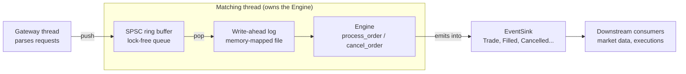
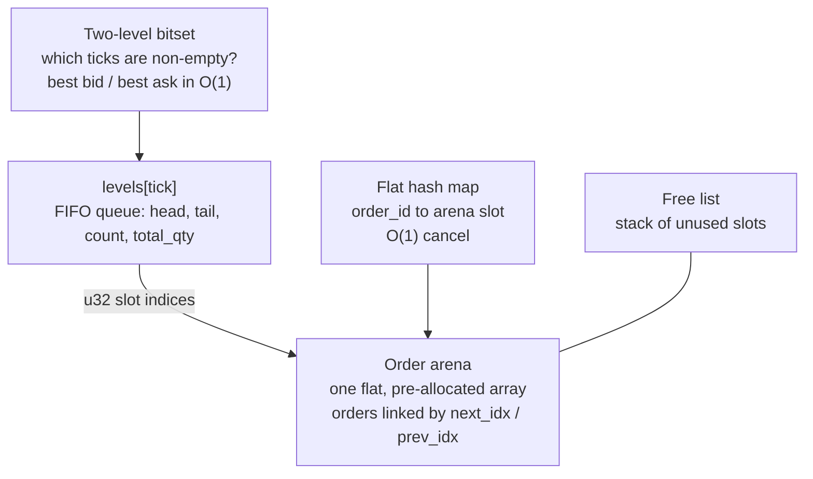

# rust-matching-engine

> *Tiếng Việt: [README.vi.md](README.vi.md)*

An ultra-low-latency, zero-allocation **Central Limit Order Book (CLOB) matching
engine** written in Rust, built as a **teaching project**: small enough to read in
an afternoon, and documented in enough depth that you can see *why* every data
structure was chosen.

If you have ever wondered how an exchange pairs buyers with sellers in
microseconds, this repository shows one way to do it, step by step.

## What you will learn

- What an order book, price-time priority, makers and takers are
  ([chapter 1](docs/01-order-book-basics.md)).
- How to design a hot path with **no heap allocation, no locks and O(1)
  operations** ([chapter 2](docs/02-architecture.md)).
- Four data-structure techniques that are useful far beyond finance:
  **arena + free list + intrusive linked list**, a **two-level bitset** with
  hardware bit-scan, an **open-addressing hash map** with backward-shift
  deletion, and a **lock-free SPSC ring buffer**.
- How to make a deterministic engine recoverable with a **memory-mapped
  write-ahead log**, and what such a log can and cannot promise.
- How to *prove* a "zero allocation" claim with a counting allocator, and how to
  gain confidence in optimised code by comparing it with a deliberately simple
  reference implementation (**differential testing**).

## Quick start

```rust
use matching_engine::{Engine, Event, Side};

let mut engine = Engine::new(10_000); // pre-allocates all storage up front
let mut events: Vec<Event> = Vec::new(); // receives the execution reports

engine.process_order(1, Side::Sell, 100, 10, &mut events); // resting ask: 10 @ tick 100
events.clear();
engine.process_order(2, Side::Buy, 100, 10, &mut events); // crosses and fills
for event in &events {
    println!("{event:?}");
}
```

Output:

```text
OrderAccepted { order_id: 2 }
Trade { maker_order_id: 1, taker_order_id: 2, price_tick: 100, qty: 10 }
OrderFilled { order_id: 1 }
OrderFilled { order_id: 2 }
```

The last argument of `process_order` and `cancel_order` is an **event sink**:
anything that implements `EventSink`, such as a `Vec<Event>`, a closure, or the
fixed-capacity `EventBatch`. The engine streams every report into it and never
allocates by itself ([chapter 7](docs/07-events.md)).

More of the API:

```rust
use matching_engine::{Engine, Event, RejectReason, Side};

let mut engine = Engine::new(10_000);
let mut events: Vec<Event> = Vec::new();
engine.process_order(1, Side::Buy, 100, 10, &mut events); // resting bid: 10 @ tick 100

engine.process_order(2, Side::Buy, 5_000, 10, &mut events); // tick 5000 is out of range
let rejected = Event::OrderRejected { order_id: 2, reason: RejectReason::PriceOutOfRange };
assert_eq!(events.last(), Some(&rejected)); // a rejection always says why

assert_eq!(engine.best_bid(), Some(100)); // highest resting buy tick
assert_eq!(engine.best_ask(), None); // lowest resting sell tick
assert_eq!(engine.depth_at(Side::Buy, 100), 10); // total quantity at one tick
assert_eq!(engine.depth_snapshot(Side::Buy, 5), [(100, 10)]); // best levels first
assert!(engine.cancel_order(1, &mut events)); // true: the order was resting
assert!(!engine.cancel_order(1, &mut events)); // false: it is already gone
```

Prices are **integer ticks** in `0..4096`; converting to and from real prices is
the caller's job (see [chapter 1](docs/01-order-book-basics.md#18-ticks-prices-as-small-integers)).

Every Rust block in this README is compiled and run by `cargo test`, so these
examples cannot silently fall out of date.

## The big picture

### The pipeline around the engine



### Inside the engine



| Problem | Solution | Complexity | Chapter |
|---|---|---|---|
| Store orders without `malloc` | Fixed **arena** + **free list** | O(1) alloc / free | [3](docs/03-order-pool.md) |
| FIFO queue per price, cancel from the middle | **Intrusive doubly-linked list** (`u32` links) | O(1) push / pop / remove | [3](docs/03-order-pool.md) |
| Best bid / best ask | **Two-level bitset** + `trailing_zeros` / `leading_zeros` | O(1), two bit-scans | [4](docs/04-price-ladder-bitset.md) |
| Find an order by id | **Open-addressing hash map** with a random seed, backward-shift delete | expected O(1) | [5](docs/05-hash-map.md) |
| Match an incoming order | Walk levels best-first, FIFO within a level | O(1 + fills) | [6](docs/06-matching-algorithm.md) |
| Report results without allocating | Stream events into a caller-supplied **`EventSink`** | O(1) per event | [7](docs/07-events.md) |
| Feed the engine from another thread | **SPSC ring buffer** with separate `Producer` / `Consumer` handles (Release/Acquire) | O(1), lock-free | [8](docs/08-ring-buffer.md) |
| Recover after a crash | **Memory-mapped WAL** with per-record checksums + deterministic replay | amortised O(1) append | [9](docs/09-write-ahead-log.md) |

## Learning path

Read in order; each chapter builds on the previous ones and ends with a link to
the next.

| # | Chapter | You will learn |
|---|---|---|
| 1 | [Order book basics](docs/01-order-book-basics.md) | Bids, asks, spread, maker/taker, price-time priority, ticks, with a worked example used throughout |
| 2 | [Architecture overview](docs/02-architecture.md) | Design goals, module map, how the structures point at each other, memory footprint, threading model |
| 3 | [The order pool](docs/03-order-pool.md) | Arena, free stack, intrusive doubly-linked FIFO, `PriceLevel`, invariants |
| 4 | [The price ladder bitset](docs/04-price-ladder-bitset.md) | Two-level bitset, bit-scan instructions, worked bit-level example |
| 5 | [The flat hash map](docs/05-hash-map.md) | Linear probing, SplitMix64, a secret seed against crafted ids, load factor, backward-shift deletion |
| 6 | [The matching algorithm](docs/06-matching-algorithm.md) | `process_order` and `cancel_order` line by line, flowcharts, a full state trace, edge cases |
| 7 | [Events](docs/07-events.md) | Event semantics and ordering, the `EventSink` trait, choosing a sink, `EventBatch` truncation |
| 8 | [The ring buffer](docs/08-ring-buffer.md) | The SPSC queue, memory ordering, false sharing, what the type system enforces, disconnect detection |
| 9 | [The write-ahead log](docs/09-write-ahead-log.md) | Why log, the record format, memory-mapped files, crash safety and its limits, and a complete wired-up program |
| 10 | [Testing and performance](docs/10-testing-and-performance.md) | What each test proves, differential testing, the counting-allocator trick, CI, reading the benchmarks |
| 11 | [Limitations and exercises](docs/11-limitations-and-exercises.md) | Known sharp edges, graded exercises, retracing past fixes commit by commit, further reading |

**Meet a word you don't know?** The [glossary](docs/glossary.md) explains every
term the chapters use, from *bid* and *tick* to *memory ordering* and *torn
write*, and says which chapter covers it.

**Want to see it run first?** `cargo run --example walkthrough` replays the
worked example from chapter 1 and prints the events and the book after every
order.

**In a hurry?** Read chapter 1 (concepts), skim chapter 2 (the map), then jump to
chapter 6 (the algorithm); follow its links back to chapters 3 to 5 when a data
structure is unfamiliar.

**Prefer to read code?** Start at [`src/engine.rs`](src/engine.rs); every module
also has detailed doc comments (`cargo doc --open`).

## Project layout

```text
src/
  lib.rs         crate root; re-exports Engine, Event, EventBatch, EventSink, RejectReason, Side
  engine.rs      matching core: process_order, cancel_order, depth queries
  pool.rs        order arena, free list, PriceLevel (intrusive FIFO queue)
  bitset.rs      two-level bitset price ladder (best bid / ask in O(1))
  hashmap.rs     seeded open-addressing hash map (order id -> arena slot)
  events.rs      Event enum, EventSink trait, bounded EventBatch sink
  ringbuffer.rs  lock-free SPSC ring buffer with Producer / Consumer handles
  wal.rs         memory-mapped, checksummed write-ahead log
tests/
  common/        shared helpers: seeded PRNG, request generator, temp files
  model_check.rs differential test against a simple reference order book
  wal_replay.rs  replaying the WAL reproduces every event
  zero_alloc.rs  counting global allocator proves zero heap allocations
  docs_sync.rs   chapter 9 must show examples/pipeline.rs verbatim
examples/
  walkthrough.rs chapter 1's worked example, printing events and the book
  pipeline.rs    ring buffer -> WAL -> engine -> replay, in one program
benches/
  matching_engine_bench.rs   criterion micro-benchmarks
docs/            the chapters listed above, plus glossary.md
docs/vi/         the same chapters in Vietnamese (README.vi.md is the Vietnamese README)
.github/workflows/ci.yml     CI: Linux (x64 and arm64), Windows, Miri, MSRV
```

## Key limits at a glance

| Limit | Value | Where it comes from |
|---|---|---|
| Price range | ticks `0..=4095` | bitset is `64 × 64` bits |
| Resting orders | `order_capacity` passed to `Engine::new` | arena size |
| Events per call | unlimited with a `Vec` or closure sink; an `EventBatch` keeps 64 and counts the rest | your choice of `EventSink` |
| Reserved order id | `u64::MAX` | hash map's "empty slot" marker |
| Order types | limit orders only | scope of the project |
| Rust version | 1.88 or newer | `rust-version` in `Cargo.toml` |

Details, consequences and workarounds are in
[chapter 11](docs/11-limitations-and-exercises.md).

## Testing and benchmarking

```sh
cargo test                      # unit, integration and doc tests (this README included)
cargo test --test model_check   # the engine against a simple reference book
cargo test --test zero_alloc    # verifies zero heap allocations on the hot path
cargo run --example walkthrough # chapter 1's worked example, step by step
cargo run --example pipeline    # the complete program from chapter 9
cargo bench                     # criterion micro-benchmarks
```

> **Windows note:** all tests pass on Windows 11 (the platform they were run on
> here). Finalizing a `WalWriter` unmaps the log before truncating it, because
> Windows refuses to shrink a file that still has a mapped view open. See
> [chapter 9](docs/09-write-ahead-log.md#96-caveats-read-before-relying-on-the-wal).

[Chapter 10](docs/10-testing-and-performance.md) explains what each test proves and
how to interpret the benchmark output.

## License

MIT, as declared in `Cargo.toml`.
