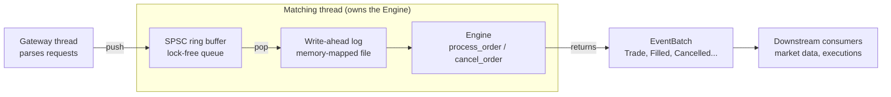
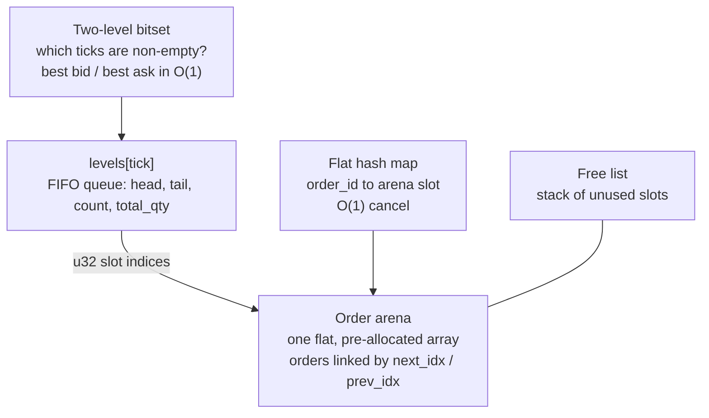

# rust-matching-engine

An ultra-low-latency, zero-allocation **Central Limit Order Book (CLOB) matching
engine** written in Rust, built as a **teaching project**: small enough to read in
an afternoon, and documented in enough depth that you can see *why* every data
structure was chosen.

If you have ever wondered how an exchange pairs buyers with sellers in
microseconds, this repository shows one way to do it, step by step.

## What you will learn

- What an order book, price-time priority, makers and takers are
  ([chapter 1](docs/01-order-book-basics.md)).
- How to design a hot path with **no heap allocation, no locks and O(1)
  operations** ([chapter 2](docs/02-architecture.md)).
- Four data-structure techniques that are useful far beyond finance:
  **arena + free list + intrusive linked list**, a **two-level bitset** with
  hardware bit-scan, an **open-addressing hash map** with backward-shift
  deletion, and a **lock-free SPSC ring buffer**.
- How to make a deterministic engine recoverable with a **memory-mapped
  write-ahead log**.
- How to *prove* a "zero allocation" claim with a counting allocator.

## Quick start

```rust
use matching_engine::{Engine, Side};

let mut engine = Engine::new(10_000); // pre-allocates all storage up front
engine.process_order(1, Side::Sell, 100, 10); // resting ask: 10 @ tick 100
let events = engine.process_order(2, Side::Buy, 100, 10); // crosses and fills
for event in &events {
    println!("{event:?}");
}
```

Output:

```text
OrderAccepted { order_id: 2 }
Trade { maker_order_id: 1, taker_order_id: 2, price_tick: 100, qty: 10 }
OrderFilled { order_id: 1 }
OrderFilled { order_id: 2 }
```

More of the API:

```rust
engine.cancel_order(1);            // (found: bool, events)
engine.best_bid();                 // Option<u32>   highest resting buy tick
engine.best_ask();                 // Option<u32>   lowest resting sell tick
engine.depth_at(Side::Buy, 100);   // u64           total quantity at one tick
engine.depth_snapshot(Side::Sell, 5); // Vec<(tick, qty)>, best first
```

Prices are **integer ticks** in `0..4096`; converting to and from real prices is
the caller's job (see [chapter 1](docs/01-order-book-basics.md#18-ticks-prices-as-small-integers)).

## The big picture

### The pipeline around the engine



### Inside the engine



| Problem | Solution | Complexity | Chapter |
|---|---|---|---|
| Store orders without `malloc` | Fixed **arena** + **free list** | O(1) alloc / free | [3](docs/03-order-pool.md) |
| FIFO queue per price, cancel from the middle | **Intrusive doubly-linked list** (`u32` links) | O(1) push / pop / remove | [3](docs/03-order-pool.md) |
| Best bid / best ask | **Two-level bitset** + `trailing_zeros` / `leading_zeros` | O(1), two bit-scans | [4](docs/04-price-ladder-bitset.md) |
| Find an order by id | **Open-addressing hash map**, backward-shift delete | expected O(1) | [5](docs/05-hash-map.md) |
| Match an incoming order | Walk levels best-first, FIFO within a level | O(1 + fills) | [6](docs/06-matching-algorithm.md) |
| Report results with no `Vec` | Fixed-size **`EventBatch`** on the stack | O(1) | [7](docs/07-events.md) |
| Feed the engine from another thread | **SPSC ring buffer** (Release/Acquire) | O(1), lock-free | [8](docs/08-ringbuffer-and-wal.md) |
| Recover after a crash | **Memory-mapped WAL** + deterministic replay | amortised O(1) append | [8](docs/08-ringbuffer-and-wal.md) |

## Learning path

Read in order; each chapter builds on the previous ones and ends with a link to
the next.

| # | Chapter | You will learn |
|---|---|---|
| 1 | [Order book basics](docs/01-order-book-basics.md) | Bids, asks, spread, maker/taker, price-time priority, ticks, with a worked example used throughout |
| 2 | [Architecture overview](docs/02-architecture.md) | Design goals, module map, how the structures point at each other, memory footprint, threading model |
| 3 | [The order pool](docs/03-order-pool.md) | Arena, free stack, intrusive doubly-linked FIFO, `PriceLevel`, invariants |
| 4 | [The price ladder bitset](docs/04-price-ladder-bitset.md) | Two-level bitset, bit-scan instructions, worked bit-level example |
| 5 | [The flat hash map](docs/05-hash-map.md) | Linear probing, SplitMix64, load factor, backward-shift deletion (with wrap-around) |
| 6 | [The matching algorithm](docs/06-matching-algorithm.md) | `process_order` and `cancel_order` line by line, flowcharts, a full state trace, edge cases |
| 7 | [Events](docs/07-events.md) | Event semantics and ordering, `EventBatch`, what happens when it overflows |
| 8 | [Ring buffer and WAL](docs/08-ringbuffer-and-wal.md) | SPSC queue and memory ordering, record format, mmap, replay, a complete wired-up program |
| 9 | [Testing and performance](docs/09-testing-and-performance.md) | What each test proves, the counting-allocator trick, reading the benchmarks |
| 10 | [Limitations and exercises](docs/10-limitations-and-exercises.md) | Known sharp edges, 18 graded exercises, further reading |

**In a hurry?** Read chapter 1 (concepts), skim chapter 2 (the map), then jump to
chapter 6 (the algorithm); follow its links back to chapters 3 to 5 when a data
structure is unfamiliar.

**Prefer to read code?** Start at [`src/engine.rs`](src/engine.rs); every module
also has detailed doc comments (`cargo doc --open`).

## Project layout

```text
src/
  lib.rs         crate root; re-exports Engine, Event, EventBatch, Side
  engine.rs      matching core: process_order, cancel_order, depth queries
  pool.rs        order arena, free list, PriceLevel (intrusive FIFO queue)
  bitset.rs      two-level bitset price ladder (best bid / ask in O(1))
  hashmap.rs     flat open-addressing hash map (order id -> arena slot)
  events.rs      Event enum and fixed-capacity EventBatch
  ringbuffer.rs  lock-free SPSC ring buffer (Disruptor style)
  wal.rs         memory-mapped binary write-ahead log
tests/
  zero_alloc.rs  counting global allocator proves zero heap allocations
benches/
  matching_engine_bench.rs   criterion micro-benchmarks
docs/            the chapters listed above
```

## Key limits at a glance

| Limit | Value | Where it comes from |
|---|---|---|
| Price range | ticks `0..=4095` | bitset is `64 × 64` bits |
| Resting orders | `order_capacity` passed to `Engine::new` | arena size |
| Events per call | 64 (extra events are dropped) | `MAX_EVENTS_PER_CALL` |
| Reserved order id | `u64::MAX` | hash map's "empty slot" marker |
| Order types | limit orders only | scope of the project |

Details, consequences and workarounds are in
[chapter 10](docs/10-limitations-and-exercises.md).

## Testing and benchmarking

```sh
cargo test                     # unit + integration tests
cargo test --test zero_alloc   # verifies zero heap allocations on the hot path
cargo bench                    # criterion micro-benchmarks
```

> **Windows note:** all tests pass on Windows 11 (the platform they were run on
> here). `WalWriter::finalize` unmaps the log before truncating it, because
> Windows refuses to shrink a file that still has a mapped view open. See
> [chapter 8](docs/08-ringbuffer-and-wal.md#811-caveats-read-before-relying-on-the-wal).

[Chapter 9](docs/09-testing-and-performance.md) explains what each test proves and
how to interpret the benchmark output.

## License

MIT, as declared in `Cargo.toml`.
