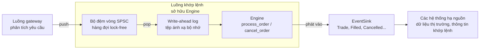
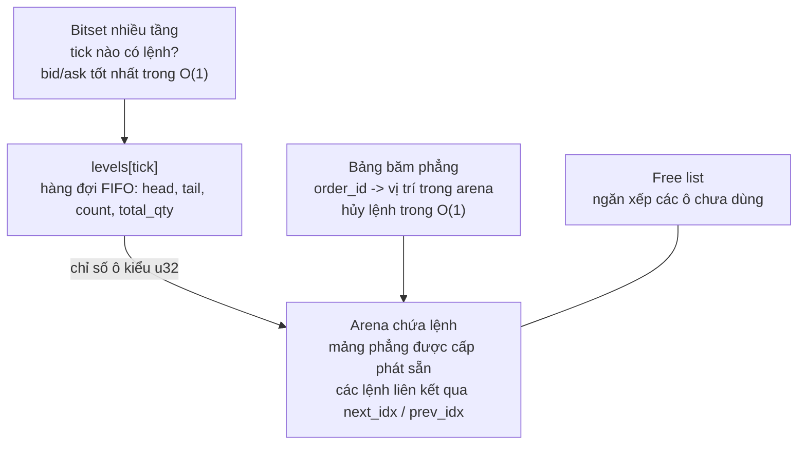

# rust-matching-engine

> *Tiếng Anh: [README.md](README.md)*

Đây là một **engine khớp lệnh dùng sổ lệnh giới hạn trung tâm** (Central Limit
Order Book, **CLOB**), viết bằng Rust. Engine có độ trễ cực thấp và **không cấp
phát bộ nhớ trên heap ở hot path**. Đây là một **dự án phục vụ mục đích học tập**:
đủ nhỏ để đọc trong một buổi chiều, nhưng có tài liệu chi tiết để bạn hiểu *vì
sao* từng cấu trúc dữ liệu được lựa chọn.

Nếu bạn từng thắc mắc một sàn giao dịch ghép lệnh mua với lệnh bán chỉ trong vài
micro giây như thế nào, repo này sẽ dẫn bạn qua một cách triển khai, từng bước
một.

## Bạn sẽ học được gì

- Sổ lệnh, ưu tiên giá-thời gian, maker và taker là gì
  ([chương 1](docs/vi/01-order-book-basics.md)).
- Cách thiết kế hot path **không cấp phát heap, không dùng khóa, với mọi thao tác
  đều có độ phức tạp O(1)** ([chương 2](docs/vi/02-architecture.md)).
- Bốn kỹ thuật về cấu trúc dữ liệu hữu ích vượt xa lĩnh vực tài chính: **arena +
  free list + danh sách liên kết intrusive**, **bitset nhiều tầng** với các lệnh
  quét bit do CPU hỗ trợ, **bảng băm open-addressing** với cách xóa bằng cách dịch lùi,
  và **bộ đệm
  vòng SPSC lock-free**.
- Cách làm cho một engine tất định có thể phục hồi sau sự cố bằng một **nhật ký
  ghi trước (write-ahead log) ánh xạ bộ nhớ**, cùng những gì loại nhật ký này có
  thể và không thể bảo đảm.
- Cách *chứng minh* lời khẳng định "không cấp phát" bằng bộ cấp phát đếm số lần
  cấp phát,
  cũng như kiểm chứng code đã tối ưu bằng cách so sánh với một bản cài đặt tham
  chiếu được cố ý giữ đơn giản (**kiểm thử đối chiếu**, differential testing).

## Bắt đầu nhanh

```rust
use matching_engine::{Engine, Event, Side};

let mut engine = Engine::new(10_000); // pre-allocates all storage up front
let mut events: Vec<Event> = Vec::new(); // receives the execution reports

engine.process_order(1, Side::Sell, 100, 10, &mut events); // resting ask: 10 @ tick 100
events.clear();
engine.process_order(2, Side::Buy, 100, 10, &mut events); // crosses and fills
for event in &events {
    println!("{event:?}");
}
```

Kết quả:

```text
OrderAccepted { order_id: 2, account: 0, side: Buy, order_type: Limit, price_tick: 100, qty: 10 }
Trade { trade_id: 1, maker_order_id: 1, taker_order_id: 2, taker_side: Buy, price_tick: 100, qty: 10 }
OrderFilled { order_id: 1 }
OrderFilled { order_id: 2 }
```

Tham số cuối của `process_order` và `cancel_order` là một **event sink** (đích
nhận sự kiện): bất kỳ kiểu nào triển khai `EventSink` đều dùng được, chẳng hạn
`Vec<Event>`, một closure hoặc `EventBatch` có dung lượng cố định. Engine gửi mọi
báo cáo vào sink này và không tự cấp phát bộ nhớ. Sự kiện chấp nhận và hủy lệnh
chứa thông tin về chiều mua/bán, giá và khối lượng; mỗi giao dịch còn ghi nhận
chiều mua/bán của lệnh chủ động (aggressor side) và `trade_id`. Nhờ vậy, các hệ
thống hạ nguồn có thể theo dõi sổ lệnh chỉ từ các sự kiện
([chương 7](docs/vi/07-events.md)).

Một vài API khác:

```rust
use matching_engine::{Engine, Event, NewOrder, RejectReason, RiskLimits, SelfTradePrevention, Side};

let mut engine = Engine::new(10_000);
let mut events: Vec<Event> = Vec::new();
engine.process_order(1, Side::Buy, 100, 10, &mut events); // resting bid: 10 @ tick 100

engine.process_order(2, Side::Buy, 5_000, 10, &mut events); // tick 5000 is out of range
let rejected = Event::OrderRejected { order_id: 2, reason: RejectReason::PriceOutOfRange };
assert_eq!(events.last(), Some(&rejected)); // a rejection always says why

assert_eq!(engine.best_bid(), Some(100)); // highest resting buy tick
assert_eq!(engine.best_ask(), None); // lowest resting sell tick
assert_eq!(engine.depth_at(Side::Buy, 100), 10); // total quantity at one tick
assert_eq!(engine.depth_snapshot(Side::Buy, 5), [(100, 10)]); // best levels first
assert_eq!(engine.resting_order(1).map(|o| o.remaining_qty), Some(10)); // order status
assert!(engine.reduce_order(1, 4, &mut events)); // 6 left, keeping its place in the queue
assert!(engine.cancel_order(1, &mut events)); // true: the order was resting
assert!(!engine.cancel_order(1, &mut events)); // false: it is already gone
assert!(matches!(events.last(), Some(Event::CancelRejected { order_id: 1, .. }))); // and says so

// Besides limit orders: immediate-or-cancel, market and post-only orders.
engine.submit_order(NewOrder::market(3, Side::Sell, 5), &mut events); // no bids left
let expired = Event::OrderExpired { order_id: 3, expired_qty: 5 };
assert_eq!(events.last(), Some(&expired)); // a market order never rests

// Accounts: block trading with yourself, and cancel everything on disconnect.
engine.submit_order(NewOrder::limit(4, Side::Sell, 110, 5).with_account(7), &mut events);
let own_bid = NewOrder::limit(5, Side::Buy, 110, 5)
    .with_account(7)
    .with_self_trade_prevention(SelfTradePrevention::CancelIncoming);
engine.submit_order(own_bid, &mut events); // would trade with its own ask: stopped
assert!(matches!(events.last(), Some(Event::OrderExpired { order_id: 5, .. })));
assert_eq!(engine.cancel_account(7, &mut events), 1); // the ask #4 goes

// Pre-trade risk limits: no order above 1,000, none more than 5 ticks through the market.
engine.set_risk_limits(RiskLimits { max_order_qty: 1_000, price_band: Some(5) });
engine.process_order(6, Side::Buy, 100, 5_000, &mut events); // a fat finger
let too_big = Event::OrderRejected { order_id: 6, reason: RejectReason::QuantityAboveLimit };
assert_eq!(events.last(), Some(&too_big));

// A wider price range: 300,000 ticks instead of 4096.
let wide = Engine::with_ticks(10_000, 300_000);
assert_eq!(wide.tick_count(), 300_000);
```

Giá được biểu diễn bằng **tick nguyên** trong khoảng `0..4096` theo mặc định.
Muốn dùng khoảng rộng hơn, hãy tạo engine bằng `Engine::with_ticks`; việc quy đổi
giữa tick và giá thực tế do bên gọi thực hiện (xem
[chương 1](docs/vi/01-order-book-basics.md#18-tick-giá-là-những-số-nguyên-nhỏ)).

Các khối mã Rust trong README này trùng nguyên văn với bản tiếng Anh và được
`cargo test` biên dịch, chạy. Test `docs_sync` cũng bảo đảm hai bản README luôn
đồng bộ, nhờ đó các ví dụ không âm thầm lỗi thời.

## Tổng quan

### Luồng xử lý quanh engine



### Bên trong engine



| Vấn đề | Giải pháp | Độ phức tạp | Chương |
|---|---|---|---|
| Lưu lệnh mà không cần `malloc` | **Arena** cố định và **free list** | Cấp phát/giải phóng trong O(1) | [3](docs/vi/03-order-pool.md) |
| Hàng đợi FIFO cho mỗi mức giá, hủy lệnh ở giữa hàng | **Danh sách liên kết đôi intrusive** (liên kết `u32`) | Thêm/lấy/gỡ trong O(1) | [3](docs/vi/03-order-pool.md) |
| Bid/ask tốt nhất | **Bitset nhiều tầng** + `trailing_zeros` / `leading_zeros` | O(1), quét bit một lần ở mỗi tầng (hai lần với 4096 tick) | [4](docs/vi/04-price-ladder-bitset.md) |
| Ngăn lỗi nhập nhầm (fat finger) | **Giới hạn rủi ro trước giao dịch**: khối lượng tối đa, biên độ giá (cũng áp dụng cho lệnh thị trường) | O(1) | [6](docs/vi/06-matching-algorithm.md) |
| Tra cứu lệnh theo ID | **Bảng băm open-addressing** với seed ngẫu nhiên, xóa bằng cách dịch lùi | O(1) theo kỳ vọng | [5](docs/vi/05-hash-map.md) |
| Khớp lệnh mới đến | Duyệt các mức giá từ tốt nhất; trong mỗi mức, khớp theo FIFO | O(1 + số lần khớp) | [6](docs/vi/06-matching-algorithm.md) |
| Phát kết quả mà không cấp phát bộ nhớ | Gửi sự kiện vào **`EventSink`** do bên gọi cung cấp | O(1) cho mỗi sự kiện | [7](docs/vi/07-events.md) |
| Đưa lệnh vào engine từ luồng khác | **Bộ đệm vòng SPSC** với hai handle riêng `Producer` / `Consumer` (Release/Acquire) | O(1), lock-free | [8](docs/vi/08-ring-buffer.md) |
| Phục hồi sau sự cố | **WAL ánh xạ bộ nhớ**, checksum cho từng bản ghi và phát lại tất định | O(1) khấu hao cho mỗi lần ghi nối thêm | [9](docs/vi/09-write-ahead-log.md) |
| Phục hồi mà không phát lại từ đầu | Ghi **snapshot** sổ lệnh vào một **checkpoint nguyên tử**, rồi chỉ phát lại phần log sau checkpoint | O(số lệnh trong sổ) cho mỗi checkpoint | [9.8](docs/vi/09-write-ahead-log.md#98-checkpoint-phát-lại-ít-hơn) |

## Lộ trình học

Hãy đọc theo thứ tự: mỗi chương nối tiếp nội dung các chương trước và kết thúc
bằng liên kết đến chương kế tiếp.

| # | Chương | Bạn sẽ học |
|---|---|---|
| 1 | [Kiến thức cơ bản về sổ lệnh](docs/vi/01-order-book-basics.md) | Bid, ask, spread, maker/taker, ưu tiên giá-thời gian, tick và ví dụ xuyên suốt các chương |
| 2 | [Tổng quan kiến trúc](docs/vi/02-architecture.md) | Mục tiêu thiết kế, sơ đồ module, cách các cấu trúc dữ liệu liên kết với nhau, dung lượng bộ nhớ và mô hình luồng |
| 3 | [Order pool: kho lệnh](docs/vi/03-order-pool.md) | Arena, free stack, hàng đợi FIFO liên kết đôi intrusive, `PriceLevel` và các bất biến |
| 4 | [Bitset cho thang giá](docs/vi/04-price-ladder-bitset.md) | Bitset hai tầng, lệnh quét bit, ví dụ minh họa từng bit và cách mở rộng thêm tầng khi phạm vi giá lớn hơn |
| 5 | [Bảng băm phẳng](docs/vi/05-hash-map.md) | Dò tuyến tính, SplitMix64, seed bí mật giúp chống các ID được tạo có chủ đích để gây va chạm, hệ số tải và xóa bằng cách dịch lùi |
| 6 | [Thuật toán khớp lệnh](docs/vi/06-matching-algorithm.md) | Phân tích `process_order` và `cancel_order` từng dòng, lưu đồ, ví dụ theo dõi trạng thái đầy đủ và các trường hợp biên |
| 7 | [Sự kiện](docs/vi/07-events.md) | Ngữ nghĩa và thứ tự sự kiện, trait `EventSink`, cách chọn sink và cách `EventBatch` cắt bớt sự kiện |
| 8 | [Bộ đệm vòng](docs/vi/08-ring-buffer.md) | Hàng đợi SPSC, thứ tự bộ nhớ, false sharing, những gì type system đảm bảo và cách phát hiện ngắt kết nối |
| 9 | [Nhật ký ghi trước](docs/vi/09-write-ahead-log.md) | Lý do cần ghi log, định dạng bản ghi, tệp ánh xạ bộ nhớ, độ an toàn khi gặp sự cố và giới hạn của nó, chương trình mẫu kết nối các thành phần và checkpoint |
| 10 | [Kiểm thử và hiệu năng](docs/vi/10-testing-and-performance.md) | Mỗi bài kiểm thử chứng minh điều gì, kiểm thử đối chiếu, mẹo dùng counting allocator, CI và cách đọc kết quả benchmark |
| 11 | [Giới hạn và bài tập](docs/vi/11-limitations-and-exercises.md) | Các hạn chế đã biết, bài tập theo độ khó, lần theo các bản sửa lỗi qua từng commit và tài liệu đọc thêm |

**Gặp thuật ngữ chưa biết?** [Bảng thuật ngữ](docs/vi/glossary.md) giải thích
các thuật ngữ trong những chương này, từ *bid* và *tick* đến *thứ tự bộ nhớ* và
*ghi dở* (torn write), đồng thời chỉ rõ mỗi thuật ngữ được trình bày ở chương nào.

**Muốn xem chương trình chạy trước?** `cargo run --example walkthrough` chạy lại
ví dụ ở chương 1 và in ra các sự kiện cùng trạng thái sổ lệnh sau mỗi lệnh.

**Đang vội?** Đọc chương 1 (khái niệm), lướt chương 2 (bản đồ), rồi nhảy tới
chương 6 (thuật toán); khi gặp một cấu trúc dữ liệu lạ, theo các liên kết ngược về
chương 3 đến 5.

**Thích đọc code hơn?** Hãy bắt đầu từ [`src/engine.rs`](src/engine.rs). Mỗi module
cũng có chú thích tài liệu chi tiết (`cargo doc --open`).

## Cấu trúc dự án

```text
src/
  lib.rs         gốc crate; re-export Engine, NewOrder, OrderType, SelfTradePrevention, RiskLimits, RestingOrder, Event, EventBatch, EventSink, RejectReason, CancelRejectReason, Side, Snapshot, SnapshotError, Checkpoint, DEFAULT_TICKS
  engine.rs      lõi khớp lệnh: submit_order, giảm/hủy/hủy hàng loạt lệnh, ngăn tự giao dịch, tra cứu lệnh, truy vấn độ sâu, snapshot/khôi phục
  pool.rs        arena lệnh, free list, PriceLevel (hàng đợi FIFO intrusive)
  bitset.rs      thang giá dùng bitset nhiều tầng, cấu hình riêng cho từng engine (bid/ask tốt nhất trong O(1))
  hashmap.rs     bảng băm open-addressing có seed (order ID -> vị trí trong arena)
  events.rs      enum Event, trait EventSink, sink EventBatch có dung lượng giới hạn
  ringbuffer.rs  bộ đệm vòng SPSC lock-free với hai handle Producer / Consumer
  wal.rs         WAL ánh xạ bộ nhớ, có checksum và khóa ghi; hỗ trợ phát lại
  snapshot.rs    trạng thái đầy đủ của engine; các tệp checkpoint được ghi nguyên tử
tests/
  common/        tiện ích dùng chung: PRNG có seed, bộ sinh yêu cầu, tệp tạm
  model_check.rs kiểm thử đối chiếu với sổ lệnh tham chiếu đơn giản
  wal_replay.rs  phát lại WAL để tái tạo chính xác mọi sự kiện
  snapshot.rs    engine khôi phục từ snapshot tiếp tục hoạt động như engine gốc
  zero_alloc.rs  global allocator đếm số lần cấp phát để chứng minh hot path không cấp phát heap
  docs_sync.rs   chương 9 phải chứa nguyên văn examples/pipeline.rs
examples/
  walkthrough.rs ví dụ ở chương 1, in các sự kiện và sổ lệnh
  pipeline.rs    bộ đệm vòng -> WAL -> engine -> phát lại trong cùng một chương trình
  checkpoint.rs  phục hồi từ checkpoint và phần cuối của log
benches/
  matching_engine_bench.rs   microbenchmark với Criterion
docs/            các chương liệt kê ở trên, cùng glossary.md
docs/vi/         các chương trên bằng tiếng Việt (README.vi.md là bản README tiếng Việt)
.github/workflows/ci.yml     CI: Linux (x64 và arm64), Windows, Miri, MSRV
```

## Các giới hạn chính trong một bảng

| Giới hạn | Giá trị | Nguồn gốc |
|---|---|---|
| Khoảng giá | tick `0..=4095` theo mặc định, tối đa 2^24 cho mỗi engine | `Engine::with_ticks`; khoảng 48 byte cho mỗi tick |
| Giới hạn rủi ro | một ngưỡng khối lượng tối đa và một biên độ giá cho mỗi engine | `RiskLimits`, cấu hình bằng `set_risk_limits` |
| Số lệnh còn trong sổ | `order_capacity` truyền vào `Engine::new` | kích thước arena |
| Số sự kiện mỗi lần gọi | không giới hạn nếu dùng `Vec` hoặc closure làm sink; `EventBatch` lưu tối đa 64 sự kiện và đếm số còn lại | tùy chọn `EventSink` |
| ID lệnh dành riêng | `u64::MAX` | giá trị đánh dấu "ô trống" trong bảng băm |
| Loại lệnh | lệnh giới hạn, immediate-or-cancel, lệnh thị trường, post-only | phạm vi của dự án |
| Tài khoản | một `u32` cho mỗi lệnh, dùng cho chống tự giao dịch và hủy hàng loạt; không có giới hạn theo từng tài khoản | phạm vi của dự án |
| Phiên bản Rust | 1.89 trở lên | `rust-version` trong `Cargo.toml` |

Các giới hạn này, hệ quả và cách khắc phục được trình bày trong
[chương 11](docs/vi/11-limitations-and-exercises.md).

## Kiểm thử và đo hiệu năng

```sh
cargo test                      # unit, integration and doc tests (this README included)
cargo test --test model_check   # the engine against a simple reference book
cargo test --test zero_alloc    # verifies zero heap allocations on the hot path
cargo run --example walkthrough # chapter 1's worked example, step by step
cargo run --example pipeline    # the complete program from chapter 9
cargo run --example checkpoint  # recovery from a checkpoint (chapter 9.8)
cargo bench                     # criterion micro-benchmarks
```

> **Lưu ý về Windows:** tất cả bài kiểm thử đều chạy thành công trên Windows 11,
> nền tảng được dùng để chạy chúng. Khi kết thúc việc ghi bằng `WalWriter`, log
> được gỡ ánh xạ trước khi tệp bị cắt ngắn, vì Windows không cho thu nhỏ tệp khi
> vùng nhớ ánh xạ của tệp vẫn đang mở. Xem
> [chương 9](docs/vi/09-write-ahead-log.md#96-những-điều-cần-lưu-ý-đọc-trước-khi-dựa-vào-wal).

[Chương 10](docs/vi/10-testing-and-performance.md) giải thích mỗi bài kiểm thử
chứng minh điều gì và cách đọc kết quả đo hiệu năng.

## Giấy phép

MIT, theo khai báo trong `Cargo.toml`.
