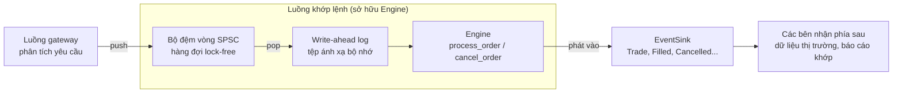
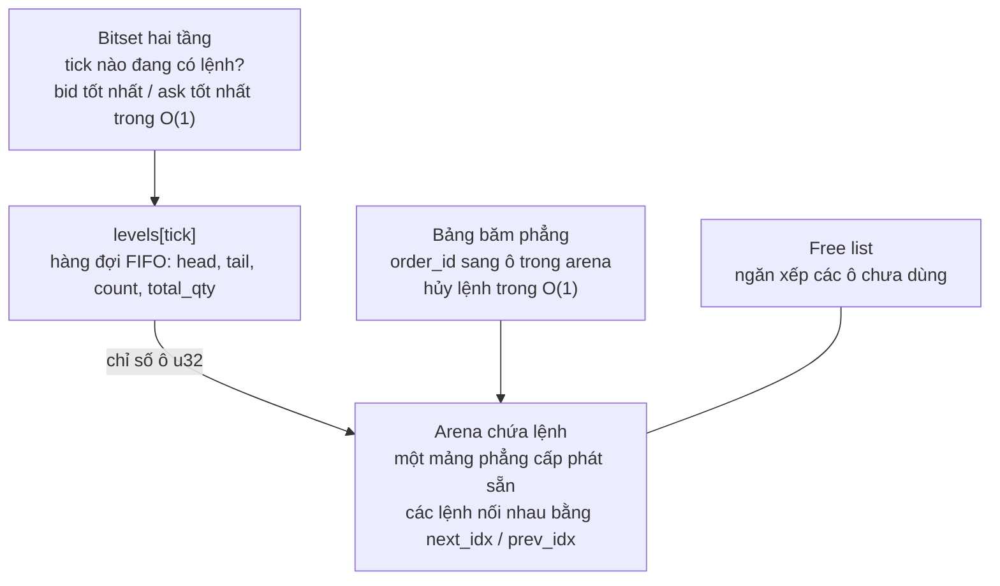

# rust-matching-engine

> *English: [README.md](README.md)*

Một **engine khớp lệnh theo sổ lệnh giới hạn trung tâm** (Central Limit Order Book,
**CLOB**) viết bằng Rust, với độ trễ cực thấp và **không cấp phát bộ nhớ** trên
đường chạy chính. Đây là một **dự án để học**: đủ nhỏ để đọc xong trong một buổi
chiều, và có tài liệu đủ sâu để bạn thấy được *vì sao* từng cấu trúc dữ liệu được
chọn.

Nếu bạn từng tự hỏi một sàn giao dịch ghép người mua với người bán trong vài
micro giây bằng cách nào, repo này chỉ ra một cách làm, từng bước một.

## Bạn sẽ học được gì

- Sổ lệnh, ưu tiên giá-thời gian, maker và taker là gì
  ([chương 1](docs/vi/01-order-book-basics.md)).
- Cách thiết kế một hot path **không cấp phát heap, không dùng khóa và mọi thao
  tác đều O(1)** ([chương 2](docs/vi/02-architecture.md)).
- Bốn kỹ thuật cấu trúc dữ liệu hữu ích vượt xa lĩnh vực tài chính: **arena +
  free list + danh sách liên kết intrusive**, **bitset hai tầng** với lệnh quét
  bit của phần cứng, **bảng băm địa chỉ mở** với cách xóa dịch lùi, và **bộ đệm
  vòng SPSC lock-free**.
- Cách làm cho một engine tất định có thể phục hồi sau sự cố bằng một **nhật ký
  ghi trước (write-ahead log) ánh xạ bộ nhớ**, và một nhật ký như thế hứa được gì,
  không hứa được gì.
- Cách *chứng minh* lời khẳng định "không cấp phát" bằng một bộ cấp phát có đếm,
  và cách tạo niềm tin vào code đã tối ưu bằng việc so sánh nó với một bản cài đặt
  tham chiếu cố tình làm thật đơn giản (**kiểm thử đối chiếu**, differential
  testing).

## Bắt đầu nhanh

```rust
use matching_engine::{Engine, Event, Side};

let mut engine = Engine::new(10_000); // pre-allocates all storage up front
let mut events: Vec<Event> = Vec::new(); // receives the execution reports

engine.process_order(1, Side::Sell, 100, 10, &mut events); // resting ask: 10 @ tick 100
events.clear();
engine.process_order(2, Side::Buy, 100, 10, &mut events); // crosses and fills
for event in &events {
    println!("{event:?}");
}
```

Kết quả:

```text
OrderAccepted { order_id: 2, side: Buy, price_tick: 100, qty: 10 }
Trade { trade_id: 1, maker_order_id: 1, taker_order_id: 2, taker_side: Buy, price_tick: 100, qty: 10 }
OrderFilled { order_id: 1 }
OrderFilled { order_id: 2 }
```

Tham số cuối cùng của `process_order` và `cancel_order` là một **event sink** (nơi
nhận sự kiện): bất cứ thứ gì cài đặt `EventSink`, chẳng hạn một `Vec<Event>`, một
closure, hoặc `EventBatch` có dung lượng cố định. Engine đổ mọi báo cáo vào đó và
tự nó không bao giờ cấp phát. Sự kiện chấp nhận lệnh và hủy lệnh mang theo phía,
giá và số lượng của lệnh, còn mỗi giao dịch mang theo phía chủ động (aggressor
side) và một `trade_id`, nên hệ thống phía sau có thể theo dõi sổ lệnh chỉ từ các
sự kiện ([chương 7](docs/vi/07-events.md)).

Thêm về API:

```rust
use matching_engine::{Engine, Event, RejectReason, Side};

let mut engine = Engine::new(10_000);
let mut events: Vec<Event> = Vec::new();
engine.process_order(1, Side::Buy, 100, 10, &mut events); // resting bid: 10 @ tick 100

engine.process_order(2, Side::Buy, 5_000, 10, &mut events); // tick 5000 is out of range
let rejected = Event::OrderRejected { order_id: 2, reason: RejectReason::PriceOutOfRange };
assert_eq!(events.last(), Some(&rejected)); // a rejection always says why

assert_eq!(engine.best_bid(), Some(100)); // highest resting buy tick
assert_eq!(engine.best_ask(), None); // lowest resting sell tick
assert_eq!(engine.depth_at(Side::Buy, 100), 10); // total quantity at one tick
assert_eq!(engine.depth_snapshot(Side::Buy, 5), [(100, 10)]); // best levels first
assert_eq!(engine.resting_order(1).map(|o| o.remaining_qty), Some(10)); // order status
assert!(engine.cancel_order(1, &mut events)); // true: the order was resting
assert!(!engine.cancel_order(1, &mut events)); // false: it is already gone
assert_eq!(events.last(), Some(&Event::CancelRejected { order_id: 1 })); // and says so
```

Giá là **tick nguyên** trong khoảng `0..4096`; việc đổi qua lại giữa tick và giá
thật là trách nhiệm của bên gọi (xem
[chương 1](docs/vi/01-order-book-basics.md#18-tick-giá-là-những-số-nguyên-nhỏ)).

Các khối Rust trong README này giống hệt từng chữ với README tiếng Anh, nơi chúng
được `cargo test` biên dịch và chạy; một test (`docs_sync`) bảo đảm hai bản không
lệch nhau. Nhờ vậy các ví dụ này không thể lặng lẽ lỗi thời.

## Bức tranh tổng thể

### Đường ống xung quanh engine



### Bên trong engine



| Vấn đề | Giải pháp | Độ phức tạp | Chương |
|---|---|---|---|
| Lưu lệnh mà không cần `malloc` | **Arena** cố định + **free list** | O(1) cấp phát / giải phóng | [3](docs/vi/03-order-pool.md) |
| Hàng đợi FIFO cho mỗi mức giá, hủy lệnh ở giữa hàng | **Danh sách liên kết đôi intrusive** (liên kết `u32`) | O(1) thêm / lấy / gỡ | [3](docs/vi/03-order-pool.md) |
| Bid tốt nhất / ask tốt nhất | **Bitset hai tầng** + `trailing_zeros` / `leading_zeros` | O(1), hai lần quét bit | [4](docs/vi/04-price-ladder-bitset.md) |
| Tìm một lệnh theo id | **Bảng băm địa chỉ mở** có seed ngẫu nhiên, xóa bằng cách dịch lùi | O(1) kỳ vọng | [5](docs/vi/05-hash-map.md) |
| Khớp một lệnh đến | Đi qua các mức giá từ tốt nhất, FIFO trong từng mức | O(1 + số lần khớp) | [6](docs/vi/06-matching-algorithm.md) |
| Báo kết quả mà không cấp phát | Đổ sự kiện vào **`EventSink`** do bên gọi cung cấp | O(1) cho mỗi sự kiện | [7](docs/vi/07-events.md) |
| Nạp lệnh cho engine từ một luồng khác | **Bộ đệm vòng SPSC** với hai handle `Producer` / `Consumer` riêng (Release/Acquire) | O(1), lock-free | [8](docs/vi/08-ring-buffer.md) |
| Phục hồi sau sự cố | **WAL ánh xạ bộ nhớ** có checksum cho từng bản ghi + phát lại tất định | O(1) khấu hao cho mỗi lần ghi nối thêm | [9](docs/vi/09-write-ahead-log.md) |

## Lộ trình học

Hãy đọc theo thứ tự; mỗi chương xây trên các chương trước và kết thúc bằng một
liên kết sang chương kế tiếp.

| # | Chương | Bạn sẽ học |
|---|---|---|
| 1 | [Kiến thức cơ bản về sổ lệnh](docs/vi/01-order-book-basics.md) | Bid, ask, spread, maker/taker, ưu tiên giá-thời gian, tick, cùng một ví dụ minh họa dùng xuyên suốt |
| 2 | [Tổng quan kiến trúc](docs/vi/02-architecture.md) | Mục tiêu thiết kế, bản đồ các module, các cấu trúc trỏ vào nhau thế nào, dung lượng bộ nhớ, mô hình luồng |
| 3 | [Order pool: kho chứa lệnh](docs/vi/03-order-pool.md) | Arena, free stack, hàng đợi FIFO liên kết đôi intrusive, `PriceLevel`, các bất biến |
| 4 | [Bitset cho thang giá](docs/vi/04-price-ladder-bitset.md) | Bitset hai tầng, các lệnh quét bit, ví dụ minh họa ở mức từng bit |
| 5 | [Bảng băm phẳng](docs/vi/05-hash-map.md) | Dò tuyến tính, SplitMix64, seed bí mật chống id được dựng sẵn để gây va chạm, hệ số tải, xóa bằng cách dịch lùi |
| 6 | [Thuật toán khớp lệnh](docs/vi/06-matching-algorithm.md) | `process_order` và `cancel_order` từng dòng một, lưu đồ, một bản theo dõi trạng thái đầy đủ, các trường hợp biên |
| 7 | [Sự kiện](docs/vi/07-events.md) | Ngữ nghĩa và thứ tự của sự kiện, trait `EventSink`, cách chọn sink, việc `EventBatch` cắt bớt sự kiện |
| 8 | [Bộ đệm vòng](docs/vi/08-ring-buffer.md) | Hàng đợi SPSC, thứ tự bộ nhớ, false sharing, những gì hệ thống kiểu bắt buộc, phát hiện ngắt kết nối |
| 9 | [Nhật ký ghi trước](docs/vi/09-write-ahead-log.md) | Vì sao cần ghi log, định dạng bản ghi, tệp ánh xạ bộ nhớ, an toàn khi sập máy và giới hạn của nó, cùng một chương trình hoàn chỉnh đã ghép nối |
| 10 | [Kiểm thử và hiệu năng](docs/vi/10-testing-and-performance.md) | Mỗi test chứng minh điều gì, kiểm thử đối chiếu, mẹo dùng counting allocator, CI, cách đọc kết quả benchmark |
| 11 | [Giới hạn và bài tập](docs/vi/11-limitations-and-exercises.md) | Các điểm sắc cạnh đã biết, bài tập xếp theo độ khó, lần lại các bản sửa lỗi trong quá khứ từng commit một, tài liệu đọc thêm |

**Gặp một từ chưa biết?** [Bảng thuật ngữ](docs/vi/glossary.md) giải thích mọi
thuật ngữ mà các chương dùng, từ *bid* và *tick* đến *thứ tự bộ nhớ* và *ghi dở*
(torn write), và cho biết chương nào nói về nó.

**Muốn thấy nó chạy trước?** `cargo run --example walkthrough` phát lại ví dụ minh
họa của chương 1 và in ra các sự kiện cùng trạng thái sổ lệnh sau mỗi lệnh.

**Đang vội?** Đọc chương 1 (khái niệm), lướt chương 2 (bản đồ), rồi nhảy tới
chương 6 (thuật toán); khi gặp một cấu trúc dữ liệu lạ, theo các liên kết ngược về
chương 3 đến 5.

**Thích đọc code hơn?** Hãy bắt đầu từ [`src/engine.rs`](src/engine.rs); mỗi module
cũng có doc comment chi tiết (`cargo doc --open`).

## Cấu trúc dự án

```text
src/
  lib.rs         gốc của crate; re-export Engine, RestingOrder, Event, EventBatch, EventSink, RejectReason, Side
  engine.rs      lõi khớp lệnh: process_order, cancel_order, tra cứu lệnh, các truy vấn độ sâu
  pool.rs        arena chứa lệnh, free list, PriceLevel (hàng đợi FIFO intrusive)
  bitset.rs      thang giá bằng bitset hai tầng (bid / ask tốt nhất trong O(1))
  hashmap.rs     bảng băm địa chỉ mở có seed (order id -> ô trong arena)
  events.rs      enum Event, trait EventSink, sink có giới hạn EventBatch
  ringbuffer.rs  bộ đệm vòng SPSC lock-free với các handle Producer / Consumer
  wal.rs         write-ahead log ánh xạ bộ nhớ, có checksum
tests/
  common/        hàm dùng chung: PRNG có seed, bộ sinh yêu cầu, tệp tạm
  model_check.rs kiểm thử đối chiếu với một sổ lệnh tham chiếu đơn giản
  wal_replay.rs  phát lại WAL tái tạo đúng mọi sự kiện
  zero_alloc.rs  global allocator có đếm chứng minh không có cấp phát heap nào
  docs_sync.rs   chương 9 phải chứa examples/pipeline.rs nguyên văn
examples/
  walkthrough.rs ví dụ minh họa của chương 1, in ra sự kiện và sổ lệnh
  pipeline.rs    bộ đệm vòng -> WAL -> engine -> phát lại, trong một chương trình
benches/
  matching_engine_bench.rs   micro-benchmark bằng criterion
docs/            các chương liệt kê ở trên, cùng glossary.md
docs/vi/         các chương đó bằng tiếng Việt (README.vi.md là README tiếng Việt)
.github/workflows/ci.yml     CI: Linux (x64 và arm64), Windows, Miri, MSRV
```

## Các giới hạn chính trong một bảng

| Giới hạn | Giá trị | Nguồn gốc |
|---|---|---|
| Khoảng giá | tick `0..=4095` | bitset gồm `64 × 64` bit |
| Số lệnh đang chờ | `order_capacity` truyền vào `Engine::new` | kích thước arena |
| Số sự kiện mỗi lần gọi | không giới hạn với sink là `Vec` hoặc closure; `EventBatch` giữ 64 sự kiện và đếm phần còn lại | tùy bạn chọn `EventSink` nào |
| Order id dành riêng | `u64::MAX` | giá trị đánh dấu "ô trống" của bảng băm |
| Loại lệnh | chỉ lệnh giới hạn | phạm vi của dự án |
| Phiên bản Rust | 1.88 trở lên | `rust-version` trong `Cargo.toml` |

Chi tiết, hệ quả và cách xử lý nằm ở
[chương 11](docs/vi/11-limitations-and-exercises.md).

## Kiểm thử và benchmark

```sh
cargo test                      # unit, integration and doc tests (this README included)
cargo test --test model_check   # the engine against a simple reference book
cargo test --test zero_alloc    # verifies zero heap allocations on the hot path
cargo run --example walkthrough # chapter 1's worked example, step by step
cargo run --example pipeline    # the complete program from chapter 9
cargo bench                     # criterion micro-benchmarks
```

> **Lưu ý về Windows:** mọi test đều qua trên Windows 11 (nền tảng đã dùng để chạy
> chúng ở đây). Khi hoàn tất một `WalWriter`, nó gỡ ánh xạ của log trước rồi mới
> cắt ngắn tệp, vì Windows không cho thu nhỏ một tệp còn đang có vùng ánh xạ mở.
> Xem [chương 9](docs/vi/09-write-ahead-log.md#96-những-điều-cần-lưu-ý-đọc-trước-khi-dựa-vào-wal).

[Chương 10](docs/vi/10-testing-and-performance.md) giải thích mỗi test chứng minh
điều gì và cách đọc kết quả benchmark.

## Giấy phép

MIT, như được khai báo trong `Cargo.toml`.
