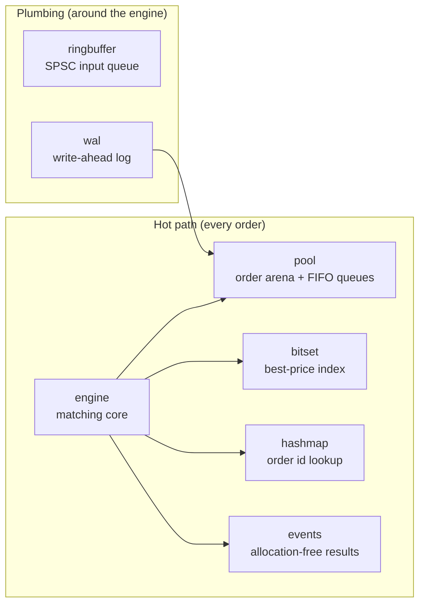
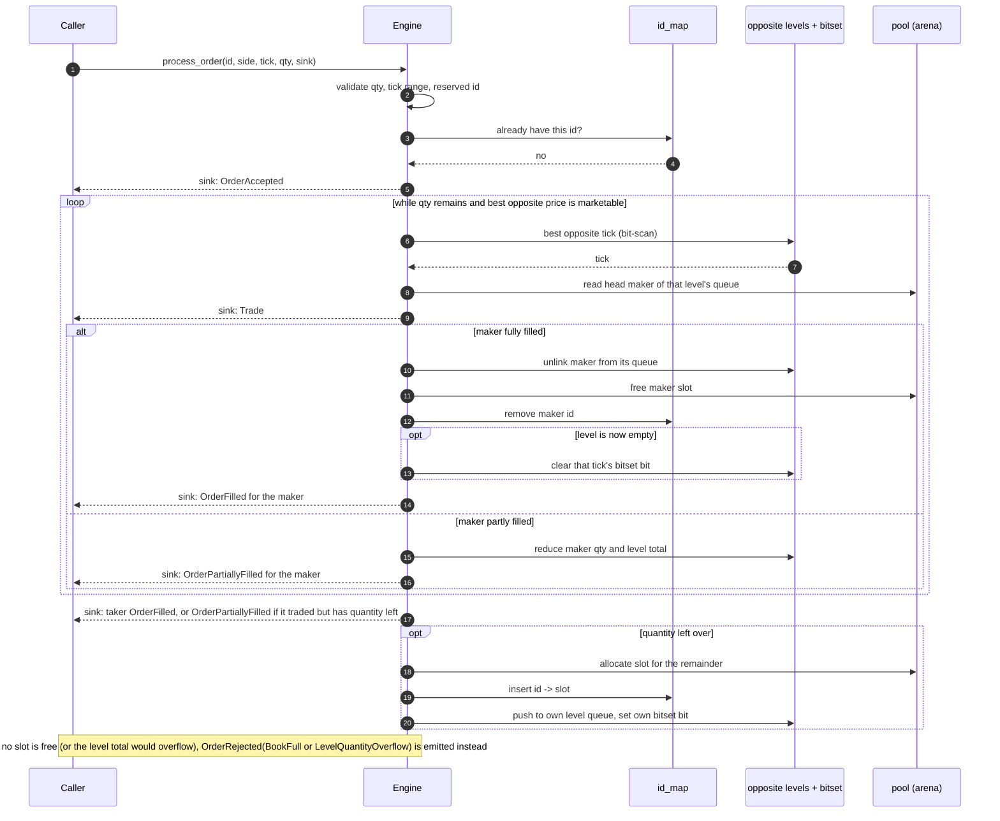
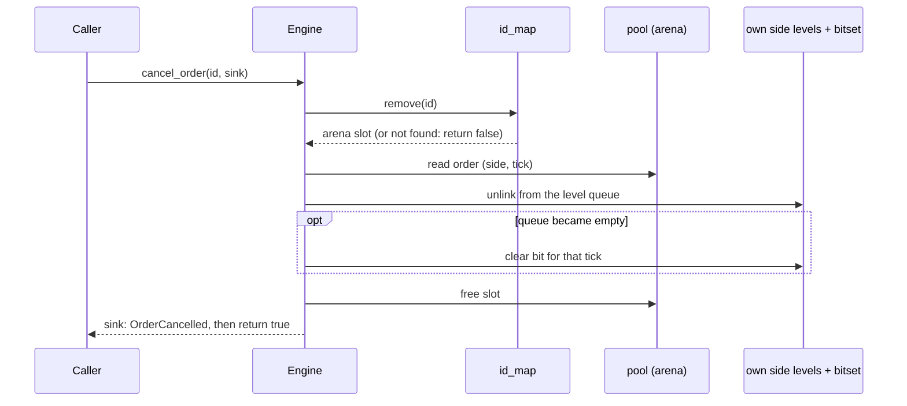

# 2. Architecture Overview

> **New word?** Every technical term in these chapters is explained in the
> [glossary](glossary.md).

This chapter is the map. It explains the design goals, how the modules fit
together, what lives in memory, and why each data structure was chosen. The
later chapters zoom into each piece.

## 2.1 Design goals

| Goal                 | What it means                                                                 | How the code achieves it                                              |
|----------------------|-------------------------------------------------------------------------------|-----------------------------------------------------------------------|
| **Low latency**      | Do as little work as possible for each order.                                 | O(1) operations, flat arrays, few branches.                           |
| **Predictable latency** | The *slowest* orders (the tail) should be nearly as fast as the average.   | No heap allocation, no locks, no resizing, no I/O inside the engine.  |
| **Determinism**      | The same input sequence always produces the same book and the same events.    | Single thread, no clocks. The id hash map's random seed only decides *where* entries live, never a result (chapter 5). |
| **Cache friendliness** | Keep hot data close together so the CPU cache works for us.                 | Arena array, `u32` indices instead of 64-bit pointers, small structs. |
| **Readable**         | This is a teaching project.                                                   | Few modules, each with one job and its own tests.                     |

> [!NOTE]
> **Why does allocation hurt latency?** `malloc` / `Box::new` is usually fast,
> but *sometimes* it is slow: it may take a lock, ask the operating system for
> memory, or walk a free list. Those rare slow calls show up as latency spikes.
> In trading, the spike (the "tail") often matters more than the average. So the
> engine allocates everything **once, at start-up**, and never again while
> processing orders.

## 2.2 The modules



| Module | File | One-sentence job | Chapter |
|---|---|---|---|
| `engine`     | [`src/engine.rs`](../src/engine.rs)       | Accepts orders, matches them, cancels them, answers depth queries. | [6](06-matching-algorithm.md) |
| `pool`       | [`src/pool.rs`](../src/pool.rs)           | Stores orders in a fixed array and links them into per-price FIFO queues. | [3](03-order-pool.md) |
| `bitset`     | [`src/bitset.rs`](../src/bitset.rs)       | Finds the best bid / best ask in O(1). | [4](04-price-ladder-bitset.md) |
| `hashmap`    | [`src/hashmap.rs`](../src/hashmap.rs)     | Maps `order_id` to the order's arena slot, for cancellation. | [5](05-hash-map.md) |
| `events`     | [`src/events.rs`](../src/events.rs)       | The `Event` enum, the `EventSink` trait the engine reports through, and a bounded `EventBatch` sink. | [7](07-events.md) |
| `ringbuffer` | [`src/ringbuffer.rs`](../src/ringbuffer.rs) | Lock-free queue, split into `Producer` and `Consumer` handles, to feed the engine from another thread. | [8](08-ring-buffer.md) |
| `wal`        | [`src/wal.rs`](../src/wal.rs)             | Append-only binary log of requests, for replay and recovery. | [9](09-write-ahead-log.md) |

Note the arrows: the engine depends on `pool`, `bitset`, `hashmap` and `events`,
but **not** on `ringbuffer` or `wal`. Those two are independent building blocks
that *you* wire around the engine (chapters 8 and 9 show how).

The crate root ([`src/lib.rs`](../src/lib.rs)) re-exports the five names most
users need: `Engine`, `Event`, `EventSink`, `EventBatch` and `Side`.

## 2.3 The `Engine` struct, field by field

```rust
pub struct Engine {
    pool: OrderPool,              // every order lives here
    id_map: FlatHashMap,          // order_id -> index into pool
    bid_bitset: TwoLevelBitset,   // which bid ticks are non-empty
    ask_bitset: TwoLevelBitset,   // which ask ticks are non-empty
    bid_levels: Box<[PriceLevel]>,// bid_levels[tick] = FIFO queue of bids at that tick
    ask_levels: Box<[PriceLevel]>,// ask_levels[tick] = FIFO queue of asks at that tick
    sequence: u64,                // arrival counter; metadata only, never read by matching
}
```

Each field has exactly one responsibility:

| Field | Question it answers | Cost |
|---|---|---|
| `pool`        | "Where is order X stored, and who is next to it in its queue?" | index into an array |
| `id_map`      | "Which arena slot holds the order with id 12345?"               | expected O(1) hash lookup |
| `*_levels`    | "What orders are waiting at price tick T?"                      | `levels[T]`: one array read |
| `*_bitset`    | "What is the best non-empty price?"                             | two bit-scans |
| `sequence`    | "How many orders has the engine accepted?" (audit metadata; FIFO order comes from the queue links, not from this number, see [6.10](06-matching-algorithm.md#610-design-notes-worth-noticing)) | one add |

### How the pieces point at each other

Here is the actual internal state after the first five orders of the
[worked example](01-order-book-basics.md#110-a-complete-worked-example). The
arena hands out slots `0, 1, 2, ...` in arrival order, so `#1` is in slot 0,
`#2` in slot 1, and so on.

```text
 ask_bitset : ticks { 101, 102 }                 bid_bitset : ticks { 99, 100 }

 ask_levels                                      bid_levels
   [101] head=1 tail=2 count=2 total_qty=7         [100] head=4 tail=4 count=1 total_qty=6
   [102] head=0 tail=0 count=1 total_qty=5         [ 99] head=3 tail=3 count=1 total_qty=10
   (all other ticks: head=NIL, count=0)            (all other ticks: head=NIL, count=0)

 pool.orders  (the arena)
   slot | order_id | side | tick | remaining | prev_idx | next_idx
   -----+----------+------+------+-----------+----------+---------
     0  |    1     | Sell | 102  |     5     |   NIL    |   NIL
     1  |    2     | Sell | 101  |     3     |   NIL    |    2      <-- head of ask queue @101
     2  |    3     | Sell | 101  |     4     |    1     |   NIL     <-- tail of ask queue @101
     3  |    4     | Buy  |  99  |    10     |   NIL    |   NIL
     4  |    5     | Buy  | 100  |     6     |   NIL    |   NIL
     5.. free                                                       (on the free stack)

 id_map     1 -> 0     2 -> 1     3 -> 2     4 -> 3     5 -> 4
 sequence   5
```

Read it like a road map:

- To find the **best ask**: `ask_bitset.lowest()` gives tick `101`.
- To find **who trades first at 101**: `ask_levels[101].head` is slot `1`, i.e.
  order `#2`, the oldest.
- To find **who is next in line**: `pool.orders[1].next_idx` is slot `2`, order
  `#3`.
- To **cancel `#3`**: the id map (`id_map.remove(3)` in the code) gives slot `2`,
  then unlink it from its queue; no searching.

The queue pointers are just small integers (`u32`) into the same array. There is
no `Box`, no `Rc`, no raw pointer, and no per-node allocation.

## 2.4 What happens when an order arrives



(The diagram is simplified: the exact order and all failure branches are in
[chapter 6](06-matching-algorithm.md).)

The engine does not decide where events go. It hands each one, at the moment it
happens, to the **sink** the caller passed in: a `Vec<Event>`, a closure, or a
bounded `EventBatch` (chapter 7). Notice that a drained price is cleared from the
bitset *before* the maker's fill is reported: the engine only calls the sink when
every structure agrees. A sink cannot look at the engine while it runs (the
engine is mutably borrowed for the whole call, so the compiler forbids it), but
a sink *can* panic. If that panic is caught, the caller gets the engine back at
the point where the sink was called, and the rule guarantees the book is
consistent there, even if the request was only partly applied. Chapter 6 explains
this in [the note after the inner loop](06-matching-algorithm.md#after-the-inner-loop)
and in [invariant 6](06-matching-algorithm.md#69-invariants-after-every-call).

Cancelling is a much shorter trip:



## 2.5 Why these data structures?

For every sub-problem a "textbook" solution exists. Here is why each was
replaced.

| Sub-problem | Textbook answer | Why it is not ideal here | What this engine does |
|---|---|---|---|
| Keep prices sorted / find the best price | `BTreeMap<Price, Level>` | O(log n), pointer-chasing across nodes, allocates on insert | **Two-level bitset**: 2 bit-scans, O(1), 520 bytes |
| Find the queue for a price | `HashMap<Price, Level>` | hashing cost, allocation, resizing | **Array indexed by tick**: `levels[tick]` |
| FIFO queue of orders at a price | `VecDeque<Order>` or `LinkedList<Order>` | `VecDeque` removal from the middle is O(n); `LinkedList` allocates a node per order | **Intrusive doubly-linked list** in the arena: O(1) everything |
| Find an order by id | `HashMap<u64, _>` (SipHash) | allocates, may resize, slower hash | **Flat open-addressing table** with a fast integer hash, plus a random seed against crafted ids |
| Store the orders | `Box<Order>` per order | one `malloc` per order, orders scattered in memory | **Arena** (one big array), `u32` indices |
| Report what happened | return a `Vec<Event>` | allocates on every call | **Stream each event into a caller-supplied `EventSink`**: the caller chooses the storage |

The trade-off for all this speed is **fixed limits** decided up front:

- at most `order_capacity` resting orders (you choose it in `Engine::new`),
- exactly 4096 price ticks (a compile-time constant).

There is no limit on events: one call can report thousands of fills, and the
sink decides whether to keep, forward or merely count them.

## 2.6 Memory footprint

Everything is allocated in `Engine::new(order_capacity)`. For capacity `N`:

| Component | Formula | `N = 10,000` |
|---|---|---|
| Order arena | `N × 48 B` | 480,000 B |
| Free-slot stack | `N × 4 B` | 40,000 B |
| Hash table | `next_pow2(2 × max(N,16)) × 16 B` | 32,768 × 16 = 524,288 B |
| Price levels (bid + ask) | `2 × 4096 × 24 B` | 196,608 B |
| `Engine` struct itself | holds the two bitsets (`2 × 520 B`) plus the pointers, counters and hash seed | 1,160 B |
| **Total** | | **1,242,056 B ≈ 1.24 MB** |

(Sizes of `Order` = 48 B, `PriceLevel` = 24 B, the 16 B hash slot and
`Engine` = 1,160 B were measured with `size_of`.)

That is small enough to live comfortably in a modern CPU's L2/L3 cache, which is
part of why the design is fast.

## 2.7 Threading model

```text
   ONE producer thread                ONE matching thread                 consumers
  +-----------------+    SPSC      +------------------------+          +-------------+
  | network / FIX / | -----------> |  pop -> WAL -> Engine  | -------> | market data |
  | gateway         |  ring buffer |  process_order/cancel  |  events  | executions  |
  +-----------------+              +------------------------+          +-------------+
```

The mutating methods (`process_order` and `cancel_order`) take `&mut self`, so
Rust itself guarantees that only one caller touches the book at a time. There
are **no locks anywhere** in the engine. The ring buffer applies the same idea
to the queue: it hands out exactly one `Producer` and one `Consumer`, so "one
writer, one reader" is enforced by the type system too (chapter 8). This follows the *single-writer principle* popularised by the LMAX
Disruptor: instead of many threads fighting over shared data, funnel all
requests through a queue into one thread that owns the data.

Note that in this pipeline the WAL append also runs on the matching thread. It is
a plain memory copy almost always, but it occasionally has to grow and re-map
the file, which is a latency spike (chapter 9).

To scale beyond one thread, run **one engine per instrument** (or per group of
instruments), each on its own core.

## 2.8 What "zero allocation" does and does not mean

It means **no heap allocation inside `process_order` and `cancel_order`**, and
this is tested (see [chapter 10](10-testing-and-performance.md)).

These things *do* allocate, and that is fine because they are not on the hot path:

| Call | Why it allocates |
|---|---|
| `Engine::new` | builds all the arrays (this is the whole point: do it once) |
| `Engine::depth_snapshot` | returns a `Vec` (for inspection / reporting) |
| `WalWriter::create`, `WalWriter::open_append`, `wal::read_all` | file and `Vec` setup |
| `ringbuffer::spsc_channel` | builds the slot array |

> [!TIP]
> "Zero allocation" is a property of the **engine**, not of every sink. A
> `Vec<Event>` sink allocates when it grows (reuse one and it stops growing after
> warm-up), a closure can do anything, and an `EventBatch` never allocates. The
> zero-allocation test drives the engine through an `EventBatch` and a counting
> closure, so it measures the engine alone (chapter 10).

## 2.9 Try it yourself

Open the API documentation, which is generated from the same doc comments
quoted in these chapters:

```sh
cargo doc --open
```

Then open [`src/engine.rs`](../src/engine.rs) and find each `Engine` field from
2.3 and the place where `new` allocates it. Every allocation that order
processing needs happens in that one function (only inspection helpers such as
`depth_snapshot` allocate later); [chapter 10](10-testing-and-performance.md) shows
the test that proves it:

```sh
cargo test --test zero_alloc
```

**Next:** [3. The order pool](03-order-pool.md)
