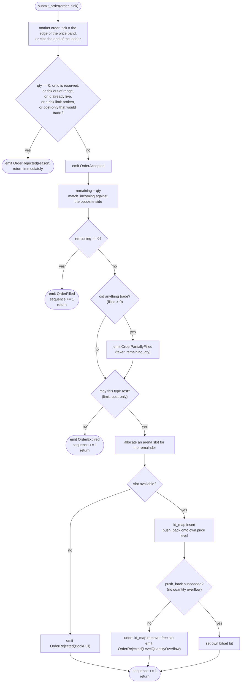
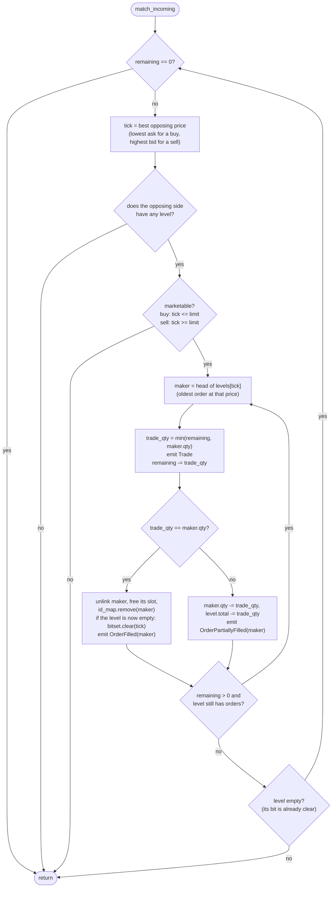

# 6. The Matching Algorithm

> **New word?** Every technical term in these chapters is explained in the
> [glossary](glossary.md).

Source: [`src/engine.rs`](../src/engine.rs)

This is the chapter where everything comes together. Read chapters 1 to 5 first
if you have not; the data structures they describe are the tools used here.
Code excerpts are lightly condensed (line breaks and comments trimmed, one side
shown where the other mirrors it); the behaviour is identical to the source.

## 6.1 The public API

```rust
let mut engine = Engine::new(order_capacity);          // allocate everything, once
// or Engine::with_ticks(order_capacity, ticks): another price range (chapter 4)
let mut events = Vec::new();                            // any EventSink (chapter 7)
engine.set_risk_limits(limits);                         // pre-trade checks (6.2)

engine.process_order(id, side, tick, qty, &mut events); // submit a limit order
engine.submit_order(order, &mut events);                // any NewOrder (see below)
let found = engine.cancel_order(id, &mut events);       // cancel a resting order: bool
let found = engine.reduce_order(id, by, &mut events);   // lower its qty, keep its place
let n = engine.cancel_account(account, &mut events);    // mass cancel one account: count
let n = engine.cancel_all(&mut events);                 // mass cancel everything: count

engine.best_bid();                 // Option<u32>
engine.best_ask();                 // Option<u32>
engine.depth_at(side, tick);       // u64   total resting qty at one tick
engine.depth_snapshot(side, n);    // Vec<(tick, qty)>  best n levels, best first
engine.live_order_count();         // usize number of resting orders
engine.resting_order(id);          // Option<RestingOrder>  side, tick, remaining qty
engine.tick_count();               // usize valid ticks are 0..tick_count()
engine.risk_limits();              // RiskLimits
```

`submit_order` takes a `NewOrder`, a small `Copy` struct with every term of an
order. Its constructors and `with_*` methods read like a sentence:

```rust
let order = NewOrder::limit(42, Side::Buy, 100, 10)     // id, side, tick, qty
    .with_type(OrderType::ImmediateOrCancel)
    .with_account(7)
    .with_self_trade_prevention(SelfTradePrevention::CancelResting);
```

`process_order(id, side, tick, qty, sink)` is shorthand for
`submit_order(NewOrder::limit(id, side, tick, qty), sink)`: account 0, self-trades
allowed. This chapter follows `submit_order`. All mutating methods
take the sink as `sink: &mut S` with
`S: EventSink + ?Sized`. Being generic, they are compiled separately for each sink
type, so `emit` is inlined into the matching loop; `?Sized` also allows a
`&mut dyn EventSink` when you prefer one compiled copy.

| Method | Mutates? | Allocates? | Cost |
|---|---|---|---|
| `new(capacity)` | builds | **yes**, once | O(capacity) |
| `submit_order` / `process_order` | yes | no (a `Vec` sink may, when it grows) | expected O(1 + number of fills) |
| `cancel_order` | yes | no | O(1) expected |
| `reduce_order` | yes | no | O(1) expected |
| `cancel_account` / `cancel_all` | yes | no | O(ticks between best and worst price + resting orders) |
| `best_bid` / `best_ask` | no | no | O(1), two bit-scans |
| `depth_at` | no | no | O(1) |
| `depth_snapshot` | no | **yes** (`Vec`) | O(ticks scanned); for reporting only |
| `live_order_count` | no | no | O(1) |
| `resting_order` | no | no | O(1) expected: one hash lookup |
| `set_risk_limits` / `risk_limits` / `tick_count` | only `set_risk_limits` | no | O(1) |

## 6.2 `submit_order` in four phases



In words:

1. **Validate.** Bad input, an order that breaks a risk limit, and a post-only
   order that would trade, are rejected before anything changes. (A market order
   first gets a limit: the edge of the price band, or without one the worst
   price its side allows; from here on it is handled like any other order.)
2. **Accept.** Emit `OrderAccepted`.
3. **Match.** Trade against the opposite side while the prices cross.
4. **Rest.** Put any leftover quantity into the book, or let it expire if the
   order type may not rest.

The order type changes only steps 1 and 4: matching is the same for every type.

### Phases 1 and 2: validation and acceptance

```rust
fn validate(&self, order_id: u64, side: Side, order_type: OrderType,
            price_tick: u32, qty: u64) -> Result<(), RejectReason> {
    if qty == 0 {
        Err(RejectReason::ZeroQuantity)
    } else if order_id == crate::hashmap::RESERVED_KEY {
        Err(RejectReason::ReservedOrderId)
    } else if (price_tick as usize) >= self.tick_count() {
        Err(RejectReason::PriceOutOfRange)
    } else if self.id_map.get(order_id).is_some() {
        Err(RejectReason::DuplicateOrderId)
    } else if qty > self.limits.max_order_qty {
        Err(RejectReason::QuantityAboveLimit)
    } else if self.is_outside_band(side, price_tick) {
        Err(RejectReason::PriceOutsideBand)
    } else if order_type == OrderType::PostOnly && self.is_marketable(side, price_tick) {
        Err(RejectReason::PostOnlyWouldTrade)
    } else {
        Ok(())
    }
}

// In submit_order (after `let NewOrder { order_id, account, side, .. } = order;`):
let price_tick = match order_type {
    OrderType::Market => self.market_limit(side),       // the edge of the price band,
    _ => price_tick,                                    // or the end of the ladder
};
if let Err(reason) = self.validate(order_id, side, order_type, price_tick, qty) {
    sink.emit(Event::OrderRejected { order_id, reason });
    return;
}
sink.emit(Event::OrderAccepted { order_id, account, side, order_type, price_tick, qty });
```

| Check | `RejectReason` | Why |
|---|---|---|
| `qty == 0` | `ZeroQuantity` | An empty order is meaningless. Without the check it would sail through matching with nothing to fill and emit a spurious `OrderAccepted` + `OrderFilled` pair. |
| `order_id == u64::MAX` | `ReservedOrderId` | Reserved as the hash map's "empty" marker (chapter 5). |
| `price_tick >= tick_count()` | `PriceOutOfRange` | The price ladder has only this many ticks (4096 by default); indexing beyond it would be out of bounds. |
| `id_map.get(id).is_some()` | `DuplicateOrderId` | Duplicate id among **live** orders. (An id that has been fully filled or cancelled is gone from the map and may be reused.) |
| `qty > limits.max_order_qty` | `QuantityAboveLimit` | A pre-trade risk limit against "fat fingers": an extra zero on the quantity. |
| `is_outside_band(side, tick)` | `PriceOutsideBand` | The other risk limit: a buy may be priced at most `band` ticks above the best ask, a sell at most `band` ticks below the best bid. With no order on the other side there is no reference, and no band applies. |
| post-only and `is_marketable(side, tick)` | `PostOnlyWouldTrade` | A post-only order promises never to take liquidity. `is_marketable` asks the question that starts matching (does the best opposing price reach this limit?) with one bit-scan and no change to the book. |

A validation failure yields **only** `OrderRejected`, with no `OrderAccepted`
before it. The checks run in the order of the table and stop at the first
failure, so an order with two problems (say, zero quantity *and* a bad tick)
always gets the same reason, `ZeroQuantity`. A market order can never fail the
price checks: its tick has been replaced before they run, by `market_limit`,
with the edge of the price band (best ask + band for a buy, best bid − band for a
sell) or, without a band, the end of the ladder. `OrderAccepted` reports that
limit, so a consumer sees how far the order may trade, and the band turns into
**protection for market orders**: they stop at its edge, and their remainder
expires.

The risk limits are engine state, changed with `set_risk_limits`. Like an order,
that call changes later results, so it is logged like one (chapter 9). Returning a `Result` from a small
function keeps that order easy to read, and lets the caller handle every
rejection with one `if let`.

### Phase 3: `match_incoming`, choosing the side

```rust
match side {
    Side::Buy  => Self::match_incoming(&mut self.pool, &mut self.ask_levels,
                      &mut self.ask_bitset, &mut self.id_map, &mut self.trades,
                      order_id, price_tick, &mut remaining, sink, Crossing::TakerBuy),
    Side::Sell => Self::match_incoming(&mut self.pool, &mut self.bid_levels,
                      &mut self.bid_bitset, &mut self.id_map, &mut self.trades,
                      order_id, price_tick, &mut remaining, sink, Crossing::TakerSell),
}
```

A **buy** taker attacks the **ask** side; a **sell** taker attacks the **bid**
side. The same function serves both. Only two things differ, captured by the
`Crossing` enum:

| | `TakerBuy` | `TakerSell` |
|---|---|---|
| Best opposing price | `bitset.lowest()` (cheapest ask) | `bitset.highest()` (richest bid) |
| Marketable when | `tick <= limit_price` | `tick >= limit_price` |
| `taker_side` reported in `Trade` | `Side::Buy` | `Side::Sell` |

`self.trades` is the engine's trade counter: `match_incoming` adds one for every
trade and stamps the new value into the event as its `trade_id` (6.10).

## 6.3 `match_incoming`, the heart of the engine



There are **two nested loops**:

- The **outer loop walks price levels**, best first.
- The **inner loop walks the FIFO queue at one price**, oldest first.

### Outer loop: pick the best price and check it crosses

```rust
let Some(tick) = (match direction {
    Crossing::TakerBuy  => bitset.lowest(),
    Crossing::TakerSell => bitset.highest(),
}) else { break };                                   // opposite side is empty

let marketable = match direction {
    Crossing::TakerBuy  => tick as u32 <= price_tick,
    Crossing::TakerSell => tick as u32 >= price_tick,
};
if !marketable { break; }
```

The early `break` when the best price is not marketable is a key optimisation and
a correctness argument at once: if the *best* opposing price cannot cross the
limit, **every other opposing price is even worse**, so nothing further can
trade. No scan needed.

### Inner loop: fill against the head of the queue

```rust
let maker_idx       = level.head;                      // oldest order at this tick
let maker_qty       = pool.get(maker_idx).remaining_qty;
let maker_order_id  = pool.get(maker_idx).order_id;
let trade_qty       = (*remaining).min(maker_qty);     // the smaller of the two

*trades += 1;                                          // number this trade
sink.emit(Event::Trade { trade_id: *trades, maker_order_id, taker_order_id,
                         taker_side, price_tick: tick as u32, qty: trade_qty });
*remaining -= trade_qty;

if trade_qty == maker_qty {
    level.remove(pool, maker_idx);          // maker fully consumed
    pool.free(maker_idx);
    id_map.remove(maker_order_id);
    if level.is_empty() {
        bitset.clear(tick);                 // price gone: update the index first...
    }
    sink.emit(Event::OrderFilled { order_id: maker_order_id }); // ...then report
} else {
    level.reduce_qty(pool, maker_idx, trade_qty);   // maker keeps its place
    sink.emit(Event::OrderPartiallyFilled {
        order_id: maker_order_id,
        remaining_qty: maker_qty - trade_qty,
    });
}
```

Three outcomes for each step, depending on `trade_qty = min(taker_left, maker_qty)`:

| Case | Result |
|---|---|
| taker_left **>** maker_qty | Maker is fully filled and removed. The taker loops again. |
| taker_left **<** maker_qty | Taker is fully filled (`remaining` hits 0). Maker stays, reduced. |
| taker_left **==** maker_qty | Both fully filled. |

Note the **trade price is `tick`, the maker's level**, not the taker's limit. That
is how price improvement (chapter 1) falls out for free.

### After the inner loop

```rust
if !levels[tick].is_empty() {
    break;                  // the taker ran out first: nothing more can trade
}
// The level drained; its bit was cleared with its last maker. Loop for the next price.
```

If the level still has orders, the taker must have been exhausted, so we stop. If
the level was drained, control returns to the outer loop, which asks the bitset
for the *next* best price.

> [!NOTE]
> **Why clear the bit inside the inner loop, before reporting the fill?** Clearing
> it after the loop would be just as correct for matching. But the engine hands
> the maker's `OrderFilled` to the caller's sink, which is code the engine does not
> control. The rule is: **only call out to the sink when every structure
> agrees** (invariant 6 in 6.9). With the bit still set, `best_ask()` would report
> a price with nothing left at it. That only becomes visible if a sink panics and
> the panic is caught, but rules like this are what keep "only visible if..."
> bugs out of a codebase. The unit test `panicking_sink_leaves_the_book_consistent`
> pins it down.

### Self-trade prevention

Right after it picks the head maker, and before it computes a trade, the inner
loop checks whether the maker belongs to the taker's own account (excerpt):

```rust
let maker = *pool.get(maker_idx);
let mode = taker.self_trade_prevention;
if mode != SelfTradePrevention::Allow && maker.account == taker.account {
    sink.emit(Event::SelfTradePrevented { taker_order_id, maker_order_id });
    if mode.cancels_resting() {               // CancelResting or CancelBoth
        level.remove(pool, maker_idx);        // exactly as for a full fill...
        pool.free(maker_idx);
        id_map.remove(maker_order_id);
        if level.is_empty() { bitset.clear(tick); }
        sink.emit(Event::OrderCancelled { /* maker, its side, tick and qty */ });
    }
    if mode.stops_incoming() {                // CancelIncoming or CancelBoth
        return true;                          // "stopped by self-trade"
    }
    continue;                                 // the next maker in line
}
```

With the default mode, `Allow`, the check is one comparison and nothing changes.
Otherwise:

| Mode | The own resting order | The incoming order |
|---|---|---|
| `CancelResting` | cancelled | keeps matching against the next maker |
| `CancelIncoming` | untouched | stops; its remainder expires, even for a limit order |
| `CancelBoth` | cancelled | stops; its remainder expires |

Three details are worth a look. The `SelfTradePrevented` event comes **first**,
while nothing has changed yet, so the sink sees a consistent book (6.9). The
resting order leaves the book through the **same steps as a fully filled
maker**, and in the same order: the bitset is updated before `OrderCancelled` is
reported. And `match_incoming` now **returns a `bool`**: `submit_order` needs to
know that the taker was stopped, because a stopped limit order must not rest.
Trades the taker made before meeting its own order stand.

## 6.4 Phase 4: resting the remainder

(Excerpt, abridged: the `Sell` arm mirrors the `Buy` arm.)

```rust
match self.pool.allocate(order_id, side, price_tick, remaining, self.sequence) {
    Some(idx) => {
        self.id_map.insert(order_id, idx);
        let rested = match side {
            Side::Buy  => { let ok = self.bid_levels[price_tick as usize].push_back(&mut self.pool, idx);
                            if ok { self.bid_bitset.set(price_tick as usize); } ok }
            Side::Sell => { /* same with ask_levels / ask_bitset */ }
        };
        if !rested {
            self.id_map.remove(order_id);   // roll back
            self.pool.free(idx);
            sink.emit(Event::OrderRejected { order_id, reason: RejectReason::LevelQuantityOverflow });
        }
    }
    None => sink.emit(Event::OrderRejected { order_id, reason: RejectReason::BookFull }),
}
```

Two things can prevent an order from resting, and both produce `OrderRejected`
**after** `OrderAccepted`:

| Cause | `RejectReason` | Why | Cleanup |
|---|---|---|---|
| Arena full (`allocate` returns `None`) | `BookFull` | `order_capacity` resting orders already exist | nothing to undo |
| Level quantity overflow (`push_back` returns `false`) | `LevelQuantityOverflow` | `total_qty` would exceed `u64::MAX` | remove the id from `id_map`, free the slot |

> [!IMPORTANT]
> **In practice, a capacity rejection only happens to an order that did not trade.**
> The source comment says trades already executed are not undone, and the code
> path is written that way defensively. But it cannot be reached:
>
> - *Arena full:* a taker that still has quantity left after trading must have
>   consumed every maker it touched completely, and each fully filled maker
>   **frees a slot**. So `allocate` always succeeds after at least one trade.
> - *Level overflow:* the book is never crossed (see 6.9). If the taker traded,
>   there is no resting order on its own side at that price, so the level is empty
>   and its `total_qty` cannot overflow.
>
> So the reachable rejection sequence is just `[OrderAccepted, OrderRejected]`.
> The differential test in `tests/model_check.rs` checks this on every one of its
> 160,000 random calls, many of them on a 64-order arena that is full most of the
> time: a call that ends in `OrderRejected` after `OrderAccepted` must contain no
> `Trade`. Run it with `cargo test --test model_check`. If you change the engine so
> both can happen, that assertion fails, and consumers must then treat the trades
> as real.

### Remainders that may not rest

Immediate-or-cancel and market orders never rest, and neither does an order that
self-trade prevention stopped. Their remainder is dropped before the arena is
even asked for a slot (excerpt):

```rust
if stopped_by_self_trade || !order_type.rests() {  // only Limit and PostOnly rest
    sink.emit(Event::OrderExpired { order_id, expired_qty: remaining });
    self.sequence = self.sequence.wrapping_add(1);
    return;
}
```

So such an order never gets `BookFull` and never uses a slot, even for an
instant. Its events end with `OrderExpired`, after the taker's
`OrderPartiallyFilled` if it traded. Why a new event instead of
`OrderCancelled`? `OrderCancelled` means "this quantity left the book", and a
consumer following the book's depth (chapter 7) subtracts it from a level. The
expired quantity was never in the book, so there is nothing to subtract.

## 6.5 A complete trace

Let's replay step 6 of the [worked example](01-order-book-basics.md#110-a-complete-worked-example)
and watch every data structure change. Start state (capacity 16; see
[chapter 2](02-architecture.md#how-the-pieces-point-at-each-other) for the full
picture):

```text
 asks:  [101] #2(slot1):3 -> #3(slot2):4   total 7        ask_bitset {101, 102}
        [102] #1(slot0):5                  total 5
 bids:  [100] #5(slot4):6                                  bid_bitset {99, 100}
        [ 99] #4(slot3):10
 free stack top -> slot 5, 6, 7, ...
```

**Incoming:** `process_order(6, Buy, tick 102, qty 14)`

| # | What happens | Data structure changes | Event emitted | `remaining` |
|---|---|---|---|---|
| 0 | Validate: qty>0, id≠MAX, 102<4096, id 6 unused. | | `OrderAccepted{6, Buy, 102, 14}` | 14 |
| 1 | `ask_bitset.lowest()` = **101**. `101 <= 102` ✓ marketable. | | | 14 |
| 2 | Head of `ask[101]` is slot 1 (`#2`, qty 3). `trade_qty = min(14,3) = 3`. | | `Trade{id 1, maker 2, taker 6, Buy, 101, 3}` | 11 |
| 3 | 3 == 3, so `#2` is fully filled. | `ask[101]`: head → slot 2, count 1, total 4. `free(slot 1)`. `id_map.remove(2)`. | `OrderFilled{2}` | 11 |
| 4 | Level 101 not empty. Head is slot 2 (`#3`, qty 4). `trade_qty = min(11,4) = 4`. | | `Trade{id 2, maker 3, taker 6, Buy, 101, 4}` | 7 |
| 5 | 4 == 4, so `#3` is fully filled. The level is now empty, so its bit is cleared before the event is emitted. | `ask[101]` empty (head = tail = NIL, count 0, total 0). `free(slot 2)`. `id_map.remove(3)`. `ask_bitset.clear(101)`, now `{102}`. | `OrderFilled{3}` | 7 |
| 6 | Inner loop ends (level empty, bit already clear). | | | 7 |
| 7 | Outer loop: `lowest()` = **102**. `102 <= 102` ✓. Head of `ask[102]` is slot 0 (`#1`, qty 5). `trade_qty = min(7,5) = 5`. | | `Trade{id 3, maker 1, taker 6, Buy, 102, 5}` | 2 |
| 8 | 5 == 5, so `#1` is fully filled; its level empties too. | `ask[102]` empty. `free(slot 0)`. `id_map.remove(1)`. `ask_bitset.clear(102)`, now empty. | `OrderFilled{1}` | 2 |
| 9 | Inner loop ends (level empty, bit already clear). | | | 2 |
| 10 | Outer loop: `lowest()` = `None` → stop. | | | 2 |
| 11 | `filled = 14 − 2 = 12 > 0`, `remaining = 2 ≠ 0`. | | `OrderPartiallyFilled{6, remaining 2}` | 2 |
| 12 | Rest the remainder: `allocate` pops the most recently freed slot, **slot 0**. | `id_map.insert(6, 0)`. `bid[102]`: head = tail = slot 0, count 1, total 2. `bid_bitset.set(102)`. `sequence = 6`. | | 2 |

End state:

```text
 asks:  (empty)                                            ask_bitset {}
 bids:  [102] #6(slot0):2                                  bid_bitset {99, 100, 102}
        [100] #5(slot4):6
        [ 99] #4(slot3):10
 best_bid = 102, best_ask = None, live_order_count = 3
```

All of that was O(1) per step, and no memory was allocated.

### More examples (all produced by the real engine)

**Price improvement**: a buy limit of 105 against an ask at 100 trades at 100:

```text
 process_order(1, Sell, 100, 5)
 process_order(2, Buy, 105, 5)   ->  OrderAccepted{2, Buy, price_tick 105, qty 5}
                                     Trade{id 1, maker 1, taker 2, Buy, price_tick 100, qty 5}
                                     OrderFilled{1}
                                     OrderFilled{2}
```

**FIFO within a level** (from the unit test `price_time_priority_within_a_level_is_fifo`):
two asks of 5 at tick 100 (`#1` then `#2`) and a buy of 6. `#1` trades first
(5), then `#2` (1).

## 6.6 `cancel_order` and `reduce_order`

```rust
pub fn cancel_order<S: EventSink + ?Sized>(&mut self, order_id: u64, sink: &mut S) -> bool {
    let Some(idx) = self.id_map.remove(order_id) else {
        sink.emit(Event::CancelRejected { order_id, reason: CancelRejectReason::NotResting });
        return false;
    };
    let order = *self.pool.get(idx);                     // copy it out (Order is Copy)
    match order.side {
        Side::Buy => {
            let level = &mut self.bid_levels[order.price_tick as usize];
            level.remove(&mut self.pool, idx);           // unlink from the FIFO
            if level.is_empty() { self.bid_bitset.clear(order.price_tick as usize); }
        }
        Side::Sell => { /* same on the ask side */ }
    }
    self.pool.free(idx);
    sink.emit(Event::OrderCancelled {                    // every structure agrees by now
        order_id, side: order.side, price_tick: order.price_tick,
        cancelled_qty: order.remaining_qty,
    });
    true
}
```

| Step | Structure used | Cost |
|---|---|---|
| Find the order's slot | `id_map.remove(order_id)` | expected O(1) |
| Read side and tick | `pool.get(idx)` | O(1) |
| Unlink from its queue (head, middle or tail) | `PriceLevel::remove` | O(1) |
| Drop the price from the index if now empty | `bitset.clear` | O(1) |
| Recycle the slot | `pool.free` | O(1) |

Cancelling an **unknown** or **already filled** id leaves the book alone, emits
`CancelRejected` (reason `NotResting`) and returns `false`. Emitting an event, and not only returning
`false`, matters to anyone who follows the engine through its events alone: every
cancel request leaves exactly one event behind. (Try cancelling order 4 twice in
the worked example: `true` with `OrderCancelled`, then `false` with
`CancelRejected`.)

`OrderCancelled` copies the side, tick and remaining quantity out of the order
record before the slot is freed, so a consumer knows which level lost how much.
To read the same fields *without* cancelling, use `resting_order(id)`: the same
`id_map` lookup, followed by a copy of the order's fields into a `RestingOrder`.

### Reducing an order

`reduce_order(id, reduce_by, sink)` lowers a resting order's quantity **in
place** (excerpt):

```rust
if reduce_by == 0 { /* CancelRejected(ZeroQuantity) */ }
let Some(idx) = self.id_map.get(order_id) else { /* CancelRejected(NotResting) */ };
let order = *self.pool.get(idx);
if reduce_by >= order.remaining_qty {
    return self.cancel_order(order_id, sink);         // nothing would be left
}
let levels = match order.side { Side::Buy => &mut self.bid_levels, Side::Sell => &mut self.ask_levels };
levels[order.price_tick as usize].reduce_qty(&mut self.pool, idx, reduce_by);
sink.emit(Event::OrderReduced { order_id, side: order.side, price_tick: order.price_tick,
                                reduced_qty: reduce_by, remaining_qty: order.remaining_qty - reduce_by });
```

The order stays exactly where it is in its queue. That is fair: a smaller order
can never take a fill away from the orders behind it. (Raising the quantity
would, so for that you cancel and send a new order, which queues at the back.)
`reduce_qty` is the same `PriceLevel` operation a partial fill uses (chapter 3):
it lowers the order's `remaining_qty` and the level's `total_qty` together.
Reducing by the whole remainder or more is a cancel, with `OrderCancelled`.

### Mass cancel

`cancel_account(account, sink)` cancels every resting order of one account, and
`cancel_all(sink)` every resting order. The engine keeps no list of orders per
account, so both **walk the book**, the same way `depth_snapshot` does (excerpt):

```rust
for side in [Side::Buy, Side::Sell] {
    let mut tick = /* best price on this side */;
    while let Some(t) = tick {
        tick = /* the next price, found before this level may empty */;
        let mut idx = /* levels[t].head */;
        while idx != NIL {
            let order = *self.pool.get(idx);            // copy: cancelling clears its links
            if account.is_none_or(|account| account == order.account) {
                self.id_map.remove(order.order_id);
                self.remove_cancelled(idx, sink);       // unlink, free, OrderCancelled
                cancelled += 1;
            }
            idx = order.next_idx;
        }
    }
}
sink.emit(Event::MassCancelled { account, cancelled_orders: cancelled });
```

So the cancellations come in a **fixed order**: bids best first, then asks best
first, oldest first at each price. That matters for determinism: a replay
reports them in the same order, and the reference book in the model check can
predict every event. `remove_cancelled` is the second half of `cancel_order`,
shared now that two callers need it. The cost is the ticks between each side's
best and worst price (at most 4096) plus the orders on them; the empty ticks are
the price of not keeping a per-account list (exercise 11 in chapter 11 adds one).
`MassCancelled` closes every mass cancel, even one that found nothing, so the
request always leaves an event.

## 6.7 Edge cases, verified

| Input | Events emitted | Book effect |
|---|---|---|
| `qty = 0` | `[OrderRejected(ZeroQuantity)]` | none |
| `price_tick = 4096` (out of range) | `[OrderRejected(PriceOutOfRange)]` | none |
| `price_tick = 4095` (last valid tick) | `[OrderAccepted]` (if nothing crosses) | rests normally |
| `order_id = u64::MAX` | `[OrderRejected(ReservedOrderId)]` | none |
| Duplicate id of a live order | `[OrderRejected(DuplicateOrderId)]` | none |
| Re-using the id of a filled/cancelled order | handled like any new order | normal |
| Order would rest but arena is full | `[OrderAccepted, OrderRejected(BookFull)]` (never preceded by trades, see 6.4) | nothing rests |
| Order would rest but level quantity would overflow `u64` | `[OrderAccepted, OrderRejected(LevelQuantityOverflow)]` | nothing rests; state unchanged |
| Order fully matches while arena is full | normal fills | needs no slot, so it succeeds |
| Post-only whose price reaches the best opposing price | `[OrderRejected(PostOnlyWouldTrade)]` | none |
| Immediate-or-cancel or market order with quantity left | `[OrderAccepted, ...fills..., OrderExpired]` | nothing rests; needs no slot |
| Market order on an empty opposing side | `[OrderAccepted, OrderExpired]` | none |
| Market order with an out-of-range tick | handled normally: the tick is ignored | normal |
| Quantity above `max_order_qty` | `[OrderRejected(QuantityAboveLimit)]` | none |
| Buy priced more than `band` ticks above the best ask (or a sell below the best bid) | `[OrderRejected(PriceOutsideBand)]` | none |
| Market order with a price band | `OrderAccepted` with limit best ask + band (or best bid − band); trades up to it; `OrderExpired` for the rest | normal |
| `cancel_order` of an id that is not resting | `[CancelRejected(NotResting)]` (returns `false`) | none |
| `reduce_order` by 0 | `[CancelRejected(ZeroQuantity)]` (returns `false`) | none |
| `reduce_order` by the remaining quantity or more | `[OrderCancelled]` (returns `true`) | the order is removed |
| Incoming order meets its own account's order, mode `Allow` (the default) | an ordinary `Trade` | normal |
| ...mode `CancelResting` | `SelfTradePrevented`, `OrderCancelled(maker)`, then matching goes on | the own order is removed |
| ...mode `CancelIncoming` | `SelfTradePrevented`, then the taker's final events and `OrderExpired` | the own order stays; nothing rests |
| `cancel_account` of an account with no resting orders, or `cancel_all` on an empty book | `[MassCancelled { cancelled_orders: 0, .. }]` | none |

## 6.8 Complexity

- **Phases 1 and 2 (validate, accept):** O(1) expected: one hash lookup.
- **Phase 3 (match):** each loop iteration produces a trade and either removes a
  maker (`O(1)` unlink + free + hash remove) or ends the taker. Moving to the next
  price is a bit-scan, also O(1). Every price level visited yields at least one
  trade or one cancelled own order, so the total cost is **O(number of fills +
  prevented self-trades)**.
- **Phase 4 (rest or expire):** O(1).
- **`cancel_order` and `reduce_order`:** O(1) expected: one hash lookup, then
  constant work on the order's queue.
- **`cancel_account` and `cancel_all`:** O(ticks between the best and worst price
  on each side + orders on them), at most 4096 ticks; no hash lookups to find
  orders, one per cancelled order to remove it.

Overall: **expected O(1 + fills)** (the "expected" is because the hash map probes;
see chapter 5), which matches the doc comment ("O(1) + O(fills)"). A
taker that doesn't cross the spread costs essentially the same as any other
no-match order, regardless of how many orders are in the book.

## 6.9 Invariants after every call

These always hold between calls, and the last one even during a call. The
differential test in chapter 10 (`tests/model_check.rs`) checks the observable ones
(best prices, depths, live count, exact events) after every request:

1. **The book is never crossed:** `best_bid < best_ask` whenever both exist.
   *Why:* an incoming buy at `p` consumes every ask `≤ p` before resting, so any
   ask left is `> p`; symmetric for sells.
2. **Bit `t` of a side's bitset is set ⇔ that side's `levels[t]` is non-empty.**
3. **Every resting order is in exactly one FIFO queue and has exactly one
   `id_map` entry;** `live_order_count()` counts them.
4. **`level.total_qty` equals the sum of `remaining_qty` of the orders in it.**
5. **Within a queue, arrival order is preserved:** new orders join at the tail, and
   a partially filled maker keeps the head.
6. **The book is consistent whenever the sink runs**, not just between calls.
   Every `emit` happens between complete state changes, which is why a drained
   price leaves the bitset before the last maker's fill is reported (6.3). A sink
   therefore never observes a half-updated book. If a sink panics and the panic is
   caught, the book is still consistent, but that request was only partly applied
   (chapter 7 explains what to do then).

## 6.10 Design notes worth noticing

**One function for both sides.** Instead of duplicating the matching loop for
buys and sells, `match_incoming` takes the opposing side's storage plus a
`Crossing` value. The `match direction` branches are trivially predictable.

**Why `match_incoming` is an associated function, not a `&mut self` method.** It
receives `&mut self.pool`, `&mut self.ask_levels`, `&mut self.ask_bitset` and
`&mut self.id_map` as separate arguments. Rust lets you borrow *disjoint fields*
of a struct mutably at the same time, but not the whole struct plus a field: a
method `fn match_incoming(&mut self, levels: &mut [PriceLevel], ...)` could not be
called with `&mut self.ask_levels`, because `self` is already borrowed as a whole.

A `&mut self` method *would* still be possible: it could start with
`let (levels, bitset) = match direction { ... }` and pick the fields itself,
because borrowing two different fields inside one function body is allowed. The
associated function was chosen because it keeps that choice in the caller and
makes every piece of state the loop touches visible in its signature. The
`#[allow(clippy::too_many_arguments)]` is the price of that clarity.

**The `sequence` counter.** It is incremented once for every order that passes
validation and is copied into the `Order` record if the order rests. The engine
never *reads* it back: time priority comes from the **position in the linked
list**, not from comparing sequence numbers. It is metadata for auditing or
debugging. (It uses `wrapping_add`, so it never panics.)

**The `trades` counter.** Unlike `sequence`, this one is read: it *is* the
`trade_id` of the last trade. It only ever changes inside the matching loop, which
is deterministic, so a replay of the same requests numbers every trade the same
way, and downstream can use the ids to spot duplicates and gaps (chapter 7). A
`u64` that grows by one per trade does not overflow in practice, so it uses a
plain `+= 1`.

**`#[inline(always)]` on tiny accessors** (`best_bid`, `best_ask`,
`live_order_count`, the bitset and pool accessors) removes call overhead in the
hot loop.

## 6.11 Try it yourself

Run every engine test, then the differential test that compares the engine with
a deliberately simple reference book over 160,000 random calls:

```sh
cargo test engine::
cargo test --test model_check
```

To watch the trace from 6.5 happen, run the chapter 1 example:

```sh
cargo run --example walkthrough
```

Then break something on purpose. In `match_incoming` in
[`src/engine.rs`](../src/engine.rs), change `Crossing::TakerBuy => tick as u32 <= price_tick`
to `Crossing::TakerBuy => (tick as u32) < price_tick`, so a buy no longer trades
at exactly its limit price. (The parentheses are needed: without them Rust reads
`u32 <` as the start of a generic type such as `u32<...>`.) Predict which tests
fail, run `cargo test`, and see whether you were right. (Undo the change
afterwards.)

**Next:** [7. Events](07-events.md)
