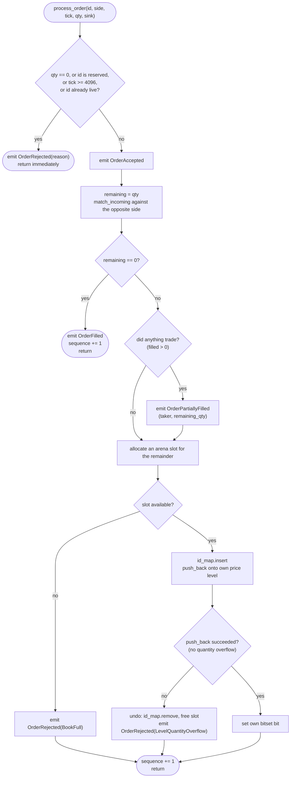

# 6. The Matching Algorithm

Source: [`src/engine.rs`](../src/engine.rs)

This is the chapter where everything comes together. Read chapters 1 to 5 first
if you have not; the data structures they describe are the tools used here.
Code excerpts are lightly condensed (line breaks and comments trimmed, one side
shown where the other mirrors it); the behaviour is identical to the source.

## 6.1 The public API

```rust
let mut engine = Engine::new(order_capacity);          // allocate everything, once
let mut events = Vec::new();                            // any EventSink (chapter 7)

engine.process_order(id, side, tick, qty, &mut events); // submit a limit order
let found = engine.cancel_order(id, &mut events);       // cancel a resting order: bool

engine.best_bid();                 // Option<u32>
engine.best_ask();                 // Option<u32>
engine.depth_at(side, tick);       // u64   total resting qty at one tick
engine.depth_snapshot(side, n);    // Vec<(tick, qty)>  best n levels, best first
engine.live_order_count();         // usize number of resting orders
```

Both mutating methods take the sink as `sink: &mut S` with
`S: EventSink + ?Sized`. Being generic, they are compiled separately for each sink
type, so `emit` is inlined into the matching loop; `?Sized` also allows a
`&mut dyn EventSink` when you prefer one compiled copy.

| Method | Mutates? | Allocates? | Cost |
|---|---|---|---|
| `new(capacity)` | builds | **yes**, once | O(capacity) |
| `process_order` | yes | no (a `Vec` sink may, when it grows) | expected O(1 + number of fills) |
| `cancel_order` | yes | no | O(1) expected |
| `best_bid` / `best_ask` | no | no | O(1), two bit-scans |
| `depth_at` | no | no | O(1) |
| `depth_snapshot` | no | **yes** (`Vec`) | O(ticks scanned); for reporting only |
| `live_order_count` | no | no | O(1) |

## 6.2 `process_order` in four phases



In words:

1. **Validate.** Bad input is rejected before anything changes.
2. **Accept.** Emit `OrderAccepted`.
3. **Match.** Trade against the opposite side while the prices cross.
4. **Rest.** Put any leftover quantity into the book.

### Phases 1 and 2: validation and acceptance

```rust
fn validate(&self, order_id: u64, price_tick: u32, qty: u64) -> Result<(), RejectReason> {
    if qty == 0 {
        Err(RejectReason::ZeroQuantity)
    } else if order_id == crate::hashmap::RESERVED_KEY {
        Err(RejectReason::ReservedOrderId)
    } else if (price_tick as usize) >= MAX_TICKS {
        Err(RejectReason::PriceOutOfRange)
    } else if self.id_map.get(order_id).is_some() {
        Err(RejectReason::DuplicateOrderId)
    } else {
        Ok(())
    }
}

// In process_order:
if let Err(reason) = self.validate(order_id, price_tick, qty) {
    sink.emit(Event::OrderRejected { order_id, reason });
    return;
}
sink.emit(Event::OrderAccepted { order_id });
```

| Check | `RejectReason` | Why |
|---|---|---|
| `qty == 0` | `ZeroQuantity` | An empty order is meaningless. Without the check it would sail through matching with nothing to fill and emit a spurious `OrderAccepted` + `OrderFilled` pair. |
| `order_id == u64::MAX` | `ReservedOrderId` | Reserved as the hash map's "empty" marker (chapter 5). |
| `price_tick >= 4096` | `PriceOutOfRange` | The price ladder only has 4096 ticks; indexing beyond it would be out of bounds. |
| `id_map.get(id).is_some()` | `DuplicateOrderId` | Duplicate id among **live** orders. (An id that has been fully filled or cancelled is gone from the map and may be reused.) |

A validation failure yields **only** `OrderRejected`, with no `OrderAccepted`
before it. The checks run in the order of the table and stop at the first
failure, so an order with two problems (say, zero quantity *and* a bad tick)
always gets the same reason, `ZeroQuantity`. Returning a `Result` from a small
function keeps that order easy to read, and lets the caller handle every
rejection with one `if let`.

### Phase 3: `match_incoming`, choosing the side

```rust
match side {
    Side::Buy  => Self::match_incoming(&mut self.pool, &mut self.ask_levels,
                      &mut self.ask_bitset, &mut self.id_map, order_id, price_tick,
                      &mut remaining, sink, Crossing::TakerBuy),
    Side::Sell => Self::match_incoming(&mut self.pool, &mut self.bid_levels,
                      &mut self.bid_bitset, &mut self.id_map, order_id, price_tick,
                      &mut remaining, sink, Crossing::TakerSell),
}
```

A **buy** taker attacks the **ask** side; a **sell** taker attacks the **bid**
side. The same function serves both. Only two things differ, captured by the
`Crossing` enum:

| | `TakerBuy` | `TakerSell` |
|---|---|---|
| Best opposing price | `bitset.lowest()` (cheapest ask) | `bitset.highest()` (richest bid) |
| Marketable when | `tick <= limit_price` | `tick >= limit_price` |

## 6.3 `match_incoming`, the heart of the engine


There are **two nested loops**:

- The **outer loop walks price levels**, best first.
- The **inner loop walks the FIFO queue at one price**, oldest first.

### Outer loop: pick the best price and check it crosses

```rust
let Some(tick) = (match direction {
    Crossing::TakerBuy  => bitset.lowest(),
    Crossing::TakerSell => bitset.highest(),
}) else { break };                                   // opposite side is empty

let marketable = match direction {
    Crossing::TakerBuy  => tick as u32 <= price_tick,
    Crossing::TakerSell => tick as u32 >= price_tick,
};
if !marketable { break; }
```

The early `break` when the best price is not marketable is a key optimisation and
a correctness argument at once: if the *best* opposing price cannot cross the
limit, **every other opposing price is even worse**, so nothing further can
trade. No scan needed.

### Inner loop: fill against the head of the queue

```rust
let maker_idx       = level.head;                      // oldest order at this tick
let maker_qty       = pool.get(maker_idx).remaining_qty;
let maker_order_id  = pool.get(maker_idx).order_id;
let trade_qty       = (*remaining).min(maker_qty);     // the smaller of the two

sink.emit(Event::Trade { maker_order_id, taker_order_id,
                         price_tick: tick as u32, qty: trade_qty });
*remaining -= trade_qty;

if trade_qty == maker_qty {
    level.remove(pool, maker_idx);          // maker fully consumed
    pool.free(maker_idx);
    id_map.remove(maker_order_id);
    if level.is_empty() {
        bitset.clear(tick);                 // price gone: update the index first...
    }
    sink.emit(Event::OrderFilled { order_id: maker_order_id }); // ...then report
} else {
    level.reduce_qty(pool, maker_idx, trade_qty);   // maker keeps its place
    sink.emit(Event::OrderPartiallyFilled {
        order_id: maker_order_id,
        remaining_qty: maker_qty - trade_qty,
    });
}
```

Three outcomes for each step, depending on `trade_qty = min(taker_left, maker_qty)`:

| Case | Result |
|---|---|
| taker_left **>** maker_qty | Maker is fully filled and removed. The taker loops again. |
| taker_left **<** maker_qty | Taker is fully filled (`remaining` hits 0). Maker stays, reduced. |
| taker_left **==** maker_qty | Both fully filled. |

Note the **trade price is `tick`, the maker's level**, not the taker's limit. That
is how price improvement (chapter 1) falls out for free.

### After the inner loop

```rust
if !levels[tick].is_empty() {
    break;                  // the taker ran out first: nothing more can trade
}
// The level drained; its bit was cleared with its last maker. Loop for the next price.
```

If the level still has orders, the taker must have been exhausted, so we stop. If
the level was drained, control returns to the outer loop, which asks the bitset
for the *next* best price.

> [!NOTE]
> **Why clear the bit inside the inner loop, before reporting the fill?** Clearing
> it after the loop would be just as correct for matching. But the engine hands
> the maker's `OrderFilled` to the caller's sink, which is code the engine does not
> control. The rule is: **only call out to the sink when every structure
> agrees** (invariant 6 in 6.9). With the bit still set, `best_ask()` would report
> a price with nothing left at it. That only becomes visible if a sink panics and
> the panic is caught, but rules like this are what keep "only visible if..."
> bugs out of a codebase. The unit test `panicking_sink_leaves_the_book_consistent`
> pins it down.

## 6.4 Phase 4: resting the remainder

(Excerpt, abridged: the `Sell` arm mirrors the `Buy` arm.)

```rust
match self.pool.allocate(order_id, side, price_tick, remaining, self.sequence) {
    Some(idx) => {
        self.id_map.insert(order_id, idx);
        let rested = match side {
            Side::Buy  => { let ok = self.bid_levels[price_tick as usize].push_back(&mut self.pool, idx);
                            if ok { self.bid_bitset.set(price_tick as usize); } ok }
            Side::Sell => { /* same with ask_levels / ask_bitset */ }
        };
        if !rested {
            self.id_map.remove(order_id);   // roll back
            self.pool.free(idx);
            sink.emit(Event::OrderRejected { order_id, reason: RejectReason::LevelQuantityOverflow });
        }
    }
    None => sink.emit(Event::OrderRejected { order_id, reason: RejectReason::BookFull }),
}
```

Two things can prevent an order from resting, and both produce `OrderRejected`
**after** `OrderAccepted`:

| Cause | `RejectReason` | Why | Cleanup |
|---|---|---|---|
| Arena full (`allocate` returns `None`) | `BookFull` | `order_capacity` resting orders already exist | nothing to undo |
| Level quantity overflow (`push_back` returns `false`) | `LevelQuantityOverflow` | `total_qty` would exceed `u64::MAX` | remove the id from `id_map`, free the slot |

> [!IMPORTANT]
> **In practice, a capacity rejection only happens to an order that did not trade.**
> The source comment says trades already executed are not undone, and the code
> path is written that way defensively. But it cannot be reached:
>
> - *Arena full:* a taker that still has quantity left after trading must have
>   consumed every maker it touched completely, and each fully filled maker
>   **frees a slot**. So `allocate` always succeeds after at least one trade.
> - *Level overflow:* the book is never crossed (see 6.9). If the taker traded,
>   there is no resting order on its own side at that price, so the level is empty
>   and its `total_qty` cannot overflow.
>
> So the reachable rejection sequence is just `[OrderAccepted, OrderRejected]`.
> The differential test in `tests/model_check.rs` checks this on every one of its
> 160,000 random calls, many of them on a 64-order arena that is full most of the
> time: a call that ends in `OrderRejected` after `OrderAccepted` must contain no
> `Trade`. Run it with `cargo test --test model_check`. If you change the engine so
> both can happen, that assertion fails, and consumers must then treat the trades
> as real.

## 6.5 A complete trace

Let's replay step 6 of the [worked example](01-order-book-basics.md#110-a-complete-worked-example)
and watch every data structure change. Start state (capacity 16; see
[chapter 2](02-architecture.md#how-the-pieces-point-at-each-other) for the full
picture):

```text
 asks:  [101] #2(slot1):3 -> #3(slot2):4   total 7        ask_bitset {101, 102}
        [102] #1(slot0):5                  total 5
 bids:  [100] #5(slot4):6                                  bid_bitset {99, 100}
        [ 99] #4(slot3):10
 free stack top -> slot 5, 6, 7, ...
```

**Incoming:** `process_order(6, Buy, tick 102, qty 14)`

| # | What happens | Data structure changes | Event emitted | `remaining` |
|---|---|---|---|---|
| 0 | Validate: qty>0, id≠MAX, 102<4096, id 6 unused. | | `OrderAccepted{6}` | 14 |
| 1 | `ask_bitset.lowest()` = **101**. `101 <= 102` ✓ marketable. | | | 14 |
| 2 | Head of `ask[101]` is slot 1 (`#2`, qty 3). `trade_qty = min(14,3) = 3`. | | `Trade{maker 2, taker 6, 101, 3}` | 11 |
| 3 | 3 == 3, so `#2` is fully filled. | `ask[101]`: head → slot 2, count 1, total 4. `free(slot 1)`. `id_map.remove(2)`. | `OrderFilled{2}` | 11 |
| 4 | Level 101 not empty. Head is slot 2 (`#3`, qty 4). `trade_qty = min(11,4) = 4`. | | `Trade{maker 3, taker 6, 101, 4}` | 7 |
| 5 | 4 == 4, so `#3` is fully filled. The level is now empty, so its bit is cleared before the event is emitted. | `ask[101]` empty (head = tail = NIL, count 0, total 0). `free(slot 2)`. `id_map.remove(3)`. `ask_bitset.clear(101)`, now `{102}`. | `OrderFilled{3}` | 7 |
| 6 | Inner loop ends (level empty, bit already clear). | | | 7 |
| 7 | Outer loop: `lowest()` = **102**. `102 <= 102` ✓. Head of `ask[102]` is slot 0 (`#1`, qty 5). `trade_qty = min(7,5) = 5`. | | `Trade{maker 1, taker 6, 102, 5}` | 2 |
| 8 | 5 == 5, so `#1` is fully filled; its level empties too. | `ask[102]` empty. `free(slot 0)`. `id_map.remove(1)`. `ask_bitset.clear(102)`, now empty. | `OrderFilled{1}` | 2 |
| 9 | Inner loop ends (level empty, bit already clear). | | | 2 |
| 10 | Outer loop: `lowest()` = `None` → stop. | | | 2 |
| 11 | `filled = 14 − 2 = 12 > 0`, `remaining = 2 ≠ 0`. | | `OrderPartiallyFilled{6, remaining 2}` | 2 |
| 12 | Rest the remainder: `allocate` pops the most recently freed slot, **slot 0**. | `id_map.insert(6, 0)`. `bid[102]`: head = tail = slot 0, count 1, total 2. `bid_bitset.set(102)`. `sequence = 6`. | | 2 |

End state:

```text
 asks:  (empty)                                            ask_bitset {}
 bids:  [102] #6(slot0):2                                  bid_bitset {99, 100, 102}
        [100] #5(slot4):6
        [ 99] #4(slot3):10
 best_bid = 102, best_ask = None, live_order_count = 3
```

All of that was O(1) per step, and no memory was allocated.

### More examples (all produced by the real engine)

**Price improvement**: a buy limit of 105 against an ask at 100 trades at 100:

```text
 process_order(1, Sell, 100, 5)
 process_order(2, Buy, 105, 5)   ->  OrderAccepted{2}
                                     Trade{maker 1, taker 2, price_tick 100, qty 5}
                                     OrderFilled{1}
                                     OrderFilled{2}
```

**FIFO within a level** (from the unit test `price_time_priority_within_a_level_is_fifo`):
two asks of 5 at tick 100 (`#1` then `#2`) and a buy of 6. `#1` trades first
(5), then `#2` (1).

## 6.6 `cancel_order`

```rust
pub fn cancel_order<S: EventSink + ?Sized>(&mut self, order_id: u64, sink: &mut S) -> bool {
    let Some(idx) = self.id_map.remove(order_id) else { return false; };
    let order = *self.pool.get(idx);                     // copy it out (Order is Copy)
    match order.side {
        Side::Buy => {
            let level = &mut self.bid_levels[order.price_tick as usize];
            level.remove(&mut self.pool, idx);           // unlink from the FIFO
            if level.is_empty() { self.bid_bitset.clear(order.price_tick as usize); }
        }
        Side::Sell => { /* same on the ask side */ }
    }
    self.pool.free(idx);
    sink.emit(Event::OrderCancelled { order_id });       // every structure agrees by now
    true
}
```

| Step | Structure used | Cost |
|---|---|---|
| Find the order's slot | `id_map.remove(order_id)` | expected O(1) |
| Read side and tick | `pool.get(idx)` | O(1) |
| Unlink from its queue (head, middle or tail) | `PriceLevel::remove` | O(1) |
| Drop the price from the index if now empty | `bitset.clear` | O(1) |
| Recycle the slot | `pool.free` | O(1) |

Cancelling an **unknown** or **already filled** id returns `false` and emits
nothing. It is not an error. (Try cancelling order 4 twice in the worked example:
`true` with `OrderCancelled`, then `false` with no events.)

## 6.7 Edge cases, verified

| Input | Events emitted | Book effect |
|---|---|---|
| `qty = 0` | `[OrderRejected(ZeroQuantity)]` | none |
| `price_tick = 4096` (out of range) | `[OrderRejected(PriceOutOfRange)]` | none |
| `price_tick = 4095` (last valid tick) | `[OrderAccepted]` (if nothing crosses) | rests normally |
| `order_id = u64::MAX` | `[OrderRejected(ReservedOrderId)]` | none |
| Duplicate id of a live order | `[OrderRejected(DuplicateOrderId)]` | none |
| Re-using the id of a filled/cancelled order | handled like any new order | normal |
| Order would rest but arena is full | `[OrderAccepted, OrderRejected(BookFull)]` (never preceded by trades, see 6.4) | nothing rests |
| Order would rest but level quantity would overflow `u64` | `[OrderAccepted, OrderRejected(LevelQuantityOverflow)]` | nothing rests; state unchanged |
| Order fully matches while arena is full | normal fills | needs no slot, so it succeeds |
| `cancel_order` of unknown id | none (returns `false`) | none |

## 6.8 Complexity

- **Phases 1 and 2 (validate, accept):** O(1) expected: one hash lookup.
- **Phase 3 (match):** each loop iteration produces a trade and either removes a
  maker (`O(1)` unlink + free + hash remove) or ends the taker. Moving to the next
  price is a bit-scan, also O(1). Every price level visited yields at least one
  trade, so the total cost is **O(number of fills)**.
- **Phase 4 (rest):** O(1).

Overall: **expected O(1 + fills)** (the "expected" is because the hash map probes;
see chapter 5), which matches the doc comment ("O(1) + O(fills)"). A
taker that doesn't cross the spread costs essentially the same as any other
no-match order, regardless of how many orders are in the book.

## 6.9 Invariants after every call

These always hold between calls, and the last one even during a call. The
differential test in chapter 9 (`tests/model_check.rs`) checks the observable ones
(best prices, depths, live count, exact events) after every request:

1. **The book is never crossed:** `best_bid < best_ask` whenever both exist.
   *Why:* an incoming buy at `p` consumes every ask `≤ p` before resting, so any
   ask left is `> p`; symmetric for sells.
2. **Bit `t` of a side's bitset is set ⇔ that side's `levels[t]` is non-empty.**
3. **Every resting order is in exactly one FIFO queue and has exactly one
   `id_map` entry;** `live_order_count()` counts them.
4. **`level.total_qty` equals the sum of `remaining_qty` of the orders in it.**
5. **Within a queue, arrival order is preserved:** new orders join at the tail, and
   a partially filled maker keeps the head.
6. **The book is consistent whenever the sink runs**, not just between calls.
   Every `emit` happens between complete state changes, which is why a drained
   price leaves the bitset before the last maker's fill is reported (6.3). A sink
   therefore never observes a half-updated book. If a sink panics and the panic is
   caught, the book is still consistent, but that request was only partly applied
   (chapter 7 explains what to do then).

## 6.10 Design notes worth noticing

**One function for both sides.** Instead of duplicating the matching loop for
buys and sells, `match_incoming` takes the opposing side's storage plus a
`Crossing` value. The `match direction` branches are trivially predictable.

**Why `match_incoming` is an associated function, not a `&mut self` method.** It
receives `&mut self.pool`, `&mut self.ask_levels`, `&mut self.ask_bitset` and
`&mut self.id_map` as separate arguments. Rust lets you borrow *disjoint fields*
of a struct mutably at the same time, but not the whole struct plus a field: a
method `fn match_incoming(&mut self, levels: &mut [PriceLevel], ...)` could not be
called with `&mut self.ask_levels`, because `self` is already borrowed as a whole.

A `&mut self` method *would* still be possible: it could start with
`let (levels, bitset) = match direction { ... }` and pick the fields itself,
because borrowing two different fields inside one function body is allowed. The
associated function was chosen because it keeps that choice in the caller and
makes every piece of state the loop touches visible in its signature. The
`#[allow(clippy::too_many_arguments)]` is the price of that clarity.

**The `sequence` counter.** It is incremented once for every order that passes
validation and is copied into the `Order` record if the order rests. The engine
never *reads* it back: time priority comes from the **position in the linked
list**, not from comparing sequence numbers. It is metadata for auditing or
debugging. (It uses `wrapping_add`, so it never panics.)

**`#[inline(always)]` on tiny accessors** (`best_bid`, `best_ask`,
`live_order_count`, the bitset and pool accessors) removes call overhead in the
hot loop.

## 6.11 Try it yourself

Run every engine test, then the differential test that compares the engine with
a deliberately simple reference book over 160,000 random calls:

```sh
cargo test engine::
cargo test --test model_check
```

To watch the trace from 6.5 happen, run the chapter 1 example:

```sh
cargo run --example walkthrough
```

Then break something on purpose. In `match_incoming` in
[`src/engine.rs`](../src/engine.rs), change `Crossing::TakerBuy => tick as u32 <= price_tick`
to `Crossing::TakerBuy => (tick as u32) < price_tick`, so a buy no longer trades
at exactly its limit price. (The parentheses are needed: without them Rust reads
`u32 <` as the start of a generic type such as `u32<...>`.) Predict which tests
fail, run `cargo test`, and see whether you were right. (Undo the change
afterwards.)

**Next:** [7. Events](07-events.md)
