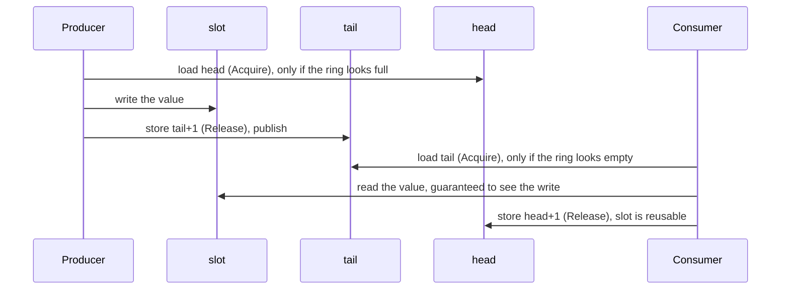

# 8. The Ring Buffer: Feeding the Engine from Another Thread

> **New word?** Every technical term in these chapters is explained in the
> [glossary](glossary.md).

Source: [`src/ringbuffer.rs`](../src/ringbuffer.rs)

The `Engine` is deliberately just a data structure. A real system needs two more
things around it:

1. A way to **feed it requests** from other threads without locks: the
   **ring buffer**, in this chapter.
2. A way to **survive a crash** and reproduce its state: the **write-ahead log**,
   in [chapter 9](09-write-ahead-log.md).

Neither is used *by* the engine; they are independent building blocks.
[Chapter 9](09-write-ahead-log.md#97-putting-it-all-together) ends by wiring all
three together. This is the shape we are building towards:

```text
  ONE gateway thread             matching thread (owns the Engine)              downstream
 +---------------+  SPSC ring   +-----------------------------------+        +------------+
 | parse / check | -----------> | pop -> WAL append -> Engine call  | -----> | publish    |
 | requests      |   buffer     |                                   | events | events     |
 +---------------+              +-----------------------------------+        +------------+
```

(An SPSC queue allows exactly one producer. With several gateway threads you need
either one SPSC queue per gateway, merged by the matching thread, or a
multi-producer queue, which this crate does not provide.)

## 8.1 What problem does it solve?

Requests arrive on network threads, but the `Engine` must be touched by **one**
thread only. We need a queue between them. A `Mutex<VecDeque<_>>` would work, but
locks can block (the thread gets descheduled while holding the lock) and
`VecDeque` may allocate. Both hurt tail latency.

The solution is a **lock-free, fixed-size, single-producer single-consumer
(SPSC) ring buffer**, in the style of the LMAX Disruptor.

- **Single producer**: exactly one thread calls `push`.
- **Single consumer**: exactly one thread calls `pop`.

Restricting ourselves to exactly one of each is what allows such a simple
design, with no compare-and-swap loops and no contention. As 8.5 shows, the API
makes it impossible to break that restriction by accident.

## 8.2 The data structure

A fixed array used as a circle, plus two counters:

```text
   capacity = 8  (power of two),  mask = 7

   slot:    0     1     2     3     4     5     6     7
          +-----+-----+-----+-----+-----+-----+-----+-----+
          |     |     |  C  |  D  |  E  |     |     |     |
          +-----+-----+-----+-----+-----+-----+-----+-----+
                          ^                 ^
                        head = 2          tail = 5
                     (consumer reads)   (producer writes)

   queued items  = tail - head = 3         (C, D, E)
   empty         : head == tail
   full          : tail - head == capacity
```

`spsc_channel` allocates the slots once and returns the two ends of the queue:

```rust
pub fn spsc_channel<T: Copy + Send>(capacity: usize) -> (Producer<T>, Consumer<T>)

/// Storage and cursors shared by the one Producer and the one Consumer.
struct Shared<T> {
    buffer: Box<[UnsafeCell<MaybeUninit<T>>]>,
    mask: usize,
    head: CachePadded<AtomicUsize>,   // consumer cursor: values popped so far
    tail: CachePadded<AtomicUsize>,   // producer cursor: values pushed so far
    producer_dropped: AtomicBool,     // disconnect flags, see 8.5
    consumer_dropped: AtomicBool,
}

pub struct Producer<T> { shared: Arc<Shared<T>>, tail: usize, cached_head: usize }
pub struct Consumer<T> { shared: Arc<Shared<T>>, head: usize, cached_tail: usize }
```

Two small things in this code are explained properly later. `CachePadded<T>` is
a wrapper that gives a value a whole cache line to itself (8.4 explains why that
matters), and `.0` is how you reach the value inside it, as in
`self.shared.head.0`. A **cache line** is the block of memory, usually 64 bytes,
that a CPU core copies into its own cache in one go.

Each handle keeps a private copy of **its own** cursor (only it ever advances
that cursor, so its copy is always exact) and a **cached** copy of the other
side's cursor (8.3 explains why).

The slots are `MaybeUninit<T>`: memory that may or may not hold a value yet.
Slots between `head` and `tail` hold values; the others are uninitialised. No
`Option` tag is needed, because the cursors already say which slots are full.

**The cursors only ever grow** (using wrapping arithmetic on overflow); they are
never reset to zero. The physical slot is `cursor & mask`.

Why grow forever instead of wrapping at `capacity`? With cursors in
`0..capacity` you cannot tell "empty" from "full" (both look like `head == tail`)
without wasting a slot. With ever-increasing cursors the difference `tail − head`
says exactly how many items are queued.

**Wrap-around example** (`capacity = 8`): `head = 6`, `tail = 10`. Four items are
queued in slots `6, 7, 0, 1` (because `6 & 7 = 6`, `7 & 7 = 7`, `8 & 7 = 0`,
`9 & 7 = 1`). The next write goes to slot `10 & 7 = 2`.

Capacity is rounded up to a power of two so `% capacity` becomes `& mask`, the
same trick used by the hash map.

## 8.3 `push` and `pop`

```rust
pub fn push(&mut self, value: T) -> Result<(), T> {
    let capacity = self.capacity();
    if self.tail.wrapping_sub(self.cached_head) >= capacity {
        // Looks full: refresh our copy of the consumer's cursor, then re-check.
        self.cached_head = self.shared.head.0.load(Ordering::Acquire);
        if self.tail.wrapping_sub(self.cached_head) >= capacity {
            return Err(value);                                   // really full
        }
    }
    let slot = &self.shared.buffer[self.tail & self.shared.mask];
    unsafe { slot.get().write(MaybeUninit::new(value)) };        // write the slot
    self.tail = self.tail.wrapping_add(1);
    self.shared.tail.0.store(self.tail, Ordering::Release);      // publish it
    Ok(())
}

pub fn pop(&mut self) -> Option<T> {
    if self.head == self.cached_tail {
        // Looks empty: refresh our copy of the producer's cursor, then re-check.
        self.cached_tail = self.shared.tail.0.load(Ordering::Acquire);
        if self.head == self.cached_tail {
            return None;                                         // really empty
        }
    }
    let slot = &self.shared.buffer[self.head & self.shared.mask];
    let value = unsafe { slot.get().read().assume_init() };      // read the slot
    self.head = self.head.wrapping_add(1);
    self.shared.head.0.store(self.head, Ordering::Release);      // free it
    Some(value)
}
```

`push` returns `Err(value)` when full, handing the value back so the caller can
retry or drop it. Nothing ever blocks or allocates.

**The cached cursors** are a big part of the speed. Reading the other side's
cursor means touching a cache line that the other core keeps writing, which is
expensive. A producer whose `cached_head` still shows free room does not need to
look at `head` at all; it re-reads it only when the ring *looks* full. Likewise
the consumer re-reads `tail` only when the ring looks empty. In the common case
each side touches only its own cache line.

### Why those memory orderings? (plain-language version)

Two threads on different CPU cores do not automatically see each other's memory
writes in the order they happened. **Release/Acquire** pairs fix that:

> Everything a thread wrote **before** a `Release` store is guaranteed to be
> visible to another thread that **`Acquire`-loads the value that store wrote**.



| Access | Ordering | Reason |
|---|---|---|
| Producer reads **its own** `tail` | none: it is a plain field of `Producer` | Only the producer advances it, so its private copy is always exact. |
| Producer reads `head` (when the ring looks full) | `Acquire` | Pairs with the consumer's `Release` store: the producer must not overwrite a slot until the consumer has **finished reading** it. |
| Producer writes `tail` | `Release` | Publishes the slot contents written just before. |
| Consumer reads `tail` (when the ring looks empty) | `Acquire` | Pairs with the producer's `Release`: makes the slot contents visible. |
| Consumer writes `head` | `Release` | Hands the slot back only after the value was read out. |

## 8.4 False sharing and `CachePadded`

```rust
#[repr(align(128))]
struct CachePadded<T>(T);
```

CPUs move memory in **cache lines** (64 bytes on x86 and most ARM cores). If
`head` and `tail` lived in the same line, every time the producer updated `tail`
it would invalidate the line in the consumer's core, and vice versa, even though
they are different variables. That ping-pong is called **false sharing**.

Why align to 128 bytes rather than 64? Modern x86 cores have an *adjacent-line
prefetcher* that pulls cache lines in pairs, so two variables only 64 bytes apart
can still interfere; 128-byte alignment gives each cursor its own pair. (Some
CPUs, such as Apple's M-series, even use 128-byte cache lines.) The price is a
few hundred bytes per queue, which is nothing.

## 8.5 Safety: what the type system enforces

The slots live in `UnsafeCell`s, because two threads write and read different
slots through the one shared `Arc<Shared<T>>`:

```rust
unsafe impl<T: Send> Send for Shared<T> {}
unsafe impl<T: Send> Sync for Shared<T> {}
```

These `unsafe impl`s are the author promising the compiler that sharing is fine
**provided** there is only one writer and one reader. An earlier version of this
crate could not keep that promise: `push` and `pop` took `&self` on one shared
buffer, so nothing stopped two threads from pushing at once, which is a data
race and undefined behaviour. The current API makes that mistake impossible to
write:

- `spsc_channel` returns **one** `Producer` and **one** `Consumer`. Neither
  implements `Clone`, so you cannot make a second producer.
- `push` and `pop` take **`&mut self`**. Even if you wrap a producer in an `Arc`
  and share it, a shared reference (`&Producer`) is not enough to push, and the
  borrow checker allows only one `&mut` at a time.
- Each handle is `Send` (when `T` is), so you can **move** it to its own thread.

The module docs prove the first two points with `compile_fail` doctests:
examples that must *not* compile.

```rust
// Does not compile:
let (producer, _consumer) = spsc_channel::<u64>(4);
let second_producer = producer.clone();   // error[E0599]: no method named `clone`
```

```rust
// Does not compile either:
let (producer, _consumer) = spsc_channel::<u64>(4);
let shared = &producer;
shared.push(1).unwrap();                  // error[E0596]: cannot borrow as mutable
```

`cargo test` checks that each one still fails with exactly that error code. This
is a powerful pattern: encode a usage rule in the types, then test that breaking
the rule does not compile.

Other details:

- `T: Copy`, so a slot can be overwritten without running a destructor, and
  values still queued when the ring is dropped need no cleanup.
- `len()` and `is_empty()` are **snapshots**. On the producer, `len()` combines
  its exact `tail` with a fresh `head`, so the true count can only be *lower* by
  the time you look (the consumer keeps draining); on the consumer it can only be
  *higher*. Use them for metrics or back-pressure hints, and rely on what `push`
  and `pop` return for correctness.

### Telling "nothing yet" from "nothing ever again"

`pop` returning `None` only means "empty right now". If the producer thread has
finished, or has died with a panic, a consumer that keeps spinning would wait
forever. So each handle raises a flag when it is dropped (which also happens when
a panic unwinds its thread):

```rust
impl<T> Drop for Producer<T> {
    fn drop(&mut self) {
        // Release: every value pushed before this point is visible to a
        // consumer that reads the flag with Acquire.
        self.shared.producer_dropped.store(true, Ordering::Release);
    }
}

impl<T: Copy> Consumer<T> {
    pub fn is_disconnected(&self) -> bool {
        // Read the flag first. Its Acquire pairs with the Release in
        // `Drop for Producer`, so the tail loaded next is the final one.
        self.shared.producer_dropped.load(Ordering::Acquire)
            && self.shared.tail.0.load(Ordering::Acquire) == self.head
    }
}
```

`Consumer::is_disconnected()` is `true` only when the producer is gone **and**
every value it pushed has been popped, so acting on it can never lose data. The
order of the two loads matters. Had we read `tail` first, the producer could
push one last value and then drop between our two loads; we would see an empty
ring, then the flag, and wrongly report "disconnected" with a value still queued.
`Producer::is_disconnected()` is the mirror image: it reports that the consumer
was dropped, so anything pushed from now on would never be read.

The idiomatic consumer loop:

```rust
loop {
    match consumer.pop() {
        Some(value) => handle(value),
        None if consumer.is_disconnected() => break, // nothing will ever arrive
        None => std::hint::spin_loop(),              // nothing yet
    }
}
```

The threaded unit test uses the same check to **fail fast**: if its producer
stops early, the consumer's assertion fires instead of the test hanging until
CI's timeout.

## 8.6 Try it yourself

Run the ring buffer's unit tests, including the one that sends values between
two real threads:

```sh
cargo test ringbuffer::
```

The module documentation in [`src/ringbuffer.rs`](../src/ringbuffer.rs) also has
two `compile_fail` examples: code that must **not** compile, because it would
break the single-producer rule. `cargo test` checks that it still fails. Try one
yourself: in [`examples/walkthrough.rs`](../examples/walkthrough.rs), create a
channel with `matching_engine::ringbuffer::spsc_channel::<u64>(8)` and try to
`clone()` the `Producer`. Read the compiler's error message, then remove the line.

**Next:** [9. The write-ahead log](09-write-ahead-log.md)
