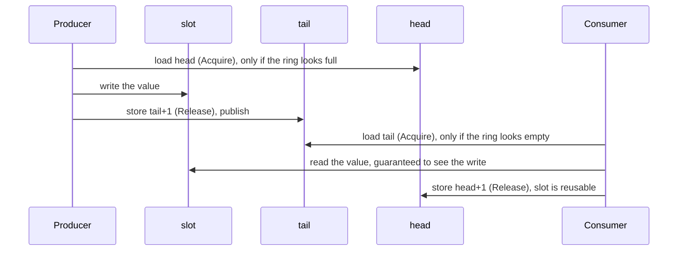
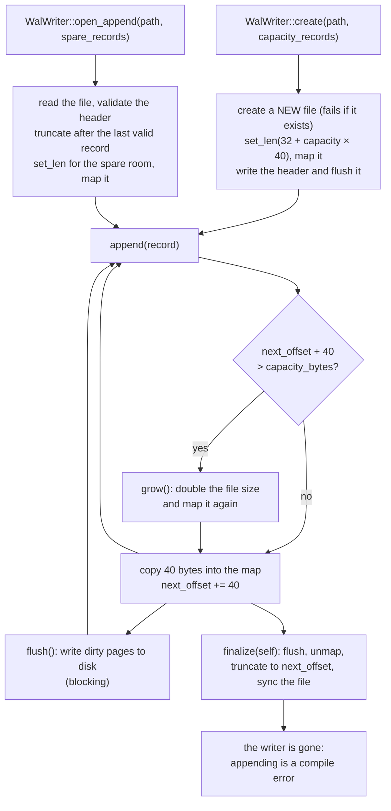

# 8. Around the Engine: Ring Buffer and Write-Ahead Log

> **New word?** Every technical term in these chapters is explained in the
> [glossary](glossary.md).

Sources: [`src/ringbuffer.rs`](../src/ringbuffer.rs), [`src/wal.rs`](../src/wal.rs)

The `Engine` is deliberately just a data structure. A real system needs two more
things around it:

1. A way to **feed it requests** from other threads without locks → the
   **ring buffer**.
2. A way to **survive a crash** and reproduce its state → the **write-ahead log**.

Neither is used *by* the engine; they are independent building blocks. The last
section of this chapter shows how to wire all three together.

```text
  ONE gateway thread             matching thread (owns the Engine)              downstream
 +---------------+  SPSC ring   +-----------------------------------+        +------------+
 | parse / check | -----------> | pop -> WAL append -> Engine call  | -----> | publish    |
 | requests      |   buffer     |                                   | events | events     |
 +---------------+              +-----------------------------------+        +------------+
```

(An SPSC queue allows exactly one producer. With several gateway threads you need
either one SPSC queue per gateway, merged by the matching thread, or a
multi-producer queue, which this crate does not provide.)

---

# Part A: The SPSC ring buffer

## 8.1 What problem does it solve?

Requests arrive on network threads, but the `Engine` must be touched by **one**
thread only. We need a queue between them. A `Mutex<VecDeque<_>>` would work, but
locks can block (the thread gets descheduled while holding the lock) and
`VecDeque` may allocate. Both hurt tail latency.

The solution is a **lock-free, fixed-size, single-producer single-consumer
(SPSC) ring buffer**, in the style of the LMAX Disruptor.

- **Single producer**: exactly one thread calls `push`.
- **Single consumer**: exactly one thread calls `pop`.

Restricting ourselves to exactly one of each is what allows such a simple
design, with no compare-and-swap loops and no contention. As 8.5 shows, the API
makes it impossible to break that restriction by accident.

## 8.2 The data structure

A fixed array used as a circle, plus two counters:

```text
   capacity = 8  (power of two),  mask = 7

   slot:    0     1     2     3     4     5     6     7
          +-----+-----+-----+-----+-----+-----+-----+-----+
          |     |     |  C  |  D  |  E  |     |     |     |
          +-----+-----+-----+-----+-----+-----+-----+-----+
                          ^                 ^
                        head = 2          tail = 5
                     (consumer reads)   (producer writes)

   queued items  = tail - head = 3         (C, D, E)
   empty         : head == tail
   full          : tail - head == capacity
```

`spsc_channel` allocates the slots once and returns the two ends of the queue:

```rust
pub fn spsc_channel<T: Copy + Send>(capacity: usize) -> (Producer<T>, Consumer<T>)

/// Storage and cursors shared by the one Producer and the one Consumer.
struct Shared<T> {
    buffer: Box<[UnsafeCell<MaybeUninit<T>>]>,
    mask: usize,
    head: CachePadded<AtomicUsize>,   // consumer cursor: values popped so far
    tail: CachePadded<AtomicUsize>,   // producer cursor: values pushed so far
    producer_dropped: AtomicBool,     // disconnect flags, see 8.5
    consumer_dropped: AtomicBool,
}

pub struct Producer<T> { shared: Arc<Shared<T>>, tail: usize, cached_head: usize }
pub struct Consumer<T> { shared: Arc<Shared<T>>, head: usize, cached_tail: usize }
```

Each handle keeps a private copy of **its own** cursor (only it ever advances
that cursor, so its copy is always exact) and a **cached** copy of the other
side's cursor (8.3 explains why).

The slots are `MaybeUninit<T>`: memory that may or may not hold a value yet.
Slots between `head` and `tail` hold values; the others are uninitialised. No
`Option` tag is needed, because the cursors already say which slots are full.

**The cursors only ever grow** (using wrapping arithmetic on overflow); they are
never reset to zero. The physical slot is `cursor & mask`.

Why grow forever instead of wrapping at `capacity`? With cursors in
`0..capacity` you cannot tell "empty" from "full" (both look like `head == tail`)
without wasting a slot. With ever-increasing cursors the difference `tail − head`
says exactly how many items are queued.

**Wrap-around example** (`capacity = 8`): `head = 6`, `tail = 10`. Four items are
queued in slots `6, 7, 0, 1` (because `6 & 7 = 6`, `7 & 7 = 7`, `8 & 7 = 0`,
`9 & 7 = 1`). The next write goes to slot `10 & 7 = 2`.

Capacity is rounded up to a power of two so `% capacity` becomes `& mask`, the
same trick used by the hash map.

## 8.3 `push` and `pop`

```rust
pub fn push(&mut self, value: T) -> Result<(), T> {
    let capacity = self.capacity();
    if self.tail.wrapping_sub(self.cached_head) >= capacity {
        // Looks full: refresh our copy of the consumer's cursor, then re-check.
        self.cached_head = self.shared.head.0.load(Ordering::Acquire);
        if self.tail.wrapping_sub(self.cached_head) >= capacity {
            return Err(value);                                   // really full
        }
    }
    let slot = &self.shared.buffer[self.tail & self.shared.mask];
    unsafe { slot.get().write(MaybeUninit::new(value)) };        // write the slot
    self.tail = self.tail.wrapping_add(1);
    self.shared.tail.0.store(self.tail, Ordering::Release);      // publish it
    Ok(())
}

pub fn pop(&mut self) -> Option<T> {
    if self.head == self.cached_tail {
        // Looks empty: refresh our copy of the producer's cursor, then re-check.
        self.cached_tail = self.shared.tail.0.load(Ordering::Acquire);
        if self.head == self.cached_tail {
            return None;                                         // really empty
        }
    }
    let slot = &self.shared.buffer[self.head & self.shared.mask];
    let value = unsafe { slot.get().read().assume_init() };      // read the slot
    self.head = self.head.wrapping_add(1);
    self.shared.head.0.store(self.head, Ordering::Release);      // free it
    Some(value)
}
```

`push` returns `Err(value)` when full, handing the value back so the caller can
retry or drop it. Nothing ever blocks or allocates.

**The cached cursors** are a big part of the speed. Reading the other side's
cursor means touching a cache line that the other core keeps writing, which is
expensive. A producer whose `cached_head` still shows free room does not need to
look at `head` at all; it re-reads it only when the ring *looks* full. Likewise
the consumer re-reads `tail` only when the ring looks empty. In the common case
each side touches only its own cache line.

### Why those memory orderings? (plain-language version)

Two threads on different CPU cores do not automatically see each other's memory
writes in the order they happened. **Release/Acquire** pairs fix that:

> Everything a thread wrote **before** a `Release` store is guaranteed to be
> visible to another thread that **`Acquire`-loads the value that store wrote**.



| Access | Ordering | Reason |
|---|---|---|
| Producer reads **its own** `tail` | none: it is a plain field of `Producer` | Only the producer advances it, so its private copy is always exact. |
| Producer reads `head` (when the ring looks full) | `Acquire` | Pairs with the consumer's `Release` store: the producer must not overwrite a slot until the consumer has **finished reading** it. |
| Producer writes `tail` | `Release` | Publishes the slot contents written just before. |
| Consumer reads `tail` (when the ring looks empty) | `Acquire` | Pairs with the producer's `Release`: makes the slot contents visible. |
| Consumer writes `head` | `Release` | Hands the slot back only after the value was read out. |

## 8.4 False sharing and `CachePadded`

```rust
#[repr(align(128))]
struct CachePadded<T>(T);
```

CPUs move memory in **cache lines** (64 bytes on x86 and most ARM cores). If
`head` and `tail` lived in the same line, every time the producer updated `tail`
it would invalidate the line in the consumer's core, and vice versa, even though
they are different variables. That ping-pong is called **false sharing**.

Why align to 128 bytes rather than 64? Modern x86 cores have an *adjacent-line
prefetcher* that pulls cache lines in pairs, so two variables only 64 bytes apart
can still interfere; 128-byte alignment gives each cursor its own pair. (Some
CPUs, such as Apple's M-series, even use 128-byte cache lines.) The price is a
few hundred bytes per queue, which is nothing.

## 8.5 Safety: what the type system enforces

The slots live in `UnsafeCell`s, because two threads write and read different
slots through the one shared `Arc<Shared<T>>`:

```rust
unsafe impl<T: Send> Send for Shared<T> {}
unsafe impl<T: Send> Sync for Shared<T> {}
```

These `unsafe impl`s are the author promising the compiler that sharing is fine
**provided** there is only one writer and one reader. An earlier version of this
crate could not keep that promise: `push` and `pop` took `&self` on one shared
buffer, so nothing stopped two threads from pushing at once, which is a data
race and undefined behaviour. The current API makes that mistake impossible to
write:

- `spsc_channel` returns **one** `Producer` and **one** `Consumer`. Neither
  implements `Clone`, so you cannot make a second producer.
- `push` and `pop` take **`&mut self`**. Even if you wrap a producer in an `Arc`
  and share it, a shared reference (`&Producer`) is not enough to push, and the
  borrow checker allows only one `&mut` at a time.
- Each handle is `Send` (when `T` is), so you can **move** it to its own thread.

The module docs prove the first two points with `compile_fail` doctests:
examples that must *not* compile.

```rust
// Does not compile:
let (producer, _consumer) = spsc_channel::<u64>(4);
let second_producer = producer.clone();   // error[E0599]: no method named `clone`
```

```rust
// Does not compile either:
let (producer, _consumer) = spsc_channel::<u64>(4);
let shared = &producer;
shared.push(1).unwrap();                  // error[E0596]: cannot borrow as mutable
```

`cargo test` checks that each one still fails with exactly that error code. This
is a powerful pattern: encode a usage rule in the types, then test that breaking
the rule does not compile.

Other details:

- `T: Copy`, so a slot can be overwritten without running a destructor, and
  values still queued when the ring is dropped need no cleanup.
- `len()` and `is_empty()` are **snapshots**. On the producer, `len()` combines
  its exact `tail` with a fresh `head`, so the true count can only be *lower* by
  the time you look (the consumer keeps draining); on the consumer it can only be
  *higher*. Use them for metrics or back-pressure hints, and rely on what `push`
  and `pop` return for correctness.

### Telling "nothing yet" from "nothing ever again"

`pop` returning `None` only means "empty right now". If the producer thread has
finished, or has died with a panic, a consumer that keeps spinning would wait
forever. So each handle raises a flag when it is dropped (which also happens when
a panic unwinds its thread):

```rust
impl<T> Drop for Producer<T> {
    fn drop(&mut self) {
        // Release: every value pushed before this point is visible to a
        // consumer that reads the flag with Acquire.
        self.shared.producer_dropped.store(true, Ordering::Release);
    }
}

impl<T: Copy> Consumer<T> {
    pub fn is_disconnected(&self) -> bool {
        // Read the flag first. Its Acquire pairs with the Release in
        // `Drop for Producer`, so the tail loaded next is the final one.
        self.shared.producer_dropped.load(Ordering::Acquire)
            && self.shared.tail.0.load(Ordering::Acquire) == self.head
    }
}
```

`Consumer::is_disconnected()` is `true` only when the producer is gone **and**
every value it pushed has been popped, so acting on it can never lose data. The
order of the two loads matters. Had we read `tail` first, the producer could
push one last value and then drop between our two loads; we would see an empty
ring, then the flag, and wrongly report "disconnected" with a value still queued.
`Producer::is_disconnected()` is the mirror image: it reports that the consumer
was dropped, so anything pushed from now on would never be read.

The idiomatic consumer loop:

```rust
loop {
    match consumer.pop() {
        Some(value) => handle(value),
        None if consumer.is_disconnected() => break, // nothing will ever arrive
        None => std::hint::spin_loop(),              // nothing yet
    }
}
```

The threaded unit test uses the same check to **fail fast**: if its producer
stops early, the consumer's assertion fires instead of the test hanging until
CI's timeout.

---

# Part B: The write-ahead log (WAL)

## 8.6 Why log at all?

If the process crashes, the order book in memory is gone. How do we get it back?

A neat trick: the engine is **deterministic**. It has no clock, its one source of
randomness (the hash seed, chapter 5) never affects a result, and its state is a
pure function of the requests it has received **and the capacity it was built
with**. So **the same sequence of requests, fed to an engine of the same
capacity, always produces exactly the same book**. Therefore we do not need to
save the book; we only need to save the **requests**, in order, and replay them
into a fresh engine. This is called *event sourcing* (here, *input* sourcing).

```text
   requests:   new(1) new(2) cancel(1) new(3) ...      ---> append to disk, in order
                                                              |
   crash! book lost                                           v
   restart:    Engine::new(capacity)  <-------  read the log, feed each request back in
```

"Write-ahead" means: **log the request first, then apply it.** If we crash right
after logging, replay re-applies the request; if we had applied it first and
crashed before logging, we would lose it.

## 8.7 The record format

A log file is a 32-byte **header** followed by fixed-size, 40-byte **records**.
Every integer is written explicitly in little-endian byte order, so a log is
portable across machines and contains no padding.

The header identifies the file and its format:

| Offset | Size | Field |
|-------:|-----:|---|
| 0 | 8 | magic `b"MEWALOG\0"` |
| 8 | 4 | format version (`1`) |
| 12 | 4 | record size in bytes (`40`) |
| 16 | 16 | reserved, zero |

Each record describes one request:

| Offset | Size | Field |
|-------:|-----:|---|
| 0 | 1 | kind: `1` = new order, `2` = cancel (`0` is never valid) |
| 1 | 1 | side: `0` = buy, `1` = sell (`0` for cancels) |
| 2 | 2 | reserved, zero |
| 4 | 4 | price tick (`0` for cancels) |
| 8 | 8 | order id |
| 16 | 8 | quantity (`0` for cancels) |
| 24 | 8 | caller-provided sequence number |
| 32 | 4 | checksum of bytes `0..32` |
| 36 | 4 | reserved, zero |

In memory a record is an ordinary Rust struct with typed fields; only `encode`
and `decode` know the byte layout:

```rust
pub struct WalRecord {
    pub kind: WalRecordKind,   // NewOrder or Cancel
    pub side: Side,            // Buy for cancels
    pub order_id: u64,
    pub price_tick: u32,       // 0 for cancels
    pub qty: u64,              // 0 for cancels
    pub sequence: u64,         // caller-supplied
}

pub fn encode(&self) -> [u8; WAL_RECORD_SIZE] {
    let mut out = [0u8; WAL_RECORD_SIZE];
    out[0] = self.kind as u8;
    out[1] = match self.side { Side::Buy => 0, Side::Sell => 1 };
    out[4..8].copy_from_slice(&self.price_tick.to_le_bytes());
    out[8..16].copy_from_slice(&self.order_id.to_le_bytes());
    out[16..24].copy_from_slice(&self.qty.to_le_bytes());
    out[24..32].copy_from_slice(&self.sequence.to_le_bytes());
    let checksum = checksum(&out[..CHECKSUMMED_LEN]);
    out[32..36].copy_from_slice(&checksum.to_le_bytes());
    out
}
```

Why spell out every byte instead of copying the struct's memory? An earlier
version did copy the raw `#[repr(C)]` struct, and it is worth knowing what that
cost:

- **Not portable.** The bytes followed the machine's endianness and alignment
  rules, so a log written on one architecture might not replay on another.
- **Uninitialised padding.** The compiler inserted 4 invisible padding bytes into
  the struct. Copying them out read uninitialised memory (undefined behaviour,
  strictly speaking), and two identical requests could produce different bytes.
- **No checksum possible.** A checksum over bytes that include random padding
  is meaningless.

`decode` reverses `encode` and **validates** as it goes, returning a
`WalDecodeError` for an unknown kind (`0` marks space that was never written), an
unknown side, or a **checksum mismatch**. The checksum folds the four 8-byte words
of the record (bytes `0..32`) through the SplitMix64 mixer from chapter 5, then
squeezes the 64-bit result into 32 bits. Some honest limits:

- **It is very likely, not certain, to catch damage.** Two different records can
  share a 32-bit checksum (about a 1 in 4 billion chance for random damage). The
  unit test `decode_rejects_zeroed_and_corrupted_records` flips every single bit
  of bytes `0..36` one at a time and checks that each flip is caught.
- **Bytes `36..40` are not covered.** They are reserved, and `decode` does not
  check that they are zero, so changing them goes unnoticed (the same test pins
  this down).
- **It is not a cryptographic MAC** (message authentication code: a checksum
  that needs a secret key to compute), so anyone who can edit the file can also
  recompute a matching checksum.

Why not the CRC32 you may know from zip files or Ethernet? The standard library
has none, and this crate keeps its dependencies to `memmap2`. A real system would
likely use CRC32C, which many CPUs compute in hardware.

Fixed-size records give two big wins: **appending needs no serialization buffer**
(encode 40 bytes and copy them) and **record *i* starts at byte `32 + i × 40`**,
so you can seek straight to it.

Constructors: `WalRecord::new_order(id, side, tick, qty, sequence)` and
`WalRecord::cancel(id, sequence)` (the unused fields are zeroed).

## 8.8 Memory-mapped files in one minute

Normally, writing to a file means a system call (`write`) per record. A
**memory-mapped file** asks the operating system to make the file's bytes appear
as ordinary memory in your process. Writing to that memory is then a plain
`memcpy`; the OS writes the dirty pages to disk later.

```text
   your process memory                 the OS                    disk
  +---------------------+        +---------------+         +-----------+
  | &mut [u8] (the map) | <----> |  page cache   | ------> | orders.wal|
  +---------------------+  memcpy +---------------+  later  +-----------+
```

This crate uses the `memmap2` crate for it. Appending a record is therefore just:

```rust
let start = self.next_offset;
self.mapping()[start..start + WAL_RECORD_SIZE].copy_from_slice(&record.encode());
self.next_offset += WAL_RECORD_SIZE;
```

Mapping is used **only for appending**, where it pays off. Reading a log for
replay (`read_all`) and scanning it in `open_append` use plain file I/O instead:
both read every byte once anyway, and a copy cannot race a writer the way a
second mapping of the same file could (8.10).

## 8.9 The writer's lifecycle



```text
   file right after create(path, 4):  [ header ][ zero ][ zero ][ zero ][ zero ]   room for 4 records
   after 3 appends:                   [ header ][ rec0 ][ rec1 ][ rec2 ][ zero ]   next_offset = 32 + 3 × 40 = 152
   after the 5th append (grow):       [ header ][ rec0 .. rec4 ][ zero ... ]       file doubled: 192 -> 384 bytes
   after finalize():                  [ header ][ rec0 .. rec4 ]                   32 + 5 × 40 = 232 bytes
```

- **`create` refuses to overwrite.** It opens the file with `create_new`, so an
  existing path fails with `AlreadyExists`. A restart can therefore never erase
  the log it is supposed to replay; use `open_append` to continue one, or delete
  the file on purpose.
- **Pre-sizing** means the common case makes no system call on append (the
  first write to each new page of the map can still cause a page fault).
- **Growth** doubles the file and remaps it. That is a syscall-heavy slow path,
  a latency spike, so pick `capacity_records` large enough for your volume.
- **`flush()` is a blocking durability barrier**, not a hint. `memmap2` calls
  `msync(MS_SYNC)` on Unix, and `FlushViewOfFile` followed by `FlushFileBuffers`
  on Windows, and returns when the OS reports the data written. That is far too
  slow to call after every record; how often to call it (per batch, per
  second...) is your durability policy.
- **`finalize(self)` consumes the writer.** It flushes, **unmaps the file, then
  truncates it** to the bytes actually written, and syncs the file, so the file
  holds exactly the header plus every record. Because it takes `self` by value,
  "append after finalize" is not a runtime error but a **compile error**: the
  same idea as the ring buffer's handles. Dropping a writer runs the same steps
  but has to ignore errors; call `finalize` when you need to see them.
- The order "unmap, then truncate" matters: Windows refuses to shrink a file
  that still has a mapped view open (see the note in 8.11).

## 8.10 Reading and replaying

```rust
pub fn read_all<P: AsRef<Path>>(path: P) -> io::Result<Vec<WalRecord>>
```

reads the whole file, checks the header (wrong magic, version or record size is
`ErrorKind::InvalidData`), then decodes records **until the first one that fails
validation**: the zero-filled preallocated tail a crash leaves behind, a torn
final write, or a partial record. The result is a `Vec` of typed records, so a
replay loop is a plain `match`; there is nothing left to check:

```rust
for record in read_all(&path)? {
    events.clear();
    match record.kind {
        WalRecordKind::NewOrder => engine.process_order(
            record.order_id, record.side, record.price_tick, record.qty, &mut events,
        ),
        WalRecordKind::Cancel => {
            engine.cancel_order(record.order_id, &mut events);
        }
    }
}
```

`read_all` uses plain I/O (`std::fs::read`), not a mapping. That makes it safe to
call even while a writer is appending to the same file: it gets a copy, and at
worst that copy ends in a half-written record, which fails its checksum and ends
the log.

**Restarting after a crash** takes three steps:

1. `read_all` the log and replay it into a fresh `Engine` **of the same
   capacity**.
2. Continue the same log with `open_append`. It stops at the same first invalid
   record that `read_all` did, discards everything after it, and appends from
   there.
3. Only then start accepting new requests.

On the very first start there is no log yet, so a service typically does this:

```rust
let mut wal = match WalWriter::open_append(&path, 16_384) {
    Ok(wal) => wal,                                    // continue the existing log
    Err(e) if e.kind() == io::ErrorKind::NotFound => {
        WalWriter::create(&path, 16_384)?              // first start: a new log
    }
    Err(e) => return Err(e),                           // damaged header: needs a human
};
```

## 8.11 Caveats (read before relying on the WAL)

The log is deliberately small. These are the things it leaves to you:

| Caveat | Consequence |
|---|---|
| `flush()` is blocking and **you** schedule it | Nothing flushes automatically except `finalize`/`Drop`. A *process* crash loses nothing already copied into the map (the OS owns those pages); a power loss or OS crash loses whatever was not flushed. You decide when a request counts as durable. |
| A failed flush is final | After `flush` returns an error, records may be lost even if a later flush succeeds: the OS may already have dropped the pages it could not write (PostgreSQL's "fsyncgate", 2018). Stop accepting requests and recover by replaying. |
| New files on Unix | A new file's directory entry is durable only after the parent directory is synced, which `create` does not do. A power loss soon after creating a log can lose the whole file. |
| A full disk on Linux | `set_len` grows the file *sparsely*. If the disk is full when a page is first written through the mapping, the kernel stops the process with `SIGBUS` instead of `append` returning an error. |
| `create` is not atomic | A crash before the header reaches the disk leaves a file whose header is all zeros. `open_append` and `read_all` then report `InvalidData`; nothing was logged in it, so it can be deleted. |
| `open_append` stops at the first invalid record | Everything after it is treated as an unfinished tail and discarded. That is right after a crash, but it would also drop valid records that follow a corrupted one. |
| One writer per file | `create` refuses an existing file, but nothing stops a second `open_append` on a log that a live writer is using, and that corrupts it (on Linux it truncates the file under the first writer's mapping). |
| Replay needs the **same capacity** | The book depends on the requests *and* on `Engine::new(capacity)`, because capacity decides which orders can rest. The log does not record it. |
| Nothing forces "log first, then apply" | The ordering is the caller's responsibility (Part C does it right). |
| The checksum is not a MAC | It catches torn and zeroed records, not deliberate tampering. |

Several of these make good exercises (chapter 10).

> [!NOTE]
> **Why the writer unmaps before truncating.** Windows refuses to shrink a file
> that still has a mapped view open (OS error 1224, "The requested operation
> cannot be performed on a file with a user-mapped section open"). An early
> version called `set_len` while the map was alive; `Drop` ignored the resulting
> error, so on Windows the file silently kept its zero padding and the old,
> unvalidating reader returned extra all-zero records. Today the writer keeps its
> map in an `Option<MmapMut>`, takes it out and drops it, and only then calls
> `set_len`. A crash (when `finalize` never runs) still leaves the zero padding
> in place, and that is fine: readers stop at the first invalid record.

---

# Part C: Putting it all together

This complete program ties the three components into one pipeline: a gateway
thread, the ring buffer, the WAL, the engine, and finally a replay that rebuilds
an identical book from the log alone. It is the file
[`examples/pipeline.rs`](../examples/pipeline.rs); run it with:

```sh
cargo run --example pipeline
```

CI compiles and runs it on every push, and the test `tests/docs_sync.rs` fails if
the copy below ever differs from the file, so what you read here is exactly what
runs.

```rust
//! The whole pipeline in one program (chapter 8, Part C).
//!
//! A gateway thread pushes requests into an SPSC ring buffer. The matching
//! thread logs each request to the write-ahead log *before* applying it to the
//! engine. Finally a replica engine is rebuilt from the log alone and must end
//! in exactly the same state.
//!
//! Run it with `cargo run --example pipeline`.

use std::thread;

use matching_engine::ringbuffer::spsc_channel;
use matching_engine::wal::{read_all, WalRecord, WalRecordKind, WalWriter};
use matching_engine::{Engine, Event, Side};

/// What the gateway thread sends to the matching thread.
#[derive(Clone, Copy)]
enum Command {
    New {
        id: u64,
        side: Side,
        tick: u32,
        qty: u64,
    },
    Cancel {
        id: u64,
    },
}

/// Applies one logged request. The live run and the replay share this
/// function, so both are guaranteed to make exactly the same engine calls.
fn apply(engine: &mut Engine, record: &WalRecord, events: &mut Vec<Event>) {
    match record.kind {
        WalRecordKind::NewOrder => engine.process_order(
            record.order_id,
            record.side,
            record.price_tick,
            record.qty,
            events,
        ),
        WalRecordKind::Cancel => {
            engine.cancel_order(record.order_id, events);
        }
    }
}

fn main() -> std::io::Result<()> {
    const N: u64 = 10_000;
    let (mut producer, mut consumer) = spsc_channel::<Command>(1024);

    // Gateway: the only producer. `producer` is dropped when the thread
    // ends, which tells the consumer that no more commands will come.
    let gateway = thread::spawn(move || {
        for id in 1..=N {
            let mut cmd = if id % 5 == 0 {
                Command::Cancel { id: id - 1 }
            } else {
                let side = if id % 2 == 0 { Side::Buy } else { Side::Sell };
                Command::New {
                    id,
                    side,
                    tick: 1000 + (id % 7) as u32,
                    qty: 1 + id % 3,
                }
            };
            // `push` hands the value back when the queue is full: retry.
            while let Err(back) = producer.push(cmd) {
                cmd = back;
                std::hint::spin_loop();
            }
        }
    });

    // This demo always starts a fresh log. `WalWriter::create` refuses to
    // overwrite an existing file, so an old one is deleted on purpose.
    let path = std::env::temp_dir().join("matching_engine_pipeline.wal");
    if path.exists() {
        std::fs::remove_file(&path)?;
    }
    let mut wal = WalWriter::create(&path, 16_384)?;
    let mut engine = Engine::new(50_000);
    let mut events = Vec::new(); // one sink, reused for every call
    let mut sequence = 0;
    loop {
        let Some(cmd) = consumer.pop() else {
            if consumer.is_disconnected() {
                break; // the gateway is gone and the queue is drained
            }
            std::hint::spin_loop();
            continue;
        };
        let record = match cmd {
            Command::New {
                id,
                side,
                tick,
                qty,
            } => WalRecord::new_order(id, side, tick, qty, sequence),
            Command::Cancel { id } => WalRecord::cancel(id, sequence),
        };
        sequence += 1;
        // 1. Write-ahead: log the request BEFORE applying it.
        wal.append(record)?;
        // 2. Apply it to the book.
        events.clear();
        apply(&mut engine, &record, &mut events);
        // 3. A real system would publish `events` downstream here.
    }
    gateway.join().expect("gateway thread panicked");
    wal.finalize()?; // flush, trim the preallocated tail, sync

    // Recovery: rebuild the book from the log alone. The replica must use
    // the same capacity, because capacity decides which orders can rest.
    let records = read_all(&path)?;
    assert_eq!(
        records.len() as u64,
        sequence,
        "every logged request is read back"
    );
    let mut replica = Engine::new(50_000);
    for record in &records {
        events.clear();
        apply(&mut replica, record, &mut events);
    }
    std::fs::remove_file(&path)?;

    assert_eq!(engine.live_order_count(), replica.live_order_count());
    for side in [Side::Buy, Side::Sell] {
        assert_eq!(
            engine.depth_snapshot(side, usize::MAX),
            replica.depth_snapshot(side, usize::MAX)
        );
    }
    println!(
        "replayed {sequence} requests: identical book with {} resting orders",
        replica.live_order_count()
    );
    Ok(())
}
```

What it demonstrates:

- **Decoupling:** the gateway never touches the engine; it only pushes commands.
- **Clean shutdown:** when the gateway thread ends, its `Producer` is dropped, and
  the matching loop stops on `is_disconnected()` once the queue is drained. If the
  gateway panicked, the same thing happens and `join` reports the panic, so
  nothing hangs.
- **Ordering:** the WAL append happens *before* the engine call.
- **One code path:** the live run and the replay both go through `apply`, so they
  cannot drift apart.
- **Determinism:** a fresh engine of the same capacity, fed the logged requests,
  ends in exactly the same state. That is what makes the WAL useful for recovery,
  testing, and audits.

## 8.12 Try it yourself

Run the ring buffer and WAL tests, the replay test, and the complete program
from Part C:

```sh
cargo test ringbuffer::
cargo test wal::
cargo test --test wal_replay
cargo run --example pipeline
```

Then simulate a crash. In [`examples/pipeline.rs`](../examples/pipeline.rs), call
`std::process::abort()` inside the matching loop after, say, 5,000 requests, and
run the example. Write a few lines that open the log with `read_all` and count
how many records survived. (Undo the change afterwards: chapter 8 must show the
example exactly as it is in the repository, and `cargo test` checks that.)

**Next:** [9. Testing and performance](09-testing-and-performance.md)
