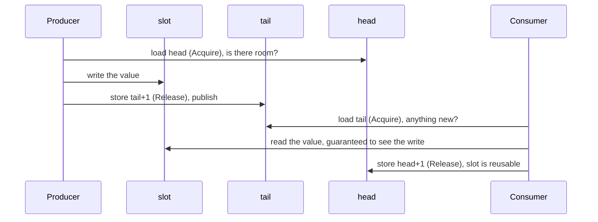
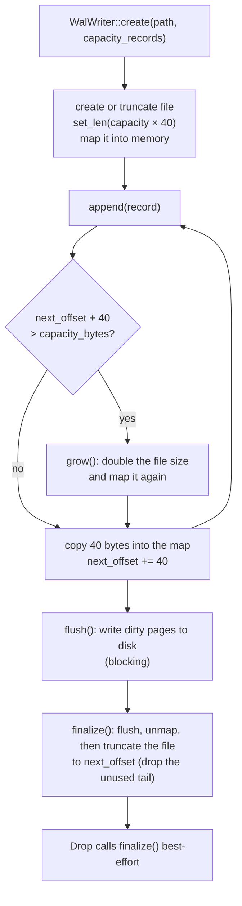

# 8. Around the Engine: Ring Buffer and Write-Ahead Log

Sources: [`src/ringbuffer.rs`](../src/ringbuffer.rs), [`src/wal.rs`](../src/wal.rs)

The `Engine` is deliberately just a data structure. A real system needs two more
things around it:

1. A way to **feed it requests** from other threads without locks → the
   **ring buffer**.
2. A way to **survive a crash** and reproduce its state → the **write-ahead log**.

Neither is used *by* the engine; they are independent building blocks. The last
section of this chapter shows how to wire all three together.

```text
  ONE gateway thread             matching thread (owns the Engine)              downstream
 +---------------+  SPSC ring   +-----------------------------------+        +------------+
 | parse / check | -----------> | pop -> WAL append -> Engine call  | -----> | publish    |
 | requests      |   buffer     |                                   | events | events     |
 +---------------+              +-----------------------------------+        +------------+
```

(An SPSC queue allows exactly one producer. With several gateway threads you need
either one SPSC queue per gateway, merged by the matching thread, or a
multi-producer queue, which this crate does not provide.)

---

# Part A: The SPSC ring buffer

## 8.1 What problem does it solve?

Requests arrive on network threads, but the `Engine` must be touched by **one**
thread only. We need a queue between them. A `Mutex<VecDeque<_>>` would work, but
locks can block (the thread gets descheduled while holding the lock) and
`VecDeque` may allocate. Both hurt tail latency.

The solution is a **lock-free, fixed-size, single-producer single-consumer
(SPSC) ring buffer**, in the style of the LMAX Disruptor.

- **Single producer**: exactly one thread calls `push`.
- **Single consumer**: exactly one thread calls `pop`.

Restricting ourselves to exactly one of each is what allows such a simple
design, with no compare-and-swap loops and no contention.

## 8.2 The data structure

A fixed array used as a circle, plus two counters:

```text
   capacity = 8  (power of two),  mask = 7

   slot:    0     1     2     3     4     5     6     7
          +-----+-----+-----+-----+-----+-----+-----+-----+
          |     |     |  C  |  D  |  E  |     |     |     |
          +-----+-----+-----+-----+-----+-----+-----+-----+
                          ^                 ^
                        head = 2          tail = 5
                     (consumer reads)   (producer writes)

   queued items  = tail - head = 3         (C, D, E)
   empty         : head == tail
   full          : tail - head == capacity
```

```rust
pub struct SpscRingBuffer<T: Copy> {
    buffer: Box<[UnsafeCell<Option<T>>]>,
    mask: usize,
    head: CachePadded<AtomicUsize>,   // consumer cursor: next slot to read
    tail: CachePadded<AtomicUsize>,   // producer cursor: next slot to write
}
```

**The cursors only ever grow** (using wrapping arithmetic on overflow); they are
never reset to zero. The physical slot is `cursor & mask`.

Why grow forever instead of wrapping at `capacity`? With cursors in
`0..capacity` you cannot tell "empty" from "full" (both look like `head == tail`)
without wasting a slot. With ever-increasing cursors the difference `tail − head`
says exactly how many items are queued.

**Wrap-around example** (`capacity = 8`): `head = 6`, `tail = 10`. Four items are
queued in slots `6, 7, 0, 1` (because `6 & 7 = 6`, `7 & 7 = 7`, `8 & 7 = 0`,
`9 & 7 = 1`). The next write goes to slot `10 & 7 = 2`.

Capacity is rounded up to a power of two so `% capacity` becomes `& mask`, the
same trick used by the hash map.

## 8.3 `push` and `pop`

```rust
pub fn push(&self, value: T) -> Result<(), T> {
    let tail = self.tail.0.load(Ordering::Relaxed);          // my own cursor
    let head = self.head.0.load(Ordering::Acquire);          // consumer's progress
    if tail.wrapping_sub(head) >= self.capacity() { return Err(value); }  // full
    let idx = tail & self.mask;
    unsafe { *self.buffer[idx].get() = Some(value); }        // write the slot
    self.tail.0.store(tail.wrapping_add(1), Ordering::Release); // publish it
    Ok(())
}

pub fn pop(&self) -> Option<T> {
    let head = self.head.0.load(Ordering::Relaxed);          // my own cursor
    let tail = self.tail.0.load(Ordering::Acquire);          // producer's progress
    if head == tail { return None; }                         // empty
    let idx = head & self.mask;
    let value = unsafe { (*self.buffer[idx].get()).take() }; // read the slot
    self.head.0.store(head.wrapping_add(1), Ordering::Release); // free it
    value
}
```

`push` returns `Err(value)` when full, handing the value back so the caller can
retry or drop it. Nothing ever blocks or allocates.

### Why those memory orderings? (plain-language version)

Two threads on different CPU cores do not automatically see each other's memory
writes in the order they happened. **Release/Acquire** pairs fix that:

> Everything a thread wrote **before** a `Release` store is guaranteed to be
> visible to another thread that **`Acquire`-loads the value that store wrote**.



| Access | Ordering | Reason |
|---|---|---|
| Producer reads **its own** `tail` | `Relaxed` | Only the producer writes `tail`, so it always sees its latest value. |
| Producer reads `head` | `Acquire` | Pairs with the consumer's `Release` store: the producer must not overwrite a slot until the consumer has **finished reading** it. |
| Producer writes `tail` | `Release` | Publishes the slot contents written just before. |
| Consumer reads `tail` | `Acquire` | Pairs with the producer's `Release`: makes the slot contents visible. |
| Consumer writes `head` | `Release` | Hands the slot back only after the value was taken out. |

## 8.4 False sharing and `CachePadded`

```rust
#[repr(align(64))]
struct CachePadded<T>(T);
```

CPUs move memory in **cache lines** (64 bytes). If `head` and `tail` lived in the
same line, every time the producer updates `tail` it would invalidate the line
in the consumer's core, and vice versa, even though they are different variables.
That ping-pong is called **false sharing**. Aligning each cursor to 64 bytes
puts them on separate lines so each core mostly keeps its own line to itself.

## 8.5 Safety, and what the type system does not enforce

```rust
unsafe impl<T: Copy + Send> Sync for SpscRingBuffer<T> {}
unsafe impl<T: Copy + Send> Send for SpscRingBuffer<T> {}
```

The buffer uses `UnsafeCell` to let two threads write and read different slots
through `&self`. The `unsafe impl`s are the author promising the compiler that
this is fine **provided the SPSC contract holds**: at most one thread calls
`push` and at most one calls `pop`.

> [!WARNING]
> **Rust cannot check that contract.** Both `push` and `pop` take `&self`, and the
> buffer is shared through an `Arc`, so nothing stops you from calling `push`
> from two threads. If you do, two producers can write the same slot and
> corrupt data: undefined behaviour. The module docs say so explicitly. A safer
> API would split the buffer into a `Producer` handle and a `Consumer` handle
> that are each `Send` but not `Clone` (an exercise in chapter 10).

Other details:

- `T: Copy` so slots can be overwritten without running destructors.
- Slots hold `Option<T>`; `pop` uses `.take()` to leave `None` behind.
- `len()` and `is_empty()` are **snapshots**. They are right on the producer or
  consumer thread. From a *third* (monitoring) thread they are approximate, and
  because `len()` loads `tail` before `head`, both cursors can move between the
  two loads and in theory produce a nonsense (wrapped) result. Use them for
  metrics, never for decisions.

---

# Part B: The write-ahead log (WAL)

## 8.6 Why log at all?

If the process crashes, the order book in memory is gone. How do we get it back?

A neat trick: the engine is **deterministic**. It has no clock and no randomness,
and its state is a pure function of the requests it has received (and the
capacity it was built with). So **the same sequence of requests always produces
exactly the same book**. Therefore we do not need to save the book; we only need to save the
**requests**, in order, and replay them into a fresh engine. This is called
*event sourcing* (here, *input* sourcing).

```text
   requests:   new(1) new(2) cancel(1) new(3) ...      ---> append to disk, in order
                                                              |
   crash! book lost                                           v
   restart:    Engine::new()  <----------  read the log, feed each request back in
```

"Write-ahead" means: **log the request first, then apply it.** If we crash right
after logging, replay re-applies the request; if we had applied it first and
crashed before logging, we would lose it.

## 8.7 The record format

Every request is one fixed-size, 40-byte record:

```rust
#[repr(C)]
pub struct WalRecord {
    pub kind: u8,          // 1 = NewOrder, 2 = Cancel   (0 is never valid)
    pub side: u8,          // 0 = Buy, 1 = Sell          (new orders only)
    pub _padding: [u8; 6], // keeps order_id aligned to 8 bytes
    pub order_id: u64,
    pub price_tick: u32,   // new orders only
    pub qty: u64,          // new orders only
    pub sequence: u64,     // caller-supplied sequence number
}
```

Measured byte layout (`offset_of!`):

```text
 byte   0    1    2              8              16        20      24             32             40
        +----+----+--------------+--------------+---------+-------+--------------+--------------+
        |kind|side|  _padding    |   order_id   |  tick   | (pad) |     qty      |   sequence   |
        | u8 | u8 |   6 bytes    |     u64      |   u32   | 4 B   |     u64      |     u64      |
        +----+----+--------------+--------------+---------+-------+--------------+--------------+
        WAL_RECORD_SIZE = 40
```

(40 bytes is the size on typical 64-bit targets. The constant is computed with
`size_of::<WalRecord>()`, so on a 32-bit target where `u64` is 4-byte aligned it
comes out smaller, another reason a log is not portable between machines.)

> [!WARNING]
> **The 4 bytes marked `(pad)` (bytes 20 to 23) are never written by any
> constructor.** Unlike `_padding`, which is an explicit, zeroed field, they are
> *implicit* padding that the compiler inserts to align `qty`. `to_bytes` copies
> the whole struct with `transmute_copy`, so whatever happens to be in that
> padding is written to the log. Two consequences: the log bytes for identical
> requests can differ, and strictly speaking reading uninitialised padding is
> undefined behaviour (the "sound" comment in the source is not quite right). It
> is harmless in practice today, but it would break any checksum over raw record
> bytes (exercise 16). Making the padding an explicit zeroed field fixes it.

Fixed-size records give two big wins: **appending needs no serialization step**
(just copy 40 bytes) and **record *i* is at byte `i × 40`**, so you can seek
straight to it.

Constructors: `WalRecord::new_order(id, side, tick, qty, sequence)` and
`WalRecord::cancel(id, sequence)` (the unused fields are zeroed).

## 8.8 Memory-mapped files in one minute

Normally, writing to a file means a system call (`write`) per record. A
**memory-mapped file** asks the operating system to make the file's bytes appear
as ordinary memory in your process. Writing to that memory is then a plain
`memcpy`; the OS writes the dirty pages to disk later.

```text
   your process memory                 the OS                    disk
  +---------------------+        +---------------+         +-----------+
  | &mut [u8] (the map) | <----> |  page cache   | ------> | orders.wal|
  +---------------------+  memcpy +---------------+  later  +-----------+
```

This crate uses the `memmap2` crate for it. Appending a record is therefore just:

```rust
self.mmap[self.next_offset..self.next_offset + WAL_RECORD_SIZE].copy_from_slice(&bytes);
self.next_offset += WAL_RECORD_SIZE;
```

## 8.9 The writer's lifecycle



```text
   file right after create(path, 4):    [ zero ][ zero ][ zero ][ zero ]     capacity = 4 records
   after 3 appends:                      [ rec0 ][ rec1 ][ rec2 ][ zero ]     next_offset = 120
   after the 5th append (grow):          [ rec0..rec4 ][ zero ][ zero ][ zero ]   capacity = 8 records
   after finalize():                     [ rec0..rec4 ]                       next_offset = 200
```

- **Pre-sizing** (`create`) means the common case makes no system call on append
  (the first write to each new page of the map can still cause a page fault).
- **Growth** doubles the file and remaps it. That is a syscall-heavy slow path, a
  latency spike, so pick `capacity_records` large enough for your expected volume.
- `flush()` is a **blocking** durability barrier, not a hint. In the `memmap2`
  version this crate uses it calls `msync(MS_SYNC)` on Unix, and
  `FlushViewOfFile` followed by `FlushFileBuffers` on Windows, and returns when
  the OS reports the data written. That is far too slow to call after every
  record; how often to call it (per batch, per second...) is your durability
  policy. (`memmap2` also has a non-blocking `flush_async`, but `WalWriter` does
  not expose it.)
- `finalize()` flushes, **unmaps the file, and then truncates it to the bytes
  actually written**, so the file contains only real records. The order matters:
  Windows refuses to shrink a file that still has a mapped view open (OS error
  1224), so the writer holds its map as an `Option<MmapMut>` and drops it before
  calling `set_len`. `finalize` ends the writer's life: a later `append` or
  `flush` returns an `io::Error` rather than re-mapping the file. Calling
  `finalize` again is harmless.

## 8.10 Reading and replaying

```rust
pub fn read_all<P: AsRef<Path>>(path: P) -> io::Result<Vec<WalRecord>>
```

maps the file, cuts it into 40-byte pieces, and decodes each by copying the bytes
into a `WalRecord`. A partial trailing record is ignored. **It does not validate
anything**: `kind` could be 0 or 99, `side` could be 7.

Because the file is pre-sized and may end with zero padding (see the caveats),
a replay loop should **stop at the first record with `kind == 0`**:

```rust
const NEW_ORDER: u8 = WalRecordKind::NewOrder as u8;
const CANCEL: u8 = WalRecordKind::Cancel as u8;

for rec in read_all(&path)? {
    match rec.kind {
        NEW_ORDER => {
            let side = if rec.side == 0 { Side::Buy } else { Side::Sell };
            engine.process_order(rec.order_id, side, rec.price_tick, rec.qty);
        }
        CANCEL => { engine.cancel_order(rec.order_id); }
        _ => break,   // kind 0 = unwritten padding; anything else = corrupt, stop
    }
}
```

## 8.11 Caveats (read before relying on the WAL)

The module docs call the format "compact and implementation-specific". Concretely:

| Caveat | Consequence |
|---|---|
| Raw `repr(C)` bytes, **native endianness** | A log written on one architecture may not replay on another. |
| **No header, version or checksum** | A torn or corrupted record is indistinguishable from a good one; you cannot detect format changes. |
| File is **pre-sized with zeros** | After a crash (when `finalize` never ran) the file ends in zero records. Replay must stop at `kind == 0`. |
| `flush()` is blocking and you must schedule it | Nothing flushes automatically except `finalize`/`Drop`. If only your *process* crashes, everything already copied into the map survives (the OS owns those pages). A power loss or OS crash loses whatever was not flushed. You decide when a request counts as "durable". |
| **`WalWriter::create` truncates an existing file** | There is no open-for-append API. After a crash, calling `create` on the old path **erases the log you meant to replay**. Replay with `read_all` first, then write a new log. |
| `append` / `flush` after `finalize` fail | `finalize` unmaps the file, so the writer is closed: `append` and `flush` return an `io::Error` ("WAL writer is already finalized") instead of re-mapping. Treat `finalize` as the last call; `len()` and `is_empty()` still work. |
| Implicit padding bytes are uninitialised | See the warning in 8.7. |
| Nothing forces "log first, then apply" | The ordering is the caller's responsibility (the example below does it right). |

> [!NOTE]
> **Why `finalize()` unmaps before truncating.** Windows refuses to shrink a file
> that still has a mapped view open (OS error 1224, "The requested operation
> cannot be performed on a file with a user-mapped section open"). An earlier
> version called `set_len` while the map was alive; `Drop` ignored the resulting
> error (`let _ = self.finalize()`), so on Windows the file silently kept its zero
> padding and `read_all` returned extra all-zero records (for example 16 instead
> of 10 after 10 appends to a WAL created with capacity 4). `finalize` now drops
> the map first, so the file is truncated on every platform and the padding only
> remains after a crash, when `finalize` never ran.
>
> That is why the zero-stopping replay loop in 8.10 stays: it is what makes
> recovery correct after a crash. Call `finalize()` yourself if you need to
> observe a truncation error; `Drop` still swallows it.

---

# Part C: Putting it all together

This complete program ties the three components into one pipeline: a producer
thread, the ring buffer, the WAL, the engine, and finally a replay that rebuilds
an identical book from the log. (It was compiled and run against this crate.)

```rust
use std::sync::Arc;
use std::thread;

use matching_engine::ringbuffer::SpscRingBuffer;
use matching_engine::wal::{read_all, WalRecord, WalRecordKind, WalWriter};
use matching_engine::{Engine, Side};

/// What the gateway thread sends to the matching thread.
#[derive(Clone, Copy)]
enum Command {
    New { id: u64, side: Side, tick: u32, qty: u64 },
    Cancel { id: u64 },
}

fn main() -> std::io::Result<()> {
    const N: u64 = 10_000;
    let queue = Arc::new(SpscRingBuffer::<Command>::new(1024));

    // Producer: pretend to be a network gateway.
    let producer = {
        let queue = Arc::clone(&queue);
        thread::spawn(move || {
            for id in 1..=N {
                let mut cmd = if id % 5 == 0 {
                    Command::Cancel { id: id - 1 }
                } else {
                    let side = if id % 2 == 0 { Side::Buy } else { Side::Sell };
                    Command::New { id, side, tick: 1000 + (id % 7) as u32, qty: 1 + id % 3 }
                };
                // push hands the value back when the queue is full: retry.
                while let Err(back) = queue.push(cmd) {
                    cmd = back;
                    std::hint::spin_loop();
                }
            }
        })
    };

    // Consumer: the single matching thread.
    let path = std::env::temp_dir().join("orders.wal");
    let mut wal = WalWriter::create(&path, 16_384)?;
    let mut engine = Engine::new(50_000);
    for seq in 0..N {
        let cmd = loop {
            match queue.pop() {
                Some(cmd) => break cmd,
                None => std::hint::spin_loop(),
            }
        };
        // 1. Write-ahead: log the request BEFORE applying it.
        wal.append(match cmd {
            Command::New { id, side, tick, qty } => WalRecord::new_order(id, side, tick, qty, seq),
            Command::Cancel { id } => WalRecord::cancel(id, seq),
        })?;
        // 2. Apply it to the book.
        let _events = match cmd {
            Command::New { id, side, tick, qty } => engine.process_order(id, side, tick, qty),
            Command::Cancel { id } => engine.cancel_order(id).1,
        };
        // 3. A real system would publish `_events` to downstream consumers here.
    }
    producer.join().unwrap();
    wal.flush()?;

    // Recovery: rebuild an identical engine from the log alone.
    const NEW_ORDER: u8 = WalRecordKind::NewOrder as u8;
    const CANCEL: u8 = WalRecordKind::Cancel as u8;
    let mut replica = Engine::new(50_000);
    for rec in read_all(&path)? {
        match rec.kind {
            NEW_ORDER => {
                let side = if rec.side == 0 { Side::Buy } else { Side::Sell };
                replica.process_order(rec.order_id, side, rec.price_tick, rec.qty);
            }
            CANCEL => {
                replica.cancel_order(rec.order_id);
            }
            _ => break, // zero padding after the last real record
        }
    }

    assert_eq!(engine.live_order_count(), replica.live_order_count());
    assert_eq!(engine.depth_snapshot(Side::Buy, 100), replica.depth_snapshot(Side::Buy, 100));
    assert_eq!(engine.depth_snapshot(Side::Sell, 100), replica.depth_snapshot(Side::Sell, 100));
    println!("replayed book is identical: {} resting orders", replica.live_order_count());
    Ok(())
}
```

What it demonstrates:

- **Decoupling:** the producer never touches the engine; it only pushes commands.
- **Ordering:** the WAL append happens *before* the engine call.
- **Determinism:** a fresh engine fed the logged requests ends in exactly the same
  state, which is what makes the WAL useful for recovery, testing, and audits.

**Next:** [9. Testing and performance](09-testing-and-performance.md)
