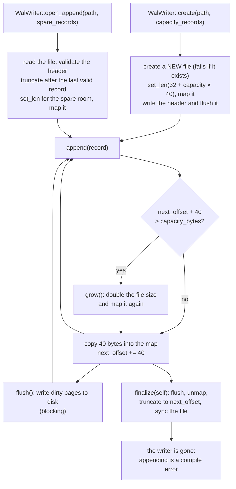

# 9. The Write-Ahead Log, and Putting It All Together

> **New word?** Every technical term in these chapters is explained in the
> [glossary](glossary.md).

Sources: [`src/wal.rs`](../src/wal.rs), [`examples/pipeline.rs`](../examples/pipeline.rs)

[Chapter 8](08-ring-buffer.md) built the queue that feeds the engine. This
chapter adds the second building block, the **write-ahead log**, which lets a
crashed engine rebuild its book (9.1 to 9.6). Then 9.7 wires the ring buffer, the
log and the engine into one complete program.

## 9.1 Why log at all?

If the process crashes, the order book in memory is gone. How do we get it back?

A neat trick: the engine is **deterministic**. It has no clock, its one source of
randomness (the hash seed, chapter 5) never affects a result, and its state is a
pure function of the requests it has received **and the capacity it was built
with**. So **the same sequence of requests, fed to an engine of the same
capacity, always produces exactly the same book**. Therefore we do not need to
save the book; we only need to save the **requests**, in order, and replay them
into a fresh engine. This is called *event sourcing* (here, *input* sourcing).

```text
   requests:   new(1) new(2) cancel(1) new(3) ...      ---> append to disk, in order
                                                              |
   crash! book lost                                           v
   restart:    Engine::new(capacity)  <-------  read the log, feed each request back in
```

"Write-ahead" means: **log the request first, then apply it.** If we crash right
after logging, replay re-applies the request; if we had applied it first and
crashed before logging, we would lose it.

## 9.2 The record format

A log file is a 32-byte **header** followed by fixed-size, 40-byte **records**.
Every integer is written explicitly in little-endian byte order, so a log is
portable across machines and contains no padding.

The header identifies the file and its format:

| Offset | Size | Field |
|-------:|-----:|---|
| 0 | 8 | magic `b"MEWALOG\0"` |
| 8 | 4 | format version (`1`) |
| 12 | 4 | record size in bytes (`40`) |
| 16 | 16 | reserved, zero |

Each record describes one request:

| Offset | Size | Field |
|-------:|-----:|---|
| 0 | 1 | kind: `1` = new order, `2` = cancel (`0` is never valid) |
| 1 | 1 | side: `0` = buy, `1` = sell (`0` for cancels) |
| 2 | 2 | reserved, zero |
| 4 | 4 | price tick (`0` for cancels) |
| 8 | 8 | order id |
| 16 | 8 | quantity (`0` for cancels) |
| 24 | 8 | caller-provided sequence number |
| 32 | 4 | checksum of bytes `0..32` |
| 36 | 4 | reserved, zero |

Here are the 40 real bytes that `encode` produces for
`WalRecord::new_order(6, Side::Buy, 102, 14, 5)`, which is order `#6` from the
worked example, logged as the sixth request (sequence 5). Each row is 8 bytes,
written in hexadecimal:

```text
 offset  bytes                     meaning
 ------  ------------------------  ---------------------------------------------
   0     01 00 00 00 66 00 00 00   kind 1 (new order), side 0 (buy), 2 reserved,
                                   price tick 0x66 = 102
   8     06 00 00 00 00 00 00 00   order id 6
  16     0e 00 00 00 00 00 00 00   quantity 0x0e = 14
  24     05 00 00 00 00 00 00 00   sequence 5
  32     16 08 01 21 00 00 00 00   checksum 0x21010816, then 4 reserved bytes
```

**Little-endian** means the *lowest* byte comes first. That is why the price 102
(`0x00000066`) is stored as `66 00 00 00`, and why the checksum `16 08 01 21` is
read backwards as `0x21010816`. Writing every field this way, instead of copying
the struct's memory, is what makes the bytes identical on every machine.

In memory a record is an ordinary Rust struct with typed fields; only `encode`
and `decode` know the byte layout:

```rust
pub struct WalRecord {
    pub kind: WalRecordKind,   // NewOrder or Cancel
    pub side: Side,            // Buy for cancels
    pub order_id: u64,
    pub price_tick: u32,       // 0 for cancels
    pub qty: u64,              // 0 for cancels
    pub sequence: u64,         // caller-supplied
}

pub fn encode(&self) -> [u8; WAL_RECORD_SIZE] {
    let mut out = [0u8; WAL_RECORD_SIZE];
    out[0] = self.kind as u8;
    out[1] = match self.side { Side::Buy => 0, Side::Sell => 1 };
    out[4..8].copy_from_slice(&self.price_tick.to_le_bytes());
    out[8..16].copy_from_slice(&self.order_id.to_le_bytes());
    out[16..24].copy_from_slice(&self.qty.to_le_bytes());
    out[24..32].copy_from_slice(&self.sequence.to_le_bytes());
    let checksum = checksum(&out[..CHECKSUMMED_LEN]);
    out[32..36].copy_from_slice(&checksum.to_le_bytes());
    out
}
```

Why spell out every byte instead of copying the struct's memory? An earlier
version did copy the raw `#[repr(C)]` struct, and it is worth knowing what that
cost:

- **Not portable.** The bytes followed the machine's endianness and alignment
  rules, so a log written on one architecture might not replay on another.
- **Uninitialised padding.** The compiler inserted 4 invisible padding bytes into
  the struct. Copying them out read uninitialised memory (undefined behaviour,
  strictly speaking), and two identical requests could produce different bytes.
- **No checksum possible.** A checksum over bytes that include random padding
  is meaningless.

`decode` reverses `encode` and **validates** as it goes, returning a
`WalDecodeError` for an unknown kind (`0` marks space that was never written), an
unknown side, or a **checksum mismatch**. The checksum folds the four 8-byte words
of the record (bytes `0..32`) through the SplitMix64 mixer from chapter 5, then
squeezes the 64-bit result into 32 bits. Some honest limits:

- **It is very likely, not certain, to catch damage.** Two different records can
  share a 32-bit checksum (about a 1 in 4 billion chance for random damage). The
  unit test `decode_rejects_zeroed_and_corrupted_records` flips every single bit
  of bytes `0..36` one at a time and checks that each flip is caught.
- **Bytes `36..40` are not covered.** They are reserved, and `decode` does not
  check that they are zero, so changing them goes unnoticed (the same test pins
  this down).
- **It is not a cryptographic MAC** (message authentication code: a checksum
  that needs a secret key to compute), so anyone who can edit the file can also
  recompute a matching checksum.

Why not the CRC32 you may know from zip files or Ethernet? The standard library
has none, and this crate keeps its dependencies to `memmap2`. A real system would
likely use CRC32C, which many CPUs compute in hardware.

Fixed-size records give two big wins: **appending needs no serialization buffer**
(encode 40 bytes and copy them) and **record *i* starts at byte `32 + i × 40`**,
so you can seek straight to it.

Constructors: `WalRecord::new_order(id, side, tick, qty, sequence)` and
`WalRecord::cancel(id, sequence)` (the unused fields are zeroed).

**What is `sequence` for?** The engine never looks at it; it is a number *you*
choose, normally 0, 1, 2, ... in the order requests are logged (the program in 9.7
does exactly that). It is not the engine's own `sequence` counter from chapter 6.
Because it goes up by one per record, it lets you:

- **detect gaps**: if record 41 is followed by record 43, something is missing
  or damaged (exercise 20 in [chapter 11](11-limitations-and-exercises.md) builds
  on this);
- **name a request** outside the log, for example to remember "events have been
  published up to request 41" (see *What about the events?* in 9.5).

## 9.3 Memory-mapped files in one minute

Normally, writing to a file means a system call (`write`) per record. A
**memory-mapped file** asks the operating system to make the file's bytes appear
as ordinary memory in your process. Writing to that memory is then a plain
`memcpy`; the OS writes the dirty pages to disk later.

```text
   your process memory                 the OS                    disk
  +---------------------+        +---------------+         +-----------+
  | &mut [u8] (the map) | <----> |  page cache   | ------> | orders.wal|
  +---------------------+  memcpy +---------------+  later  +-----------+
```

This crate uses the `memmap2` crate for it. Appending a record is therefore just:

```rust
let start = self.next_offset;
self.mapping()[start..start + WAL_RECORD_SIZE].copy_from_slice(&record.encode());
self.next_offset += WAL_RECORD_SIZE;
```

Mapping is used **only for appending**, where it pays off. Reading a log for
replay (`read_all`) and scanning it in `open_append` use plain file I/O instead:
both read every byte once anyway, and a copy cannot race a writer the way a
second mapping of the same file could (9.5).

## 9.4 The writer's lifecycle



```text
   file right after create(path, 4):  [ header ][ zero ][ zero ][ zero ][ zero ]   room for 4 records
   after 3 appends:                   [ header ][ rec0 ][ rec1 ][ rec2 ][ zero ]   next_offset = 32 + 3 × 40 = 152
   after the 5th append (grow):       [ header ][ rec0 .. rec4 ][ zero ... ]       file doubled: 192 -> 384 bytes
   after finalize():                  [ header ][ rec0 .. rec4 ]                   32 + 5 × 40 = 232 bytes
```

- **`create` refuses to overwrite.** It opens the file with `create_new`, so an
  existing path fails with `AlreadyExists`. A restart can therefore never erase
  the log it is supposed to replay; use `open_append` to continue one, or delete
  the file on purpose.
- **Pre-sizing** means the common case makes no system call on append (the
  first write to each new page of the map can still cause a page fault).
- **Growth** doubles the file and remaps it. That is a syscall-heavy slow path,
  a latency spike, so pick `capacity_records` large enough for your volume.
- **`flush()` is a blocking durability barrier**, not a hint. `memmap2` calls
  `msync(MS_SYNC)` on Unix, and `FlushViewOfFile` followed by `FlushFileBuffers`
  on Windows, and returns when the OS reports the data written. That is far too
  slow to call after every record; how often to call it (per batch, per
  second...) is your durability policy.
- **`finalize(self)` consumes the writer.** It flushes, **unmaps the file, then
  truncates it** to the bytes actually written, and syncs the file, so the file
  holds exactly the header plus every record. Because it takes `self` by value,
  "append after finalize" is not a runtime error but a **compile error**: the
  same idea as the ring buffer's handles. Dropping a writer runs the same steps
  but has to ignore errors; call `finalize` when you need to see them.
- The order "unmap, then truncate" matters: Windows refuses to shrink a file
  that still has a mapped view open (see the note in 9.6).

## 9.5 Reading and replaying

```rust
pub fn read_all<P: AsRef<Path>>(path: P) -> io::Result<Vec<WalRecord>>
```

reads the whole file, checks the header (wrong magic, version or record size is
`ErrorKind::InvalidData`), then decodes records **until the first one that fails
validation**: the zero-filled preallocated tail a crash leaves behind, a torn
final write, or a partial record. The result is a `Vec` of typed records, so a
replay loop is a plain `match`; there is nothing left to check:

```rust
for record in read_all(&path)? {
    events.clear();
    match record.kind {
        WalRecordKind::NewOrder => engine.process_order(
            record.order_id, record.side, record.price_tick, record.qty, &mut events,
        ),
        WalRecordKind::Cancel => {
            engine.cancel_order(record.order_id, &mut events);
        }
    }
}
```

`read_all` uses plain I/O (`std::fs::read`), not a mapping. That makes it safe to
call even while a writer is appending to the same file: it gets a copy, and at
worst that copy ends in a half-written record, which fails its checksum and ends
the log.

**Restarting after a crash** takes three steps:

1. `read_all` the log and replay it into a fresh `Engine` **of the same
   capacity**.
2. Continue the same log with `open_append`. It stops at the same first invalid
   record that `read_all` did, discards everything after it, and appends from
   there.
3. Only then start accepting new requests.

Here is what the file looks like at each step, for a writer that crashed while
writing its fourth record:

```text
 after the crash:
   [ header ][ rec 0 ][ rec 1 ][ rec 2 ][ rec 3: torn ][ 00 00 00 ... preallocated, never written ]
                                         ^ checksum fails

 read_all:      header OK, rec 0, rec 1, rec 2 are valid; rec 3 fails -> stop.
                Returns 3 records; replay them into Engine::new(same capacity).

 open_append:   finds the same first invalid record, cuts the file there,
                and grows it again with fresh zeros:
   [ header ][ rec 0 ][ rec 1 ][ rec 2 ][ 00 00 00 ... room for new records ]
                                         ^ the next append writes here
```

The torn record is lost. If the crash interrupted that very append, losing it is
correct: the log is written *ahead*, so the request had not been applied to the
engine yet. After a power loss, though, the lost tail can also hold requests that
*were* applied but not yet flushed to disk; 9.6 explains how `flush` decides
that. The test
`open_append_resumes_after_the_last_valid_record` builds the same situation (a torn
record with stale data after it) and checks that only the valid records survive.

### What about the events?

The log stores **requests**, not events. Replaying it makes the engine emit every
event again: every trade, every fill, from the very first request. That is
useful, and also a trap:

- **Duplicates.** If downstream systems (market data, trade confirmations) already
  received those events before the crash, sending them again would report each
  trade twice. A replay must therefore *not* publish its events, or downstream
  must recognise and ignore repeats.
- **Gaps.** The matching loop logs a request, applies it, and *then* publishes its
  events. A crash between those steps leaves a request that is in the log but
  whose events never left the process.

The usual fix uses the WAL `sequence` number from 9.2. Downstream remembers the
sequence of the last request whose events it has fully processed, say 41. On
restart, the replay throws away the events of requests 0 to 41 and publishes the
events of requests 42 onwards. Because the engine is deterministic, those are
exactly the events the crashed process would have published, down to the
`trade_id` of every trade ([7.2](07-events.md#72-ordering-rules)): a consumer that
only cares about trades can simply skip every `trade_id` it has already seen. This
repository leaves that bookkeeping to you; the program in 9.7 does not publish
events at all.

On the very first start there is no log yet, so a service typically does this:

```rust
let mut wal = match WalWriter::open_append(&path, 16_384) {
    Ok(wal) => wal,                                    // continue the existing log
    Err(e) if e.kind() == io::ErrorKind::NotFound => {
        WalWriter::create(&path, 16_384)?              // first start: a new log
    }
    Err(e) => return Err(e),                           // damaged header: needs a human
};
```

## 9.6 Caveats (read before relying on the WAL)

The log is deliberately small. These are the things it leaves to you:

| Caveat | Consequence |
|---|---|
| `flush()` is blocking and **you** schedule it | Nothing flushes automatically except `finalize`/`Drop`. A *process* crash loses nothing already copied into the map (the OS owns those pages); a power loss or OS crash loses whatever was not flushed. You decide when a request counts as durable. |
| A failed flush is final | After `flush` returns an error, records may be lost even if a later flush succeeds: the OS may already have dropped the pages it could not write (PostgreSQL's "fsyncgate", 2018). Stop accepting requests and recover by replaying. |
| New files on Unix | A new file's directory entry is durable only after the parent directory is synced, which `create` does not do. A power loss soon after creating a log can lose the whole file. |
| A full disk on Linux | `set_len` grows the file *sparsely*. If the disk is full when a page is first written through the mapping, the kernel stops the process with `SIGBUS` instead of `append` returning an error. |
| `create` is not atomic | A crash before the header reaches the disk leaves a file whose header is all zeros. `open_append` and `read_all` then report `InvalidData`; nothing was logged in it, so it can be deleted. |
| `open_append` stops at the first invalid record | Everything after it is treated as an unfinished tail and discarded. That is right after a crash, but it would also drop valid records that follow a corrupted one. |
| One writer per file | `create` refuses an existing file, but nothing stops a second `open_append` on a log that a live writer is using, and that corrupts it (on Linux it truncates the file under the first writer's mapping). |
| Replay needs the **same capacity** | The book depends on the requests *and* on `Engine::new(capacity)`, because capacity decides which orders can rest. The log does not record it. |
| Nothing forces "log first, then apply" | The ordering is the caller's responsibility (9.7 does it right). |
| The checksum is not a MAC | It catches torn and zeroed records, not deliberate tampering. |

Several of these make good exercises (chapter 11).

> [!NOTE]
> **Why the writer unmaps before truncating.** Windows refuses to shrink a file
> that still has a mapped view open (OS error 1224, "The requested operation
> cannot be performed on a file with a user-mapped section open"). An early
> version called `set_len` while the map was alive; `Drop` ignored the resulting
> error, so on Windows the file silently kept its zero padding and the old,
> unvalidating reader returned extra all-zero records. Today the writer keeps its
> map in an `Option<MmapMut>`, takes it out and drops it, and only then calls
> `set_len`. A crash (when `finalize` never runs) still leaves the zero padding
> in place, and that is fine: readers stop at the first invalid record.

## 9.7 Putting it all together

This complete program ties the three components into one pipeline: a gateway
thread, the ring buffer, the WAL, the engine, and finally a replay that rebuilds
an identical book from the log alone. It is the file
[`examples/pipeline.rs`](../examples/pipeline.rs); run it with:

```sh
cargo run --example pipeline
```

CI compiles and runs it on every push, and the test `tests/docs_sync.rs` fails if
the copy below ever differs from the file, so what you read here is exactly what
runs.

```rust
//! The whole pipeline in one program (chapter 9, section 9.7).
//!
//! A gateway thread pushes requests into an SPSC ring buffer. The matching
//! thread logs each request to the write-ahead log *before* applying it to the
//! engine. Finally a replica engine is rebuilt from the log alone and must end
//! in exactly the same state.
//!
//! Run it with `cargo run --example pipeline`.

use std::thread;

use matching_engine::ringbuffer::spsc_channel;
use matching_engine::wal::{read_all, WalRecord, WalRecordKind, WalWriter};
use matching_engine::{Engine, Event, Side};

/// What the gateway thread sends to the matching thread.
#[derive(Clone, Copy)]
enum Command {
    New {
        id: u64,
        side: Side,
        tick: u32,
        qty: u64,
    },
    Cancel {
        id: u64,
    },
}

/// Applies one logged request. The live run and the replay share this
/// function, so both are guaranteed to make exactly the same engine calls.
fn apply(engine: &mut Engine, record: &WalRecord, events: &mut Vec<Event>) {
    match record.kind {
        WalRecordKind::NewOrder => engine.submit_order(
            record.order_id,
            record.side,
            record.order_type,
            record.price_tick,
            record.qty,
            events,
        ),
        WalRecordKind::Cancel => {
            engine.cancel_order(record.order_id, events);
        }
    }
}

fn main() -> std::io::Result<()> {
    const N: u64 = 10_000;
    let (mut producer, mut consumer) = spsc_channel::<Command>(1024);

    // Gateway: the only producer. `producer` is dropped when the thread
    // ends, which tells the consumer that no more commands will come.
    let gateway = thread::spawn(move || {
        for id in 1..=N {
            let mut cmd = if id % 5 == 0 {
                Command::Cancel { id: id - 1 }
            } else {
                let side = if id % 2 == 0 { Side::Buy } else { Side::Sell };
                Command::New {
                    id,
                    side,
                    tick: 1000 + (id % 7) as u32,
                    qty: 1 + id % 3,
                }
            };
            // `push` hands the value back when the queue is full: retry.
            while let Err(back) = producer.push(cmd) {
                cmd = back;
                std::hint::spin_loop();
            }
        }
    });

    // This demo always starts a fresh log. `WalWriter::create` refuses to
    // overwrite an existing file, so an old one is deleted on purpose.
    let path = std::env::temp_dir().join("matching_engine_pipeline.wal");
    if path.exists() {
        std::fs::remove_file(&path)?;
    }
    let mut wal = WalWriter::create(&path, 16_384)?;
    let mut engine = Engine::new(50_000);
    let mut events = Vec::new(); // one sink, reused for every call
    let mut sequence = 0;
    loop {
        let Some(cmd) = consumer.pop() else {
            if consumer.is_disconnected() {
                break; // the gateway is gone and the queue is drained
            }
            std::hint::spin_loop();
            continue;
        };
        let record = match cmd {
            Command::New {
                id,
                side,
                tick,
                qty,
            } => WalRecord::new_order(id, side, tick, qty, sequence),
            Command::Cancel { id } => WalRecord::cancel(id, sequence),
        };
        sequence += 1;
        // 1. Write-ahead: log the request BEFORE applying it.
        wal.append(record)?;
        // 2. Apply it to the book.
        events.clear();
        apply(&mut engine, &record, &mut events);
        // 3. A real system would publish `events` downstream here.
    }
    gateway.join().expect("gateway thread panicked");
    wal.finalize()?; // flush, trim the preallocated tail, sync

    // Recovery: rebuild the book from the log alone. The replica must use
    // the same capacity, because capacity decides which orders can rest.
    let records = read_all(&path)?;
    assert_eq!(
        records.len() as u64,
        sequence,
        "every logged request is read back"
    );
    let mut replica = Engine::new(50_000);
    for record in &records {
        events.clear();
        apply(&mut replica, record, &mut events);
    }
    std::fs::remove_file(&path)?;

    assert_eq!(engine.live_order_count(), replica.live_order_count());
    for side in [Side::Buy, Side::Sell] {
        assert_eq!(
            engine.depth_snapshot(side, usize::MAX),
            replica.depth_snapshot(side, usize::MAX)
        );
    }
    println!(
        "replayed {sequence} requests: identical book with {} resting orders",
        replica.live_order_count()
    );
    Ok(())
}
```

What it demonstrates:

- **Decoupling:** the gateway never touches the engine; it only pushes commands.
- **Clean shutdown:** when the gateway thread ends, its `Producer` is dropped, and
  the matching loop stops on `is_disconnected()` once the queue is drained. If the
  gateway panicked, the same thing happens and `join` reports the panic, so
  nothing hangs.
- **Ordering:** the WAL append happens *before* the engine call.
- **One code path:** the live run and the replay both go through `apply`, so they
  cannot drift apart.
- **Determinism:** a fresh engine of the same capacity, fed the logged requests,
  ends in exactly the same state. That is what makes the WAL useful for recovery,
  testing, and audits.

What it deliberately leaves out:

- **It never calls `flush()`** while running; only `finalize` at the end syncs
  the file. So its log survives a crash of the *process* (the operating system
  still holds the written pages and saves them later), but not a power loss or an
  operating-system crash, which can lose everything since the last sync. A real
  service decides when to call `flush`, for example before confirming a request
  to the client (9.6).
- **It never actually crashes**, so the replay reads a cleanly finalized log.
  The exercise in 9.8 makes it crash on purpose.

## 9.8 Try it yourself

Run the WAL tests, the replay test, and the complete program from 9.7:

```sh
cargo test wal::
cargo test --test wal_replay
cargo run --example pipeline
```

Then simulate a crash. In [`examples/pipeline.rs`](../examples/pipeline.rs), call
`std::process::abort()` inside the matching loop after, say, 5,000 requests, and
run the example. Write a few lines that open the log with `read_all` and count
how many records survived. (Undo the change afterwards: chapter 9 must show the
example exactly as it is in the repository, and `cargo test` checks that.)

**Next:** [10. Testing and performance](10-testing-and-performance.md)
