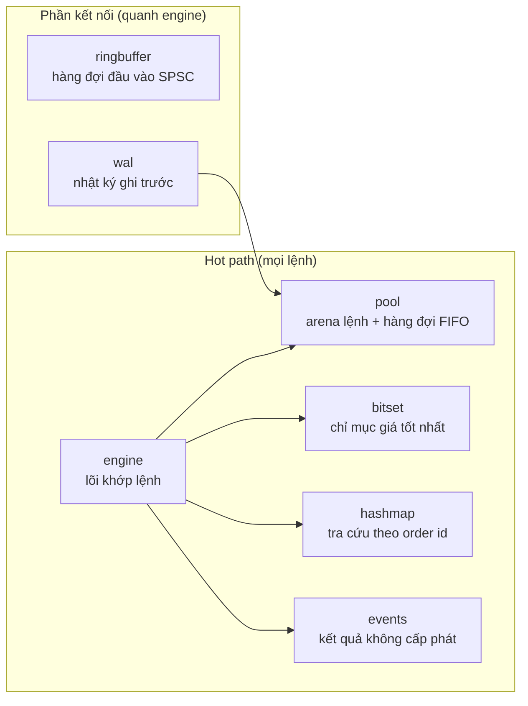
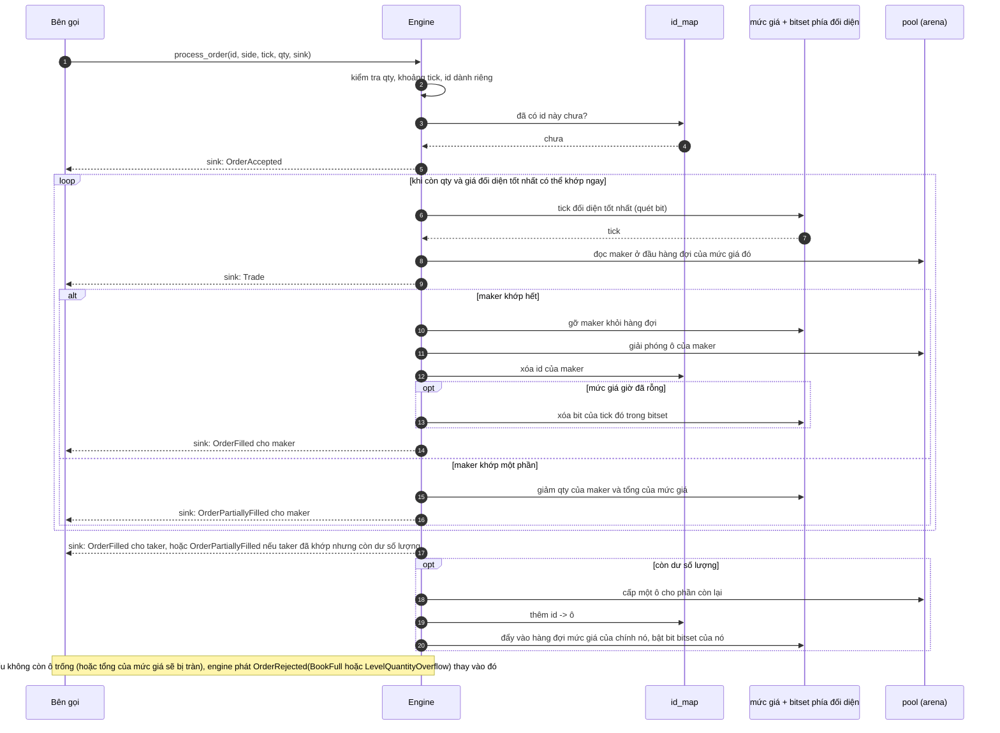
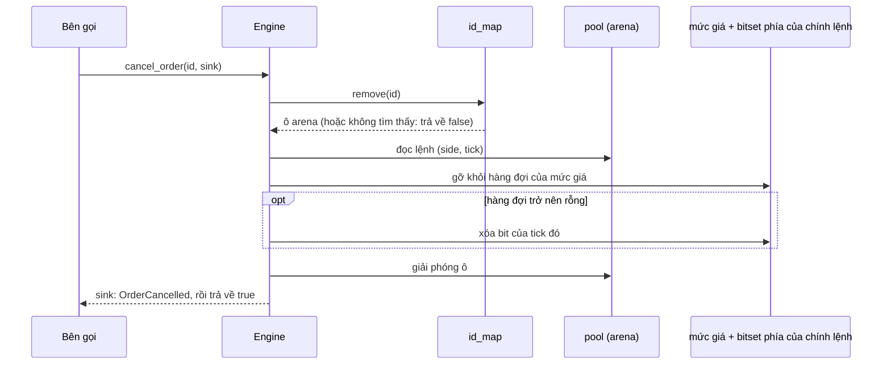

# 2. Tổng quan kiến trúc

> *Bản gốc tiếng Anh: [02-architecture.md](../02-architecture.md)*

> **Gặp từ lạ?** Mọi thuật ngữ trong các chương đều được giải thích trong
> [bảng thuật ngữ](glossary.md).

Chương này là tấm bản đồ. Nó trình bày các mục tiêu thiết kế, cách các module
khớp với nhau, thứ gì nằm trong bộ nhớ, và vì sao từng cấu trúc dữ liệu được
chọn. Các chương sau sẽ phóng to vào từng phần.

## 2.1 Mục tiêu thiết kế

| Mục tiêu             | Ý nghĩa                                                                       | Cách thực hiện trong code                                             |
|----------------------|-------------------------------------------------------------------------------|-----------------------------------------------------------------------|
| **Độ trễ thấp** (low latency) | Mỗi lệnh chỉ cần thực hiện ít thao tác nhất có thể.                   | Thao tác O(1), mảng phẳng, ít nhánh rẽ.                               |
| **Độ trễ ổn định** (predictable latency) | Các lệnh *chậm nhất* (phần "đuôi" của phân phối) phải có độ trễ gần mức trung bình. | Không cấp phát trên heap, không khóa, không đổi kích thước, không I/O bên trong engine. |
| **Tính tất định** (determinism) | Cùng một chuỗi đầu vào thì luôn ra cùng một sổ lệnh và cùng các sự kiện. | Chạy một luồng, không đọc đồng hồ. Seed ngẫu nhiên của bảng băm id chỉ quyết định các mục nằm *ở đâu*, không bao giờ ảnh hưởng đến kết quả (chương 5). |
| **Thân thiện với cache** | Giữ dữ liệu hay dùng nằm sát nhau để cache của CPU phát huy tác dụng. | Mảng arena, chỉ số `u32` thay cho con trỏ 64 bit, struct nhỏ.          |
| **Dễ đọc**           | Đây là một dự án để học.                                                      | Ít module, mỗi module một việc và có test riêng.                      |

> [!NOTE]
> **Vì sao cấp phát bộ nhớ làm hại độ trễ?** `malloc` / `Box::new` thường là
> nhanh, nhưng *thỉnh thoảng* nó chậm: nó có thể phải giành một cái khóa, xin
> hệ điều hành thêm bộ nhớ, hoặc duyệt qua một free list (danh sách các ô
> trống). Những lần gọi chậm hiếm hoi đó hiện ra thành các đỉnh vọt của độ trễ.
> Trong giao dịch, cú vọt ấy (phần "đuôi") thường quan trọng hơn mức trung bình.
> Vì vậy engine cấp phát mọi thứ **một lần duy nhất, lúc khởi động**, và không
> bao giờ cấp phát nữa trong lúc xử lý lệnh.

## 2.2 Các module



| Module | Tệp | Việc của module (một câu) | Chương |
|---|---|---|---|
| `engine`     | [`src/engine.rs`](../../src/engine.rs)       | Nhận lệnh, khớp lệnh, hủy lệnh và trả lời các truy vấn độ sâu (depth). | [6](06-matching-algorithm.md) |
| `pool`       | [`src/pool.rs`](../../src/pool.rs)           | Lưu các lệnh trong một mảng cố định và nối chúng thành các hàng đợi FIFO (vào trước, ra trước) theo từng mức giá. | [3](03-order-pool.md) |
| `bitset`     | [`src/bitset.rs`](../../src/bitset.rs)       | Tìm bid tốt nhất / ask tốt nhất trong O(1). | [4](04-price-ladder-bitset.md) |
| `hashmap`    | [`src/hashmap.rs`](../../src/hashmap.rs)     | Ánh xạ `order_id` sang ô arena của lệnh đó, phục vụ việc hủy lệnh. | [5](05-hash-map.md) |
| `events`     | [`src/events.rs`](../../src/events.rs)       | Enum `Event`, trait `EventSink` mà engine dùng để báo kết quả, và `EventBatch`, một sink có giới hạn dung lượng. | [7](07-events.md) |
| `ringbuffer` | [`src/ringbuffer.rs`](../../src/ringbuffer.rs) | Hàng đợi lock-free (không dùng khóa), tách thành hai handle `Producer` và `Consumer`, để nạp lệnh cho engine từ một luồng khác. | [8](08-ring-buffer.md) |
| `wal`        | [`src/wal.rs`](../../src/wal.rs)             | Nhật ký nhị phân chỉ ghi nối thêm (append-only) các yêu cầu, dùng để phát lại (replay) và khôi phục. | [9](09-write-ahead-log.md) |

Hãy nhìn các mũi tên: engine phụ thuộc vào `pool`, `bitset`, `hashmap` và
`events`, nhưng **không** phụ thuộc vào `ringbuffer` hay `wal`. Hai module này là
những khối xây dựng độc lập, do *bạn* nối quanh engine (chương 8 và 9 chỉ cách
làm).

Crate tái xuất năm tên mà hầu hết trường hợp sử dụng cần đến trong
[`src/lib.rs`](../../src/lib.rs): `Engine`, `Event`, `EventSink`, `EventBatch` và
`Side`.

## 2.3 Struct `Engine`, từng trường một

```rust
pub struct Engine {
    pool: OrderPool,              // every order lives here
    id_map: FlatHashMap,          // order_id -> index into pool
    bid_bitset: TwoLevelBitset,   // which bid ticks are non-empty
    ask_bitset: TwoLevelBitset,   // which ask ticks are non-empty
    bid_levels: Box<[PriceLevel]>,// bid_levels[tick] = FIFO queue of bids at that tick
    ask_levels: Box<[PriceLevel]>,// ask_levels[tick] = FIFO queue of asks at that tick
    sequence: u64,                // arrival counter; metadata only, never read by matching
}
```

Mỗi trường chỉ có đúng một trách nhiệm:

| Trường | Câu hỏi mà nó trả lời | Chi phí |
|---|---|---|
| `pool`        | "Lệnh X nằm ở đâu, và ai đứng cạnh nó trong hàng đợi?"       | truy cập mảng theo chỉ số |
| `id_map`      | "Ô arena nào đang giữ lệnh có id 12345?"                       | tra bảng băm, O(1) kỳ vọng |
| `*_levels`    | "Những lệnh nào đang chờ ở tick giá T?"                        | `levels[T]`: một lần đọc mảng |
| `*_bitset`    | "Mức giá không rỗng tốt nhất là mức nào?"                      | hai lần quét bit |
| `sequence`    | "Engine đã nhận bao nhiêu lệnh?" (metadata phục vụ kiểm toán; thứ tự FIFO đến từ các liên kết trong hàng đợi chứ không phải từ con số này, xem [6.10](06-matching-algorithm.md#610-những-ghi-chú-thiết-kế-đáng-chú-ý)) | một phép cộng |

### Các mảnh ghép trỏ vào nhau như thế nào

Dưới đây là trạng thái bên trong thật sự sau năm lệnh đầu tiên của
[ví dụ minh họa](01-order-book-basics.md#110-một-ví-dụ-hoàn-chỉnh). Arena
cấp các ô theo thứ tự `0, 1, 2, ...` đúng như thứ tự lệnh đến, nên `#1` nằm ở ô
0, `#2` ở ô 1, và cứ thế.

```text
 ask_bitset : ticks { 101, 102 }                 bid_bitset : ticks { 99, 100 }

 ask_levels                                      bid_levels
   [101] head=1 tail=2 count=2 total_qty=7         [100] head=4 tail=4 count=1 total_qty=6
   [102] head=0 tail=0 count=1 total_qty=5         [ 99] head=3 tail=3 count=1 total_qty=10
   (mọi tick khác: head=NIL, count=0)              (mọi tick khác: head=NIL, count=0)

 pool.orders  (arena)
   slot | order_id | side | tick | remaining | prev_idx | next_idx
   -----+----------+------+------+-----------+----------+---------
     0  |    1     | Sell | 102  |     5     |   NIL    |   NIL
     1  |    2     | Sell | 101  |     3     |   NIL    |    2      <-- đầu hàng đợi ask @101
     2  |    3     | Sell | 101  |     4     |    1     |   NIL     <-- cuối hàng đợi ask @101
     3  |    4     | Buy  |  99  |    10     |   NIL    |   NIL
     4  |    5     | Buy  | 100  |     6     |   NIL    |   NIL
     5.. trống                                                      (nằm trong free stack)

 id_map     1 -> 0     2 -> 1     3 -> 2     4 -> 3     5 -> 4
 sequence   5
```

Hãy đọc nó như một tấm bản đồ chỉ đường:

- Để tìm **ask tốt nhất**: `ask_bitset.lowest()` cho ra tick `101`.
- Để biết **ai khớp trước ở mức 101**: `ask_levels[101].head` là ô `1`, tức là
  lệnh `#2`, lệnh cũ nhất.
- Để biết **ai là người kế tiếp trong hàng**: `pool.orders[1].next_idx` là ô
  `2`, lệnh `#3`.
- Để **hủy `#3`**: bảng băm id (trong code là `id_map.remove(3)`) cho ra ô `2`,
  rồi gỡ nó khỏi hàng đợi; không phải tìm kiếm gì cả.

Các "con trỏ" của hàng đợi chỉ là những số nguyên nhỏ (`u32`) trỏ vào cùng một
mảng. Không có `Box`, không có `Rc`, không có con trỏ thô (raw pointer), và
không có cấp phát riêng cho từng nút.

## 2.4 Chuyện gì xảy ra khi một lệnh đến



(Sơ đồ này đã được đơn giản hóa: thứ tự chính xác và mọi nhánh lỗi nằm trong
[chương 6](06-matching-algorithm.md).)

Engine không tự quyết định sự kiện đi đâu. Mỗi sự kiện được trao cho **sink**
(nơi nhận sự kiện) mà bên gọi truyền vào, ngay tại lúc nó xảy ra. Sink có thể là
một `Vec<Event>`, một closure, hoặc một `EventBatch` có giới hạn dung lượng
(chương 7). Để ý rằng một mức giá đã cạn sẽ bị xóa khỏi bitset *trước khi* báo
việc khớp của maker: engine chỉ gọi sink khi mọi cấu trúc dữ liệu đều đã nhất
quán với nhau. Sink không thể nhìn vào engine trong lúc chạy (engine đang bị
mượn độc quyền (`&mut`) suốt lời gọi, nên trình biên dịch cấm), nhưng sink *có
thể* panic. Nếu panic đó được bắt lại, bên gọi nhận lại engine đúng tại điểm đã
gọi sink, và quy tắc trên bảo đảm sổ lệnh vẫn nhất quán ở đó, kể cả khi yêu cầu
mới chỉ được xử lý một phần. Chương 6 giải thích điều này ở
[ghi chú sau vòng lặp trong](06-matching-algorithm.md#sau-vòng-lặp-trong) và ở
[bất biến 6](06-matching-algorithm.md#69-các-bất-biến-sau-mỗi-lần-gọi).

Hủy lệnh là một hành trình ngắn hơn nhiều:



## 2.5 Vì sao chọn những cấu trúc dữ liệu này?

Mỗi bài toán con đều có một lời giải "trong sách giáo khoa". Đây là lý do
từng lời giải đó bị thay thế.

| Bài toán con | Lời giải trong sách giáo khoa | Vì sao chưa lý tưởng ở đây | Engine này làm gì |
|---|---|---|---|
| Giữ các giá được sắp xếp / tìm giá tốt nhất | `BTreeMap<Price, Level>` | O(log n), phải đi theo con trỏ qua các nút (pointer-chasing), cấp phát khi chèn | **Bitset hai tầng**: 2 lần quét bit, O(1), 520 byte |
| Tìm hàng đợi của một mức giá | `HashMap<Price, Level>` | tốn công băm, cấp phát, đổi kích thước | **Mảng đánh chỉ số theo tick**: `levels[tick]` |
| Hàng đợi FIFO các lệnh tại một mức giá | `VecDeque<Order>` hoặc `LinkedList<Order>` | `VecDeque` xóa phần tử ở giữa mất O(n); `LinkedList` cấp phát một nút cho mỗi lệnh | **Danh sách liên kết đôi intrusive** nằm trong arena: mọi thao tác đều O(1) |
| Tìm lệnh theo id | `HashMap<u64, _>` (SipHash) | cấp phát, có thể đổi kích thước, hàm băm chậm hơn | **Bảng phẳng địa chỉ mở** (open addressing) với hàm băm số nguyên nhanh, cộng thêm seed ngẫu nhiên để chống các id bị cố ý chọn để gây va chạm |
| Lưu các lệnh | `Box<Order>` cho mỗi lệnh | mỗi lệnh một lần `malloc`, các lệnh nằm rải rác trong bộ nhớ | **Arena** (một mảng lớn), chỉ số `u32` |
| Báo cáo chuyện đã xảy ra | trả về một `Vec<Event>` | cấp phát ở mỗi lần gọi | **Đẩy từng sự kiện vào một `EventSink` do bên gọi cung cấp**: bên gọi tự chọn nơi lưu |

Cái giá của tốc độ này là những **giới hạn cố định** được quyết định từ trước:

- tối đa `order_capacity` lệnh đang chờ (bạn chọn con số này khi gọi
  `Engine::new`),
- đúng 4096 tick giá (một hằng số xác định lúc biên dịch).

Sự kiện thì không bị giới hạn: một lời gọi có thể báo hàng nghìn lần khớp, và
sink quyết định giữ lại, chuyển tiếp hay chỉ đếm chúng.

## 2.6 Dung lượng bộ nhớ

Mọi thứ được cấp phát trong `Engine::new(order_capacity)`. Với sức chứa `N`:

| Thành phần | Công thức | `N = 10,000` |
|---|---|---|
| Arena chứa lệnh | `N × 48 B` | 480,000 B |
| Free stack (ngăn xếp các ô trống) | `N × 4 B` | 40,000 B |
| Bảng băm | `next_pow2(2 × max(N,16)) × 16 B` | 32,768 × 16 = 524,288 B |
| Các mức giá (bid + ask) | `2 × 4096 × 24 B` | 196,608 B |
| Bản thân struct `Engine` | chứa hai bitset (`2 × 520 B`) cùng các con trỏ, bộ đếm và seed của hàm băm | 1,160 B |
| **Tổng cộng** | | **1,242,056 B ≈ 1.24 MB** |

(Kích thước của `Order` = 48 B, `PriceLevel` = 24 B, ô băm 16 B và
`Engine` = 1,160 B đều được đo bằng `size_of`.)

Con số đó đủ nhỏ để nằm gọn trong cache L2/L3 của một CPU hiện đại, và đó là một
phần lý do thiết kế này nhanh.

## 2.7 Mô hình luồng

```text
   MỘT luồng producer                 MỘT luồng khớp lệnh                 consumer
  +-----------------+    SPSC      +------------------------+          +--------------------+
  | mạng / FIX /    | -----------> |  pop -> WAL -> Engine  | -------> | dữ liệu thị trường |
  | gateway         | bộ đệm vòng  |  process_order/cancel  | sự kiện  | báo cáo khớp lệnh  |
  +-----------------+              +------------------------+          +--------------------+
```

Các phương thức làm thay đổi sổ (`process_order` và `cancel_order`) nhận
`&mut self`, nên chính Rust bảo đảm rằng mỗi lúc chỉ có một bên gọi được đụng
vào sổ lệnh. Trong engine **không có khóa nào cả**. Bộ đệm vòng áp dụng cùng ý
tưởng cho hàng đợi: nó chỉ trao ra đúng một `Producer` và một `Consumer`, nên
quy tắc "một bên ghi, một bên đọc" cũng được hệ thống kiểu (type system) ép
buộc (chương 8). Cách làm này theo *nguyên tắc một bên ghi duy nhất*
(single-writer principle) do LMAX Disruptor phổ biến: thay vì để nhiều luồng
tranh nhau dữ liệu dùng chung, ta dồn mọi yêu cầu qua một hàng đợi vào một luồng
duy nhất sở hữu dữ liệu.

Lưu ý rằng trong luồng xử lý này, việc ghi thêm vào WAL cũng chạy trên luồng
khớp lệnh. Thông thường, thao tác này chỉ ghi vào bộ nhớ, nhưng thỉnh thoảng WAL
phải nới rộng và ánh xạ lại (re-map) tệp, làm độ trễ tăng vọt (chương 9).

Để mở rộng vượt quá một luồng, hãy chạy **mỗi mã giao dịch (instrument) một
engine** (hoặc mỗi nhóm mã một engine), mỗi engine trên một lõi riêng.

## 2.8 "Không cấp phát" nghĩa là gì và không có nghĩa là gì

Nó có nghĩa là **không có cấp phát trên heap bên trong `process_order` và
`cancel_order`**, và điều này được kiểm thử (xem
[chương 10](10-testing-and-performance.md)).

Những lời gọi sau *có* cấp phát, và không sao cả vì chúng không nằm trên hot path
(đoạn code chạy cho mọi lệnh):

| Lời gọi | Vì sao nó cấp phát |
|---|---|
| `Engine::new` | dựng toàn bộ các mảng (đây chính là mục đích: chỉ làm một lần) |
| `Engine::depth_snapshot` | trả về một `Vec` (để kiểm tra / báo cáo) |
| `WalWriter::create`, `WalWriter::open_append`, `wal::read_all` | khởi tạo tệp và `Vec` |
| `ringbuffer::spsc_channel` | dựng mảng các ô |

> [!TIP]
> "Không cấp phát" là tính chất của **engine**, không phải của mọi sink. Một sink
> kiểu `Vec<Event>` có cấp phát khi nó phình ra (nếu dùng lại cùng một `Vec` thì
> sau giai đoạn khởi động (warm-up) nó sẽ không phình thêm nữa), một closure thì
> làm gì cũng được, còn `EventBatch` thì không bao giờ cấp phát. Bài test không
> cấp phát cho engine chạy qua một `EventBatch` và một closure có đếm, nhờ vậy
> chỉ đo riêng engine (chương 10).

## 2.9 Tự thực hành

Hãy mở tài liệu API, được sinh ra từ chính các doc comment mà các chương này
trích dẫn:

```sh
cargo doc --open
```

Sau đó mở [`src/engine.rs`](../../src/engine.rs) và tìm từng trường của `Engine`
ở mục 2.3 cùng chỗ mà `new` cấp phát nó. Mọi lần cấp phát mà việc xử lý lệnh cần
đều diễn ra trong đúng hàm đó (chỉ các hàm hỗ trợ kiểm tra như `depth_snapshot`
mới cấp phát về sau); [chương 10](10-testing-and-performance.md) cho thấy bài
test chứng minh điều ấy:

```sh
cargo test --test zero_alloc
```

**Tiếp theo:** [3. Order pool: kho chứa lệnh](03-order-pool.md)
