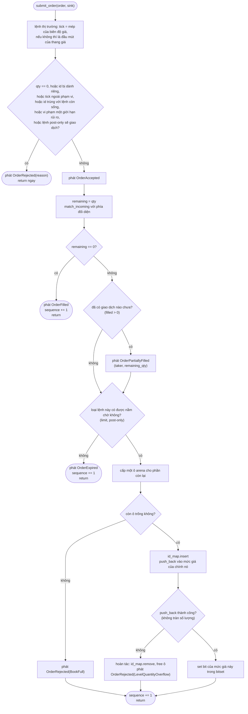
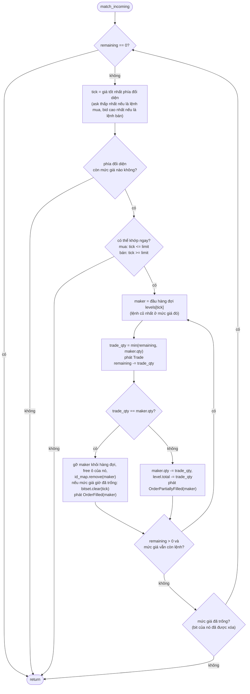

# 6. Thuật toán khớp lệnh

> *Bản gốc tiếng Anh: [06-matching-algorithm.md](../06-matching-algorithm.md)*

> **Gặp từ lạ?** Mọi thuật ngữ trong các chương đều được giải thích trong
> [bảng thuật ngữ](glossary.md).

Mã nguồn: [`src/engine.rs`](../../src/engine.rs)

Đây là chương mà mọi thứ ghép lại với nhau. Nếu chưa đọc chương 1 đến chương 5,
bạn nên đọc trước: các cấu trúc dữ liệu được mô tả ở đó chính là công cụ mà ta
dùng ở đây. Các đoạn code trích dẫn được rút gọn nhẹ (bỏ bớt chỗ xuống dòng và
comment, và chỉ hiện một phía khi phía còn lại là bản đối xứng), nhưng hành vi
giống hệt mã nguồn.

## 6.1 API công khai

```rust
let mut engine = Engine::new(order_capacity);          // allocate everything, once
// or Engine::with_ticks(order_capacity, ticks): another price range (chapter 4)
let mut events = Vec::new();                            // any EventSink (chapter 7)
engine.set_risk_limits(limits);                         // pre-trade checks (6.2)

engine.process_order(id, side, tick, qty, &mut events); // submit a limit order
engine.submit_order(order, &mut events);                // any NewOrder (see below)
let found = engine.cancel_order(id, &mut events);       // cancel a resting order: bool
let found = engine.reduce_order(id, by, &mut events);   // lower its qty, keep its place
let n = engine.cancel_account(account, &mut events);    // mass cancel one account: count
let n = engine.cancel_all(&mut events);                 // mass cancel everything: count

engine.best_bid();                 // Option<u32>
engine.best_ask();                 // Option<u32>
engine.depth_at(side, tick);       // u64   total resting qty at one tick
engine.depth_snapshot(side, n);    // Vec<(tick, qty)>  best n levels, best first
engine.live_order_count();         // usize number of resting orders
engine.resting_order(id);          // Option<RestingOrder>  side, tick, remaining qty
engine.tick_count();               // usize valid ticks are 0..tick_count()
engine.risk_limits();              // RiskLimits
```

`submit_order` nhận một `NewOrder`, một struct `Copy` nhỏ chứa mọi điều khoản
của một lệnh. Các hàm khởi tạo và các phương thức `with_*` của nó đọc lên như một
câu văn:

```rust
let order = NewOrder::limit(42, Side::Buy, 100, 10)     // id, side, tick, qty
    .with_type(OrderType::ImmediateOrCancel)
    .with_account(7)
    .with_self_trade_prevention(SelfTradePrevention::CancelResting);
```

`process_order(id, side, tick, qty, sink)` là cách viết tắt của
`submit_order(NewOrder::limit(id, side, tick, qty), sink)`: tài khoản 0, cho phép
tự giao dịch. Chương này đi theo `submit_order`. Mọi phương thức làm thay đổi sổ
lệnh đều nhận event sink (nơi nhận sự kiện) dưới dạng `sink: &mut S` với
`S: EventSink + ?Sized`. Vì là generic nên trình
biên dịch tạo một bản riêng cho từng kiểu sink, và lời gọi `emit` được inline
thẳng vào vòng lặp khớp lệnh. Ràng buộc `?Sized` còn cho phép truyền
`&mut dyn EventSink` khi bạn muốn chỉ có một bản code được biên dịch.

| Phương thức | Thay đổi sổ? | Cấp phát? | Chi phí |
|---|---|---|---|
| `new(capacity)` | dựng sổ | **có**, một lần | O(capacity) |
| `submit_order` / `process_order` | có | không (sink dạng `Vec` có thể cấp phát khi nó phình ra) | O(1 + số lần khớp) kỳ vọng |
| `cancel_order` | có | không | O(1) kỳ vọng |
| `reduce_order` | có | không | O(1) kỳ vọng |
| `cancel_account` / `cancel_all` | có | không | O(số tick giữa giá tốt nhất và giá tệ nhất + số lệnh đang chờ) |
| `best_bid` / `best_ask` | không | không | O(1), hai lần quét bit |
| `depth_at` | không | không | O(1) |
| `depth_snapshot` | không | **có** (`Vec`) | O(số tick phải quét); chỉ dùng để báo cáo |
| `live_order_count` | không | không | O(1) |
| `resting_order` | không | không | O(1) kỳ vọng: một lần tra bảng băm |
| `set_risk_limits` / `risk_limits` / `tick_count` | chỉ `set_risk_limits` | không | O(1) |

## 6.2 `submit_order` gồm bốn giai đoạn



Tóm tắt bằng lời:

1. **Kiểm tra hợp lệ (validate).** Đầu vào sai, lệnh vi phạm một giới hạn rủi
   ro, và lệnh post-only sẽ gây ra giao dịch, đều bị từ chối trước khi có bất cứ
   thứ gì thay đổi. (Lệnh thị trường trước hết được gán một mức giới hạn: mép của
   biên độ giá, hoặc nếu không có biên độ thì là mức giá tệ nhất mà phía của nó
   cho phép; từ đây trở đi nó được xử lý như mọi lệnh khác.)
2. **Chấp nhận (accept).** Phát sự kiện `OrderAccepted`.
3. **Khớp (match).** Giao dịch với phía đối diện chừng nào giá còn chạm nhau.
4. **Cho nằm chờ (rest).** Đưa phần số lượng còn lại vào sổ, hoặc để nó hết hạn
   (expire) nếu loại lệnh đó không được phép nằm chờ.

Loại lệnh chỉ làm thay đổi bước 1 và bước 4: việc khớp lệnh thì như nhau với mọi
loại.

### Giai đoạn 1 và 2: kiểm tra hợp lệ và chấp nhận lệnh

```rust
fn validate(&self, order_id: u64, side: Side, order_type: OrderType,
            price_tick: u32, qty: u64) -> Result<(), RejectReason> {
    if qty == 0 {
        Err(RejectReason::ZeroQuantity)
    } else if order_id == crate::hashmap::RESERVED_KEY {
        Err(RejectReason::ReservedOrderId)
    } else if (price_tick as usize) >= self.tick_count() {
        Err(RejectReason::PriceOutOfRange)
    } else if self.id_map.get(order_id).is_some() {
        Err(RejectReason::DuplicateOrderId)
    } else if qty > self.limits.max_order_qty {
        Err(RejectReason::QuantityAboveLimit)
    } else if self.is_outside_band(side, price_tick) {
        Err(RejectReason::PriceOutsideBand)
    } else if order_type == OrderType::PostOnly && self.is_marketable(side, price_tick) {
        Err(RejectReason::PostOnlyWouldTrade)
    } else {
        Ok(())
    }
}

// In submit_order (after `let NewOrder { order_id, account, side, .. } = order;`):
let price_tick = match order_type {
    OrderType::Market => self.market_limit(side),       // the edge of the price band,
    _ => price_tick,                                    // or the end of the ladder
};
if let Err(reason) = self.validate(order_id, side, order_type, price_tick, qty) {
    sink.emit(Event::OrderRejected { order_id, reason });
    return;
}
sink.emit(Event::OrderAccepted { order_id, account, side, order_type, price_tick, qty });
```

| Kiểm tra | `RejectReason` | Lý do |
|---|---|---|
| `qty == 0` | `ZeroQuantity` | Lệnh rỗng thì vô nghĩa. Nếu không có bước kiểm tra này, nó sẽ đi thẳng qua khâu khớp lệnh mà chẳng có gì để khớp, rồi phát ra một cặp `OrderAccepted` + `OrderFilled` vô lý. |
| `order_id == u64::MAX` | `ReservedOrderId` | Được dành riêng làm giá trị đánh dấu "trống" của bảng băm (chương 5). |
| `price_tick >= tick_count()` | `PriceOutOfRange` | Thang giá chỉ có chừng ấy tick (mặc định là 4096); đánh chỉ mục vượt quá sẽ truy cập ngoài giới hạn mảng. |
| `id_map.get(id).is_some()` | `DuplicateOrderId` | Trùng id với một lệnh **còn sống** (live). (Id của lệnh đã khớp hết hoặc đã hủy thì không còn trong map, nên có thể dùng lại.) |
| `qty > limits.max_order_qty` | `QuantityAboveLimit` | Một giới hạn rủi ro trước giao dịch chống "lỗi bấm nhầm (fat finger)": thừa một chữ số 0 ở số lượng. |
| `is_outside_band(side, tick)` | `PriceOutsideBand` | Giới hạn rủi ro còn lại: một lệnh mua chỉ được đặt giá cao hơn ask tốt nhất tối đa `band` tick, một lệnh bán chỉ được đặt giá thấp hơn bid tốt nhất tối đa `band` tick. Khi phía bên kia không có lệnh nào thì không có giá tham chiếu, và không áp dụng biên độ nào. |
| post-only và `is_marketable(side, tick)` | `PostOnlyWouldTrade` | Lệnh post-only cam kết không bao giờ lấy thanh khoản. `is_marketable` đặt đúng câu hỏi mở đầu việc khớp lệnh (giá tốt nhất phía đối diện có chạm tới giới hạn này không?) chỉ với một lần quét bit và không thay đổi gì trong sổ. |

Khi kiểm tra thất bại, chỉ có **một** sự kiện `OrderRejected` được phát ra,
không có `OrderAccepted` đứng trước. Các bước kiểm tra chạy theo thứ tự trong
bảng và dừng ở lỗi đầu tiên, nên một lệnh mắc hai lỗi (ví dụ số lượng bằng 0
*và* tick sai) luôn nhận cùng một lý do là `ZeroQuantity`. Lệnh thị trường không
bao giờ trượt các bước kiểm tra giá: tick của nó đã được `market_limit` thay
trước khi các bước đó chạy, bằng mép của biên độ giá (ask tốt nhất + band với
lệnh mua, bid tốt nhất − band với lệnh bán) hoặc, nếu không có biên độ, bằng đầu
mút của thang giá. `OrderAccepted` báo lại mức giới hạn đó, nên bên tiêu thụ biết
lệnh được phép giao dịch xa tới đâu, và biên độ giá trở thành **lớp bảo vệ cho
lệnh thị trường**: chúng dừng lại ở mép biên độ, và phần còn lại của chúng hết
hạn.

Các giới hạn rủi ro là trạng thái của engine, được thay đổi bằng
`set_risk_limits`. Cũng như một lệnh, lời gọi đó làm thay đổi các kết quả về sau,
nên nó được ghi vào log giống như một lệnh (chương 9). Trả về `Result` từ một hàm nhỏ giúp thứ tự đó dễ đọc, và để nơi gọi xử lý mọi trường hợp từ chối
chỉ bằng một câu `if let`.

### Giai đoạn 3: `match_incoming`, chọn phía

```rust
match side {
    Side::Buy  => Self::match_incoming(&mut self.pool, &mut self.ask_levels,
                      &mut self.ask_bitset, &mut self.id_map, &mut self.trades,
                      order_id, price_tick, &mut remaining, sink, Crossing::TakerBuy),
    Side::Sell => Self::match_incoming(&mut self.pool, &mut self.bid_levels,
                      &mut self.bid_bitset, &mut self.id_map, &mut self.trades,
                      order_id, price_tick, &mut remaining, sink, Crossing::TakerSell),
}
```

Một taker **mua** tấn công phía **ask**; một taker **bán** tấn công phía
**bid**. Cùng một hàm phục vụ cả hai, và chỉ có hai điểm khác nhau, được gói
trong enum `Crossing`:

| | `TakerBuy` | `TakerSell` |
|---|---|---|
| Giá tốt nhất phía đối diện | `bitset.lowest()` (ask rẻ nhất) | `bitset.highest()` (bid cao nhất) |
| Có thể khớp ngay khi | `tick <= limit_price` | `tick >= limit_price` |
| `taker_side` được báo trong `Trade` | `Side::Buy` | `Side::Sell` |

`self.trades` là bộ đếm giao dịch của engine: `match_incoming` tăng nó thêm một
sau mỗi giao dịch và ghi giá trị mới vào sự kiện làm `trade_id` của giao dịch đó
(6.10).

## 6.3 `match_incoming`, trái tim của engine



Có **hai vòng lặp lồng nhau**:

- **Vòng ngoài duyệt qua các mức giá**, mức tốt nhất trước.
- **Vòng trong duyệt hàng đợi FIFO ở một mức giá**, lệnh cũ nhất trước.

### Vòng ngoài: chọn giá tốt nhất và kiểm tra xem có chạm giá không

```rust
let Some(tick) = (match direction {
    Crossing::TakerBuy  => bitset.lowest(),
    Crossing::TakerSell => bitset.highest(),
}) else { break };                                   // opposite side is empty

let marketable = match direction {
    Crossing::TakerBuy  => tick as u32 <= price_tick,
    Crossing::TakerSell => tick as u32 >= price_tick,
};
if !marketable { break; }
```

Câu `break` sớm khi giá tốt nhất không thể khớp ngay vừa là một tối ưu quan
trọng, vừa là một lập luận chứng minh tính đúng đắn: nếu giá *tốt nhất* phía đối
diện còn không chạm tới giới hạn, thì **mọi giá khác phía đối diện đều tệ hơn**,
nên không thể có thêm giao dịch nào. Không cần quét thêm.

### Vòng trong: khớp với lệnh ở đầu hàng đợi

```rust
let maker_idx       = level.head;                      // oldest order at this tick
let maker_qty       = pool.get(maker_idx).remaining_qty;
let maker_order_id  = pool.get(maker_idx).order_id;
let trade_qty       = (*remaining).min(maker_qty);     // the smaller of the two

*trades += 1;                                          // number this trade
sink.emit(Event::Trade { trade_id: *trades, maker_order_id, taker_order_id,
                         taker_side, price_tick: tick as u32, qty: trade_qty });
*remaining -= trade_qty;

if trade_qty == maker_qty {
    level.remove(pool, maker_idx);          // maker fully consumed
    pool.free(maker_idx);
    id_map.remove(maker_order_id);
    if level.is_empty() {
        bitset.clear(tick);                 // price gone: update the index first...
    }
    sink.emit(Event::OrderFilled { order_id: maker_order_id }); // ...then report
} else {
    level.reduce_qty(pool, maker_idx, trade_qty);   // maker keeps its place
    sink.emit(Event::OrderPartiallyFilled {
        order_id: maker_order_id,
        remaining_qty: maker_qty - trade_qty,
    });
}
```

Mỗi bước có ba kết quả có thể xảy ra, tùy theo
`trade_qty = min(taker_left, maker_qty)`:

| Trường hợp | Kết quả |
|---|---|
| taker_left **>** maker_qty | Maker khớp hết và bị gỡ khỏi sổ. Taker lặp tiếp. |
| taker_left **<** maker_qty | Taker khớp hết (`remaining` về 0). Maker vẫn ở lại, với số lượng đã giảm. |
| taker_left **==** maker_qty | Cả hai cùng khớp hết. |

Hãy để ý: **giá giao dịch là `tick`, tức mức giá của maker**, chứ không phải
giới hạn của taker. Nhờ vậy giá tốt hơn mong đợi (price improvement, chương 1)
có sẵn mà không tốn thêm công sức.

### Sau vòng lặp trong

```rust
if !levels[tick].is_empty() {
    break;                  // the taker ran out first: nothing more can trade
}
// The level drained; its bit was cleared with its last maker. Loop for the next price.
```

Nếu mức giá vẫn còn lệnh, thì taker chắc chắn đã hết số lượng, nên ta dừng.
Nếu mức giá đã cạn, quyền điều khiển quay về vòng ngoài, và vòng ngoài hỏi
bitset về mức giá tốt nhất *tiếp theo*.

> [!NOTE]
> **Tại sao phải xóa bit ngay trong vòng lặp trong, trước khi báo lệnh khớp?**
> Nếu xóa sau vòng lặp thì việc khớp lệnh vẫn đúng như nhau. Nhưng engine đưa
> sự kiện `OrderFilled` của maker cho sink của nơi gọi, và đó là code mà engine
> không kiểm soát. Quy tắc là: **chỉ gọi ra sink khi mọi cấu trúc dữ liệu đã
> nhất quán với nhau** (bất biến 6 ở mục 6.9). Nếu bit vẫn đang bật, `best_ask()`
> sẽ báo một mức giá mà thực ra không còn lệnh nào. Lỗi này chỉ lộ ra khi một
> sink bị panic và panic đó bị bắt lại, nhưng chính những quy tắc như thế giúp
> codebase không có các lỗi kiểu "chỉ lộ ra khi...". Unit test
> `panicking_sink_leaves_the_book_consistent` khóa chặt hành vi này.

### Chống tự giao dịch

Ngay sau khi chọn maker ở đầu hàng đợi, và trước khi tính giao dịch, vòng lặp
trong kiểm tra xem maker có thuộc chính tài khoản của taker hay không (đoạn
trích):

```rust
let maker = *pool.get(maker_idx);
let mode = taker.self_trade_prevention;
if mode != SelfTradePrevention::Allow && maker.account == taker.account {
    sink.emit(Event::SelfTradePrevented { taker_order_id, maker_order_id });
    if mode.cancels_resting() {               // CancelResting or CancelBoth
        level.remove(pool, maker_idx);        // exactly as for a full fill...
        pool.free(maker_idx);
        id_map.remove(maker_order_id);
        if level.is_empty() { bitset.clear(tick); }
        sink.emit(Event::OrderCancelled { /* maker, its side, tick and qty */ });
    }
    if mode.stops_incoming() {                // CancelIncoming or CancelBoth
        return true;                          // "stopped by self-trade"
    }
    continue;                                 // the next maker in line
}
```

Với chế độ mặc định là `Allow`, bước kiểm tra chỉ là một phép so sánh và không có
gì thay đổi. Còn lại thì:

| Chế độ | Lệnh đang chờ của chính tài khoản | Lệnh đến |
|---|---|---|
| `CancelResting` | bị hủy | tiếp tục khớp với maker kế tiếp |
| `CancelIncoming` | giữ nguyên | dừng lại; phần còn lại của nó hết hạn, kể cả khi là lệnh giới hạn |
| `CancelBoth` | bị hủy | dừng lại; phần còn lại của nó hết hạn |

Có ba chi tiết đáng xem kỹ. Sự kiện `SelfTradePrevented` được phát **trước
tiên**, khi chưa có gì thay đổi, nên sink nhìn thấy một sổ nhất quán (6.9). Lệnh
đang chờ rời khỏi sổ qua **đúng các bước của một maker khớp hết**, và theo cùng
thứ tự: bitset được cập nhật trước khi `OrderCancelled` được báo. Và giờ
`match_incoming` **trả về một `bool`**: `submit_order` cần biết taker đã bị
dừng, vì một lệnh giới hạn bị dừng thì không được nằm chờ. Các giao dịch mà taker
đã thực hiện trước khi gặp lệnh của chính nó vẫn giữ nguyên hiệu lực.

## 6.4 Giai đoạn 4: cho phần còn lại nằm chờ trong sổ

(Đoạn trích đã rút gọn: nhánh `Sell` đối xứng với nhánh `Buy`.)

```rust
match self.pool.allocate(order_id, side, price_tick, remaining, self.sequence) {
    Some(idx) => {
        self.id_map.insert(order_id, idx);
        let rested = match side {
            Side::Buy  => { let ok = self.bid_levels[price_tick as usize].push_back(&mut self.pool, idx);
                            if ok { self.bid_bitset.set(price_tick as usize); } ok }
            Side::Sell => { /* same with ask_levels / ask_bitset */ }
        };
        if !rested {
            self.id_map.remove(order_id);   // roll back
            self.pool.free(idx);
            sink.emit(Event::OrderRejected { order_id, reason: RejectReason::LevelQuantityOverflow });
        }
    }
    None => sink.emit(Event::OrderRejected { order_id, reason: RejectReason::BookFull }),
}
```

Có hai nguyên nhân khiến một lệnh không thể nằm chờ trong sổ, và cả hai đều tạo
ra `OrderRejected` **sau** `OrderAccepted`:

| Nguyên nhân | `RejectReason` | Lý do | Dọn dẹp |
|---|---|---|---|
| Arena đầy (`allocate` trả về `None`) | `BookFull` | đã có `order_capacity` lệnh đang nằm chờ | không có gì để hoàn tác |
| Tổng số lượng của mức giá bị tràn (`push_back` trả về `false`) | `LevelQuantityOverflow` | `total_qty` sẽ vượt quá `u64::MAX` | xóa id khỏi `id_map`, free ô |

> [!IMPORTANT]
> **Trên thực tế, việc từ chối vì hết dung lượng chỉ xảy ra với lệnh chưa giao
> dịch lần nào.** Comment trong mã nguồn nói rằng các giao dịch đã thực hiện sẽ
> không bị hoàn tác, và đường code được viết như vậy để phòng thủ. Nhưng tình
> huống đó không thể xảy ra:
>
> - *Arena đầy:* taker vẫn còn số lượng sau khi khớp thì chắc chắn đã khớp hết
>   mọi maker mà nó chạm tới, và mỗi maker khớp hết đều **giải phóng một ô**.
>   Vì vậy `allocate` luôn thành công sau ít nhất một giao dịch.
> - *Tràn mức giá:* sổ không bao giờ bị chéo giá (crossed, xem 6.9). Nếu taker
>   đã giao dịch, thì phía của chính nó ở mức giá đó không có lệnh nào đang chờ,
>   nên mức giá đang trống và `total_qty` của nó không thể tràn.
>
> Vì vậy chuỗi sự kiện từ chối thực sự có thể xảy ra chỉ là
> `[OrderAccepted, OrderRejected]`. Kiểm thử đối chiếu (differential test)
> trong `tests/model_check.rs` kiểm tra điều này trên từng lời gọi trong số
> 160,000 lời gọi ngẫu nhiên của nó, nhiều lời gọi chạy trên arena chỉ có 64
> lệnh và đầy gần như suốt thời gian: lời gọi nào kết thúc bằng `OrderRejected`
> sau `OrderAccepted` thì không được chứa `Trade` nào. Bạn chạy nó bằng
> `cargo test --test model_check`. Nếu bạn sửa engine để cả hai có thể xảy ra
> cùng lúc, câu assert đó sẽ thất bại, và khi đó bên tiêu thụ sự kiện phải coi
> các giao dịch kia là thật.

### Phần còn lại không được nằm chờ

Lệnh immediate-or-cancel và lệnh thị trường không bao giờ nằm chờ, lệnh bị cơ
chế chống tự giao dịch dừng lại cũng vậy. Phần còn lại của chúng bị bỏ đi trước
cả khi arena được hỏi xin một ô (đoạn trích):

```rust
if stopped_by_self_trade || !order_type.rests() {  // only Limit and PostOnly rest
    sink.emit(Event::OrderExpired { order_id, expired_qty: remaining });
    self.sequence = self.sequence.wrapping_add(1);
    return;
}
```

Vì vậy một lệnh như thế không bao giờ nhận `BookFull` và không bao giờ chiếm một
ô, dù chỉ trong khoảnh khắc. Chuỗi sự kiện của nó kết thúc bằng `OrderExpired`,
sau `OrderPartiallyFilled` của taker nếu nó đã giao dịch. Vì sao lại cần một sự
kiện mới thay vì `OrderCancelled`? `OrderCancelled` có nghĩa là "số lượng này đã
rời khỏi sổ", và bên tiêu thụ đang theo dõi độ sâu của sổ (chương 7) sẽ trừ nó
khỏi một mức giá. Số lượng hết hạn chưa từng nằm trong sổ, nên không có gì để
trừ.

## 6.5 Theo dõi trọn vẹn từng bước

Ta hãy chạy lại bước 6 của
[ví dụ minh họa](01-order-book-basics.md#110-một-ví-dụ-hoàn-chỉnh) và quan
sát từng cấu trúc dữ liệu thay đổi ra sao. Trạng thái ban đầu (dung lượng 16;
xem [chương 2](02-architecture.md#các-mảnh-ghép-trỏ-vào-nhau-như-thế-nào) để có
bức tranh đầy đủ):

```text
 ask:   [101] #2(ô1):3 -> #3(ô2):4   tổng 7        ask_bitset {101, 102}
        [102] #1(ô0):5               tổng 5
 bid:   [100] #5(ô4):6                             bid_bitset {99, 100}
        [ 99] #4(ô3):10
 đỉnh free stack -> ô 5, 6, 7, ...
```

**Lệnh đến:** `process_order(6, Buy, tick 102, qty 14)`

| # | Điều gì xảy ra | Cấu trúc dữ liệu thay đổi | Sự kiện được phát | `remaining` |
|---|---|---|---|---|
| 0 | Kiểm tra hợp lệ: qty>0, id≠MAX, 102<4096, id 6 chưa dùng. | | `OrderAccepted{6, Buy, 102, 14}` | 14 |
| 1 | `ask_bitset.lowest()` = **101**. `101 <= 102` ✓ có thể khớp ngay. | | | 14 |
| 2 | Phần tử đầu của `ask[101]` là ô 1 (`#2`, qty 3). `trade_qty = min(14,3) = 3`. | | `Trade{id 1, maker 2, taker 6, Buy, 101, 3}` | 11 |
| 3 | 3 == 3, nên `#2` khớp hết. | `ask[101]`: head → ô 2, count 1, total 4. `free(slot 1)`. `id_map.remove(2)`. | `OrderFilled{2}` | 11 |
| 4 | Mức 101 chưa trống. Phần tử đầu là ô 2 (`#3`, qty 4). `trade_qty = min(11,4) = 4`. | | `Trade{id 2, maker 3, taker 6, Buy, 101, 4}` | 7 |
| 5 | 4 == 4, nên `#3` khớp hết. Mức giá giờ đã trống, nên bit của nó được xóa trước khi phát sự kiện. | `ask[101]` trống (head = tail = NIL, count 0, total 0). `free(slot 2)`. `id_map.remove(3)`. `ask_bitset.clear(101)`, giờ là `{102}`. | `OrderFilled{3}` | 7 |
| 6 | Vòng trong kết thúc (mức giá trống, bit đã được xóa). | | | 7 |
| 7 | Vòng ngoài: `lowest()` = **102**. `102 <= 102` ✓. Phần tử đầu của `ask[102]` là ô 0 (`#1`, qty 5). `trade_qty = min(7,5) = 5`. | | `Trade{id 3, maker 1, taker 6, Buy, 102, 5}` | 2 |
| 8 | 5 == 5, nên `#1` khớp hết; mức giá của nó cũng trống theo. | `ask[102]` trống. `free(slot 0)`. `id_map.remove(1)`. `ask_bitset.clear(102)`, giờ rỗng. | `OrderFilled{1}` | 2 |
| 9 | Vòng trong kết thúc (mức giá trống, bit đã được xóa). | | | 2 |
| 10 | Vòng ngoài: `lowest()` = `None` → dừng. | | | 2 |
| 11 | `filled = 14 − 2 = 12 > 0`, `remaining = 2 ≠ 0`. | | `OrderPartiallyFilled{6, remaining 2}` | 2 |
| 12 | Cho phần còn lại nằm chờ: `allocate` lấy ra ô vừa được giải phóng gần nhất, **ô 0**. | `id_map.insert(6, 0)`. `bid[102]`: head = tail = ô 0, count 1, total 2. `bid_bitset.set(102)`. `sequence = 6`. | | 2 |

Trạng thái cuối:

```text
 ask:   (trống)                                    ask_bitset {}
 bid:   [102] #6(ô0):2                             bid_bitset {99, 100, 102}
        [100] #5(ô4):6
        [ 99] #4(ô3):10
 best_bid = 102, best_ask = None, live_order_count = 3
```

Mỗi bước ở trên đều là O(1), và không có byte bộ nhớ nào được cấp phát.

### Thêm vài ví dụ (đều do engine thật tạo ra)

**Giá tốt hơn mong đợi** (price improvement): một lệnh mua giới hạn ở giá 105
gặp một ask ở giá 100 sẽ giao dịch ở giá 100:

```text
 process_order(1, Sell, 100, 5)
 process_order(2, Buy, 105, 5)   ->  OrderAccepted{2, Buy, price_tick 105, qty 5}
                                     Trade{id 1, maker 1, taker 2, Buy, price_tick 100, qty 5}
                                     OrderFilled{1}
                                     OrderFilled{2}
```

**FIFO trong cùng một mức giá** (lấy từ unit test
`price_time_priority_within_a_level_is_fifo`): hai ask, mỗi lệnh số lượng 5 ở
tick 100 (`#1` rồi đến `#2`), và một lệnh mua 6. `#1` giao dịch trước (5), rồi
đến `#2` (1).

## 6.6 `cancel_order` và `reduce_order`

```rust
pub fn cancel_order<S: EventSink + ?Sized>(&mut self, order_id: u64, sink: &mut S) -> bool {
    let Some(idx) = self.id_map.remove(order_id) else {
        sink.emit(Event::CancelRejected { order_id, reason: CancelRejectReason::NotResting });
        return false;
    };
    let order = *self.pool.get(idx);                     // copy it out (Order is Copy)
    match order.side {
        Side::Buy => {
            let level = &mut self.bid_levels[order.price_tick as usize];
            level.remove(&mut self.pool, idx);           // unlink from the FIFO
            if level.is_empty() { self.bid_bitset.clear(order.price_tick as usize); }
        }
        Side::Sell => { /* same on the ask side */ }
    }
    self.pool.free(idx);
    sink.emit(Event::OrderCancelled {                    // every structure agrees by now
        order_id, side: order.side, price_tick: order.price_tick,
        cancelled_qty: order.remaining_qty,
    });
    true
}
```

| Bước | Cấu trúc được dùng | Chi phí |
|---|---|---|
| Tìm ô chứa lệnh | `id_map.remove(order_id)` | O(1) kỳ vọng |
| Đọc phía (mua/bán) và tick | `pool.get(idx)` | O(1) |
| Gỡ khỏi hàng đợi (ở đầu, giữa hoặc cuối) | `PriceLevel::remove` | O(1) |
| Bỏ mức giá khỏi chỉ mục nếu giờ đã trống | `bitset.clear` | O(1) |
| Trả ô về để dùng lại | `pool.free` | O(1) |

Hủy một id **không tồn tại** hoặc **đã khớp hết** sẽ không đụng gì đến sổ, phát
`CancelRejected` (lý do `NotResting`) và trả về `false`. Việc phát một sự kiện, chứ không chỉ trả về
`false`, có ý nghĩa với bất kỳ ai theo dõi engine chỉ qua các sự kiện của nó: mọi
yêu cầu hủy đều để lại đúng một sự kiện. (Hãy thử hủy lệnh 4 hai lần trong ví dụ
minh họa: lần đầu trả về `true` kèm `OrderCancelled`, lần sau trả về `false` kèm
`CancelRejected`.)

`OrderCancelled` sao chép phía, tick và số lượng còn lại ra khỏi bản ghi lệnh
trước khi ô được free, nhờ vậy bên tiêu thụ biết mức giá nào bị mất bao nhiêu. Để
đọc chính các field đó *mà không* hủy lệnh, hãy dùng `resting_order(id)`: cùng
một lần tra `id_map`, rồi sao chép các field của lệnh vào một `RestingOrder`.

### Giảm số lượng của lệnh

`reduce_order(id, reduce_by, sink)` giảm số lượng của một lệnh đang chờ **ngay
tại chỗ** (đoạn trích):

```rust
if reduce_by == 0 { /* CancelRejected(ZeroQuantity) */ }
let Some(idx) = self.id_map.get(order_id) else { /* CancelRejected(NotResting) */ };
let order = *self.pool.get(idx);
if reduce_by >= order.remaining_qty {
    return self.cancel_order(order_id, sink);         // nothing would be left
}
let levels = match order.side { Side::Buy => &mut self.bid_levels, Side::Sell => &mut self.ask_levels };
levels[order.price_tick as usize].reduce_qty(&mut self.pool, idx, reduce_by);
sink.emit(Event::OrderReduced { order_id, side: order.side, price_tick: order.price_tick,
                                reduced_qty: reduce_by, remaining_qty: order.remaining_qty - reduce_by });
```

Lệnh vẫn giữ nguyên vị trí của nó trong hàng đợi. Như vậy là công bằng: một lệnh
nhỏ đi thì không bao giờ có thể giành mất lần khớp của các lệnh xếp sau nó. (Tăng
số lượng thì có thể, nên muốn tăng thì bạn hủy rồi gửi một lệnh mới, lệnh này sẽ
xếp vào cuối hàng.) `reduce_qty` chính là thao tác của `PriceLevel` mà một lần
khớp một phần sử dụng (chương 3): nó giảm `remaining_qty` của lệnh và `total_qty`
của mức giá cùng một lúc. Giảm bằng hoặc nhiều hơn toàn bộ phần còn lại thì là
hủy lệnh, kèm `OrderCancelled`.

### Hủy hàng loạt

`cancel_account(account, sink)` hủy mọi lệnh đang chờ của một tài khoản, còn
`cancel_all(sink)` hủy mọi lệnh đang chờ. Engine không giữ danh sách lệnh theo
từng tài khoản, nên cả hai đều **duyệt qua sổ**, giống cách `depth_snapshot` làm
(đoạn trích):

```rust
for side in [Side::Buy, Side::Sell] {
    let mut tick = /* best price on this side */;
    while let Some(t) = tick {
        tick = /* the next price, found before this level may empty */;
        let mut idx = /* levels[t].head */;
        while idx != NIL {
            let order = *self.pool.get(idx);            // copy: cancelling clears its links
            if account.is_none_or(|account| account == order.account) {
                self.id_map.remove(order.order_id);
                self.remove_cancelled(idx, sink);       // unlink, free, OrderCancelled
                cancelled += 1;
            }
            idx = order.next_idx;
        }
    }
}
sink.emit(Event::MassCancelled { account, cancelled_orders: cancelled });
```

Vì vậy các lệnh hủy diễn ra theo một **thứ tự cố định**: bid trước, từ giá tốt
nhất, rồi đến ask, từ giá tốt nhất, và ở mỗi mức giá thì lệnh cũ nhất trước. Điều
đó quan trọng cho tính tất định: khi chạy lại (replay) thì chúng được báo theo
đúng thứ tự cũ, và sổ lệnh tham chiếu trong kiểm thử đối chiếu có thể đoán trước
từng sự kiện. `remove_cancelled` là nửa sau của `cancel_order`, giờ được dùng
chung vì có hai nơi gọi cần đến nó. Chi phí là số tick giữa giá tốt nhất và giá
tệ nhất của mỗi phía (tối đa bằng số tick) cộng với số lệnh ở đó; các tick trống là cái
giá của việc không giữ danh sách theo tài khoản (bài tập 11 ở chương 11 thêm một
danh sách như vậy). `MassCancelled` khép lại mọi lần hủy hàng loạt, kể cả lần
không tìm thấy lệnh nào, nên yêu cầu đó luôn để lại một sự kiện.

## 6.7 Các trường hợp biên, đã được kiểm chứng

| Đầu vào | Sự kiện được phát | Ảnh hưởng đến sổ |
|---|---|---|
| `qty = 0` | `[OrderRejected(ZeroQuantity)]` | không có |
| `price_tick = 4096` (ngoài phạm vi) | `[OrderRejected(PriceOutOfRange)]` | không có |
| `price_tick = 4095` (tick hợp lệ cuối cùng) | `[OrderAccepted]` (nếu không có gì khớp) | nằm chờ bình thường |
| `order_id = u64::MAX` | `[OrderRejected(ReservedOrderId)]` | không có |
| Trùng id với một lệnh còn sống | `[OrderRejected(DuplicateOrderId)]` | không có |
| Dùng lại id của một lệnh đã khớp hết/đã hủy | xử lý như mọi lệnh mới | bình thường |
| Lệnh phải nằm chờ nhưng arena đã đầy | `[OrderAccepted, OrderRejected(BookFull)]` (không bao giờ có giao dịch đi trước, xem 6.4) | không có gì được đưa vào sổ |
| Lệnh phải nằm chờ nhưng tổng số lượng của mức giá sẽ tràn `u64` | `[OrderAccepted, OrderRejected(LevelQuantityOverflow)]` | không có gì được đưa vào sổ; trạng thái không đổi |
| Lệnh khớp hết hoàn toàn khi arena đã đầy | các lần khớp bình thường | không cần ô nào, nên vẫn thành công |
| Lệnh post-only có giá chạm tới giá tốt nhất phía đối diện | `[OrderRejected(PostOnlyWouldTrade)]` | không có |
| Lệnh immediate-or-cancel hoặc lệnh thị trường còn số lượng dư | `[OrderAccepted, ...các lần khớp..., OrderExpired]` | không có gì được đưa vào sổ; không cần ô nào |
| Lệnh thị trường khi phía đối diện trống | `[OrderAccepted, OrderExpired]` | không có |
| Lệnh thị trường với tick ngoài phạm vi | xử lý bình thường: tick bị bỏ qua | bình thường |
| Số lượng vượt quá `max_order_qty` | `[OrderRejected(QuantityAboveLimit)]` | không có |
| Lệnh mua có giá cao hơn ask tốt nhất quá `band` tick (hoặc lệnh bán thấp hơn bid tốt nhất quá mức đó) | `[OrderRejected(PriceOutsideBand)]` | không có |
| Lệnh thị trường khi có biên độ giá | `OrderAccepted` với giới hạn là ask tốt nhất + band (hoặc bid tốt nhất − band); giao dịch tới mức đó; `OrderExpired` cho phần còn lại | bình thường |
| `cancel_order` với một id không nằm chờ trong sổ | `[CancelRejected(NotResting)]` (trả về `false`) | không có |
| `reduce_order` với lượng giảm bằng 0 | `[CancelRejected(ZeroQuantity)]` (trả về `false`) | không có |
| `reduce_order` với lượng giảm bằng hoặc lớn hơn số lượng còn lại | `[OrderCancelled]` (trả về `true`) | lệnh bị gỡ khỏi sổ |
| Lệnh đến gặp lệnh của chính tài khoản mình, chế độ `Allow` (mặc định) | một `Trade` bình thường | bình thường |
| ...chế độ `CancelResting` | `SelfTradePrevented`, `OrderCancelled(maker)`, rồi việc khớp lệnh tiếp tục | lệnh của chính tài khoản bị gỡ khỏi sổ |
| ...chế độ `CancelIncoming` | `SelfTradePrevented`, rồi các sự kiện cuối của taker và `OrderExpired` | lệnh của chính tài khoản vẫn ở lại; không có gì được đưa vào sổ |
| `cancel_account` với một tài khoản không có lệnh nào đang chờ, hoặc `cancel_all` trên sổ trống | `[MassCancelled { cancelled_orders: 0, .. }]` | không có |

## 6.8 Độ phức tạp

- **Giai đoạn 1 và 2 (kiểm tra, chấp nhận):** O(1) kỳ vọng: một lần tra bảng
  băm.
- **Giai đoạn 3 (khớp):** mỗi vòng lặp tạo ra một giao dịch, rồi hoặc loại một
  maker khỏi sổ (`O(1)` cho gỡ khỏi hàng đợi + free + xóa khỏi bảng băm), hoặc
  làm taker hết số lượng. Chuyển sang mức giá kế tiếp là một lần quét bit, cũng
  O(1). Mỗi mức giá được duyệt qua đều tạo ra ít nhất một giao dịch hoặc một
  lệnh của chính tài khoản bị hủy, nên tổng chi phí là **O(số lần khớp + số lần
  tự giao dịch bị chặn)**.
- **Giai đoạn 4 (nằm chờ hoặc hết hạn):** O(1).
- **`cancel_order` và `reduce_order`:** O(1) kỳ vọng: một lần tra bảng băm, rồi
  một lượng công việc cố định trên hàng đợi của lệnh.
- **`cancel_account` và `cancel_all`:** O(số tick giữa giá tốt nhất và giá tệ
  nhất ở mỗi phía + số lệnh ở đó), tối đa `tick_count()` tick; không cần tra bảng băm để
  tìm lệnh, chỉ một lần cho mỗi lệnh bị hủy để xóa nó.

Tổng thể: **O(1 + số lần khớp) kỳ vọng** (chữ "kỳ vọng" có mặt vì bảng băm phải
dò; xem chương 5), khớp với doc comment ("O(1) + O(fills)"). Một taker không
vượt spread có chi phí gần như bằng mọi lệnh không khớp khác, bất kể trong sổ có
bao nhiêu lệnh.

## 6.9 Các bất biến sau mỗi lần gọi

Các bất biến (invariant) này luôn đúng giữa các lần gọi, và cái cuối cùng còn
đúng ngay cả trong lúc đang gọi. Kiểm thử đối chiếu ở chương 10
(`tests/model_check.rs`) kiểm tra những cái quan sát được (giá tốt nhất, độ sâu,
số lệnh còn sống, chính xác từng sự kiện) sau mỗi yêu cầu:

1. **Sổ lệnh không bao giờ bị chéo giá (crossed):** `best_bid < best_ask` mỗi
   khi cả hai cùng tồn tại.
   *Vì sao:* một lệnh mua đến ở giá `p` sẽ khớp hết mọi ask `≤ p` trước khi nằm
   chờ, nên ask nào còn lại đều `> p`; với lệnh bán thì đối xứng.
2. **Bit `t` của bitset ở một phía được bật ⇔ `levels[t]` của phía đó không
   rỗng.**
3. **Mỗi lệnh đang chờ nằm trong đúng một hàng đợi FIFO và có đúng một mục
   trong `id_map`;** `live_order_count()` đếm chúng.
4. **`level.total_qty` bằng tổng `remaining_qty` của các lệnh trong mức giá
   đó.**
5. **Trong một hàng đợi, thứ tự đến được giữ nguyên:** lệnh mới nối vào đuôi,
   và maker mới khớp một phần vẫn giữ vị trí đầu hàng.
6. **Sổ luôn nhất quán mỗi khi sink chạy**, chứ không chỉ giữa các lần gọi.
   Mỗi lần `emit` đều xảy ra giữa hai thay đổi trạng thái hoàn chỉnh, và đó là
   lý do một mức giá đã cạn rời khỏi bitset trước khi lệnh khớp của maker cuối
   cùng được báo (6.3). Nhờ vậy sink không bao giờ nhìn thấy một sổ mới cập nhật
   dở. Nếu một sink bị panic và panic đó bị bắt, sổ vẫn nhất quán, nhưng yêu
   cầu đó mới chỉ được áp dụng một phần (chương 7 giải thích khi đó nên làm
   gì).

## 6.10 Những ghi chú thiết kế đáng chú ý

**Một hàm cho cả hai phía.** Thay vì nhân đôi vòng lặp khớp lệnh cho lệnh mua và
lệnh bán, `match_incoming` nhận vùng lưu trữ của phía đối diện cùng một giá trị
`Crossing`. Các nhánh `match direction` cực kỳ dễ cho CPU dự đoán (branch
prediction).

**Vì sao `match_incoming` là associated function (hàm liên kết), không phải
phương thức `&mut self`.** Nó nhận `&mut self.pool`, `&mut self.ask_levels`,
`&mut self.ask_bitset` và `&mut self.id_map` làm các tham số riêng. Rust cho
phép mượn dạng mutable *các field rời nhau* (disjoint fields) của một struct
cùng một lúc, nhưng không cho mượn cả struct cộng thêm một field: một phương
thức `fn match_incoming(&mut self, levels: &mut [PriceLevel], ...)` sẽ không
thể được gọi với `&mut self.ask_levels`, vì `self` đã bị mượn nguyên cả khối
rồi.

Thật ra phương thức `&mut self` *vẫn làm được*: nó có thể mở đầu bằng
`let (levels, bitset) = match direction { ... }` rồi tự chọn các field, vì
trong thân một hàm thì mượn hai field khác nhau là được phép. Cách dùng
associated function được chọn vì nó giữ quyết định đó ở nơi gọi, và làm cho mọi
phần trạng thái mà vòng lặp đụng tới đều lộ ra ngay trong chữ ký hàm.
`#[allow(clippy::too_many_arguments)]` là cái giá phải trả cho sự rõ ràng ấy.

**Bộ đếm `sequence`.** Nó tăng một lần cho mỗi lệnh vượt qua bước kiểm tra hợp
lệ, và được sao chép vào bản ghi `Order` nếu lệnh đó nằm chờ trong sổ. Engine
không bao giờ *đọc lại* giá trị này: ưu tiên về thời gian đến từ **vị trí trong
danh sách liên kết**, chứ không phải từ việc so sánh các số sequence. Nó chỉ là
metadata phục vụ kiểm toán (audit) hoặc gỡ lỗi. (Nó dùng `wrapping_add` nên
không bao giờ panic.)

**Bộ đếm `trades`.** Khác với `sequence`, bộ đếm này có được đọc: nó *chính là*
`trade_id` của giao dịch gần nhất. Nó chỉ thay đổi bên trong vòng lặp khớp lệnh,
vốn có tính tất định (deterministic), nên khi chạy lại (replay) cùng các yêu cầu
đó thì mọi giao dịch đều được đánh số y như cũ, và phía sau có thể dùng các id
này để phát hiện bản trùng lặp và chỗ bị hụt (chương 7). Một số `u64` tăng thêm
một cho mỗi giao dịch thì trên thực tế không bao giờ tràn, nên nó dùng `+= 1`
bình thường.

**`#[inline(always)]` trên các accessor nhỏ xíu** (`best_bid`, `best_ask`,
`live_order_count`, các accessor của bitset và pool) loại bỏ chi phí gọi hàm
trong hot path.

## 6.11 Tự thực hành

Chạy mọi test của engine, rồi chạy kiểm thử đối chiếu so engine với một sổ lệnh
tham chiếu được viết cố ý thật đơn giản, trên 160,000 lời gọi ngẫu nhiên:

```sh
cargo test engine::
cargo test --test model_check
```

Để xem bản trace ở mục 6.5 diễn ra ngay trước mắt, hãy chạy ví dụ của chương 1:

```sh
cargo run --example walkthrough
```

Sau đó hãy cố tình làm hỏng một chỗ. Trong `match_incoming` ở
[`src/engine.rs`](../../src/engine.rs), đổi
`Crossing::TakerBuy => tick as u32 <= price_tick` thành
`Crossing::TakerBuy => (tick as u32) < price_tick`, để lệnh mua không còn giao
dịch ở đúng mức giá giới hạn của nó nữa. (Cần có dấu ngoặc: nếu thiếu, Rust sẽ
hiểu `u32 <` là phần mở đầu của một kiểu generic như `u32<...>`.) Hãy đoán
trước test nào sẽ thất bại, chạy `cargo test`, rồi xem bạn đoán đúng không.
(Nhớ hoàn tác thay đổi sau khi làm xong.)

**Tiếp theo:** [7. Sự kiện (events)](07-events.md)
