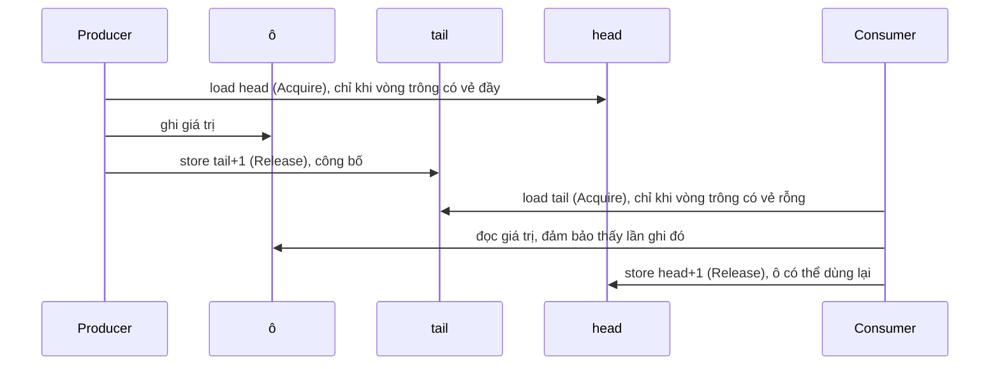

# 8. Bộ đệm vòng (ring buffer): đưa yêu cầu vào engine từ một thread khác

> *Bản gốc tiếng Anh: [08-ring-buffer.md](../08-ring-buffer.md)*

> **Gặp từ lạ?** Mọi thuật ngữ trong các chương đều được giải thích trong
> [bảng thuật ngữ](glossary.md).

Mã nguồn: [`src/ringbuffer.rs`](../../src/ringbuffer.rs)

`Engine` cố ý chỉ là một cấu trúc dữ liệu. Một hệ thống thực tế cần thêm hai thứ
bao quanh nó:

1. Một cách **đưa yêu cầu vào** từ các thread (luồng) khác mà không dùng khóa:
   **bộ đệm vòng** (ring buffer), trong chương này.
2. Một cách **sống sót qua sự cố** và dựng lại trạng thái: **nhật ký ghi trước**
   (write-ahead log), trong [chương 9](09-write-ahead-log.md).

Engine không dùng cái nào trong hai thứ này; chúng là những viên gạch độc lập.
[Chương 9](09-write-ahead-log.md#97-ghép-tất-cả-lại) kết thúc bằng việc nối
cả ba lại với nhau. Đây là hình dạng mà ta đang hướng tới:

```text
  MỘT thread gateway             thread khớp lệnh (sở hữu Engine)               phía sau
 +---------------+     SPSC     +-----------------------------------+        +------------+
 | đọc, kiểm tra | -----------> | pop -> ghi WAL -> gọi Engine      | -----> | phát       |
 | yêu cầu       | bộ đệm vòng  |                                   | sự kiện| sự kiện    |
 +---------------+              +-----------------------------------+        +------------+
```

(Một hàng đợi SPSC, tức một producer và một consumer, chỉ cho phép đúng một
producer. Nếu có nhiều thread gateway, bạn cần hoặc là mỗi gateway một hàng đợi
SPSC riêng rồi để thread khớp lệnh gộp chúng lại, hoặc là một hàng đợi nhiều
producer, thứ mà crate này không cung cấp.)

## 8.1 Nó giải quyết bài toán gì?

Yêu cầu đến từ các thread mạng, nhưng `Engine` chỉ được phép bị **một** thread
chạm vào. Ta cần một hàng đợi nằm giữa chúng. `Mutex<VecDeque<_>>` thì chạy được,
nhưng khóa có thể chặn (thread bị hệ điều hành gạt ra khỏi CPU trong lúc đang giữ
khóa) và `VecDeque` có thể cấp phát bộ nhớ. Cả hai đều làm hại độ trễ đuôi (tail
latency).

Lời giải là một **bộ đệm vòng** (ring buffer) **lock-free** (không dùng khóa), kích
thước cố định, **một producer một consumer** (single-producer single-consumer, viết
tắt là SPSC), theo phong cách của LMAX Disruptor.

- **Một producer**: đúng một thread gọi `push`.
- **Một consumer**: đúng một thread gọi `pop`.

Thiết kế đơn giản như vậy là nhờ chỉ có một producer và một consumer: không cần
vòng lặp compare-and-swap hay xử lý tranh chấp giữa các thread (contention). Như
mục 8.5 sẽ cho thấy, API được thiết kế để bạn không
thể vô tình phá vỡ giới hạn đó.

## 8.2 Cấu trúc dữ liệu

Một mảng cố định được dùng như một vòng tròn, cộng với hai bộ đếm, mà ta sẽ gọi là
**cursor**:

```text
   capacity = 8  (lũy thừa của 2),  mask = 7

   ô:       0     1     2     3     4     5     6     7
          +-----+-----+-----+-----+-----+-----+-----+-----+
          |     |     |  C  |  D  |  E  |     |     |     |
          +-----+-----+-----+-----+-----+-----+-----+-----+
                          ^                 ^
                        head = 2          tail = 5
                     (consumer đọc)    (producer ghi)

   số phần tử đang chờ = tail - head = 3         (C, D, E)
   rỗng                : head == tail
   đầy                 : tail - head == capacity
```

`spsc_channel` cấp phát các ô một lần duy nhất và trả về hai đầu của hàng đợi:

```rust
pub fn spsc_channel<T: Copy + Send>(capacity: usize) -> (Producer<T>, Consumer<T>)

/// Storage and cursors shared by the one Producer and the one Consumer.
struct Shared<T> {
    buffer: Box<[UnsafeCell<MaybeUninit<T>>]>,
    mask: usize,
    head: CachePadded<AtomicUsize>,   // consumer cursor: values popped so far
    tail: CachePadded<AtomicUsize>,   // producer cursor: values pushed so far
    producer_dropped: AtomicBool,     // disconnect flags, see 8.5
    consumer_dropped: AtomicBool,
}

pub struct Producer<T> { shared: Arc<Shared<T>>, tail: usize, cached_head: usize }
pub struct Consumer<T> { shared: Arc<Shared<T>>, head: usize, cached_tail: usize }
```

Trong đoạn code này có hai chi tiết nhỏ sẽ được giải thích kỹ ở phần sau.
`CachePadded<T>` là một wrapper cho giá trị bên trong một cache line riêng cho
chính nó (mục 8.4 giải thích vì sao điều đó quan trọng), và `.0` là cách bạn lấy
giá trị nằm trong nó, như trong `self.shared.head.0`. Một **cache line** là khối
bộ nhớ, thường là 64 byte, mà một nhân CPU sao chép vào cache của riêng nó trong
một lần.

Mỗi handle giữ một bản sao riêng của cursor **của chính nó** (chỉ nó mới tiến cursor
đó, nên bản sao của nó luôn chính xác) và một bản sao **lưu tạm** (cached) của
cursor phía bên kia (mục 8.3 giải thích vì sao).

Các ô là `MaybeUninit<T>`: vùng nhớ có thể đã hoặc chưa chứa giá trị. Các ô nằm
giữa `head` và `tail` chứa giá trị; những ô còn lại chưa được khởi tạo. Không cần
tag `Option`, vì các cursor đã cho biết ô nào đang có dữ liệu.

**Các cursor chỉ tăng mãi** (dùng phép tính wrapping khi tràn số); chúng không bao
giờ bị đặt lại về 0. Ô vật lý là `cursor & mask`.

Tại sao lại tăng mãi thay vì quay vòng ở `capacity`? Nếu cursor nằm trong
`0..capacity`, bạn không phân biệt được "rỗng" với "đầy" (cả hai đều trông như
`head == tail`) trừ khi phí đi một ô. Với cursor luôn tăng, hiệu `tail − head` cho
biết chính xác có bao nhiêu phần tử đang nằm trong hàng đợi.

**Ví dụ quay vòng** (`capacity = 8`): `head = 6`, `tail = 10`. Bốn phần tử nằm
trong các ô `6, 7, 0, 1` (vì `6 & 7 = 6`, `7 & 7 = 7`, `8 & 7 = 0`, `9 & 7 = 1`).
Lần ghi tiếp theo sẽ vào ô `10 & 7 = 2`.

Capacity được làm tròn lên thành lũy thừa của 2 để `% capacity` trở thành
`& mask`, cùng mẹo mà bảng băm đã dùng.

## 8.3 `push` và `pop`

```rust
pub fn push(&mut self, value: T) -> Result<(), T> {
    let capacity = self.capacity();
    if self.tail.wrapping_sub(self.cached_head) >= capacity {
        // Looks full: refresh our copy of the consumer's cursor, then re-check.
        self.cached_head = self.shared.head.0.load(Ordering::Acquire);
        if self.tail.wrapping_sub(self.cached_head) >= capacity {
            return Err(value);                                   // really full
        }
    }
    let slot = &self.shared.buffer[self.tail & self.shared.mask];
    // SAFETY: `tail - head < capacity`, and the Acquire load that produced
    // `cached_head` synchronized with the consumer's Release store, so the
    // consumer has finished reading this slot (or it was never used). It
    // will not read it again until the Release store below publishes it,
    // and this unique producer is the only writer.
    unsafe { slot.get().write(MaybeUninit::new(value)) };        // write the slot
    self.tail = self.tail.wrapping_add(1);
    self.shared.tail.0.store(self.tail, Ordering::Release);      // publish it
    Ok(())
}

pub fn pop(&mut self) -> Option<T> {
    if self.head == self.cached_tail {
        // Looks empty: refresh our copy of the producer's cursor, then re-check.
        self.cached_tail = self.shared.tail.0.load(Ordering::Acquire);
        if self.head == self.cached_tail {
            return None;                                         // really empty
        }
    }
    let slot = &self.shared.buffer[self.head & self.shared.mask];
    // SAFETY: `head < tail`, and the Acquire load that produced
    // `cached_tail` synchronized with the producer's Release store that
    // published this slot, so it holds an initialized value. The producer
    // will not overwrite it until the Release store below frees it.
    let value = unsafe { slot.get().read().assume_init() };      // read the slot
    self.head = self.head.wrapping_add(1);
    self.shared.head.0.store(self.head, Ordering::Release);      // free it
    Some(value)
}
```

`push` trả về `Err(value)` khi đầy, đưa giá trị trở lại để bên gọi thử lại hoặc bỏ
nó đi. Không có gì bao giờ bị chặn hay phải cấp phát.

**Đọc các khối `unsafe`.** Ghi vào một ô thông qua một `Arc` dùng chung, và đọc một
`MaybeUninit` như thể nó đã chứa giá trị, là những việc trình biên dịch không kiểm
tra được, nên cần `unsafe`. Từ khóa đó không tắt các quy tắc đi; nó có nghĩa là
*lập trình viên* hứa rằng các quy tắc vẫn được giữ. Quy ước của Rust là viết lời
hứa đó ra trong một comment `// SAFETY:` ngay phía trên khối, như ở đây: mỗi
comment nói rõ những sự thật nào (việc kiểm tra cursor, cặp Acquire/Release bên
dưới, chỉ có một producer) khiến thao tác này đúng. Nếu bạn sửa code xung quanh một
khối `unsafe`, hãy kiểm tra lại comment `SAFETY` của nó trước tiên.

**Các cursor lưu tạm (cached)** đóng góp rất nhiều vào tốc độ. Đọc cursor của phía
bên kia nghĩa là chạm vào một cache line mà nhân CPU kia liên tục ghi vào, và việc
đó rất đắt. Một producer có `cached_head` vẫn cho thấy còn chỗ trống thì không cần
nhìn vào `head` chút nào; nó chỉ đọc lại `head` khi vòng *trông có vẻ* đầy. Tương
tự, consumer chỉ đọc lại `tail` khi vòng trông có vẻ rỗng. Trong trường hợp thường
gặp, mỗi bên chỉ truy cập vào cache line của chính mình.

### Tại sao lại dùng những thứ tự bộ nhớ (memory ordering) này? (bản giải thích dễ hiểu)

Hai thread chạy trên hai nhân CPU khác nhau không tự động thấy các lần ghi bộ nhớ
của nhau theo đúng thứ tự chúng đã xảy ra. Cặp **Release/Acquire** sửa điều đó:

> Mọi thứ một thread đã ghi **trước** một lần store `Release` đều được đảm bảo là
> nhìn thấy được bởi thread khác **`Acquire`-load đúng giá trị mà lần store đó đã
> ghi**.



| Thao tác | Ordering | Lý do |
|---|---|---|
| Producer đọc `tail` **của chính nó** | không có: đó chỉ là một field thường của `Producer` | Chỉ producer mới tiến nó, nên bản sao riêng luôn chính xác. |
| Producer đọc `head` (khi vòng trông có vẻ đầy) | `Acquire` | Ghép cặp với lần store `Release` của consumer: producer không được ghi đè một ô cho tới khi consumer đã **đọc xong** nó. |
| Producer ghi `tail` | `Release` | Công bố nội dung ô vừa được ghi ngay trước đó. |
| Consumer đọc `tail` (khi vòng trông có vẻ rỗng) | `Acquire` | Ghép cặp với `Release` của producer: làm cho nội dung ô nhìn thấy được. |
| Consumer ghi `head` | `Release` | Chỉ trả ô lại sau khi giá trị đã được đọc ra. |

**Điều gì sẽ hỏng nếu dùng `Relaxed`?** `Relaxed` làm mỗi thao tác atomic
(nguyên tử) tự nó an toàn, nhưng không hứa gì về thứ tự mà các lần ghi *khác* trở
nên nhìn thấy được. Giả sử producer store `tail` bằng `Relaxed`:

```text
   producer (nhân 1)                       consumer (nhân 2)
   -----------------                       -----------------
   1. ghi lệnh #7 vào ô 4
   2. tail = 5   (store Relaxed)
                                           3. load tail -> thấy 5
                                           4. đọc ô 4
```

Không có gì ép nhân 2 phải thấy bước 1 trước bước 2. CPU (hoặc trình biên dịch) có
thể làm cho `tail` mới nhìn thấy được trước, nên ở bước 4 consumer có thể đọc **các
byte cũ của ô 4**: một lệnh trước đó, hoặc bộ nhớ chưa khởi tạo. Đó là một data race
(tranh chấp dữ liệu), và là hành vi không xác định (undefined behavior, UB). Với
`Release` ở bước 2 và `Acquire` ở bước 3, việc thấy `tail = 5` *đảm bảo* thấy mọi
thứ producer đã ghi trước đó, bao gồm cả ô 4.

Trên x86, lỗi này thường nằm ẩn: CPU x86 không bao giờ làm hai lần store nhìn thấy
được sai thứ tự, nên chỉ có trình biên dịch mới có thể sắp xếp lại chúng, và nó
hiếm khi làm vậy. Code vẫn sai, chỉ là gặp may. Trên ARM (điện thoại, Apple
Silicon, nhiều máy chủ), bản thân CPU sắp xếp lại thứ tự, nên lỗi thực sự lộ ra,
đó là lý do CI (tích hợp liên tục) chạy test ring buffer nhiều thread trên cả máy
ARM (chương 10).

## 8.4 False sharing và `CachePadded`

```rust
#[repr(align(128))]
struct CachePadded<T>(T);
```

CPU di chuyển bộ nhớ theo từng **cache line** (64 byte trên x86 và hầu hết các nhân
ARM). Nếu `head` và `tail` nằm trong cùng một line, mỗi lần producer cập nhật
`tail` nó sẽ làm mất hiệu lực (invalidate) line đó trong nhân của consumer, và
ngược lại, dù chúng là hai biến khác nhau. Kiểu ping-pong đó gọi là **false
sharing**.

Tại sao lại căn lề 128 byte chứ không phải 64? Các nhân x86 hiện đại có một
*prefetcher* (bộ nạp trước) kiểu *line liền kề* (adjacent-line), kéo các cache line
về theo cặp, nên hai biến chỉ cách nhau 64 byte vẫn có thể gây nhiễu lẫn nhau;
căn lề 128 byte cho mỗi cursor một cặp line riêng. (Một số CPU, như dòng M của
Apple, thậm chí dùng cache line 128 byte.) Cái giá là vài trăm byte cho mỗi hàng
đợi, tức là không đáng kể.

## 8.5 An toàn: những điều hệ thống kiểu bắt buộc

Các ô nằm trong `UnsafeCell`, vì hai thread ghi và đọc các ô khác nhau thông qua
cùng một `Arc<Shared<T>>` dùng chung:

```rust
unsafe impl<T: Send> Send for Shared<T> {}
unsafe impl<T: Send> Sync for Shared<T> {}
```

Các `unsafe impl` này là lời tác giả hứa với trình biên dịch rằng việc chia sẻ là
ổn **với điều kiện** chỉ có một bên ghi và một bên đọc. Một phiên bản đầu của crate
này không giữ được lời hứa đó: `push` và `pop` nhận `&self` trên một buffer dùng
chung, nên không gì ngăn hai thread push cùng lúc, mà đó là data race và hành vi
không xác định. API hiện tại làm cho lỗi đó không thể viết ra được:

- `spsc_channel` trả về **một** `Producer` và **một** `Consumer`. Cả hai đều không
  cài `Clone`, nên bạn không thể tạo producer thứ hai.
- `push` và `pop` nhận **`&mut self`**. Kể cả khi bạn bọc một producer trong `Arc`
  rồi chia sẻ nó, một tham chiếu dùng chung (`&Producer`) không đủ để push, và
  borrow checker (bộ kiểm tra mượn của trình biên dịch) chỉ cho phép một `&mut`
  tại một thời điểm.
- Mỗi handle là `Send` (khi `T` là `Send`), nên bạn có thể **chuyển** (move) nó sang
  thread riêng của nó.

Tài liệu của module chứng minh hai điểm đầu bằng các doctest `compile_fail`: những
ví dụ mà *không được* biên dịch.

```rust
// Does not compile:
let (producer, _consumer) = spsc_channel::<u64>(4);
let second_producer = producer.clone();   // error[E0599]: no method named `clone`
```

```rust
// Does not compile either:
let (producer, _consumer) = spsc_channel::<u64>(4);
let shared = &producer;
shared.push(1).unwrap();                  // error[E0596]: cannot borrow as mutable
```

`cargo test` kiểm tra rằng mỗi ví dụ vẫn thất bại đúng với mã lỗi đó. Đây là một
pattern rất mạnh: mã hóa quy tắc sử dụng vào trong các kiểu, rồi kiểm thử rằng việc
phá quy tắc thì không biên dịch được.

Một số chi tiết khác:

- `T: Copy`, nên một ô có thể bị ghi đè mà không phải chạy destructor, và các giá
  trị còn nằm trong hàng đợi khi ring bị drop không cần dọn dẹp.
- `len()` và `is_empty()` chỉ là **ảnh chụp tức thời** (snapshot). Ở phía producer,
  `len()` kết hợp `tail` chính xác của nó với một `head` mới đọc, nên số đếm thật
  chỉ có thể *thấp hơn* vào lúc bạn nhìn (consumer vẫn tiếp tục lấy ra); ở phía
  consumer thì chỉ có thể *cao hơn*. Hãy dùng chúng cho số liệu đo (metrics) hoặc
  gợi ý back-pressure (báo bên gửi chậm lại), còn tính đúng đắn thì dựa vào giá trị
  mà `push` và `pop` trả về.

### Phân biệt "chưa có gì" với "sẽ không bao giờ có gì nữa"

`pop` trả về `None` chỉ có nghĩa là "lúc này đang rỗng". Nếu thread producer đã kết
thúc, hoặc đã chết vì panic, một consumer cứ quay vòng chờ (spin loop) sẽ đợi mãi
mãi. Vì vậy mỗi handle bật một cờ khi nó bị drop (việc này cũng xảy ra khi một panic
lan ngược (unwind) qua thread của nó):

```rust
impl<T> Drop for Producer<T> {
    fn drop(&mut self) {
        // Release: every value pushed before this point is visible to a
        // consumer that reads the flag with Acquire.
        self.shared.producer_dropped.store(true, Ordering::Release);
    }
}

impl<T: Copy> Consumer<T> {
    pub fn is_disconnected(&self) -> bool {
        // Read the flag first. Its Acquire pairs with the Release in
        // `Drop for Producer`, so the tail loaded next is the final one.
        self.shared.producer_dropped.load(Ordering::Acquire)
            && self.shared.tail.0.load(Ordering::Acquire) == self.head
    }
}
```

`Consumer::is_disconnected()` chỉ là `true` khi producer đã biến mất **và** mọi giá
trị nó đã push đều đã được pop, nên hành động dựa trên nó không bao giờ làm mất dữ
liệu. Thứ tự của hai lần load rất quan trọng. Nếu ta đọc `tail` trước, producer có
thể push một giá trị cuối rồi bị drop giữa hai lần load của ta; ta sẽ thấy vòng
rỗng, rồi thấy cờ, và báo sai là "đã ngắt kết nối" trong khi vẫn còn một giá trị
nằm trong hàng đợi. `Producer::is_disconnected()` là hình ảnh phản chiếu của nó: nó
báo rằng consumer đã bị drop, nên bất cứ thứ gì push từ giờ trở đi sẽ không bao giờ
được đọc.

Vòng lặp consumer điển hình:

```rust
loop {
    match consumer.pop() {
        Some(value) => handle(value),
        None if consumer.is_disconnected() => break, // nothing will ever arrive
        None => std::hint::spin_loop(),              // nothing yet
    }
}
```

Test nhiều thread dùng cùng cách kiểm tra này để **thất bại nhanh**: nếu producer
của nó dừng sớm, assertion của consumer sẽ nổ ra thay vì để test treo cho đến khi
CI hết thời gian chờ (timeout).

## 8.6 Tự thực hành

Chạy các unit test của ring buffer, gồm cả test gửi giá trị giữa hai thread thật:

```sh
cargo test ringbuffer::
```

Tài liệu module trong [`src/ringbuffer.rs`](../../src/ringbuffer.rs) cũng có hai ví
dụ `compile_fail`: code **không được** biên dịch, vì nó sẽ phá quy tắc một
producer. `cargo test` kiểm tra rằng nó vẫn thất bại. Hãy tự thử một cái: trong
[`examples/walkthrough.rs`](../../examples/walkthrough.rs), tạo một channel bằng
`matching_engine::ringbuffer::spsc_channel::<u64>(8)` rồi thử gọi `clone()` trên
`Producer`. Đọc thông báo lỗi của trình biên dịch, rồi xóa dòng đó đi.

**Tiếp theo:** [9. Nhật ký ghi trước (write-ahead log) và ghép tất cả lại](09-write-ahead-log.md)
