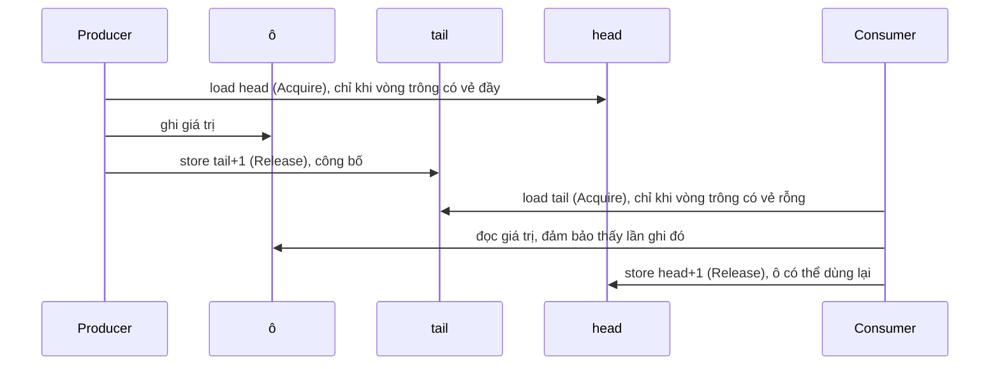

# 8. Bộ đệm vòng (ring buffer): đưa yêu cầu vào bộ khớp lệnh từ một luồng khác

> *Bản gốc tiếng Anh: [08-ring-buffer.md](../08-ring-buffer.md)*

> **Gặp từ lạ?** Mọi thuật ngữ trong các chương đều được giải thích trong
> [bảng thuật ngữ](glossary.md).

Mã nguồn: [`src/ringbuffer.rs`](../../src/ringbuffer.rs)

`Engine` được thiết kế như một cấu trúc dữ liệu độc lập. Một hệ thống thực tế
cần thêm hai thành phần:

1. Một cách **đưa yêu cầu vào** từ các luồng khác mà không cần khóa:
   **bộ đệm vòng** (ring buffer), trong chương này.
2. Một cách **khôi phục trạng thái sau sự cố**: **nhật ký ghi trước**
   (write-ahead log), trong [chương 9](09-write-ahead-log.md).

Bộ khớp lệnh không phụ thuộc vào hai thành phần này; mỗi thành phần hoạt động độc lập.
[Chương 9](09-write-ahead-log.md#97-ghép-tất-cả-lại) kết thúc bằng việc nối
cả ba lại với nhau. Đây là mô hình hệ thống mà ta sẽ xây dựng:

```text
  MỘT thread gateway             thread khớp lệnh (sở hữu Engine)               phía sau
 +---------------+     SPSC     +-----------------------------------+        +------------+
 | đọc, kiểm tra | -----------> | pop -> ghi WAL -> gọi Engine      | -----> | phát       |
 | yêu cầu       | bộ đệm vòng  |                                   | sự kiện| sự kiện    |
 +---------------+              +-----------------------------------+        +------------+
```

(Một hàng đợi SPSC, tức một bên ghi (producer) và một bên đọc (consumer), chỉ cho phép đúng một
producer. Nếu có nhiều luồng gateway, bạn cần mỗi gateway một hàng đợi
SPSC riêng rồi để luồng khớp lệnh gộp chúng lại, hoặc dùng một hàng đợi nhiều
producer, thứ mà crate này không cung cấp.)

## 8.1 Nó giải quyết bài toán gì?

Yêu cầu đến từ các luồng mạng, nhưng chỉ **một** luồng được phép truy cập
`Engine`. Ta cần một hàng đợi nằm giữa chúng. `Mutex<VecDeque<_>>` có thể dùng
được, nhưng khóa có thể chặn (luồng đang giữ khóa phải nhường CPU cho luồng
khác), còn `VecDeque` có thể cấp phát bộ nhớ. Cả hai đều làm tăng độ trễ đuôi
(tail latency).

Giải pháp là một **bộ đệm vòng** (ring buffer) **lock-free** (không dùng khóa), kích
thước cố định, **một bên ghi, một bên đọc** (single-producer single-consumer, viết
tắt là SPSC), theo phong cách của LMAX Disruptor.

- **Một bên ghi (producer)**: đúng một luồng gọi `push`.
- **Một bên đọc (consumer)**: đúng một luồng gọi `pop`.

Thiết kế đơn giản như vậy là nhờ chỉ có một bên ghi (producer) và một bên đọc (consumer): không cần
vòng lặp compare-and-swap hay xử lý tranh chấp giữa các luồng (contention). Như
mục 8.5 sẽ cho thấy, API được thiết kế để bạn không
thể vô tình phá vỡ giới hạn đó.

## 8.2 Cấu trúc dữ liệu

Một mảng cố định được dùng như một vòng tròn, cùng với hai bộ đếm gọi là
**cursor**:

```text
   capacity = 8  (lũy thừa của 2),  mask = 7

   ô:       0     1     2     3     4     5     6     7
          +-----+-----+-----+-----+-----+-----+-----+-----+
          |     |     |  C  |  D  |  E  |     |     |     |
          +-----+-----+-----+-----+-----+-----+-----+-----+
                          ^                 ^
                        head = 2          tail = 5
                     (consumer đọc)    (producer ghi)

   số phần tử đang chờ = tail - head = 3         (C, D, E)
   rỗng                : head == tail
   đầy                 : tail - head == capacity
```

`spsc_channel` cấp phát các ô đúng một lần rồi trả về hai đầu của hàng đợi:

```rust
pub fn spsc_channel<T: Copy + Send>(capacity: usize) -> (Producer<T>, Consumer<T>)

/// Storage and cursors shared by the one Producer and the one Consumer.
struct Shared<T> {
    buffer: Box<[UnsafeCell<MaybeUninit<T>>]>,
    mask: usize,
    head: CachePadded<AtomicUsize>,   // consumer cursor: values popped so far
    tail: CachePadded<AtomicUsize>,   // producer cursor: values pushed so far
    producer_dropped: AtomicBool,     // disconnect flags, see 8.5
    consumer_dropped: AtomicBool,
}

pub struct Producer<T> { shared: Arc<Shared<T>>, tail: usize, cached_head: usize }
pub struct Consumer<T> { shared: Arc<Shared<T>>, head: usize, cached_tail: usize }
```

Trong đoạn mã này có hai chi tiết sẽ được giải thích kỹ hơn ở phần sau.
`CachePadded<T>` là một kiểu bọc đặt giá trị bên trong trên một cache line riêng (mục 8.4 giải thích vì sao điều đó quan trọng), và `.0` là cách bạn lấy
giá trị nằm trong nó, như trong `self.shared.head.0`. Một **cache line** là khối
bộ nhớ, thường là 64 byte, mà một lõi CPU sao chép vào cache của riêng nó trong
một lần.

Mỗi đầu hàng đợi giữ một bản sao riêng của cursor **của chính nó** (chỉ nó mới tăng cursor
đó, nên bản sao của nó luôn chính xác) và một bản sao **lưu tạm** (cached) của
cursor phía bên kia (mục 8.3 giải thích vì sao).

Các ô dùng `MaybeUninit<T>`: vùng nhớ có thể đã hoặc chưa chứa giá trị. Những ô
nằm giữa `head` và `tail` có giá trị; các ô còn lại chưa được khởi tạo. Không cần
tag `Option`, vì cursor cho biết ô nào đang có dữ liệu.

**Các cursor chỉ tăng mãi** (dùng phép tính wrapping khi tràn số); chúng không bao
giờ bị đặt lại về 0. Ô vật lý là `cursor & mask`.

Tại sao lại tăng mãi thay vì quay vòng ở `capacity`? Nếu cursor nằm trong
`0..capacity`, bạn không phân biệt được "rỗng" với "đầy" (cả hai đều trông như
`head == tail`) trừ khi chừa lại một ô không dùng. Với cursor luôn tăng, hiệu `tail − head` cho
biết chính xác có bao nhiêu phần tử đang nằm trong hàng đợi.

**Ví dụ quay vòng** (`capacity = 8`): `head = 6`, `tail = 10`. Bốn phần tử nằm
trong các ô `6, 7, 0, 1` (vì `6 & 7 = 6`, `7 & 7 = 7`, `8 & 7 = 0`, `9 & 7 = 1`).
Lần ghi tiếp theo sẽ vào ô `10 & 7 = 2`.

Dung lượng được làm tròn lên thành lũy thừa của 2 để `% capacity` có thể thay
bằng `& mask`, theo cùng cách tối ưu mà bảng băm sử dụng.

## 8.3 `push` và `pop`

```rust
pub fn push(&mut self, value: T) -> Result<(), T> {
    let capacity = self.capacity();
    if self.tail.wrapping_sub(self.cached_head) >= capacity {
        // Looks full: refresh our copy of the consumer's cursor, then re-check.
        self.cached_head = self.shared.head.0.load(Ordering::Acquire);
        if self.tail.wrapping_sub(self.cached_head) >= capacity {
            return Err(value);                                   // really full
        }
    }
    let slot = &self.shared.buffer[self.tail & self.shared.mask];
    // SAFETY: `tail - head < capacity`, and the Acquire load that produced
    // `cached_head` synchronized with the consumer's Release store, so the
    // consumer has finished reading this slot (or it was never used). It
    // will not read it again until the Release store below publishes it,
    // and this unique producer is the only writer.
    unsafe { slot.get().write(MaybeUninit::new(value)) };        // write the slot
    self.tail = self.tail.wrapping_add(1);
    self.shared.tail.0.store(self.tail, Ordering::Release);      // publish it
    Ok(())
}

pub fn pop(&mut self) -> Option<T> {
    if self.head == self.cached_tail {
        // Looks empty: refresh our copy of the producer's cursor, then re-check.
        self.cached_tail = self.shared.tail.0.load(Ordering::Acquire);
        if self.head == self.cached_tail {
            return None;                                         // really empty
        }
    }
    let slot = &self.shared.buffer[self.head & self.shared.mask];
    // SAFETY: `head < tail`, and the Acquire load that produced
    // `cached_tail` synchronized with the producer's Release store that
    // published this slot, so it holds an initialized value. The producer
    // will not overwrite it until the Release store below frees it.
    let value = unsafe { slot.get().read().assume_init() };      // read the slot
    self.head = self.head.wrapping_add(1);
    self.shared.head.0.store(self.head, Ordering::Release);      // free it
    Some(value)
}
```

Khi hàng đợi đầy, `push` trả về `Err(value)` để bên gọi có thể thử lại hoặc bỏ
giá trị đó. Thao tác này không chặn và không cấp phát.

**Đọc các khối `unsafe`.** Ghi vào một ô thông qua `Arc` dùng chung và đọc một
`MaybeUninit` như thể nó đã chứa giá trị là những thao tác trình biên dịch không
thể kiểm tra, nên cần dùng `unsafe`. Từ khóa này không vô hiệu hóa các quy tắc an
toàn; nó có nghĩa là *lập trình viên* cam kết bảo đảm các quy tắc đó được giữ.
Theo quy ước của Rust, lời cam kết được ghi trong chú thích `// SAFETY:` ngay phía
trên khối lệnh. Ở đây, mỗi chú thích nêu các điều kiện (kiểm tra cursor, cặp
Acquire/Release bên dưới, chỉ có một producer) giúp thao tác an toàn. Nếu sửa
mã quanh một khối `unsafe`, hãy kiểm tra lại chú thích `SAFETY` của nó trước tiên.

**Các cursor lưu tạm (cached)** góp phần đáng kể vào tốc độ. Đọc cursor của phía
bên kia đồng nghĩa với việc truy cập cache line mà lõi CPU kia liên tục ghi vào,
đây là thao tác tốn kém. Nếu `cached_head` cho thấy vẫn còn chỗ, producer không
cần đọc `head`; nó chỉ đọc lại `head` khi vòng *có vẻ* đầy. Tương tự, consumer
chỉ đọc lại `tail` khi vòng có vẻ rỗng. Trong trường hợp thường gặp, mỗi bên chỉ
truy cập cache line của chính mình.

### Vì sao chọn các chế độ thứ tự bộ nhớ (memory ordering) này?

Hai luồng chạy trên hai lõi CPU khác nhau không tự động quan sát các lần ghi bộ
nhớ của nhau theo đúng thứ tự xảy ra. Cặp **Release/Acquire** giải quyết vấn đề đó:

> Mọi dữ liệu một luồng đã ghi **trước** thao tác ghi `Release` đều được bảo đảm
> là luồng khác đọc được nếu luồng đó **đọc bằng `Acquire` đúng giá trị mà thao tác
> `Release` đã ghi**.



| Thao tác | Thứ tự bộ nhớ | Lý do |
|---|---|---|
| Producer đọc `tail` **của chính nó** | không có: đó chỉ là một trường thông thường của `Producer` | Chỉ producer mới tăng giá trị này, nên bản sao riêng luôn chính xác. |
| Producer đọc `head` (khi vòng trông có vẻ đầy) | `Acquire` | Ghép cặp với thao tác ghi `Release` của consumer: producer không được ghi đè một ô cho tới khi consumer đã **đọc xong** nó. |
| Producer ghi `tail` | `Release` | Công bố nội dung ô vừa được ghi ngay trước đó. |
| Consumer đọc `tail` (khi vòng trông có vẻ rỗng) | `Acquire` | Ghép cặp với `Release` của producer: bảo đảm đọc được nội dung ô. |
| Consumer ghi `head` | `Release` | Chỉ trả ô lại sau khi giá trị đã được đọc ra. |

**Điều gì sẽ hỏng nếu dùng `Relaxed`?** `Relaxed` bảo đảm từng thao tác atomic
(nguyên tử) an toàn, nhưng không bảo đảm thứ tự mà luồng khác quan sát các thao tác ghi bộ nhớ. Giả sử producer ghi `tail` bằng `Relaxed`:

```text
   producer (nhân 1)                       consumer (nhân 2)
   -----------------                       -----------------
   1. ghi lệnh #7 vào ô 4
   2. tail = 5   (store Relaxed)
                                           3. load tail -> thấy 5
                                           4. đọc ô 4
```

Không có gì bảo đảm lõi 2 sẽ thấy bước 1 trước bước 2. CPU (hoặc trình biên dịch) có
thể khiến lõi 2 thấy giá trị `tail` mới trước, nên ở bước 4 consumer có thể đọc **các
byte cũ của ô 4**: một lệnh trước đó, hoặc bộ nhớ chưa khởi tạo. Đó là một data race
(tranh chấp dữ liệu), và là hành vi không xác định (undefined behavior, UB). Với
`Release` ở bước 2 và `Acquire` ở bước 3, việc thấy `tail = 5` *đảm bảo* thấy mọi
thứ producer đã ghi trước đó, bao gồm cả ô 4.

Trên x86, lỗi này thường nằm ẩn: CPU x86 giữ nguyên thứ tự quan sát
của hai thao tác ghi, nên chỉ có trình biên dịch mới có thể sắp xếp lại chúng, và nó
hiếm khi làm vậy. Mã vẫn sai dù lỗi có thể chưa xuất hiện. Trên ARM (điện thoại, Apple
Silicon, nhiều máy chủ), bản thân CPU sắp xếp lại thứ tự, nên lỗi thực sự lộ ra,
đó là lý do CI (tích hợp liên tục) chạy kiểm thử bộ đệm vòng trên nhiều luồng trên cả máy
ARM (chương 10).

## 8.4 False sharing và `CachePadded`

```rust
#[repr(align(128))]
struct CachePadded<T>(T);
```

CPU di chuyển bộ nhớ theo từng **cache line** (64 byte trên x86 và hầu hết các nhân
ARM). Nếu `head` và `tail` nằm trong cùng một line, mỗi lần producer cập nhật
`tail` nó sẽ làm mất hiệu lực (invalidate) line đó trong lõi CPU của consumer, và
ngược lại, dù chúng là hai biến khác nhau. Việc liên tục làm mất hiệu lực cache của nhau gọi là **false
sharing**.

Tại sao lại căn chỉnh 128 byte chứ không phải 64? Các lõi x86 hiện đại có một
*prefetcher* (bộ nạp trước) kiểu *line liền kề* (adjacent-line), kéo các cache line
về theo cặp, nên hai biến chỉ cách nhau 64 byte vẫn có thể gây nhiễu lẫn nhau;
căn chỉnh 128 byte giúp mỗi cursor nằm trong một cặp cache line riêng. (Một số CPU, như dòng M của
Apple, thậm chí dùng cache line 128 byte.) Đổi lại, cần thêm vài trăm byte cho mỗi hàng
đợi, tức là không đáng kể.

## 8.5 An toàn: các ràng buộc của hệ thống kiểu

Các ô nằm trong `UnsafeCell`, vì hai luồng ghi và đọc các ô khác nhau thông qua
cùng một `Arc<Shared<T>>` dùng chung:

```rust
unsafe impl<T: Send> Send for Shared<T> {}
unsafe impl<T: Send> Sync for Shared<T> {}
```

Các `unsafe impl` này là cam kết với trình biên dịch rằng việc chia sẻ an toàn
**với điều kiện** chỉ có một bên ghi và một bên đọc. Phiên bản đầu của crate này
không bảo đảm được điều đó: `push` và `pop` nhận `&self` trên bộ đệm dùng chung,
nên không có gì ngăn hai luồng cùng gọi `push`, gây ra data race và hành vi
không xác định. API hiện tại ngăn cách sử dụng sai này ngay từ lúc biên dịch:

- `spsc_channel` trả về **một** `Producer` và **một** `Consumer`. Hai kiểu này
  không triển khai `Clone`, nên bạn không thể tạo producer thứ hai.
- `push` và `pop` nhận **`&mut self`**. Kể cả khi bạn bọc một producer trong `Arc`
  rồi chia sẻ nó, một tham chiếu dùng chung (`&Producer`) không đủ để gọi `push`, và
  borrow checker (bộ kiểm tra mượn của trình biên dịch) chỉ cho phép một `&mut`
  tại một thời điểm.
- Mỗi đầu hàng đợi là `Send` (khi `T` là `Send`), nên bạn có thể **chuyển** (move) nó sang
  luồng riêng của nó.

Tài liệu của mô-đun chứng minh hai điểm đầu bằng các doctest `compile_fail`: những
ví dụ *phải bị trình biên dịch từ chối*.

```rust
// Does not compile:
let (producer, _consumer) = spsc_channel::<u64>(4);
let second_producer = producer.clone();   // error[E0599]: no method named `clone`
```

```rust
// Does not compile either:
let (producer, _consumer) = spsc_channel::<u64>(4);
let shared = &producer;
shared.push(1).unwrap();                  // error[E0596]: cannot borrow as mutable
```

`cargo test` xác nhận mỗi ví dụ vẫn thất bại với đúng mã lỗi đó. Đây là một mẫu
rất hữu ích: mã hóa quy tắc sử dụng vào kiểu dữ liệu, rồi kiểm thử rằng vi phạm
quy tắc sẽ khiến mã không biên dịch được.

Một số chi tiết khác:

- `T: Copy`, nên có thể ghi đè một ô mà không cần chạy destructor; các giá trị
  còn trong hàng đợi cũng không cần dọn dẹp khi bộ đệm vòng bị hủy.
- `len()` và `is_empty()` chỉ là **ảnh chụp tức thời** (snapshot). Ở phía producer,
  `len()` kết hợp `tail` chính xác của nó với một `head` mới đọc, nên số phần tử thực tế
  chỉ có thể *thấp hơn* vào lúc bạn nhìn (consumer vẫn tiếp tục lấy ra); ở phía
  consumer thì chỉ có thể *cao hơn*. Hãy dùng chúng để thu thập số liệu (metrics) hoặc
  gợi ý back-pressure (báo bên gửi chậm lại), còn tính đúng đắn thì dựa vào giá trị
  mà `push` và `pop` trả về.

### Phân biệt "chưa có gì" với "sẽ không bao giờ có gì nữa"

`pop` trả về `None` chỉ có nghĩa là "lúc này đang rỗng". Nếu luồng producer đã kết
thúc, hoặc đã chết vì panic, một consumer cứ quay vòng chờ (spin loop) sẽ đợi mãi
mãi. Vì vậy mỗi đầu hàng đợi bật một cờ khi nó bị drop (việc này cũng xảy ra khi một panic
lan ngược (unwind) qua luồng của nó):

```rust
impl<T> Drop for Producer<T> {
    fn drop(&mut self) {
        // Release: every value pushed before this point is visible to a
        // consumer that reads the flag with Acquire.
        self.shared.producer_dropped.store(true, Ordering::Release);
    }
}

impl<T: Copy> Consumer<T> {
    pub fn is_disconnected(&self) -> bool {
        // Read the flag first. Its Acquire pairs with the Release in
        // `Drop for Producer`, so the tail loaded next is the final one.
        self.shared.producer_dropped.load(Ordering::Acquire)
            && self.shared.tail.0.load(Ordering::Acquire) == self.head
    }
}
```

`Consumer::is_disconnected()` chỉ là `true` khi producer đã bị hủy **và** mọi giá
trị đã đưa vào hàng đợi đều đã được lấy ra, nên hành động dựa trên nó không bao giờ làm mất dữ
liệu. Thứ tự của hai thao tác đọc rất quan trọng. Nếu ta đọc `tail` trước, producer có
thể đưa vào một giá trị cuối rồi bị hủy giữa hai thao tác đọc của ta; ta sẽ thấy vòng
rỗng, rồi thấy cờ, và báo sai là "đã ngắt kết nối" trong khi vẫn còn một giá trị
nằm trong hàng đợi. `Producer::is_disconnected()` là phép kiểm tra tương ứng ở phía ghi: nó
báo rằng consumer đã bị drop, nên mọi giá trị được đưa vào từ thời điểm đó sẽ không bao giờ
được đọc.

Vòng lặp consumer điển hình:

```rust
loop {
    match consumer.pop() {
        Some(value) => handle(value),
        None if consumer.is_disconnected() => break, // nothing will ever arrive
        None => std::hint::spin_loop(),              // nothing yet
    }
}
```

Kiểm thử nhiều luồng cũng dùng cách kiểm tra này để **thất bại nhanh**: nếu producer
dừng sớm, assertion của consumer sẽ báo lỗi thay vì để kiểm thử treo đến khi CI hết
thời gian chờ (timeout).

## 8.6 Tự thực hành

Chạy các kiểm thử đơn vị của ring buffer, gồm cả kiểm thử gửi giá trị giữa hai luồng thực tế:

```sh
cargo test ringbuffer::
```

Tài liệu mô-đun trong [`src/ringbuffer.rs`](../../src/ringbuffer.rs) cũng có hai ví
dụ `compile_fail`: mã **không được** biên dịch vì sẽ vi phạm quy tắc một
producer. `cargo test` xác nhận chúng vẫn thất bại. Hãy tự thử một ví dụ: trong
[`examples/walkthrough.rs`](../../examples/walkthrough.rs), tạo một kênh bằng
`matching_engine::ringbuffer::spsc_channel::<u64>(8)` rồi thử gọi `clone()` trên
`Producer`. Đọc thông báo lỗi của trình biên dịch, rồi xóa dòng đó đi.

**Tiếp theo:** [9. Nhật ký ghi trước (write-ahead log) và ghép tất cả lại](09-write-ahead-log.md)
