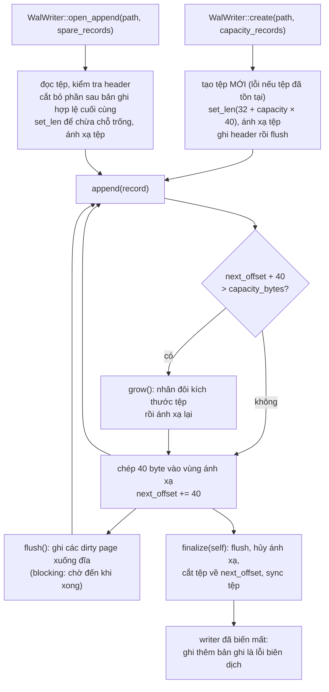

# 9. Nhật ký ghi trước (write-ahead log) và ghép tất cả lại

> *Bản gốc tiếng Anh: [09-write-ahead-log.md](../09-write-ahead-log.md)*

> **Gặp từ lạ?** Mọi thuật ngữ trong các chương đều được giải thích trong
> [bảng thuật ngữ](glossary.md).

Mã nguồn: [`src/wal.rs`](../../src/wal.rs), [`examples/pipeline.rs`](../../examples/pipeline.rs)

[Chương 8](08-ring-buffer.md) đã xây hàng đợi cấp lệnh cho engine. Chương này
thêm khối xây dựng thứ hai, **nhật ký ghi trước** (write-ahead log, WAL), giúp
một engine vừa crash dựng lại được sổ lệnh của mình (từ 9.1 đến 9.6). Sau đó 9.7
nối bộ đệm vòng, log và engine lại thành một chương trình hoàn chỉnh.

## 9.1 Vì sao phải ghi log?

Nếu process bị crash, sổ lệnh nằm trong bộ nhớ sẽ mất sạch. Làm sao lấy lại nó?

Có một mẹo hay: engine là **tất định** (deterministic). Nó không có đồng hồ,
nguồn ngẫu nhiên duy nhất của nó (seed của hàm băm, chương 5) không bao giờ ảnh
hưởng tới kết quả, và trạng thái của nó là một hàm thuần túy của các yêu cầu
(request) đã nhận và sức chứa (capacity) của engine lúc được tạo. Vì vậy
**cùng một chuỗi yêu cầu, nạp vào một engine cùng capacity, luôn cho ra đúng cùng
một sổ lệnh**. Do đó ta không cần lưu sổ lệnh; chỉ cần lưu các **yêu cầu**, theo
đúng thứ tự, rồi phát lại (replay) chúng vào một engine mới. Cách này gọi là
*event sourcing* (ở đây chính xác hơn là *input* sourcing).

```text
   yêu cầu:    new(1) new(2) cancel(1) new(3) ...      ---> ghi nối tiếp xuống đĩa, theo đúng thứ tự
                                                              |
   crash! mất sổ lệnh                                         v
   khởi động:  Engine::new(capacity)  <-------  đọc log, nạp lại từng yêu cầu
```

"Write-ahead" (ghi trước) nghĩa là: **ghi log yêu cầu trước, rồi mới áp dụng
nó.** Nếu ta crash ngay sau khi ghi log, lần phát lại sẽ áp dụng lại yêu cầu đó;
còn nếu ta áp dụng trước rồi crash trước khi ghi log, ta sẽ mất yêu cầu ấy.

## 9.2 Định dạng bản ghi

Một tệp log gồm một **header** 32 byte, theo sau là các **bản ghi** (record) kích
thước cố định 40 byte. Mọi số nguyên đều được ghi tường minh theo thứ tự byte
little-endian (byte thấp đứng trước), nên một tệp log mang sang máy nào cũng đọc
được và không chứa padding.

Header cho biết đây là tệp gì và theo định dạng nào:

| Offset | Kích thước | Trường |
|-------:|-----:|---|
| 0 | 8 | magic `b"MEWALOG\0"` |
| 8 | 4 | phiên bản định dạng (`1`) |
| 12 | 4 | kích thước bản ghi tính bằng byte (`40`) |
| 16 | 16 | dự phòng, bằng 0 |

Mỗi bản ghi mô tả một yêu cầu:

| Offset | Kích thước | Trường |
|-------:|-----:|---|
| 0 | 1 | kind: `1` = lệnh mới, `2` = hủy lệnh (`0` không bao giờ hợp lệ) |
| 1 | 1 | side: `0` = mua, `1` = bán (`0` với hủy lệnh) |
| 2 | 2 | dự phòng, bằng 0 |
| 4 | 4 | tick giá (`0` với hủy lệnh) |
| 8 | 8 | id của lệnh |
| 16 | 8 | số lượng (`0` với hủy lệnh) |
| 24 | 8 | số thứ tự do bên gọi cung cấp |
| 32 | 4 | checksum của các byte `0..32` |
| 36 | 4 | dự phòng, bằng 0 |

Đây là 40 byte thật mà `encode` tạo ra cho
`WalRecord::new_order(6, Side::Buy, 102, 14, 5)`, tức lệnh `#6` trong ví dụ minh
họa, được ghi log như yêu cầu thứ sáu (sequence 5). Mỗi hàng gồm 8 byte, viết
dưới dạng hệ thập lục phân (hexadecimal):

```text
 offset  byte                      ý nghĩa
 ------  ------------------------  ---------------------------------------------
   0     01 00 00 00 66 00 00 00   kind 1 (lệnh mới), side 0 (mua), 2 byte dự phòng,
                                   tick giá 0x66 = 102
   8     06 00 00 00 00 00 00 00   id lệnh 6
  16     0e 00 00 00 00 00 00 00   số lượng 0x0e = 14
  24     05 00 00 00 00 00 00 00   sequence 5
  32     16 08 01 21 00 00 00 00   checksum 0x21010816, rồi 4 byte dự phòng
```

**Little-endian** nghĩa là byte *thấp nhất* đứng đầu. Vì thế giá 102
(`0x00000066`) được lưu thành `66 00 00 00`, và checksum `16 08 01 21` phải đọc
ngược lại thành `0x21010816`. Ghi từng trường theo cách này, thay vì chép nguyên
vùng nhớ của struct, là điều khiến các byte giống hệt nhau trên mọi máy.

Trong bộ nhớ, một bản ghi là một struct Rust bình thường với các trường có kiểu
rõ ràng; chỉ `encode` và `decode` biết cách bố trí byte:

```rust
pub struct WalRecord {
    pub kind: WalRecordKind,   // NewOrder or Cancel
    pub side: Side,            // Buy for cancels
    pub order_id: u64,
    pub price_tick: u32,       // 0 for cancels
    pub qty: u64,              // 0 for cancels
    pub sequence: u64,         // caller-supplied
}

pub fn encode(&self) -> [u8; WAL_RECORD_SIZE] {
    let mut out = [0u8; WAL_RECORD_SIZE];
    out[0] = self.kind as u8;
    out[1] = match self.side { Side::Buy => 0, Side::Sell => 1 };
    out[4..8].copy_from_slice(&self.price_tick.to_le_bytes());
    out[8..16].copy_from_slice(&self.order_id.to_le_bytes());
    out[16..24].copy_from_slice(&self.qty.to_le_bytes());
    out[24..32].copy_from_slice(&self.sequence.to_le_bytes());
    let checksum = checksum(&out[..CHECKSUMMED_LEN]);
    out[32..36].copy_from_slice(&checksum.to_le_bytes());
    out
}
```

Tại sao phải viết từng byte thay vì chép nguyên struct từ bộ nhớ? Phiên bản đầu
tiên chép thẳng struct `#[repr(C)]`; cách làm đó có những nhược điểm đáng lưu ý:

- **Không mang sang máy khác được.** Các byte phụ thuộc thứ tự byte
  (endianness) và quy tắc căn lề (alignment) của máy, nên một log ghi trên kiến
  trúc này có thể không phát lại được trên kiến trúc khác.
- **Padding chưa được khởi tạo.** Trình biên dịch chèn 4 byte đệm vô hình vào
  struct. Chép chúng ra nghĩa là đọc vùng nhớ chưa khởi tạo (nói chặt chẽ thì đó
  là hành vi không xác định, undefined behavior), và hai yêu cầu giống hệt nhau
  có thể cho ra các byte khác nhau.
- **Không thể có checksum.** Checksum tính trên những byte lẫn padding ngẫu nhiên
  thì vô nghĩa.

`decode` làm ngược lại `encode` và **kiểm tra** ngay trong lúc giải mã, trả về
`WalDecodeError` nếu gặp kind lạ (`0` đánh dấu vùng chưa từng được ghi), side lạ,
hoặc **checksum không khớp**. Checksum lấy bốn từ 8 byte của bản ghi (các byte
`0..32`), trộn chúng qua hàm trộn (mixer) SplitMix64 ở chương 5, rồi ép kết quả
64 bit xuống 32 bit. Vài giới hạn cần nói thẳng:

- **Rất có khả năng phát hiện hư hỏng, nhưng không chắc chắn.** Hai bản ghi khác
  nhau có thể trùng checksum 32 bit (xác suất khoảng 1 trên 4 tỷ với hư hỏng
  ngẫu nhiên). Unit test `decode_rejects_zeroed_and_corrupted_records` lật từng
  bit một trong các byte `0..36` và kiểm tra rằng lần lật nào cũng bị phát hiện.
- **Các byte `36..40` không được bao phủ.** Chúng là phần dự phòng, và `decode`
  không kiểm tra chúng có bằng 0 hay không, nên sửa chúng thì không ai hay biết
  (chính test trên cũng chốt cứng điều này).
- **Nó không phải MAC mật mã** (message authentication code: loại checksum cần
  một khóa bí mật để tính), nên ai sửa được tệp thì cũng tính lại được checksum
  khớp.

Sao không dùng CRC32 mà bạn có thể đã biết từ tệp zip hay Ethernet? Thư viện
chuẩn không có sẵn, mà crate này chỉ cho phép phụ thuộc duy nhất vào `memmap2`.
Hệ thống thật nhiều khả năng sẽ dùng CRC32C, loại mà nhiều CPU tính được ngay
bằng phần cứng.

Bản ghi kích thước cố định mang lại hai lợi ích lớn: **ghi thêm không cần bộ đệm
tuần tự hóa** (mã hóa 40 byte rồi chép đi) và **bản ghi thứ *i* bắt đầu tại byte
`32 + i × 40`**, nên bạn nhảy thẳng (seek) tới nó được.

Hàm khởi tạo (constructor): `WalRecord::new_order(id, side, tick, qty, sequence)`
và `WalRecord::cancel(id, sequence)` (các trường không dùng được gán bằng 0).

**`sequence` dùng để làm gì?** Engine không bao giờ nhìn tới nó; đây là con số
*bạn* tự chọn, thường là 0, 1, 2, ... theo thứ tự các yêu cầu được ghi log
(chương trình ở mục 9.7 làm đúng như vậy). Nó không phải bộ đếm `sequence` riêng
của engine ở chương 6. Vì nó tăng đúng một đơn vị sau mỗi bản ghi, bạn có thể
dùng nó để:

- **phát hiện lỗ hổng**: nếu sau bản ghi 41 là bản ghi 43 thì có gì đó đã bị mất
  hoặc bị hỏng (bài tập 20 ở [chương 11](11-limitations-and-exercises.md) xây
  tiếp từ ý này);
- **đặt tên cho một yêu cầu** ở bên ngoài log, ví dụ để nhớ rằng "các sự kiện đã
  được phát hành tới yêu cầu 41" (xem *Còn các sự kiện thì sao?* ở mục 9.5).

## 9.3 Tệp ánh xạ bộ nhớ trong một phút

Bình thường, ghi vào tệp nghĩa là mỗi bản ghi tốn một lời gọi hệ thống (syscall)
`write`. **Tệp ánh xạ bộ nhớ** (memory-mapped file) thì khác: ta nhờ hệ điều hành
làm cho các byte của tệp hiện ra như bộ nhớ thông thường bên trong process của
bạn. Khi đó ghi vào vùng nhớ này chỉ là một phép `memcpy` thường; hệ điều hành sẽ
ghi các dirty page (trang đã sửa nhưng chưa ghi xuống đĩa) xuống đĩa sau.

```text
   bộ nhớ process của bạn              hệ điều hành              đĩa
  +---------------------+        +---------------+         +-----------+
  | &mut [u8] (ánh xạ)  | <----> |  page cache   | ------> | orders.wal|
  +---------------------+ memcpy +---------------+  sau đó +-----------+
```

Crate này dùng crate `memmap2` cho việc đó. Nhờ vậy, ghi thêm một bản ghi chỉ
cần:

```rust
let start = self.next_offset;
self.mapping()[start..start + WAL_RECORD_SIZE].copy_from_slice(&record.encode());
self.next_offset += WAL_RECORD_SIZE;
```

Ánh xạ bộ nhớ chỉ được dùng **cho việc ghi thêm**, nơi nó thật sự có lợi. Còn đọc
log để phát lại (`read_all`) và quét log trong `open_append` thì dùng I/O tệp
thông thường: cả hai đằng nào cũng đọc mỗi byte đúng một lần, và một bản sao thì
không thể chạy đua (race) với writer như cách mà một lần ánh xạ thứ hai của cùng
tệp có thể gây ra (xem 9.5).

## 9.4 Vòng đời của writer



```text
   ngay sau create(path, 4):           [ header ][ zero ][ zero ][ zero ][ zero ]   chỗ cho 4 bản ghi
   sau 3 lần append:                   [ header ][ rec0 ][ rec1 ][ rec2 ][ zero ]   next_offset = 32 + 3 × 40 = 152
   sau lần append thứ 5 (grow):        [ header ][ rec0 .. rec4 ][ zero ... ]       tệp nhân đôi: 192 -> 384 byte
   sau finalize():                     [ header ][ rec0 .. rec4 ]                   32 + 5 × 40 = 232 byte
```

- **`create` từ chối ghi đè.** Nó mở tệp bằng `create_new`, nên nếu đường dẫn đã
  tồn tại thì sẽ báo lỗi `AlreadyExists`. Nhờ vậy, một lần khởi động lại không
  bao giờ xóa mất log mà đáng lẽ nó phải phát lại; muốn viết tiếp một log thì
  dùng `open_append`, hoặc xóa tệp một cách có chủ đích.
- **Định kích thước trước** nghĩa là trường hợp thường gặp không tốn lời gọi hệ
  thống nào khi append (lần ghi đầu tiên vào mỗi page mới của vùng ánh xạ vẫn có
  thể gây ra page fault).
- **Mở rộng** là nhân đôi tệp rồi ánh xạ lại. Đây là đường chậm, tốn rất nhiều
  syscall, và gây ra một đợt tăng độ trễ (latency spike), nên hãy chọn
  `capacity_records` đủ lớn cho lượng yêu cầu của bạn.
- **`flush()` là thao tác đồng bộ hóa có tính chặn (blocking) để bảo đảm độ bền
  vững (durability)**, không phải một lời gợi ý. `memmap2` gọi `msync(MS_SYNC)` trên Unix, và
  `FlushViewOfFile` rồi `FlushFileBuffers` trên Windows, và chỉ trả về khi hệ
  điều hành báo dữ liệu đã được ghi. Gọi nó sau mỗi bản ghi thì chậm quá mức;
  gọi bao lâu một lần (mỗi batch, mỗi giây...) chính là chính sách độ bền vững
  của bạn.
- **`finalize(self)` tiêu thụ (consume) writer.** Nó flush, **hủy ánh xạ tệp, rồi
  mới cắt (truncate) tệp** về đúng số byte đã ghi, và sync tệp, nên tệp chỉ còn
  đúng header cộng mọi bản ghi. Vì nhận `self` theo giá trị (by value), "append
  sau finalize" không phải lỗi lúc chạy mà là **lỗi biên dịch**: cùng ý tưởng với
  các handle của bộ đệm vòng. Drop một writer cũng chạy các bước tương tự nhưng
  buộc phải bỏ qua lỗi; hãy gọi `finalize` khi bạn cần thấy lỗi.
- Thứ tự "hủy ánh xạ rồi mới cắt" rất quan trọng: Windows từ chối thu nhỏ một
  tệp khi vẫn còn một view ánh xạ đang mở (xem ghi chú ở 9.6).

## 9.5 Đọc và phát lại

```rust
pub fn read_all<P: AsRef<Path>>(path: P) -> io::Result<Vec<WalRecord>>
```

đọc toàn bộ tệp, kiểm tra header (magic, phiên bản hoặc kích thước bản ghi sai sẽ
cho lỗi `ErrorKind::InvalidData`), rồi giải mã các bản ghi **cho đến bản ghi đầu
tiên không qua được bước kiểm tra**: phần đuôi toàn số 0 được cấp phát sẵn mà một
lần crash để lại, một lần ghi cuối bị ghi dở (torn write), hoặc một bản ghi chỉ
có một phần. Kết quả là một `Vec` các bản ghi có kiểu rõ ràng, nên vòng lặp phát
lại chỉ là một `match` thường; không còn gì phải kiểm tra thêm:

```rust
for record in read_all(&path)? {
    events.clear();
    match record.kind {
        WalRecordKind::NewOrder => engine.process_order(
            record.order_id, record.side, record.price_tick, record.qty, &mut events,
        ),
        WalRecordKind::Cancel => {
            engine.cancel_order(record.order_id, &mut events);
        }
    }
}
```

`read_all` dùng I/O thông thường (`std::fs::read`), không dùng ánh xạ. Nhờ vậy gọi
nó vẫn an toàn ngay cả khi một writer đang ghi vào cùng tệp: nó nhận về một bản
sao, và xấu nhất thì bản sao đó kết thúc bằng một bản ghi ghi dở, bản ghi này
không qua được checksum và đánh dấu điểm kết thúc của log.

**Khởi động lại sau crash** gồm ba bước:

1. `read_all` log rồi phát lại vào một `Engine` mới **có cùng capacity**.
2. Viết tiếp chính log đó bằng `open_append`. Nó dừng ở đúng bản ghi không hợp lệ
   đầu tiên mà `read_all` đã dừng, bỏ mọi thứ phía sau, và ghi tiếp từ đó.
3. Chỉ sau đó mới bắt đầu nhận yêu cầu mới.

Đây là hình dạng của tệp ở từng bước, với một writer bị crash đúng lúc đang ghi
bản ghi thứ tư:

```text
 sau khi crash:
   [ header ][ rec 0 ][ rec 1 ][ rec 2 ][ rec 3: ghi dở ][ 00 00 00 ... cấp phát sẵn, chưa từng được ghi ]
                                         ^ checksum sai

 read_all:      header OK, rec 0, rec 1, rec 2 hợp lệ; rec 3 không hợp lệ -> dừng.
                Trả về 3 bản ghi; phát lại chúng vào Engine::new(cùng capacity).

 open_append:   tìm đúng bản ghi không hợp lệ đầu tiên đó, cắt tệp tại đây,
                rồi nới tệp ra lại bằng các số 0 mới:
   [ header ][ rec 0 ][ rec 1 ][ rec 2 ][ 00 00 00 ... chỗ trống cho bản ghi mới ]
                                         ^ lần append kế tiếp ghi vào đây
```

Bản ghi bị ghi dở thì mất. Nếu crash xảy ra đúng giữa lần append đó, mất nó là
đúng: log được ghi *trước* (ahead), nên yêu cầu ấy chưa kịp được áp dụng vào
engine. Tuy nhiên, sau một lần mất điện, phần đuôi bị mất cũng có thể chứa những
yêu cầu *đã* được áp dụng nhưng chưa được flush xuống đĩa; mục 9.6 giải thích
chuyện này phụ thuộc vào `flush` ra sao. Test
`open_append_resumes_after_the_last_valid_record` dựng đúng tình huống đó (một bản
ghi ghi dở, theo sau là dữ liệu cũ còn sót lại) và kiểm tra rằng chỉ các bản ghi
hợp lệ còn lại.

### Còn các sự kiện thì sao?

Log lưu **yêu cầu**, không lưu sự kiện. Phát lại log khiến engine phát ra lại mọi
sự kiện: mọi giao dịch, mọi lần khớp, từ yêu cầu đầu tiên. Điều đó vừa hữu ích,
vừa là một cái bẫy:

- **Trùng lặp.** Nếu các hệ thống phía sau (dữ liệu thị trường, xác nhận giao
  dịch) đã nhận những sự kiện này trước khi crash, gửi lại sẽ khiến mỗi giao dịch
  bị báo hai lần. Vì vậy một lần phát lại *không* được phát hành các sự kiện của
  nó, hoặc phía hạ nguồn (downstream) phải nhận ra và bỏ qua các sự kiện lặp.
- **Thiếu hụt.** Vòng lặp khớp lệnh ghi log một yêu cầu, áp dụng nó, *rồi mới*
  phát hành các sự kiện của nó. Nếu crash xảy ra giữa các bước này, ta có một yêu
  cầu đã nằm trong log nhưng sự kiện của nó chưa bao giờ ra khỏi process.

Cách xử lý thông thường dùng số `sequence` của WAL ở mục 9.2. Phía downstream nhớ
sequence của yêu cầu cuối cùng mà nó đã xử lý xong sự kiện, giả sử là 41. Khi
khởi động lại, quá trình phát lại bỏ đi các sự kiện của yêu cầu từ 0 đến 41 và
phát hành các sự kiện của yêu cầu từ 42 trở đi. Vì engine là tất định, đó chính
xác là những sự kiện mà process bị crash lẽ ra đã phát hành, đến tận `trade_id`
của từng giao dịch ([7.2](07-events.md#72-quy-tắc-về-thứ-tự)): một consumer chỉ
quan tâm đến giao dịch có thể đơn giản bỏ qua mọi `trade_id` mà nó đã thấy. Repo
này để phần ghi sổ đó cho bạn tự làm; chương trình ở 9.7 hoàn toàn không phát
hành sự kiện.

Ở lần khởi động đầu tiên thì chưa có log, nên một service thường làm như sau:

```rust
let mut wal = match WalWriter::open_append(&path, 16_384) {
    Ok(wal) => wal,                                    // continue the existing log
    Err(e) if e.kind() == io::ErrorKind::NotFound => {
        WalWriter::create(&path, 16_384)?              // first start: a new log
    }
    Err(e) => return Err(e),                           // damaged header: needs a human
};
```

## 9.6 Những điều cần lưu ý (đọc trước khi dựa vào WAL)

Log này cố ý làm nhỏ gọn. Sau đây là những việc nó để lại cho bạn:

| Lưu ý | Hệ quả |
|---|---|
| `flush()` có tính blocking và **bạn** là người lên lịch gọi nó | Không có gì tự flush ngoại trừ `finalize`/`Drop`. Crash *process* không làm mất gì đã được chép vào vùng ánh xạ (hệ điều hành đang giữ các page đó); còn mất điện hay crash hệ điều hành thì mất mọi thứ chưa được flush. Bạn quyết định khi nào một yêu cầu được coi là đã bền vững. |
| Flush thất bại là không cứu được | Sau khi `flush` trả về lỗi, các bản ghi có thể đã mất ngay cả khi lần flush sau thành công: hệ điều hành có thể đã vứt bỏ những page mà nó không ghi được ("fsyncgate" của PostgreSQL, 2018). Hãy ngừng nhận yêu cầu và phục hồi bằng cách phát lại. |
| Tệp mới trên Unix | Mục thư mục (directory entry) của một tệp mới chỉ bền vững sau khi thư mục cha được sync, mà `create` không làm việc này. Mất điện ngay sau khi tạo log có thể làm mất cả tệp. |
| Đĩa đầy trên Linux | `set_len` nới tệp theo kiểu *thưa* (sparse). Nếu đĩa đã đầy vào lúc một page được ghi lần đầu qua vùng ánh xạ, kernel sẽ dừng process bằng `SIGBUS` thay vì để `append` trả về lỗi. |
| `create` không có tính nguyên tử (atomicity) | Crash trước khi header xuống tới đĩa sẽ để lại một tệp có header toàn số 0. Khi đó `open_append` và `read_all` đều báo `InvalidData`; chưa có gì được ghi vào tệp, nên có thể xóa nó đi. |
| `open_append` dừng ở bản ghi không hợp lệ đầu tiên | Mọi thứ phía sau được coi là phần đuôi chưa hoàn tất và bị bỏ đi. Sau crash thì làm vậy là đúng, nhưng nó cũng sẽ bỏ luôn các bản ghi hợp lệ nằm sau một bản ghi bị hỏng. |
| Mỗi tệp chỉ một writer | `create` từ chối tệp đã tồn tại, nhưng không có gì ngăn một `open_append` thứ hai trên log mà một writer đang chạy sử dụng, và điều đó làm hỏng log (trên Linux nó cắt tệp ngay dưới chân vùng ánh xạ của writer thứ nhất). |
| Phát lại cần **cùng capacity** | Sổ lệnh phụ thuộc vào các yêu cầu *và* vào `Engine::new(capacity)`, vì capacity quyết định lệnh nào nằm chờ được. Log không ghi lại giá trị này. |
| Không có gì ép buộc "ghi log trước, áp dụng sau" | Thứ tự này là trách nhiệm của bên gọi (mục 9.7 làm đúng). |
| Checksum không phải MAC | Nó bắt được bản ghi ghi dở và bản ghi toàn số 0, chứ không chống được việc cố ý can thiệp. |

Nhiều lưu ý trong số này là bài tập hay (chương 11).

> [!NOTE]
> **Vì sao writer hủy ánh xạ trước khi cắt tệp.** Windows từ chối thu nhỏ một tệp
> khi vẫn còn một view ánh xạ đang mở (lỗi OS 1224, "The requested operation
> cannot be performed on a file with a user-mapped section open"). Một phiên bản
> đầu đã gọi `set_len` khi vùng ánh xạ còn sống; `Drop` bỏ qua lỗi sinh ra, nên
> trên Windows tệp lặng lẽ giữ nguyên phần đệm toàn số 0, và bộ đọc cũ, vốn không
> có bước kiểm tra, trả về thêm các bản ghi toàn số 0. Ngày nay writer giữ vùng
> ánh xạ trong một `Option<MmapMut>`, lấy nó ra rồi drop, và chỉ sau đó mới gọi
> `set_len`. Một lần crash (khi `finalize` không bao giờ chạy) vẫn để lại phần đệm
> toàn số 0, và điều đó không sao: bộ đọc dừng ở bản ghi không hợp lệ đầu tiên.

## 9.7 Ghép tất cả lại

Chương trình hoàn chỉnh này nối ba thành phần thành một pipeline: một luồng
(thread) gateway, bộ đệm vòng, WAL, engine, và cuối cùng là một lần phát lại để
dựng ra một sổ lệnh y hệt chỉ từ log. Đó là tệp
[`examples/pipeline.rs`](../../examples/pipeline.rs); chạy nó bằng:

```sh
cargo run --example pipeline
```

CI biên dịch và chạy nó sau mỗi lần push, và test `tests/docs_sync.rs` sẽ thất bại
nếu bản sao bên dưới khác với tệp thật, nên những gì bạn đọc ở đây chính là những
gì đang chạy.

```rust
//! The whole pipeline in one program (chapter 9, section 9.7).
//!
//! A gateway thread pushes requests into an SPSC ring buffer. The matching
//! thread logs each request to the write-ahead log *before* applying it to the
//! engine. Finally a replica engine is rebuilt from the log alone and must end
//! in exactly the same state.
//!
//! Run it with `cargo run --example pipeline`.

use std::thread;

use matching_engine::ringbuffer::spsc_channel;
use matching_engine::wal::{read_all, WalRecord, WalRecordKind, WalWriter};
use matching_engine::{Engine, Event, Side};

/// What the gateway thread sends to the matching thread.
#[derive(Clone, Copy)]
enum Command {
    New {
        id: u64,
        side: Side,
        tick: u32,
        qty: u64,
    },
    Cancel {
        id: u64,
    },
}

/// Applies one logged request. The live run and the replay share this
/// function, so both are guaranteed to make exactly the same engine calls.
fn apply(engine: &mut Engine, record: &WalRecord, events: &mut Vec<Event>) {
    match record.kind {
        WalRecordKind::NewOrder => engine.process_order(
            record.order_id,
            record.side,
            record.price_tick,
            record.qty,
            events,
        ),
        WalRecordKind::Cancel => {
            engine.cancel_order(record.order_id, events);
        }
    }
}

fn main() -> std::io::Result<()> {
    const N: u64 = 10_000;
    let (mut producer, mut consumer) = spsc_channel::<Command>(1024);

    // Gateway: the only producer. `producer` is dropped when the thread
    // ends, which tells the consumer that no more commands will come.
    let gateway = thread::spawn(move || {
        for id in 1..=N {
            let mut cmd = if id % 5 == 0 {
                Command::Cancel { id: id - 1 }
            } else {
                let side = if id % 2 == 0 { Side::Buy } else { Side::Sell };
                Command::New {
                    id,
                    side,
                    tick: 1000 + (id % 7) as u32,
                    qty: 1 + id % 3,
                }
            };
            // `push` hands the value back when the queue is full: retry.
            while let Err(back) = producer.push(cmd) {
                cmd = back;
                std::hint::spin_loop();
            }
        }
    });

    // This demo always starts a fresh log. `WalWriter::create` refuses to
    // overwrite an existing file, so an old one is deleted on purpose.
    let path = std::env::temp_dir().join("matching_engine_pipeline.wal");
    if path.exists() {
        std::fs::remove_file(&path)?;
    }
    let mut wal = WalWriter::create(&path, 16_384)?;
    let mut engine = Engine::new(50_000);
    let mut events = Vec::new(); // one sink, reused for every call
    let mut sequence = 0;
    loop {
        let Some(cmd) = consumer.pop() else {
            if consumer.is_disconnected() {
                break; // the gateway is gone and the queue is drained
            }
            std::hint::spin_loop();
            continue;
        };
        let record = match cmd {
            Command::New {
                id,
                side,
                tick,
                qty,
            } => WalRecord::new_order(id, side, tick, qty, sequence),
            Command::Cancel { id } => WalRecord::cancel(id, sequence),
        };
        sequence += 1;
        // 1. Write-ahead: log the request BEFORE applying it.
        wal.append(record)?;
        // 2. Apply it to the book.
        events.clear();
        apply(&mut engine, &record, &mut events);
        // 3. A real system would publish `events` downstream here.
    }
    gateway.join().expect("gateway thread panicked");
    wal.finalize()?; // flush, trim the preallocated tail, sync

    // Recovery: rebuild the book from the log alone. The replica must use
    // the same capacity, because capacity decides which orders can rest.
    let records = read_all(&path)?;
    assert_eq!(
        records.len() as u64,
        sequence,
        "every logged request is read back"
    );
    let mut replica = Engine::new(50_000);
    for record in &records {
        events.clear();
        apply(&mut replica, record, &mut events);
    }
    std::fs::remove_file(&path)?;

    assert_eq!(engine.live_order_count(), replica.live_order_count());
    for side in [Side::Buy, Side::Sell] {
        assert_eq!(
            engine.depth_snapshot(side, usize::MAX),
            replica.depth_snapshot(side, usize::MAX)
        );
    }
    println!(
        "replayed {sequence} requests: identical book with {} resting orders",
        replica.live_order_count()
    );
    Ok(())
}
```

Chương trình này minh họa:

- **Tách rời (decoupling):** gateway không bao giờ chạm vào engine; nó chỉ đẩy các
  command vào hàng đợi.
- **Tắt gọn gàng (clean shutdown):** khi luồng gateway kết thúc, `Producer` của nó
  bị drop, và vòng lặp khớp lệnh dừng nhờ `is_disconnected()` sau khi hàng đợi
  đã được rút cạn. Nếu gateway bị panic thì chuyện tương tự xảy ra và `join` báo
  lại panic đó, nên không có gì bị treo.
- **Thứ tự:** lần append vào WAL diễn ra *trước* lời gọi engine.
- **Một đường code duy nhất:** cả lần chạy thật lẫn lần phát lại đều đi qua
  `apply`, nên chúng không thể lệch nhau.
- **Tính tất định (determinism):** một engine mới có cùng capacity, được nạp các
  yêu cầu đã ghi log, sẽ kết thúc ở đúng cùng một trạng thái. Đó là điều khiến WAL
  hữu ích cho việc phục hồi, kiểm thử và kiểm toán (audit).

Những gì chương trình cố ý bỏ qua:

- **Nó không bao giờ gọi `flush()`** trong lúc chạy; chỉ `finalize` ở cuối mới
  sync tệp. Vì vậy log của nó sống sót qua một lần crash của *process* (hệ điều
  hành vẫn giữ các page đã ghi và sẽ lưu chúng sau), nhưng không qua được mất điện
  hay crash hệ điều hành, những sự cố có thể làm mất mọi thứ kể từ lần sync cuối.
  Một service thật phải quyết định khi nào gọi `flush`, chẳng hạn trước khi xác
  nhận một yêu cầu với client (mục 9.6).
- **Nó không bao giờ crash thật**, nên lần phát lại đọc một log đã finalize gọn
  gàng. Bài tập ở 9.8 sẽ cho nó crash có chủ đích.

## 9.8 Tự thực hành

Hãy chạy các test của WAL, test phát lại, và chương trình hoàn chỉnh ở 9.7:

```sh
cargo test wal::
cargo test --test wal_replay
cargo run --example pipeline
```

Sau đó hãy mô phỏng một lần crash. Trong
[`examples/pipeline.rs`](../../examples/pipeline.rs), gọi `std::process::abort()`
bên trong vòng lặp khớp lệnh sau, chẳng hạn, 5,000 yêu cầu, rồi chạy ví dụ. Viết
vài dòng mở log bằng `read_all` và đếm xem còn lại bao nhiêu bản ghi. (Nhớ hoàn
tác thay đổi sau đó: chương 9 phải hiển thị ví dụ y hệt như trong repo, và
`cargo test` kiểm tra điều này.)

**Tiếp theo:** [10. Kiểm thử và hiệu năng](10-testing-and-performance.md)
