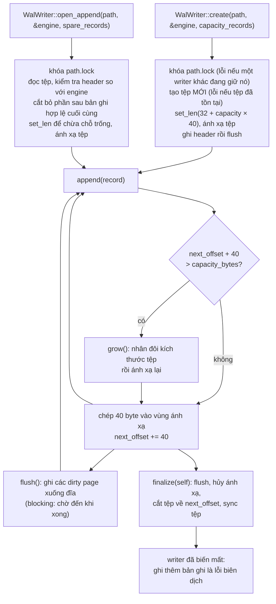

# 9. Nhật ký ghi trước (write-ahead log) và ghép tất cả lại

> *Bản gốc tiếng Anh: [09-write-ahead-log.md](../09-write-ahead-log.md)*

> **Gặp từ lạ?** Mọi thuật ngữ trong các chương đều được giải thích trong
> [bảng thuật ngữ](glossary.md).

Mã nguồn: [`src/wal.rs`](../../src/wal.rs), [`src/snapshot.rs`](../../src/snapshot.rs),
[`examples/pipeline.rs`](../../examples/pipeline.rs), [`examples/checkpoint.rs`](../../examples/checkpoint.rs)

[Chương 8](08-ring-buffer.md) đã xây hàng đợi cấp lệnh cho engine. Chương này bổ
sung khối xây dựng thứ hai, **nhật ký ghi trước** (write-ahead log, WAL), để
dựng lại sổ lệnh của engine sau khi crash (mục 9.1 đến 9.6). Mục 9.7 ghép bộ đệm
vòng, log và engine thành một chương trình hoàn chỉnh; mục 9.8 bổ sung
checkpoint, giúp phục hồi mà không phải phát lại log từ yêu cầu đầu tiên.

## 9.1 Vì sao phải ghi log?

Nếu process bị crash, sổ lệnh nằm trong bộ nhớ sẽ mất sạch. Làm sao lấy lại nó?

Có một điểm thuận lợi: engine là **tất định** (deterministic). Nó không dùng
đồng hồ; nguồn ngẫu nhiên duy nhất của nó (seed của hàm băm, chương 5) không ảnh
hưởng đến kết quả. Trạng thái của engine chỉ phụ thuộc vào các yêu cầu (request)
đã nhận, sức chứa (capacity) và số tick lúc khởi tạo. Vì vậy, **cùng một chuỗi
yêu cầu, nạp vào các engine được tạo theo cùng cách, luôn tạo ra cùng một sổ
lệnh**. Ta không cần lưu sổ lệnh; chỉ cần lưu các **yêu cầu** theo đúng thứ tự
rồi phát lại (replay) chúng vào engine mới. Cách này gọi là
*event sourcing* (ở đây chính xác hơn là *input* sourcing).

```text
   yêu cầu:    new(1) new(2) cancel(1) reduce(2) ...   ---> ghi nối tiếp xuống đĩa, theo đúng thứ tự
                                                              |
   crash! mất sổ lệnh                                         v
   khởi động:  Engine::new(capacity)  <-------  đọc log, nạp lại từng yêu cầu
```

Capacity và số tick cũng quan trọng như các yêu cầu, nên log ghi chúng vào header
(9.2) và hàm `replay` của thư viện dựng engine với đúng các giá trị đó. Giới hạn
rủi ro cũng là đầu vào nhưng có thể thay đổi trong ngày, nên được ghi log thành
các yêu cầu riêng.

"Write-ahead" (ghi trước) nghĩa là **ghi yêu cầu vào log rồi mới áp dụng**. Nếu
crash ngay sau khi ghi log, lần phát lại sẽ áp dụng yêu cầu đó; ngược lại, nếu
áp dụng trước rồi crash trước khi ghi log, yêu cầu sẽ bị mất.

## 9.2 Định dạng bản ghi

Một tệp log gồm một **header** 32 byte, theo sau là các **bản ghi** (record) kích
thước cố định 40 byte. Mọi số nguyên đều được ghi tường minh theo thứ tự byte
little-endian (byte thấp đứng trước), nên một tệp log mang sang máy nào cũng đọc
được và không chứa padding.

Header cho biết đây là tệp gì và theo định dạng nào:

| Offset | Kích thước | Trường |
|-------:|-----:|---|
| 0 | 8 | magic `b"MEWALOG\0"` |
| 8 | 4 | phiên bản định dạng (`5`; các phiên bản `1` đến `4` vẫn được đọc) |
| 12 | 4 | kích thước bản ghi tính bằng byte (`40`) |
| 16 | 8 | capacity của engine dùng để ghi log (`0` = không rõ) |
| 24 | 8 | số tick của engine (`0` = mặc định 4096, giá trị mà mọi log cũ hơn đều dùng) |

Mỗi bản ghi mô tả một yêu cầu:

| Offset | Kích thước | Trường |
|-------:|-----:|---|
| 0 | 1 | kind: `1` = lệnh mới, `2` = hủy lệnh, `3` = giảm số lượng, `4` = hủy các lệnh của một tài khoản, `5` = hủy mọi lệnh, `6` = đặt giới hạn rủi ro (`0` không bao giờ hợp lệ) |
| 1 | 1 | side: `0` = mua, `1` = bán |
| 2 | 1 | loại lệnh: `0` = limit, `1` = immediate-or-cancel, `2` = market, `3` = post-only |
| 3 | 1 | chống tự giao dịch: `0` = cho phép, `1` = hủy lệnh đang chờ, `2` = hủy lệnh đến, `3` = hủy cả hai |
| 4 | 4 | tick giá |
| 8 | 8 | id của lệnh |
| 16 | 8 | số lượng; với bản ghi giảm số lượng, là lượng cần bớt đi |
| 24 | 8 | số thứ tự do bên gọi cung cấp |
| 32 | 4 | checksum của các byte `0..32`, và của tài khoản khi nó khác 0 |
| 36 | 4 | tài khoản (của một lệnh mới, hoặc tài khoản mà một bản ghi kind `4` hủy lệnh) |

Trường nào không được kind đó sử dụng đều bằng 0: bản ghi hủy lệnh không có side,
giá hay tài khoản; bản ghi hủy hàng loạt không có id lệnh.

Bản ghi giới hạn rủi ro (kind `6`) tái sử dụng các trường của lệnh: số lượng là
số lượng tối đa cho một lệnh, tick giá là biên độ giá (price band), còn byte
side cho biết có áp dụng biên độ giá (`1`) hay không (`0`).

**Năm phiên bản.** Định dạng này đã được mở rộng bốn lần. Phiên bản 1 không có loại
lệnh và không có bản ghi giảm số lượng; phiên bản 2 thêm hai thứ đó, nhưng không
có chống tự giao dịch, không có tài khoản và không có hủy hàng loạt; phiên bản 3
thêm những thứ đó, nhưng không ghi lại capacity của engine; phiên bản 4 ghi lại
capacity, nhưng không ghi số tick, và không có giới hạn rủi ro. Trong các phiên bản
cũ, những byte của các trường còn thiếu là phần dự phòng, luôn bằng 0, và 0 có
nghĩa là "limit", "cho phép", "tài khoản 0", "capacity không rõ" và "4096 tick". Vì
vậy **mọi bản ghi cũ cũng là một bản ghi phiên bản 5 hợp lệ**, và cả năm phiên bản
đều được đọc.

Điều ngược lại thì không đúng: một bộ đọc cũ sẽ bỏ qua các byte mới và phát lại,
chẳng hạn, một lệnh immediate-or-cancel như một lệnh limit, hoặc coi mọi lệnh là
của tài khoản 0, để lại một sổ lệnh khác. Đó là lý do có số phiên bản:
`open_append` ghi lại header cũ thành phiên bản 5 (và flush nó) trước khi ghi thêm
bất cứ thứ gì, và khi đó một bộ đọc cũ sẽ từ chối tệp thay vì đọc sai. Cũng lần
ghi lại đó lưu capacity và số tick của engine mà `open_append` được truyền vào, nên
từ đó về sau log biết các giá trị này.

Đây là 40 byte mà `encode` tạo ra cho
`WalRecord::new_order(6, Side::Buy, 102, 14, 5)`, tức lệnh `#6` trong ví dụ minh
họa, được ghi log như yêu cầu thứ sáu (sequence 5). Mỗi hàng gồm 8 byte, viết
dưới dạng hệ thập lục phân (hexadecimal):

```text
 offset  byte                      ý nghĩa
 ------  ------------------------  ---------------------------------------------
   0     01 00 00 00 66 00 00 00   kind 1 (lệnh mới), side 0 (mua), loại 0 (limit),
                                   cho phép tự giao dịch, tick giá 0x66 = 102
   8     06 00 00 00 00 00 00 00   id lệnh 6
  16     0e 00 00 00 00 00 00 00   số lượng 0x0e = 14
  24     05 00 00 00 00 00 00 00   sequence 5
  32     16 08 01 21 00 00 00 00   checksum 0x21010816, rồi tài khoản 0
```

**Little-endian** nghĩa là byte có trọng số *thấp nhất* đứng đầu. Vì vậy, giá 102
(`0x00000066`) được lưu thành `66 00 00 00`, và checksum `16 08 01 21` phải đọc
ngược lại thành `0x21010816`. Ghi từng trường theo cách này, thay vì chép nguyên
vùng nhớ của struct, là điều khiến các byte giống hệt nhau trên mọi máy.

Trong bộ nhớ, bản ghi là một struct Rust thông thường với các trường có kiểu rõ
ràng; chỉ `encode` và `decode` mới xử lý cách bố trí byte:

```rust
pub struct WalRecord {
    pub kind: WalRecordKind,   // NewOrder, Cancel, Reduce, CancelAccount, CancelAll
    pub side: Side,            // the zero value (Buy, Limit, Allow, 0) when unused
    pub order_type: OrderType,
    pub self_trade_prevention: SelfTradePrevention,
    pub account: u32,
    pub order_id: u64,
    pub price_tick: u32,
    pub qty: u64,              // the reduction for Reduce
    pub sequence: u64,         // caller-supplied
}

pub fn encode(&self) -> [u8; WAL_RECORD_SIZE] {
    let mut out = [0u8; WAL_RECORD_SIZE];
    out[0] = self.kind as u8;
    out[1] = match self.side { Side::Buy => 0, Side::Sell => 1 };
    out[2] = match self.order_type {
        OrderType::Limit => 0, OrderType::ImmediateOrCancel => 1,
        OrderType::Market => 2, OrderType::PostOnly => 3,
    };
    out[3] = /* the self-trade prevention mode, 0 to 3, the same way */;
    out[4..8].copy_from_slice(&self.price_tick.to_le_bytes());
    out[8..16].copy_from_slice(&self.order_id.to_le_bytes());
    out[16..24].copy_from_slice(&self.qty.to_le_bytes());
    out[24..32].copy_from_slice(&self.sequence.to_le_bytes());
    out[36..40].copy_from_slice(&self.account.to_le_bytes());
    let checksum = checksum(&out);                 // reads 0..32 and 36..40
    out[32..36].copy_from_slice(&checksum.to_le_bytes());
    out
}
```

Tại sao phải viết từng byte thay vì chép nguyên struct từ bộ nhớ? Phiên bản đầu
tiên chép thẳng struct `#[repr(C)]`; cách làm đó có những nhược điểm đáng lưu ý:

- **Không mang sang máy khác được.** Các byte phụ thuộc thứ tự byte
  (endianness) và quy tắc căn lề (alignment) của máy, nên một log ghi trên kiến
  trúc này có thể không phát lại được trên kiến trúc khác.
- **Padding chưa được khởi tạo.** Trình biên dịch chèn 4 byte đệm vô hình vào
  struct. Chép chúng ra nghĩa là đọc vùng nhớ chưa khởi tạo (nói chặt chẽ thì đó
  là hành vi không xác định, undefined behavior), và hai yêu cầu giống hệt nhau
  có thể cho ra các byte khác nhau.
- **Không thể có checksum.** Checksum tính trên những byte lẫn padding ngẫu nhiên
  thì vô nghĩa.

`decode` làm ngược lại `encode` và **kiểm tra** ngay trong lúc giải mã, trả về
`WalDecodeError` nếu gặp kind lạ (`0` đánh dấu vùng chưa từng được ghi), side,
loại lệnh hoặc chế độ chống tự giao dịch lạ, hoặc **checksum không khớp**.
Checksum lấy bốn từ 8 byte của bản ghi (các byte `0..32`), trộn chúng qua hàm trộn
(mixer) SplitMix64 ở chương 5, rồi ép kết quả 64 bit xuống 32 bit.

Tài khoản, nằm ở các byte `36..40`, được đưa vào checksum như **word thứ năm,
nhưng chỉ khi khác 0**. Quy tắc này có vẻ lạ cho đến khi thấy lợi ích của nó: ở
phiên bản 1 và 2, các byte này là phần dự phòng và luôn bằng 0. Vì vậy, bản ghi
của tài khoản 0 vẫn có cùng checksum như trước, và các bản ghi cũ vẫn hợp lệ mà
không cần ghi lại. Unit test
`a_record_for_account_zero_keeps_its_version_2_bytes` cố định các byte này.
Thông tin tài khoản bị hỏng vẫn được phát hiện: nếu một bit bị lật khiến giá trị
khác 0 thì word thứ năm xuất hiện; nếu bit bị lật khiến giá trị trở về 0 thì word
đó biến mất. Trong cả hai trường hợp, checksum đều không còn khớp.

Một vài giới hạn cần lưu ý:

- **Rất có khả năng phát hiện hư hỏng, nhưng không chắc chắn.** Hai bản ghi khác
  nhau có thể trùng checksum 32 bit (xác suất khoảng 1 trên 4 tỷ với hư hỏng
  ngẫu nhiên). Unit test `decode_rejects_zeroed_and_corrupted_records` lật từng
  bit một của một bản ghi, cả 40 byte, với một tài khoản bằng 0 và một tài khoản
  khác 0, và kiểm tra rằng lần lật nào cũng bị phát hiện.
- **Nó không phải MAC mật mã** (message authentication code: loại checksum cần
  một khóa bí mật để tính), nên ai sửa được tệp thì cũng tính lại được checksum
  khớp.

Vì sao không dùng CRC32, loại checksum quen thuộc trong tệp zip hay Ethernet?
Thư viện chuẩn không cung cấp sẵn, còn crate này chỉ có một dependency là
`memmap2`. Hệ thống thực tế nhiều khả năng sẽ dùng CRC32C, có thể được nhiều CPU
tính trực tiếp bằng phần cứng.

Bản ghi kích thước cố định mang lại hai lợi ích lớn: **ghi thêm không cần bộ đệm
tuần tự hóa** (mã hóa 40 byte rồi chép đi) và **bản ghi thứ *i* bắt đầu tại byte
`32 + i × 40`**, nên bạn nhảy thẳng (seek) tới nó được.

Các hàm khởi tạo (constructor) gồm: `WalRecord::new_order(id, side, tick, qty, sequence)`
cho lệnh limit, `WalRecord::submit(order, sequence)` cho một `NewOrder` bất kỳ,
`WalRecord::cancel(id, sequence)`, `WalRecord::reduce(id, reduce_by, sequence)`,
`WalRecord::cancel_account(account, sequence)` và `WalRecord::cancel_all(sequence)`
(các trường không dùng được gán bằng 0). `record.order()` biến một bản ghi lệnh mới
trở lại thành `NewOrder` mà nó đã ghi log, sẵn sàng cho `submit_order`.

**`sequence` dùng để làm gì?** Engine không đọc giá trị này; đó là con số
*bạn* tự chọn, thường là 0, 1, 2, ... theo thứ tự ghi các yêu cầu vào log
(chương trình ở mục 9.7 làm như vậy). Đây không phải bộ đếm `sequence` riêng
của engine ở chương 6. Vì giá trị tăng đúng một đơn vị sau mỗi bản ghi, bạn có
thể dùng nó để:

- **phát hiện lỗ hổng**: nếu sau bản ghi 41 là bản ghi 43 thì có gì đó đã bị mất
  hoặc bị hỏng (bài tập 20 ở [chương 11](11-limitations-and-exercises.md) xây
  tiếp từ ý này);
- **định danh một yêu cầu** bên ngoài log, ví dụ để nhớ rằng "các sự kiện đã
  được phát hành tới yêu cầu 41" (xem *Còn các sự kiện thì sao?* ở mục 9.5).

## 9.3 Tệp ánh xạ bộ nhớ trong một phút

Thông thường, mỗi lần ghi một bản ghi vào tệp cần một lời gọi hệ thống (syscall)
`write`. **Tệp ánh xạ bộ nhớ** (memory-mapped file) hoạt động khác: ta nhờ hệ
điều hành ánh xạ các byte của tệp vào vùng nhớ thông thường bên trong process.
Khi đó, ghi vào vùng nhớ chỉ cần một phép `memcpy`; hệ điều hành sẽ ghi các dirty
page (trang đã sửa nhưng chưa ghi xuống đĩa) xuống đĩa sau.

```text
   bộ nhớ process của bạn              hệ điều hành              đĩa
  +---------------------+        +---------------+         +-----------+
  | &mut [u8] (ánh xạ)  | <----> |  page cache   | ------> | orders.wal|
  +---------------------+ memcpy +---------------+  sau đó +-----------+
```

Crate này dùng `memmap2` để làm việc đó. Nhờ vậy, append một bản ghi chỉ cần:

```rust
let start = self.next_offset;
self.mapping()[start..start + WAL_RECORD_SIZE].copy_from_slice(&record.encode());
self.next_offset += WAL_RECORD_SIZE;
```

Ánh xạ bộ nhớ chỉ được dùng **để ghi thêm**, nơi nó thực sự có lợi. Việc đọc log
để phát lại (`read_all`) và quét log trong `open_append` dùng I/O tệp thông
thường: cả hai đều chỉ đọc mỗi byte một lần, còn bản sao dữ liệu không thể chạy
đua (race) với writer như một ánh xạ thứ hai của cùng tệp có thể gây ra (xem 9.5).

## 9.4 Vòng đời của writer



```text
   sau create(path, &engine, 4):       [ header ][ zero ][ zero ][ zero ][ zero ]   chỗ cho 4 bản ghi
   sau 3 lần append:                   [ header ][ rec0 ][ rec1 ][ rec2 ][ zero ]   next_offset = 32 + 3 × 40 = 152
   sau lần append thứ 5 (grow):        [ header ][ rec0 .. rec4 ][ zero ... ]       tệp nhân đôi: 192 -> 384 byte
   sau finalize():                     [ header ][ rec0 .. rec4 ]                   32 + 5 × 40 = 232 byte
```

- **`create` từ chối ghi đè.** Nó mở tệp bằng `create_new`, nên nếu đường dẫn đã
  tồn tại thì sẽ báo lỗi `AlreadyExists`. Nhờ vậy, một lần khởi động lại không
  bao giờ xóa mất log mà đáng lẽ nó phải phát lại; muốn viết tiếp một log thì
  dùng `open_append`, hoặc xóa tệp một cách có chủ đích.
- **Cả hai constructor đều nhận engine.** `create` ghi capacity và số tick của
  engine vào header.
  `open_append` kiểm tra chúng: nếu header ghi một capacity hoặc số tick khác, nó
  báo lỗi `InvalidInput` trước khi chạm vào tệp, vì viết tiếp log cho một engine
  khác sẽ khiến log không phát lại được nữa.
- **Mỗi lúc chỉ một writer.** Cả hai constructor trước hết lấy khóa độc quyền
  (`File::try_lock`) trên một tệp đi kèm nhỏ, `path.lock`, và giữ nó suốt vòng đời
  của writer. Writer thứ hai sẽ nhận `WouldBlock`, thay vì cắt tệp log trong khi
  writer thứ nhất vẫn đang ánh xạ nó. Hệ điều hành nhả khóa khi writer bị drop
  hoặc process của nó kết thúc, nên crash không thể khiến log bị khóa vĩnh viễn.
  Vì sao dùng tệp riêng? Trên Windows, khóa là *bắt buộc* (mandatory): khóa trực
  tiếp tệp log sẽ ngăn `read_all` đọc log trong khi writer đang ghi, dù thao tác
  đó được bảo đảm an toàn ở mục kế tiếp. (Tệp khóa vẫn nằm lại trên đĩa; nó rỗng.)
- **Định kích thước trước** giúp trường hợp thường gặp không cần lời gọi hệ
  thống nào khi append (lần ghi đầu tiên vào mỗi page mới của vùng ánh xạ vẫn có
  thể gây ra page fault).
- **Mở rộng** là nhân đôi kích thước tệp rồi ánh xạ lại. Đây là đường chậm, cần
  nhiều syscall và gây ra một đợt tăng độ trễ (latency spike), nên hãy chọn
  `capacity_records` đủ lớn cho lượng yêu cầu của bạn.
- **`flush()` là thao tác đồng bộ hóa có tính chặn (blocking) để bảo đảm độ bền
  vững (durability)**, không phải một lời gợi ý. `memmap2` gọi `msync(MS_SYNC)`
  trên Unix, hoặc `FlushViewOfFile` rồi `FlushFileBuffers` trên Windows; hàm chỉ
  trả về khi hệ điều hành báo dữ liệu đã được ghi. Gọi sau mỗi bản ghi sẽ quá
  chậm; tần suất gọi (mỗi batch, mỗi giây...) là chính sách độ bền vững của bạn.
- **`finalize(self)` tiêu thụ (consume) writer.** Hàm flush, **hủy ánh xạ tệp rồi
  mới cắt (truncate) tệp** về đúng số byte đã ghi, sau đó sync tệp. Vì vậy tệp chỉ còn
  đúng header cộng mọi bản ghi. Vì nhận `self` theo giá trị (by value), "append
  sau finalize" không phải lỗi lúc chạy mà là **lỗi biên dịch**: cùng ý tưởng với
  các handle của bộ đệm vòng. Drop một writer cũng chạy các bước tương tự nhưng
  buộc phải bỏ qua lỗi; hãy gọi `finalize` khi bạn cần thấy lỗi.
- Thứ tự "hủy ánh xạ rồi mới cắt" rất quan trọng: Windows không cho thu nhỏ một
  tệp khi vẫn còn một view ánh xạ đang mở (xem ghi chú ở 9.6).

## 9.5 Đọc và phát lại

```rust
pub fn read<P: AsRef<Path>>(path: P) -> io::Result<WalContents>   // capacity + records
pub fn read_all<P: AsRef<Path>>(path: P) -> io::Result<Vec<WalRecord>>  // just the records
```

`read` đọc toàn bộ tệp, kiểm tra header (magic, phiên bản hoặc kích thước bản ghi
sai sẽ gây lỗi `ErrorKind::InvalidData`), rồi giải mã bản ghi **cho đến bản ghi
đầu tiên không hợp lệ**: phần đuôi toàn số 0 được cấp phát sẵn còn lại sau crash,
bản ghi cuối bị ghi dở (torn write), hoặc bản ghi chỉ được ghi một phần. Hàm trả
về `WalContents` gồm capacity của engine lấy từ header (`None` với log có từ
trước phiên bản 4), số tick (4096 với log có từ trước phiên bản 5), và một
`Vec` chứa các bản ghi đã giải mã.

Biến một bản ghi trở lại thành một lời gọi engine là việc của
`WalRecord::apply_to`, một `match` thường, không còn gì phải kiểm tra thêm:

```rust
pub fn apply_to<S: EventSink + ?Sized>(&self, engine: &mut Engine, sink: &mut S) {
    match self.kind {
        WalRecordKind::NewOrder => engine.submit_order(self.order(), sink),
        WalRecordKind::Cancel => { engine.cancel_order(self.order_id, sink); }
        WalRecordKind::Reduce => { engine.reduce_order(self.order_id, self.qty, sink); }
        WalRecordKind::CancelAccount => { engine.cancel_account(self.account, sink); }
        WalRecordKind::CancelAll => { engine.cancel_all(sink); }
    }
}
```

Vòng lặp chạy thật cũng nên áp dụng từng yêu cầu bằng `apply_to` ngay sau khi ghi
log. Như vậy, lần chạy thật và lần phát lại thực hiện đúng cùng các lời gọi ngay
từ đầu. Còn `replay` thực hiện toàn bộ quá trình phục hồi trong một lời gọi:

```rust
let engine = replay(&path, &mut events)?;  // Engine::with_ticks(recorded capacity
                                           // and tick count), then
                                           // apply_to for every record, in order
```

Hàm này từ chối log không ghi lại capacity (với lỗi `InvalidData`) thay vì tự
đoán. Với log cũ như vậy, hãy dùng `read` rồi phát lại vào engine do bạn tự dựng.

`read_all` dùng I/O thông thường (`std::fs::read`), không dùng ánh xạ. Vì vậy,
hàm vẫn an toàn khi writer đang ghi vào cùng tệp: nó đọc một bản sao, trường hợp
xấu nhất bản sao kết thúc bằng bản ghi ghi dở. Bản ghi đó không qua được checksum
và đánh dấu điểm kết thúc của log.

**Khởi động lại sau crash** gồm ba bước:

1. `replay` log. Nó dựng một `Engine` mới **với capacity và số tick mà log ghi
   lại** và áp dụng mọi bản ghi hợp lệ.
2. Mở log để ghi tiếp bằng `open_append(path, &engine, spare)`. Hàm dừng tại đúng
   bản ghi không hợp lệ đầu tiên mà `replay` gặp, bỏ mọi thứ phía sau rồi ghi tiếp
   từ đó.
3. Chỉ sau đó mới bắt đầu nhận yêu cầu mới.

Đây là hình dạng của tệp ở từng bước, với một writer bị crash đúng lúc đang ghi
bản ghi thứ tư:

```text
 sau khi crash:
   [ header ][ rec 0 ][ rec 1 ][ rec 2 ][ rec 3: ghi dở ][ 00 00 00 ... cấp phát sẵn, chưa từng được ghi ]
                                         ^ checksum sai

 replay:        header OK, rec 0, rec 1, rec 2 hợp lệ; rec 3 không hợp lệ -> dừng.
                Áp dụng 3 bản ghi đó vào một engine được dựng đúng như header ghi.

 open_append:   tìm đúng bản ghi không hợp lệ đầu tiên đó, cắt tệp tại đây,
                rồi nới tệp ra lại bằng các số 0 mới:
   [ header ][ rec 0 ][ rec 1 ][ rec 2 ][ 00 00 00 ... chỗ trống cho bản ghi mới ]
                                         ^ lần append kế tiếp ghi vào đây
```

Bản ghi ghi dở sẽ bị bỏ. Nếu crash xảy ra giữa lần append đó thì đây là kết quả
đúng: log được ghi *trước* (ahead), nên yêu cầu chưa kịp được áp dụng vào engine.
Tuy nhiên, sau khi mất điện, phần đuôi bị mất cũng có thể chứa các yêu cầu *đã*
được áp dụng nhưng chưa flush xuống đĩa; mục 9.6 giải thích điều này phụ thuộc
vào `flush` như thế nào. Test `open_append_resumes_after_the_last_valid_record`
tạo đúng tình huống đó (một bản ghi dở theo sau là dữ liệu cũ còn sót lại) và
kiểm tra rằng chỉ các bản ghi hợp lệ được giữ lại.

### Còn các sự kiện thì sao?

Log lưu **yêu cầu**, không lưu sự kiện. Khi phát lại log, engine lại phát ra mọi
sự kiện (mọi giao dịch và mọi lần khớp) kể từ yêu cầu đầu tiên. Điều này vừa hữu
ích, vừa tiềm ẩn rủi ro:

- **Trùng lặp.** Nếu các hệ thống phía sau (dữ liệu thị trường, xác nhận giao
  dịch) đã nhận sự kiện trước khi crash, gửi lại sẽ khiến mỗi giao dịch được báo
  hai lần. Vì vậy, khi phát lại, hoặc là *không* phát hành các sự kiện, hoặc phía
  hạ nguồn (downstream) phải nhận diện và bỏ qua sự kiện trùng lặp.
- **Thiếu hụt.** Vòng lặp khớp lệnh ghi log một yêu cầu, áp dụng nó, *rồi mới*
  phát hành các sự kiện của nó. Nếu crash xảy ra giữa các bước này, ta có một yêu
  cầu đã nằm trong log nhưng sự kiện của nó chưa bao giờ ra khỏi process.

Cách xử lý phổ biến dùng `sequence` của WAL ở mục 9.2. Phía downstream ghi nhớ
sequence của yêu cầu cuối cùng mà nó đã xử lý xong sự kiện; giả sử đó là 41. Khi
khởi động lại, quá trình phát lại bỏ qua sự kiện của các yêu cầu từ 0 đến 41 rồi
phát hành sự kiện từ yêu cầu 42 trở đi. Vì engine tất định, các sự kiện được tạo
ra khớp chính xác với những gì process bị crash lẽ ra đã phát hành, kể cả
`trade_id` của từng giao dịch ([7.2](07-events.md#72-quy-tắc-về-thứ-tự)). Một
consumer chỉ quan tâm đến giao dịch có thể bỏ qua mọi `trade_id` đã thấy. Repo
này để bạn tự triển khai phần ghi nhớ đó; chương trình ở 9.7 không phát hành sự
kiện.

Ở lần khởi động đầu tiên thì chưa có log, nên một service thường làm như sau:

```rust
let mut wal = match WalWriter::open_append(&path, &engine, 16_384) {
    Ok(wal) => wal,                                    // continue the existing log
    Err(e) if e.kind() == io::ErrorKind::NotFound => {
        WalWriter::create(&path, &engine, 16_384)?     // first start: a new log
    }
    Err(e) => return Err(e),                           // damaged header, another
};                                                     // engine, another writer:
                                                       // needs a human
```

## 9.6 Những điều cần lưu ý (đọc trước khi dựa vào WAL)

Log này được cố ý giữ đơn giản, nên bạn cần tự xử lý các vấn đề sau:

| Lưu ý | Hệ quả |
|---|---|
| `flush()` có tính blocking và **bạn** phải lên lịch gọi nó | Không thao tác nào tự flush, ngoại trừ `finalize`/`Drop`. Crash *process* không làm mất dữ liệu đã chép vào vùng ánh xạ (hệ điều hành vẫn giữ các page đó); nhưng mất điện hoặc crash hệ điều hành có thể làm mất mọi thứ chưa được flush. Bạn quyết định khi nào một yêu cầu được xem là đã bền vững. |
| Lỗi khi flush không thể khắc phục | Sau khi `flush` trả về lỗi, các bản ghi có thể đã mất ngay cả khi lần flush sau thành công: hệ điều hành có thể đã bỏ những page không ghi được ("fsyncgate" của PostgreSQL, 2018). Hãy ngừng nhận yêu cầu và phục hồi bằng cách phát lại. |
| Tệp mới trên Unix | Mục thư mục (directory entry) của tệp mới chỉ bền vững sau khi thư mục cha được sync; `create` không làm việc này. Mất điện ngay sau khi tạo log có thể làm mất cả tệp. |
| Đĩa đầy trên Linux | `set_len` nới tệp theo kiểu *thưa* (sparse). Nếu đĩa đầy khi một page được ghi lần đầu qua vùng ánh xạ, kernel sẽ dừng process bằng `SIGBUS` thay vì để `append` trả về lỗi. |
| `create` không có tính nguyên tử (atomicity) | Crash trước khi header được ghi xuống đĩa sẽ để lại tệp có header toàn số 0. Khi đó `open_append` và `read_all` đều báo `InvalidData`; vì chưa có dữ liệu nào được ghi, có thể xóa tệp đó. |
| `open_append` dừng ở bản ghi không hợp lệ đầu tiên | Mọi thứ phía sau được coi là phần đuôi chưa hoàn tất và bị bỏ. Sau crash, đây là cách xử lý đúng; tuy nhiên, nó cũng bỏ các bản ghi hợp lệ nằm sau bản ghi bị hỏng. |
| Khóa writer chỉ mang tính hợp tác | Khóa trên `path.lock` ngăn một `WalWriter` thứ hai (trong cùng process hoặc process khác) ghi vào log. Khóa này không ngăn chương trình khác ghi trực tiếp vào tệp log. |
| Log cũ hơn phiên bản 4 không ghi capacity | Cho đến khi `open_append` ghi tiếp và nâng cấp log đó, `replay` sẽ từ chối nó. Phát lại log bằng `read` cùng `Engine::new(capacity)` chỉ đúng nếu bạn chọn đúng capacity ban đầu. |
| Không có gì ép buộc "ghi log trước, áp dụng sau" | Thứ tự này do bên gọi chịu trách nhiệm (mục 9.7 thực hiện đúng). |
| Checksum không phải MAC | Nó bắt được bản ghi ghi dở và bản ghi toàn số 0, chứ không chống được việc cố ý can thiệp. |

Nhiều lưu ý trong số này là bài tập hay (chương 11).

> [!NOTE]
> **Vì sao writer hủy ánh xạ trước khi cắt tệp.** Windows từ chối thu nhỏ một tệp
> khi vẫn còn một view ánh xạ đang mở (lỗi OS 1224, "The requested operation
> cannot be performed on a file with a user-mapped section open"). Một phiên bản
> đầu đã gọi `set_len` khi vùng ánh xạ còn sống; `Drop` bỏ qua lỗi sinh ra, nên
> trên Windows tệp lặng lẽ giữ nguyên phần đệm toàn số 0, và bộ đọc cũ, vốn không
> có bước kiểm tra, trả về thêm các bản ghi toàn số 0. Ngày nay writer giữ vùng
> ánh xạ trong một `Option<MmapMut>`, lấy nó ra rồi drop, và chỉ sau đó mới gọi
> `set_len`. Một lần crash (khi `finalize` không bao giờ chạy) vẫn để lại phần đệm
> toàn số 0, và điều đó không sao: bộ đọc dừng ở bản ghi không hợp lệ đầu tiên.

## 9.7 Ghép tất cả lại

Chương trình hoàn chỉnh này ghép ba thành phần chính—bộ đệm vòng, WAL và
engine—với luồng (thread) gateway để tạo thành một pipeline; sau đó, log được
phát lại để dựng lại sổ lệnh. Mã nguồn nằm trong
[`examples/pipeline.rs`](../../examples/pipeline.rs); chạy nó bằng:

```sh
cargo run --example pipeline
```

CI biên dịch và chạy ví dụ này sau mỗi lần push. Test `tests/docs_sync.rs` cũng
thất bại nếu nội dung trong tài liệu không khớp với tệp nguồn. Nhờ vậy, ví dụ
bạn đọc ở đây chính là mã đang chạy.

```rust
//! The whole pipeline in one program (chapter 9, section 9.7).
//!
//! A gateway thread pushes requests into an SPSC ring buffer. The matching
//! thread logs each request to the write-ahead log *before* applying it to the
//! engine. Finally a replica engine is rebuilt from the log alone and must end
//! in exactly the same state.
//!
//! Run it with `cargo run --example pipeline`.

use std::thread;

use matching_engine::ringbuffer::spsc_channel;
use matching_engine::wal::{replay, WalRecord, WalWriter};
use matching_engine::{Engine, Event, Side};

/// What the gateway thread sends to the matching thread.
#[derive(Clone, Copy)]
enum Command {
    New {
        id: u64,
        side: Side,
        tick: u32,
        qty: u64,
    },
    Cancel {
        id: u64,
    },
}

fn main() -> std::io::Result<()> {
    const N: u64 = 10_000;
    // The log records the engine's capacity, and refuses to be continued
    // for an engine of another.
    const CAPACITY: usize = 50_000;
    let (mut producer, mut consumer) = spsc_channel::<Command>(1024);

    // Gateway: the only producer. `producer` is dropped when the thread
    // ends, which tells the consumer that no more commands will come.
    let gateway = thread::spawn(move || {
        for id in 1..=N {
            let mut cmd = if id % 5 == 0 {
                Command::Cancel { id: id - 1 }
            } else {
                let side = if id % 2 == 0 { Side::Buy } else { Side::Sell };
                Command::New {
                    id,
                    side,
                    tick: 1000 + (id % 7) as u32,
                    qty: 1 + id % 3,
                }
            };
            // `push` hands the value back when the queue is full: retry.
            while let Err(back) = producer.push(cmd) {
                cmd = back;
                std::hint::spin_loop();
            }
        }
    });

    // This demo always starts a fresh log. `WalWriter::create` refuses to
    // overwrite an existing file, so an old one is deleted on purpose.
    let path = std::env::temp_dir().join("matching_engine_pipeline.wal");
    if path.exists() {
        std::fs::remove_file(&path)?;
    }
    let mut engine = Engine::new(CAPACITY);
    let mut wal = WalWriter::create(&path, &engine, 16_384)?;
    let mut events = Vec::new(); // one sink, reused for every call
    let mut sequence = 0;
    loop {
        let Some(cmd) = consumer.pop() else {
            if consumer.is_disconnected() {
                break; // the gateway is gone and the queue is drained
            }
            std::hint::spin_loop();
            continue;
        };
        let record = match cmd {
            Command::New {
                id,
                side,
                tick,
                qty,
            } => WalRecord::new_order(id, side, tick, qty, sequence),
            Command::Cancel { id } => WalRecord::cancel(id, sequence),
        };
        sequence += 1;
        // 1. Write-ahead: log the request BEFORE applying it.
        wal.append(record)?;
        // 2. Apply it to the book, exactly as a replay will.
        events.clear();
        record.apply_to(&mut engine, &mut events);
        // 3. A real system would publish `events` downstream here.
    }
    gateway.join().expect("gateway thread panicked");
    wal.finalize()?; // flush, trim the preallocated tail, sync

    // Recovery: rebuild the book from the log alone. `replay` builds the
    // replica like the engine the log records and applies every record
    // with `apply_to`, like the loop above. Its events are not needed here.
    let replica = replay(&path, &mut |_: Event| {})?;
    std::fs::remove_file(&path)?;

    assert_eq!(engine.live_order_count(), replica.live_order_count());
    for side in [Side::Buy, Side::Sell] {
        assert_eq!(
            engine.depth_snapshot(side, usize::MAX),
            replica.depth_snapshot(side, usize::MAX)
        );
    }
    println!(
        "replayed {sequence} requests: identical book with {} resting orders",
        replica.live_order_count()
    );
    Ok(())
}
```

Chương trình này minh họa:

- **Tách rời (decoupling):** gateway không bao giờ chạm vào engine; nó chỉ đẩy các
  command vào hàng đợi.
- **Dừng gọn gàng (clean shutdown):** khi luồng gateway kết thúc, `Producer` của
  nó bị drop. Vòng lặp khớp lệnh dừng nhờ `is_disconnected()` sau khi hàng đợi đã
  được rút cạn. Nếu gateway panic thì điều tương tự xảy ra; `join` báo lại panic
  đó nên chương trình không bị treo.
- **Thứ tự:** lần append vào WAL diễn ra *trước* lời gọi engine.
- **Một đường code duy nhất:** cả lần chạy thật lẫn lần phát lại đều đi qua
  `WalRecord::apply_to`, nên chúng không thể lệch nhau.
- **Tính tất định (determinism):** engine mới được dựng theo đúng thông tin trong
  log và nạp lại các yêu cầu đã ghi sẽ kết thúc ở cùng trạng thái. Đây là điều
  khiến WAL hữu ích cho việc phục hồi, kiểm thử và kiểm toán (audit).

Những gì chương trình cố ý bỏ qua:

- **Nó không gọi `flush()`** trong lúc chạy; chỉ `finalize` ở cuối mới sync tệp.
  Vì vậy log vẫn tồn tại sau crash của *process* (hệ điều hành vẫn giữ các page
  đã ghi và sẽ lưu chúng sau), nhưng không bảo toàn dữ liệu khi mất điện hoặc
  crash hệ điều hành, những sự cố có thể làm mất mọi thứ kể từ lần sync cuối.
  Một service thật phải quyết định khi nào gọi `flush`, chẳng hạn trước khi xác
  nhận một yêu cầu với client (mục 9.6).
- **Nó không bao giờ crash thật**, nên lần phát lại đọc một log đã finalize gọn
  gàng. Bài tập ở 9.9 sẽ cho nó crash có chủ đích.
- **Nó phát lại từ yêu cầu đầu tiên.** Mục kế tiếp khắc phục điều đó.

## 9.8 Checkpoint: phát lại ít hơn

Phát lại toàn bộ log vẫn khả thi, nhưng engine chạy càng lâu thì thời gian phục
hồi càng tăng: một tuần yêu cầu đồng nghĩa với một tuần phát lại. Cách khắc phục
là định kỳ lưu **trạng thái** rồi chỉ phát lại các yêu cầu phát sinh sau đó.

**Một snapshot** là toàn bộ trạng thái của engine: capacity và số tick, hai bộ đếm
của nó (số lệnh đã chấp nhận và số giao dịch), giới hạn rủi ro của nó, và mọi lệnh
đang chờ theo thứ tự ưu tiên (các bid từ giá tốt nhất, rồi đến các ask, ở mỗi mức
giá thì lệnh cũ nhất trước). Nó nằm
trong [`src/snapshot.rs`](../../src/snapshot.rs):

```rust
let snapshot = engine.snapshot();               // walks the book; allocates a Vec
let mut copy = Engine::restore(&snapshot)?;     // the same book, the same counters
```

`restore` đưa các lệnh vào sổ theo đúng thứ tự đã liệt kê, nhờ đó giữ nguyên ưu
tiên thời gian. Hàm cũng khôi phục các bộ đếm để giao dịch kế tiếp nhận đúng
`trade_id`. Test `tests/snapshot.rs` kiểm tra điều này: sau khi restore, thêm
10,000 yêu cầu ngẫu nhiên tạo ra cùng các sự kiện ở cả hai engine. `restore` còn
từ chối (với `SnapshotError`) những snapshot mô tả trạng thái sổ lệnh không thể
xảy ra, chẳng hạn sổ bị chéo giá (crossed book) hoặc có id lệnh trùng, thay vì
dựng một engine không hợp lệ.

**Một checkpoint** là một snapshot trên đĩa, cộng thêm một con số: `next_sequence`,
số sequence của WAL thuộc yêu cầu đầu tiên mà snapshot *không* bao gồm. Khi đó
việc phục hồi chỉ còn ba dòng:

```rust
let checkpoint = read_checkpoint(&checkpoint_path)?;
let mut engine = Engine::restore(&checkpoint.snapshot)?;
replay_from(&log_path, &mut engine, checkpoint.next_sequence, &mut events)?;
```

`replay_from` bỏ qua mọi bản ghi đứng trước `next_sequence` (snapshot đã chứa tác
dụng của chúng), áp dụng phần còn lại bằng `apply_to` và từ chối engine có
capacity hoặc số tick khác với log. Cách này dựa trên việc sequence tăng đúng
một đơn vị sau mỗi bản ghi, như trong các chương trình của chương này.

Tệp checkpoint được ghi **nguyên tử** (atomic), vì checkpoint ghi dở còn tệ hơn
không có checkpoint: `write_checkpoint` ghi `path.tmp`, sync tệp, đổi tên đè lên
`path`, rồi trên Unix sync cả thư mục để lần đổi tên vẫn tồn tại sau mất điện.
Crash ở bất kỳ thời điểm nào cũng chỉ để lại checkpoint cũ hoặc checkpoint mới.
Tệp kết thúc bằng checksum của mọi byte đứng trước; `read_checkpoint` báo
`InvalidData` nếu tệp bị hỏng hoặc bị cắt cụt.

[`examples/checkpoint.rs`](../../examples/checkpoint.rs) ghép các phần lại: lần
chạy thật ghi checkpoint ở giữa 10,000 yêu cầu; lần phục hồi khôi phục checkpoint,
chỉ phát lại nửa sau và phải tạo ra đúng sổ lệnh như lần chạy thật.

Hai điều cần ghi nhớ:

- **Một snapshot làm dừng luồng khớp lệnh.** Tạo snapshot cần duyệt qua cả sổ
  lệnh, nên hãy tạo checkpoint giữa các yêu cầu, vài phút một lần hoặc mỗi
  triệu yêu cầu một lần, chứ không đặt trên hot path.
- **Log vẫn tiếp tục lớn dần.** Sau khi có checkpoint, các bản ghi đứng trước
  `next_sequence` không còn cần để phục hồi, nhưng không có gì tự xóa chúng đi;
  phía downstream vẫn có thể cần *sự kiện* tương ứng (xem *Còn các sự kiện
  thì sao?* ở mục 9.5: phát lại từ checkpoint không thể tạo lại các sự kiện
  trước đó). Bài tập 16 ở chương 11 bắt đầu log mới tại mỗi checkpoint.

## 9.9 Tự thực hành

Hãy chạy các test của WAL, các test phát lại và snapshot, và các chương trình hoàn
chỉnh ở 9.7 và 9.8:

```sh
cargo test wal::
cargo test snapshot
cargo test --test wal_replay
cargo run --example pipeline
cargo run --example checkpoint
```

Sau đó hãy mô phỏng một lần crash. Trong
[`examples/pipeline.rs`](../../examples/pipeline.rs), gọi `std::process::abort()`
bên trong vòng lặp khớp lệnh sau, chẳng hạn, 5,000 yêu cầu, rồi chạy ví dụ. Viết
vài dòng mở log bằng `read_all` và đếm xem còn lại bao nhiêu bản ghi. (Nhớ hoàn
tác thay đổi sau đó: chương 9 phải hiển thị ví dụ y hệt như trong repo, và
`cargo test` kiểm tra điều này.)

**Tiếp theo:** [10. Kiểm thử và hiệu năng](10-testing-and-performance.md)
